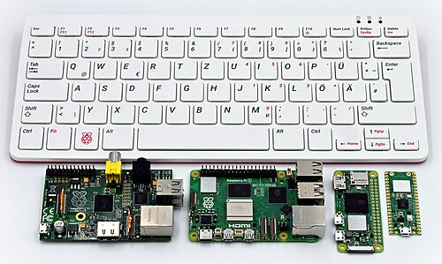

<!-- _class: lead -->

# 마이크로임베디드프로그래밍

## 오리엔테이션

### [munseong.jeong@daejin.ac.kr](mailto:munseong.jeong@daejin.ac.kr)

---

## 수업 개요 (Course Overview)

- [라즈베리파이](https://en.wikipedia.org/wiki/Raspberry_Pi) 기반 **GPIO 제어**와 센서·주변장치 활용 실습
- **크로스 컴파일, CMake, CI/CD**를 포함한 임베디드 소프트웨어 빌드·배포 프로세스 습득
- IoT·로보틱스·AI 기반 제어 시스템의 설계·구현 역량 함양

---

## 선수과목 (Prerequisites)

- 논리회로및실습
- 컴퓨터시스템구조
- 임베디드시스템응용
- 프로그래밍 관련 교과목

### 필요한 사전 지식

- C/C++ 문법, 포인터, 메모리 구조에 대한 이해
- 기초적인 UNIX 셸(Shell) 명령어 사용 경험
- 디지털 논리(HIGH/LOW), 전압 및 저항 등 기초 회로 개념

### 사전 학습 자료

- [Basic Unix commands](https://www.youtube.com/watch?v=3DA1grSp4mU)
- [Basic Linux Navigation](https://www.youtube.com/watch?v=dzHscTzpAME)
- [The vi Text Editor - Basic Intro](https://www.youtube.com/watch?v=KtTjamPKMhw)

---

## 수업 형태 및 평가 방법 (Format and Assessment)

- 실습 및 팀 프로젝트는 **3인 1조** 팀으로 수행
- 세부 평가 방법 및 반영 비율

| 평가 요소 | 반영 비율 | 세부 평가 방법                        |
| --------- | --------- | ------------------------------------- |
| 출석      | 10%       | 총 수업일수의 1/4 이상 결석 시 F 처리 |
| 중간시험  | 15%       | 중간고사 및 팀 프로젝트 제안서 평가   |
| 기말시험  | 25%       | 팀 프로젝트 결과 보고서 평가          |
| 과제      | 50%       | 실습 보고서 제출                      |

> **출결 안내**
>
> - 총 수업일수의 1/4(약 8회) 이상 결석 시 성적과 무관하게 F 처리
> - 공식 증빙 자료 제출 시 지각·결석 출결 정정 가능

---

## 실습 구성 (Lab Overview)

| 실습 | 주제                     |
| ---- | ------------------------ |
| 1    | 크로스 컴파일            |
| 2    | LED·스위치·PWM·상태 기계 |
| 3    | 온습도·조도·거리 센서    |
| 4    | 센서 통합 웹 서버        |
| 5    | 오디오 시각화·녹음       |
| 6    | 사진·영상 촬영           |
| 7    | 웹캠 기반 CCTV           |

- 실습 2~4: 라즈베리파이의 GPIO를 활용한 센서 제어
- 실습 5~7: 웹캠을 사용한 오디오·영상 처리

---

## 조별 지급 교보재 (Lab Equipment)

- 교보재는 조 편성 완료 후 배부하며, 14주차에 일괄 회수 예정

| 분류      | 품목                                  | 수량             | 활용 실습       |
| --------- | ------------------------------------- | ---------------- | --------------- |
| 컨트롤러  | Raspberry Pi 4/400(전원·microSD 포함) | 1 set            | 전체            |
| 배선      | 브레드보드                            | 1개              | 실습 01~06      |
| 배선      | 점퍼 케이블(M-M, M-F)                 | 1 set(20개 이상) | 실습 01~06      |
| 표시      | 5mm LED                               | 3개              | 실습 01, 02, 04 |
| 입력      | 푸시버튼 스위치                       | 2개              | 실습 01, 02     |
| 센서      | 온습도 센서(DHT11)                    | 1개              | 실습 03, 06     |
| 센서      | 조도 센서(CdS)                        | 1개              | 실습 04, 06     |
| 변환      | MCP3008 ADC(10bit, SPI)               | 1개              | 실습 04, 06     |
| 센서      | 초음파 센서(HC-SR04)                  | 1개              | 실습 05, 06     |
| 출력      | 부저(Buzzer)                          | 1개              | 실습 05, 06     |
| 영상·음성 | USB 웹캠(마이크 내장형)               | 1개              | 실습 07, 08, 10 |

---

## 저항 소요량 (Resistors)

| 저항값          | 용도                   | 실습별 소요            | 필요 개수 |
| --------------- | ---------------------- | ---------------------- | --------- |
| 330Ω(또는 220Ω) | LED 전류 제한          | 01=3개, 02=2개, 04=1개 | 3개       |
| 10kΩ            | 스위치 풀업 / CdS 분배 | 01=2개, 04=1개, 06=1개 | 2개       |
| 1kΩ             | HC-SR04 Echo 레벨 분배 | 05=1개, 06=1개         | 1개       |
| 2kΩ             | HC-SR04 Echo 레벨 분배 | 05=1개, 06=1개         | 1개       |

---

## 과제 (Assignments)

| 과제명                  | 유형        |
| ----------------------- | ----------- |
| 실습 보고서             | 개별 레포트 |
| 팀 프로젝트 제안서      | 팀 레포트   |
| 팀 프로젝트 결과 보고서 | 팀 레포트   |

### 실습 보고서 작성 지침

- 실습 목표, 회로 구성, 소스 코드, 실행 결과, 고찰 순으로 작성
- **실행 결과에 사진 또는 영상을 첨부**
- 소스 코드 전체를 붙여넣지 않고 핵심 구현 부분을 발췌하여 설명

---

## 팀 프로젝트 (Team Project)

- 주제: 라즈베리파이 특성을 활용한 임베디드 시스템 구축

### 일정

| 시점             | 제출 산출물             |
| ---------------- | ----------------------- |
| 8주차(중간고사)  | 팀 프로젝트 제안서      |
| 15주차(기말고사) | 팀 프로젝트 결과 보고서 |

- 제안서 구성 요소: **개발 목표, 사용 부품, 시스템 구성도, 역할 분담, 일정 계획**
- 결과 보고서 구성 요소: **구현 내용, 실행 결과, 문제점 및 해결 과정, 향후 개선점**

---

## 참고 자료 (References)

- Raspberry Pi Documentation — [https://www.raspberrypi.com/documentation/](https://www.raspberrypi.com/documentation/)
- libgpiod — [https://libgpiod.readthedocs.io/](https://libgpiod.readthedocs.io/)
- lgpio — [https://abyz.me.uk/lg/lgpio.html](https://abyz.me.uk/lg/lgpio.html)
- CMake Documentation — [https://cmake.org/documentation/](https://cmake.org/documentation/)
- GitHub Actions — [https://docs.github.com/actions](https://docs.github.com/actions)
