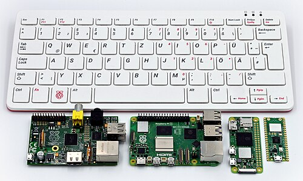

<!-- _class: lead -->

# 마이크로임베디드프로그래밍

## 오리엔테이션

### [munseong.jeong@daejin.ac.kr](mailto:munseong.jeong@daejin.ac.kr)

---

## 수업 개요 (Course Overview)

- **하드웨어 제어**: [라즈베리파이](https://en.wikipedia.org/wiki/Raspberry_Pi)의 **GPIO**로 센서를 읽고 LED·부저를 구동하는 실습
- **빌드와 배포**: **크로스 컴파일**, **CMake**, **CI/CD**로 코드를 빌드하고 보드에 배포하는 과정 실습
- **응용 시스템**: 센서·카메라·오디오를 결합한 IoT 시스템을 팀 프로젝트로 설계·구현

---

## 수업 개요 (Cont'd - 1)

### 주요 용어 (Key Terms)

- **GPIO**(General-Purpose Input/Output): 프로그램이 입력 또는 출력 용도를 정하는 범용 디지털 핀
  - 예: 출력으로 설정한 핀에 HIGH(3.3V)를 쓰면 연결된 LED가 켜짐
- **크로스 컴파일**: 호스트(x86_64 PC)에서 다른 CPU의 타깃(라즈베리파이, AArch64)용 실행 파일을 만드는 빌드
  - 예: PC에서 `aarch64-linux-gnu-g++`로 빌드한 파일을 라즈베리파이에 복사해 실행
- **CMake**: 소스 목록과 빌드 옵션을 기술한 `CMakeLists.txt`로부터 Makefile 등의 빌드 스크립트를 생성하는 도구
- **CI/CD**(Continuous Integration/Continuous Delivery): 코드를 저장소에 올릴 때마다 빌드·테스트·배포를 자동으로 수행하는 방식
  - 예: GitHub Actions가 `git push`마다 크로스 컴파일과 테스트를 실행

---

## 선수과목 및 사전 지식 (Prerequisites)

### 권장 선수과목

- 논리회로및실습, 컴퓨터시스템구조, 임베디드시스템응용, 프로그래밍 관련 교과목

### 필수 사전 지식

- **프로그래밍**: C/C++ 기초 문법, 포인터 연산, 동적 메모리 할당(`new`/`delete`, `malloc`/`free`)
- **운영체제**: Linux 터미널에서 셸(shell) 기본 명령어(`ls`, `cd`, `cp`, `ssh`)를 사용한 경험
- **하드웨어 기초**: 디지털 논리 레벨(HIGH/LOW), 옴의 법칙(V = IR) 수준의 전자회로 지식

### 권장 사전 학습 자료

- [Basic Unix commands](https://www.youtube.com/watch?v=3DA1grSp4mU)
- [Basic Linux Navigation](https://www.youtube.com/watch?v=dzHscTzpAME)
- [The vi Text Editor - Basic Intro](https://www.youtube.com/watch?v=KtTjamPKMhw)

---

## 수업 형태 및 평가 방법 (Format and Assessment)

- **수업 방식**: 이론 강의와 **3인 1조** 팀 실습·프로젝트를 병행
- **평가 항목과 반영 비율**

| 평가 항목 | 반영 비율 | 평가 세부 내용 |
| :-------- | :-------: | :------------- |
| **출석** | 10% | 출결 규정에 따른 출석 점수 |
| **중간고사** | 15% | 지필 평가 및 팀 프로젝트 제안서 평가 |
| **기말고사** | 25% | 팀 프로젝트 최종 결과 보고서 및 시연 평가 |
| **과제** | 50% | 주차별 실습 보고서 작성 및 제출 |

> **출결 규정 안내**
>
> - 총 수업일수의 1/4(약 8회) 초과 결석 시 다른 점수와 무관하게 학칙에 따라 **F 처리**
> - 공적인 사유로 인한 결석은 증빙 서류를 제출한 경우에만 출결 정정 가능

---

## 실습 구성 (Lab Overview)

| 실습 번호 | 실습 주제 | 주요 내용 |
| :-------: | :-------- | :-------- |
| **01** | 크로스 컴파일 | 빌드 환경 구축 및 타깃 보드 배포 |
| **02** | 기본 입출력 및 PWM | LED, 택트 스위치, 소프트웨어 PWM, 상태 기계(FSM) |
| **03** | 기초 센서 인터페이싱 | 온습도(DHT11), 조도(CdS), 초음파 거리 센서 제어 |
| **04** | 센서 통합 웹 서버 | 센서 데이터 수집 및 실시간 경량 웹 서버 구축 |
| **05** | 오디오 입출력 | ALSA 라이브러리 기반 녹음 및 오디오 파형 시각화 |
| **06** | 카메라 영상 제어 | V4L2 기반 정지 영상 및 동영상 캡처 |
| **07** | 웹캠 기반 CCTV | 실시간 스트리밍 및 원격 모니터링 시스템 구현 |

- **실습 02~04**: 라즈베리파이의 GPIO와 SPI 버스를 이용한 하드웨어 제어
- **실습 05~07**: Linux 커널의 오디오·영상 인터페이스를 이용한 멀티미디어 프로그래밍

---

## 실습 구성 (Cont'd - 1)

### 실습 주제 용어 (Lab Terms)

- **PWM**(Pulse Width Modulation): 일정 주기 안에서 HIGH 구간의 비율(듀티비)을 바꿔 평균 전력을 조절하는 방식
  - 예: 듀티비 50%로 LED를 구동하면 항상 켠 경우보다 어둡게 보임
- **소프트웨어 PWM**: 하드웨어 PWM 장치 대신 프로그램이 일정 시간마다 핀을 켜고 끄는 방식
- **상태 기계**(FSM, Finite State Machine): 현재 상태와 입력에 따라 다음 상태가 정해지는 제어 구조
  - 예: 버튼을 누를 때마다 신호등 LED가 녹 → 황 → 적 순서로 바뀜
- **ALSA**(Advanced Linux Sound Architecture): Linux 커널의 오디오 장치 인터페이스와 그 사용자 라이브러리 `libasound`
- **V4L2**(Video4Linux2): Linux 커널의 카메라·영상 캡처 장치 인터페이스, `/dev/video0` 같은 장치 파일로 접근

---

## 조별 지급 교보재 (Lab Equipment)

- **배부와 회수**: 조 편성 후 일괄 배부하고 **14주차 종강 시 전체 회수**

| 분류 | 품목 | 기본 수량 | 활용 실습 |
| :--- | :--- | :-------: | :-------- |
| **컨트롤러** | Raspberry Pi 4/400(전원 어댑터, microSD 포함) | 1 set | 전체 실습 |
| **배선** | 브레드보드(Breadboard) | 1개 | 실습 01~06 |
| **배선** | 점퍼 케이블(M-M, M-F) | 1 set(20핀 이상) | 실습 01~06 |
| **출력** | 5mm LED(적/황/녹) | 3개 | 실습 01, 02, 04 |
| **입력** | 택트 스위치(Push Button) | 2개 | 실습 01, 02 |
| **센서** | 온습도 센서(DHT11, 단일 데이터선 통신) | 1개 | 실습 03, 06 |
| **센서** | 조도 센서(CdS 포토레지스터) | 1개 | 실습 03, 04, 06 |
| **변환** | MCP3008 ADC(10-bit, SPI 통신) | 1개 | 실습 03, 04, 06 |
| **센서** | 초음파 센서(HC-SR04) | 1개 | 실습 03, 06 |
| **출력** | 피에조 부저(Buzzer) | 1개 | 실습 02, 06 |
| **영상·음성** | USB 웹캠(마이크 내장형) | 1개 | 실습 05~07 |

---

## 조별 지급 교보재 (Cont'd - 1)

### 부품 관련 용어 (Component Terms)

- **ADC**(Analog-to-Digital Converter): 아날로그 전압을 디지털 정수로 바꾸는 변환기
  - 라즈베리파이에는 아날로그 입력 핀이 없어 CdS 분압 전압을 직접 읽을 수 없음
  - MCP3008: 8채널, 입력 전압 0~$V_{REF}$를 0~1023(10비트) 값으로 변환
- **SPI**(Serial Peripheral Interface): SCLK·MOSI·MISO·CS 4개 신호선을 쓰는 동기식 직렬 버스
  - 예: 라즈베리파이가 MCP3008에 채널 번호를 보내고 변환 결과 10비트를 받음
- **DHT11 통신**: 데이터선 1개로 시작 신호와 40비트 측정 데이터를 주고받는 제조사 고유 방식
  - Dallas(Maxim)의 1-Wire 규격과 호환되지 않는 별도 방식

---

## 저항 소요량 (Resistors)

| 저항값 | 주요 용도 | 실습별 상세 소요 | 조별 지급 개수 |
| :----- | :-------- | :--------------- | :------------: |
| **330Ω**(또는 220Ω) | LED 전류 제한 | 01=3개, 02=2개, 04=1개 | 3개 |
| **10kΩ** | 스위치 풀업 / CdS 전압 분배 | 01=2개, 03=1개, 04=1개 | 2개 |
| **1kΩ** | HC-SR04 Echo 5V → 3.3V 분압(R1) | 03=1개, 06=1개 | 1개 |
| **2kΩ** | HC-SR04 Echo 5V → 3.3V 분압(R2) | 03=1개, 06=1개 | 1개 |

- **Echo 분압 이유**: 라즈베리파이 GPIO의 입력 전압 한계는 3.3V이며, 5V를 직접 연결하면 핀이 손상될 수 있음
- **분압 결과**: Echo(5V) → R1(1kΩ) → GPIO → R2(2kΩ) → GND 연결 시 GPIO 전압은 5V × 2/(1+2) ≈ 3.3V

---

## 과제 안내 (Assignments)

| 구분 | 과제명 | 제출 형식 | 제출 주기 |
| :--- | :----- | :-------: | :-------- |
| **개별 과제** | 실습 보고서 | 개별 레포트(PDF) | 매 실습 종료 후 |
| **팀 과제** | 팀 프로젝트 제안서 | 조별 레포트(1부) | 8주차(중간고사 기간) |
| **팀 과제** | 팀 프로젝트 결과 보고서 | 조별 레포트(1부) | 15주차(기말고사 기간) |

### 실습 보고서 작성 기준

- **구성 순서**: 실습 목표 → 회로 구성도 → 핵심 소스 코드 → 실행 결과 → 고찰
- **동작 검증**: **직접 촬영한 실행 사진과 시연 영상** 첨부(조원 1인 이상이 식별되도록 촬영)
- **코드 설명**: 전체 코드를 그대로 붙이지 않고 **핵심 로직만 발췌**하여 설명

---

## 팀 프로젝트 (Team Project)

- **프로젝트 주제**: 라즈베리파이의 GPIO·센서·카메라·오디오를 활용한 임베디드 시스템 설계와 구현

### 진행 일정 및 산출물

| 시점 | 제출 산출물 | 주요 작성 내용 |
| :--- | :--- | :--- |
| **8주차**(중간) | **팀 프로젝트 제안서** | • 개발 목표 및 기대 효과 |
| | | • 소요 부품 및 하드웨어 구성도 |
| | | • 전체 시스템 소프트웨어 아키텍처 |
| | | • 조원별 역할 분담 및 마일스톤 일정 |
| **15주차**(기말) | **팀 프로젝트 결과 보고서** | • 최종 구현 시스템 상세 설명 |
| | | • 정상 동작 검증 결과(시연 영상 포함) |
| | | • 문제점 분석 및 트러블슈팅 내역 |
| | | • 자체 평가 및 향후 개선점 |

---

## 참고 자료 (References)

- **Raspberry Pi 공식 문서**: [https://www.raspberrypi.com/documentation/](https://www.raspberrypi.com/documentation/)
- **libgpiod API 가이드**: [https://libgpiod.readthedocs.io/](https://libgpiod.readthedocs.io/)
- **lgpio 라이브러리 문서**: [https://abyz.me.uk/lg/lgpio.html](https://abyz.me.uk/lg/lgpio.html)
- **CMake 공식 레퍼런스**: [https://cmake.org/documentation/](https://cmake.org/documentation/)
- **GitHub Actions 워크플로 가이드**: [https://docs.github.com/actions](https://docs.github.com/actions)
