<!-- _class: lead -->

# 마이크로임베디드프로그래밍

## 임베디드 시스템 개론

### [munseong.jeong@daejin.ac.kr](mailto:munseong.jeong@daejin.ac.kr)

---

## 임베디드 시스템의 정의 (Definition)

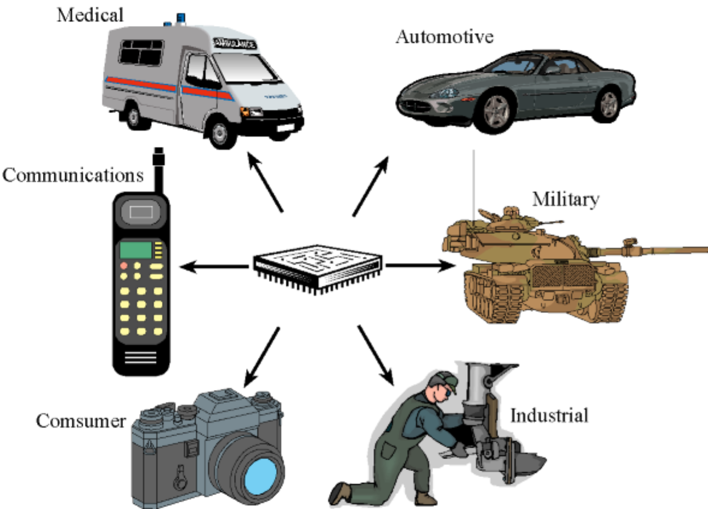

- **정의**: 가전·산업 설비·자동차 등 다른 장치 내부에 탑재되어 정해진 기능만 수행하는 컴퓨터 시스템
- **범용 컴퓨터와의 차이**: PC는 사용자가 설치한 임의의 프로그램을 실행하지만, 임베디드 시스템의 기능은 출하 시 고정됨
  - 예: 세탁기의 제어 보드는 세탁 코스 실행만 담당하며 다른 프로그램을 설치할 수 없음

---

## 임베디드 시스템의 정의 (Cont'd - 1)

### 범용 시스템과의 비교

| 비교 항목 | 범용 시스템(General-Purpose) | 임베디드 시스템(Embedded System) |
| :--- | :--- | :--- |
| **사용 목적** | 사용자가 설치한 여러 프로그램 실행 | 정해진 제어·처리 기능만 수행 |
| **가용 자원** | 고성능 CPU, GB 단위 RAM | 제한된 연산 능력, 수십 KB~수 MB 메모리 |
| **사용자 인터페이스** | 디스플레이, 키보드, 마우스 | 버튼, LED, 소형 디스플레이 또는 UI 없음 |
| **실시간성(Real-Time)** | 응답 지연을 대체로 허용 | 정해진 마감 시간(deadline) 안의 응답 요구 |
| **전원** | 상시 전원 | 배터리 구동 기기가 많아 저전력 설계가 중요 |

---

## 임베디드 시스템의 제약 (Constraints)

- **자원 제약**: 제품 원가에 맞춰 CPU 클록, 메모리(SRAM·Flash) 용량, 저장 공간이 제한됨
  - 예: STM32F103C8 MCU의 메모리는 Flash 64KB, SRAM 20KB
- **전력 제약**: 배터리 구동 기기에서는 평균 소비 전류가 배터리 교체 주기를 결정
- **실시간성 제약**: 입력이 들어온 뒤 정해진 마감 시간 안에 제어 결과를 출력해야 함
- **동작 환경 제약**: 고온·저온, 진동, 습도, 전자파 간섭(EMI) 환경에서도 정상 동작해야 함
  - 예: 차량용 제어기는 엔진룸의 고온과 진동 속에서도 동작해야 함

---

## 임베디드 시스템의 제약 (Cont'd - 1)

### 실시간성 (Real-Time)

- **실시간 시스템**: 결과의 정확성뿐 아니라 결과가 나온 시각까지 요구 사항에 포함되는 시스템
- **마감 시간**(deadline): 입력 발생 후 출력이 완료되어야 하는 시간 한계
- **경성 실시간**(hard real-time): 마감 시간을 한 번이라도 넘기면 시스템 실패로 간주
  - 예: 에어백 제어기가 충돌 감지 후 마감 시간 안에 에어백을 전개하지 못하면 탑승자 보호 실패
- **연성 실시간**(soft real-time): 마감 시간을 넘기면 서비스 품질(QoS)만 떨어지고 기능은 유지
  - 예: 영상 스트리밍에서 프레임이 늦게 도착하면 화면이 끊기지만 재생은 계속됨

---

## 임베디드 시스템의 제약 (Cont'd - 2)

### 개발과 설계에 미치는 영향

- **예측 가능성**(determinism): 같은 입력에 대해 실행 시간이 일정하게 유지되는 성질
  - 실행 중 `malloc()`을 반복하면 힙 단편화로 할당 시간이 달라지고 할당이 실패할 수도 있음
  - 대책: 필요한 메모리를 초기화 단계에서 미리 할당하고 실행 중에는 할당하지 않음
- **연산 방식 선택**: FPU(Floating-Point Unit, 부동소수점 연산 장치)가 없으면 고정소수점 연산 고려
  - 예: Cortex-M0+용 Clang `-O2`에서 `float` 곱셈은 `__aeabi_fmul` 함수 호출, `int` 곱셈은 `muls` 명령 1개
- **크기와 속도의 균형**: 코드 크기(footprint)를 줄이는 최적화(`-Os`)와 속도를 높이는 최적화(`-O2`)를 목적에 맞게 선택

---

## 임베디드 시스템의 구성 (Components)

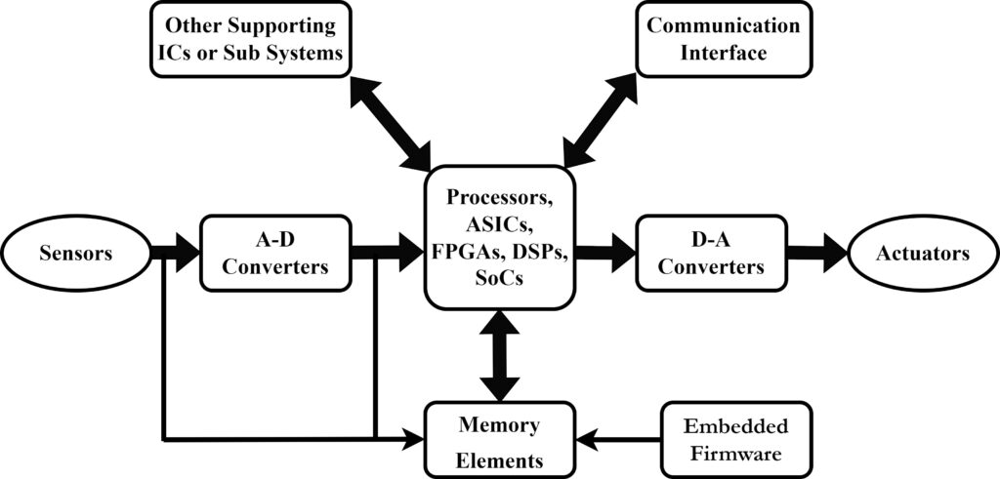

- **프로세서**: 프로그램을 실행하는 MCU 또는 MPU(뒤에서 비교)
- **메모리**: 펌웨어(firmware)를 저장하는 Flash와 실행 중 데이터를 두는 SRAM·DRAM
- **전원·보조 회로**: 전원 관리 IC(PMIC), 실시간 시계(RTC), 리셋 회로, 클록 발진기
- **주변장치**(peripheral): CPU와 외부 신호를 연결하는 칩 내부 하드웨어 블록
- **센서·액추에이터**: 물리량을 전기 신호로 바꾸는 입력 장치와 모터·LED처럼 동작을 만드는 출력 장치
- **소프트웨어 계층**: 베어메탈 펌웨어, RTOS 태스크, 또는 Linux 위의 응용 프로그램

---

## 임베디드 시스템의 구성 (Cont'd - 1)

### 주요 주변장치 (Peripherals)

| 주변장치 | 역할 | 예 |
| :--- | :--- | :--- |
| **GPIO** | 핀 하나의 HIGH/LOW 입출력 | LED 점등, 버튼 입력 |
| **UART** | TX·RX 2개 선으로 바이트를 주고받는 비동기 직렬 통신 | PC 시리얼 콘솔 |
| **I2C** | SDA·SCL 2개 선에 여러 장치를 주소로 구분해 연결하는 직렬 버스 | 온도 센서, OLED 디스플레이 |
| **SPI** | 클록·데이터·칩 선택 선을 쓰는 동기식 직렬 버스 | MCP3008 ADC, SD 카드 |
| **ADC** | 아날로그 전압을 디지털 값으로 변환 | 조도 센서 전압 측정 |
| **PWM** | HIGH 구간의 비율(듀티비)을 조절한 주기 신호 생성 | LED 밝기, 서보 모터 각도 |
| **타이머** | 클록을 세어 일정 시간마다 인터럽트 발생 | 1ms 주기 제어 루프 |

- **펌웨어**: 장치의 Flash에 저장되어 전원이 켜지면 실행되는 소프트웨어

---

## MCU와 MPU (Microcontroller vs Microprocessor)

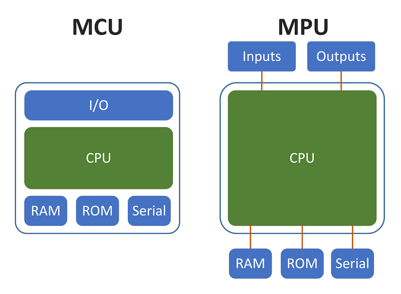

| 비교 항목 | MCU(Microcontroller) | MPU(Microprocessor) |
| :--- | :--- | :--- |
| **대표 제품군** | STM32, ESP32, RP2350 | Raspberry Pi(BCM2711), NXP i.MX, RK3588 |
| **주요 메모리** | 칩 내부 SRAM(수십 KB ~ 수 MB) | 칩 외부 DRAM(수백 MB ~ 수 GB) |
| **프로그램 저장** | 칩 내부 Flash(수십 KB ~ 수 MB) | 외부 저장 장치(SD 카드, eMMC, NVMe) |
| **운영체제(OS)** | 없음(베어메탈) 또는 RTOS | Linux, Android 등 범용 OS |
| **부팅 소요 시간** | 수 ms | 수 초 ~ 수십 초 |

> - **MCU**: 연산 코어·메모리·주변장치를 한 칩에 집적한 제어용 프로세서
> - **MPU**: 외부 DRAM·저장 장치와 결합해 운영체제를 실행하는 고성능 프로세서

---

## 임베디드 시스템의 응용 (Applications)

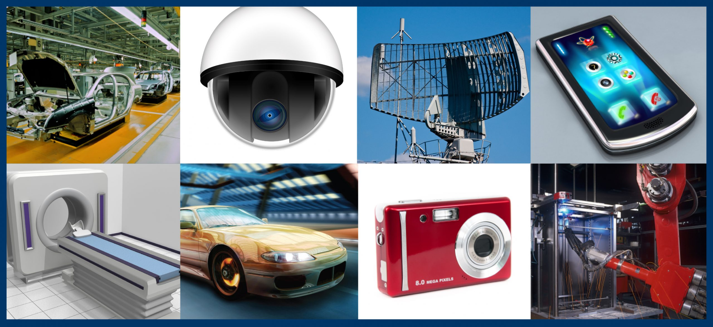

- **스마트 가전**: 세탁기, 냉장고, 에어컨, 로봇청소기
- **자동차 전장**: 엔진을 제어하는 ECU(Electronic Control Unit), 운전자 보조 시스템(ADAS), 인포테인먼트
- **의료 기기**: 휴대형 혈당측정기, 환자 감시 장치, 약물 주입 펌프
- **산업 자동화**: 공장 설비 제어기(PLC, Programmable Logic Controller), 산업용 로봇, 모터 드라이버
- **IoT·스마트홈**: 환경 센서 노드, 스마트 도어록, 전력량 계량기
- **항공·우주·국방**: 비행 제어 컴퓨터, 유도·항법 장치, 위성 탑재 컴퓨터

---

## 임베디드 시스템의 응용 (Cont'd - 1)

### 최근 기술 동향 (Recent Trends)

- **엣지 AI**(edge AI): 데이터를 클라우드로 보내지 않고 장치 자체에서 신경망 추론을 수행하는 방식
  - **추론**(inference): 학습이 끝난 신경망에 입력을 넣어 결과를 계산하는 과정
  - 예: 현관 카메라가 서버 연결 없이 영상에서 사람을 검출
- **임베디드 보안**: 네트워크에 연결되는 장치가 늘면서 하드웨어 암호화와 보안 부팅의 필요성 증가
  - **보안 부팅**(secure boot): 부팅 시 펌웨어의 전자 서명을 검증해 변조된 펌웨어의 실행을 막는 기능
- **빌드·배포 자동화**: 펌웨어 규모가 커지면서 CI/CD로 빌드·테스트·배포를 자동화하는 사례 증가

---

## 소프트웨어 실행 환경의 세 가지 선택 (Three Execution Models)

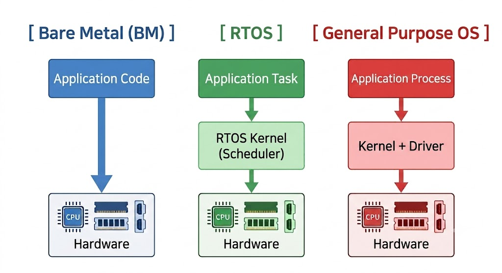

- **선택 기준**: 타이밍 정밀도와 개발 생산성 사이의 트레이드오프(하나를 얻으면 다른 하나를 잃는 관계)
- **실시간 요구가 엄격한 경우**: 베어메탈 또는 RTOS
- **네트워크 스택, 파일 시스템, 멀티미디어, GUI가 필요한 경우**: 범용 OS
- **결정 방법**: 하드웨어 제약과 필요한 소프트웨어 기능을 함께 따져 선택

---

## 베어메탈 (BM, Bare Metal)

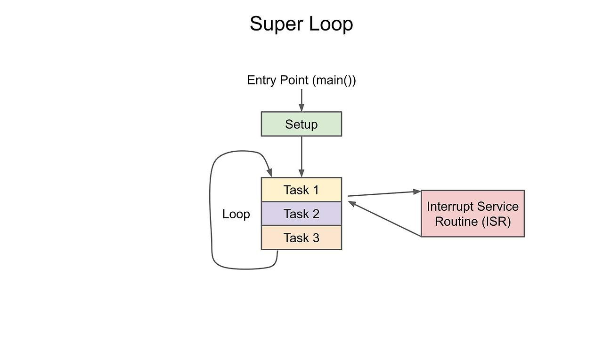

- **정의**: 운영체제 없이 응용 코드가 하드웨어 레지스터를 직접 제어하는 구조
- **자원 사용**: 하나의 프로그램이 CPU, 메모리, 주변장치를 모두 직접 사용
- **구조**: 시스템 전체가 하나의 실행 파일이며 OS 호출 같은 중간 계층이 없음

---

## 베어메탈 (Cont'd - 1)

```c
int main() {
  hardware_init();          /* Clocks, GPIO, timers */
  while (1) {               /* Super loop */
    read_sensors();
    update_control();
    drive_outputs();
  }
}
```

- **슈퍼 루프**(super loop): 무한 루프에서 센서 입력 → 제어 연산 → 출력 구동을 차례로 반복하는 구조
- **ISR**(Interrupt Service Routine): 인터럽트 발생 시 실행되는 함수, 긴급한 처리만 하고 나머지는 메인 루프에 넘김
  - 예: 버튼 ISR은 플래그만 설정하고, 메인 루프가 플래그를 확인해 LED 상태를 바꿈
- **공유 변수**: ISR과 메인 루프가 함께 쓰는 변수는 `volatile`로 선언해 컴파일러가 읽기를 생략하지 못하게 함
- **원자성**: `volatile`은 원자성을 보장하지 않으므로 여러 바이트 변수는 인터럽트를 잠시 금지하고 읽음

---

## 베어메탈 (Cont'd - 2)

### 베어메탈과 Linux의 GPIO 접근 비교

| 비교 항목 | 베어메탈(MCU) | Linux(라즈베리파이) |
| :--- | :--- | :--- |
| **LED를 켜는 방법** | GPIO 출력 레지스터 주소에 값을 직접 씀 | GPIO 문자 디바이스(`/dev/gpiochipN`)를 libgpiod로 요청 |
| **접근 권한 검사** | 없음 | 커널이 프로세스의 권한을 검사 |
| **처리 경로** | CPU 저장(store) 명령 1개 | 시스템 콜 → 커널 GPIO 드라이버 → 레지스터 |
| **잘못된 핀 지정** | 다른 주변장치 레지스터를 덮어써도 감지되지 않음 | 없는 라인이나 사용 중인 라인 요청은 커널이 거부 |

- **시스템 콜**(system call): 응용 프로그램이 커널 기능을 요청하는 진입점(예: `open()`, `ioctl()`)

---

## 베어메탈 (Cont'd - 3)

### 장단점 비교 (Trade-Offs)

| 장점 | 단점 |
| :--- | :--- |
| OS 스케줄러가 없어 응답 시간 예측이 쉬움 | 기능이 늘수록 슈퍼 루프의 타이밍 설계가 복잡해짐 |
| 수 ms 안에 부팅 | 여러 작업의 동시 실행을 직접 구현해야 함 |
| 수 KB 메모리에서도 동작 | 통신 프로토콜, 파일 시스템을 직접 구현하거나 이식해야 함 |
| 백그라운드 작업이 없어 전력 관리가 쉬움 | 레지스터를 직접 다루므로 다른 칩으로 옮기기 어려움 |
| OS 라이선스 비용과 커널 메모리가 필요 없음 | 디버깅·실행 추적 도구가 제한적 |

### 주요 적용 영역 (Use Cases)

- **단일 기능 장치**: 소형 모터 제어기, 센서 송신기, 전원 시퀀서
- **경성 실시간 장치**: 마이크로초 단위의 타이밍 오차도 허용하지 않는 제어기
- **저가 대량 생산 제품**: 부품 원가(BOM, Bill of Materials)를 최소화해야 하는 제품

---

## RTOS (Real-Time Operating System)

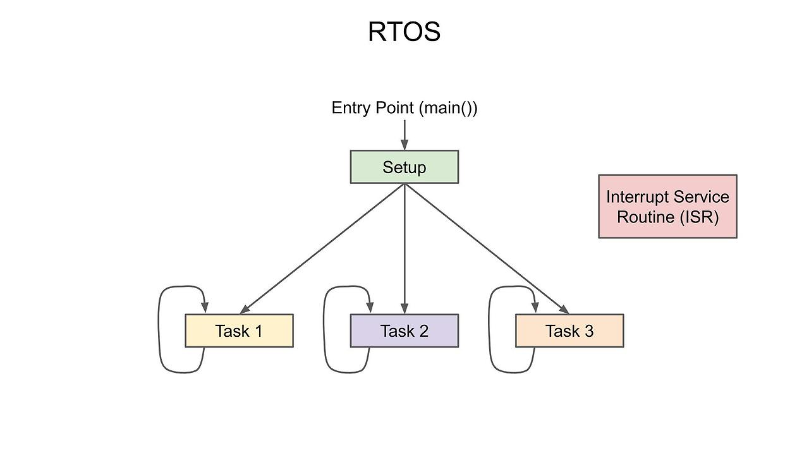

- **정의**: 태스크의 마감 시간을 지키도록 설계된 소형 운영체제(실시간 운영체제)
- **태스크**(task): RTOS가 스케줄링하는 실행 단위, 각자 스택과 우선순위를 가짐
- **스케줄러**: 실행 가능한 태스크 중 우선순위가 가장 높은 태스크를 정해진 시간 안에 실행

---

## RTOS (Cont'd - 1)

```c
#include "FreeRTOS.h"
#include "task.h"

/* Concept: Two tasks run independently at different periods. */
void SensorTask(void* arg) {
  for (;;) {
    ReadSensor();
    vTaskDelay(pdMS_TO_TICKS(100));  /* Every 100 ms */
  }
}

void NetworkTask(void* arg) {
  for (;;) {
    SendPacket();
    vTaskDelay(pdMS_TO_TICKS(1000));  /* Every 1 s */
  }
}
```

- **틱**(tick): 타이머 인터럽트로 만드는 RTOS의 기본 시간 단위, `pdMS_TO_TICKS()`가 ms를 틱 수로 변환
- **`vTaskDelay()`**: 지정한 틱 수만큼 태스크를 대기 상태로 두며, 그동안 다른 태스크가 CPU를 사용

---

## RTOS (Cont'd - 2)

### FreeRTOS의 주요 기능

- **태스크 생성**: `xTaskCreate()`로 함수를 태스크로 등록하면 커널이 태스크마다 별도 스택을 할당
- **선점형 스케줄링**(preemptive scheduling): 우선순위가 더 높은 태스크가 실행 가능해지면 현재 태스크를 즉시 중단하고 교체
  - 예: `SensorTask`의 우선순위가 더 높으면, 100ms가 지나는 순간 `NetworkTask` 실행 중이라도 `SensorTask`가 먼저 실행
- **문맥 교환**(context switch): 실행 중인 태스크의 레지스터를 저장하고 다음 태스크의 레지스터를 복원하는 동작
- **동기화 객체**: 태스크 간 데이터 전달용 큐(queue), 공유 자원 보호용 세마포어(semaphore)·뮤텍스(mutex) 제공
- **크기**: 커널 코드가 수 KB~수십 KB 수준이므로 RAM이 수십 KB인 32비트 MCU에서도 동작

---

## RTOS (Cont'd - 3)

### 태스크 스케줄링 메커니즘 (Task Scheduling)

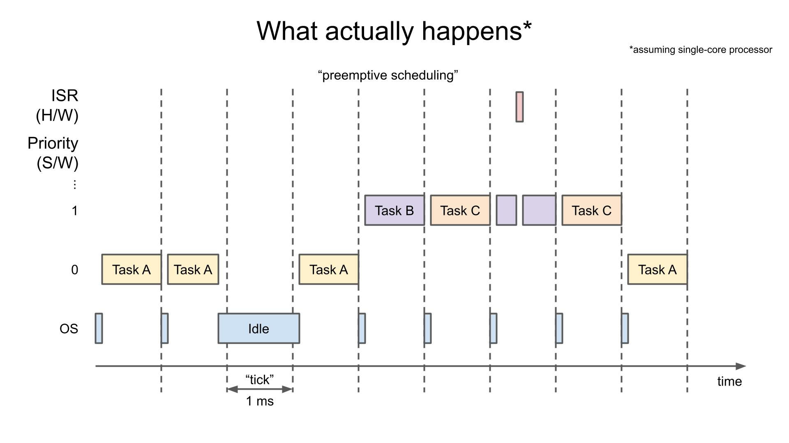

---

## 범용 OS (General-Purpose OS)

- **정의**: Linux, Android처럼 여러 프로세스를 서로 보호하며 실행하는 완전한 운영체제
- **제공 기능**: 시분할 스케줄러, 가상 메모리, 파일 시스템, TCP/IP 네트워크 스택
- **소프트웨어 재사용**: 웹 서버, 데이터베이스, OpenCV 같은 기존 오픈소스 라이브러리를 그대로 사용
- **개발 도구**: POSIX API, GDB 디버거, Valgrind 메모리 검사기 등 PC와 같은 도구 사용
- **용도**: 영상 처리, 네트워크 서비스, GUI가 필요한 장치

---

## 범용 OS (Cont'd - 1)

### 하드웨어 요구와 실시간성 한계

- **MMU**(Memory Management Unit): 프로그램이 쓰는 가상 주소를 실제 물리 주소로 변환하는 하드웨어
  - 프로세스마다 별도 주소 공간을 두어 한 프로세스의 잘못된 포인터가 다른 프로세스 메모리를 바꾸지 못함
  - 일반 Linux 배포판과 Android는 MMU가 있는 프로세서(예: Cortex-A)를 요구
- **메모리**: 커널과 여러 프로세스를 올리기 위해 수백 MB 이상의 DRAM 필요
- **실시간성 한계**: 선점이 금지된 커널 구간, 페이지 폴트, 백그라운드 프로세스로 인해 응답 지연이 일정하지 않음
  - **페이지 폴트**(page fault): 접근한 가상 메모리 페이지가 물리 메모리에 없어 커널이 개입하는 상황
  - 예: 1ms 주기 제어 루프라도 시스템 부하가 큰 순간에는 일부 주기가 늦어질 수 있음

---

## 세 계층 비교 (Comparison)

| 비교 항목 | 베어메탈 | RTOS | 범용 OS(GPOS) |
| :--- | :--- | :--- | :--- |
| **메모리 요구량** | 수 KB ~ 수십 KB | 수십 KB ~ 수백 KB | 수백 MB ~ 수 GB |
| **부팅 소요 시간** | 수 ms | 수십 ms 내외 | 수 초 ~ 수십 초 |
| **타이밍 예측성** | 가장 높음 | 높음(마감 시간 보장 설계) | 낮음(부하에 따라 변동) |
| **멀티태스킹 방식** | 슈퍼 루프·상태 기계로 직접 분기 | 우선순위 기반 선점형 스케줄링 | 프로세스 단위 시분할 스케줄링 |
| **네트워크·파일 시스템** | 라이브러리를 직접 이식 | 경량 스택(lwIP, FatFs) 사용 | 커널에 내장 |
| **개발·디버깅** | 어려움(하드웨어 직접 처리) | 중간(태스크 동기화 문제) | 쉬움(진단 도구 풍부) |
| **대표 하드웨어** | RP2350, STM32F1/F4 | ESP32, STM32H7 | Raspberry Pi, NVIDIA Jetson |

---

## 저전력 플랫폼 (Low-Power Platforms)

- **목표**: 배터리 하나로 수개월~수년 동안 교체 없이 동작
- **방법**: 깨어 있는 시간을 최소화하고 나머지 시간은 슬립 모드로 유지해 평균 전류를 낮춤

### 전력 동작 모드 (Power Modes)

| 동작 모드 | 시스템 내부 상태 | 상대적 전력 소모 |
| :--- | :--- | :---: |
| **Active(동작)** | CPU에 클록이 공급되어 명령을 실행 | 가장 큼 |
| **Sleep(슬립)** | CPU 정지, 타이머·인터럽트 회로는 동작 | 중간 |
| **Deep Sleep(딥슬립)** | 대부분의 회로 전원 차단, RTC 타이머나 외부 웨이크업 핀으로 복귀 | 가장 작음 |

---

## 저전력 플랫폼 (Cont'd - 1)

### 배터리 수명 추정 (Battery Life)

$$\text{Battery life (h)} \approx \frac{\text{Battery capacity (mAh)}}{\text{Average current (mA)}}$$

- **슬립을 활용한 경우**: 2000mAh 배터리, 평균 전류 0.1mA → 약 20,000시간(약 2.3년)
- **슬립 없이 상시 동작한 경우**: 같은 배터리, 평균 전류 10mA → 약 200시간(약 8일)
- **한계**: 온도와 방전 전류에 따라 실제 용량이 줄어들므로 추정치로만 사용

---

## 저전력 플랫폼 (Cont'd - 2)

### 전류 프로파일 분석 (Current Consumption vs Time)

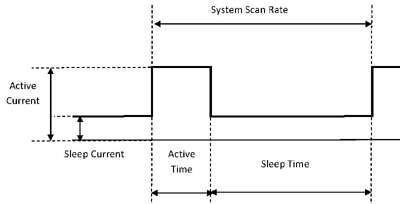

---

## 저전력 설계의 원칙 (Low-Power Design)

- **Race-to-Sleep**: 높은 클록으로 작업을 빨리 끝내고 곧바로 슬립 모드로 전환하는 전략
  - 활성 시간이 짧아져 총 에너지(전력 × 시간)가 줄어드는 경우에 유리
- **실측 검증**: 최적화(예: SIMD 병렬화) 후 동작 1회당 소비 에너지가 줄었는지 전류 측정 장비로 확인
  - **SIMD**(Single Instruction, Multiple Data): 명령 하나로 여러 데이터를 동시에 처리하는 방식
- **이벤트 기반 구동**: 폴링(상태를 반복해서 읽는 대기) 대신 인터럽트가 CPU를 깨우는 구조
  - 예: 버튼 상태를 1ms마다 읽는 대신 버튼 인터럽트가 발생할 때까지 슬립
- **무선 통신 최소화**: 전력 소모가 큰 RF 송수신의 횟수와 전송 데이터 크기를 줄임
- **클록 게이팅**(clock gating): 사용하지 않는 주변장치(UART, SPI, ADC)의 클록 공급을 끊어 전력 소모를 줄임

---

## 저전력 설계의 원칙 (Cont'd - 1)

### 운영체제와 저전력

- **범용 OS(Linux)**: 상주 프로세스와 커널 타이머가 CPU를 주기적으로 깨우므로 MCU의 딥슬립 수준 대기 전력에 도달하기 어려움
- **배터리 센서 노드**: 슬립 모드를 세밀하게 제어할 수 있는 **MCU + 베어메탈/RTOS** 조합을 주로 사용

---

## 플랫폼 지도 (Platform Map)

| 분류 | 대표 하드웨어 플랫폼 | 권장 실행 환경 |
| :--- | :--- | :--- |
| **교육용 MCU** | Raspberry Pi Pico 2(RP2350) | 베어메탈 / RTOS |
| **산업·범용 MCU** | STMicroelectronics STM32 | 베어메탈 / RTOS |
| **무선 특화 MCU** | Espressif ESP32 | RTOS(ESP-IDF) |
| **산업용 MPU** | NXP i.MX 시리즈 | Embedded Linux |
| **고성능 SBC용 SoC** | Rockchip RK3588 | Embedded Linux / Android |
| **엣지 AI 모듈** | NVIDIA Jetson | Embedded Linux(JetPack) |
| **고성능 모바일 AP** | Qualcomm Snapdragon | Linux / Android |
| **교육·프로토타이핑** | Raspberry Pi | Raspberry Pi OS(Linux) |

- **SoC**(System on Chip): CPU, GPU, 메모리 컨트롤러, 주변장치를 한 칩에 집적한 반도체
- **SBC**(Single-Board Computer): SoC, 메모리, 입출력 커넥터를 기판 하나에 갖춘 컴퓨터(예: 라즈베리파이)

---

## STMicroelectronics STM32

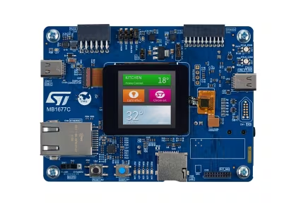

- **개요**: Arm **Cortex-M** 코어 기반의 32비트 MCU 제품군, 산업 제어 분야에서 널리 사용

| 항목 | 내용 |
| :--- | :--- |
| **하드웨어 구성** | Cortex-M0+ ~ M7/M33 코어 + 아날로그·통신 주변장치 |
| **소프트웨어 환경** | 베어메탈(ST 제공 HAL/LL 드라이버 라이브러리), FreeRTOS, Zephyr RTOS |
| **장점** | 제품군 간 핀·주변장치 호환성이 높아 상위 제품으로 옮기기 쉬움 |
| **주요 적용 분야** | 공장 자동화, 모터 벡터 제어(FOC), 가전, 의료 기기 |

- **개발 도구**: STM32CubeMX에서 핀·클록을 그래픽으로 설정하면 초기화 C 코드를 자동 생성

---

## Espressif ESP32

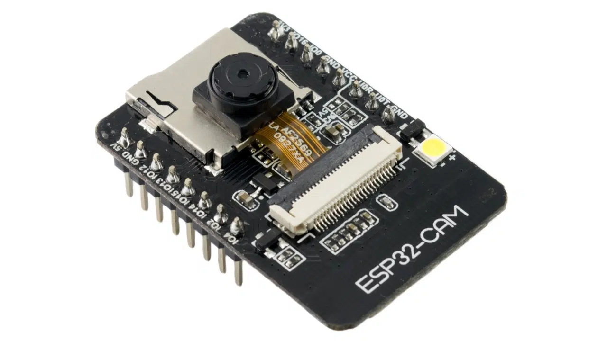

- **개요**: **Wi-Fi(2.4GHz)와 Bluetooth(BLE)를 칩에 내장**한 IoT용 MCU 제품군

| 항목 | 내용 |
| :--- | :--- |
| **하드웨어 구성** | Xtensa 듀얼코어(ESP32, ESP32-S3) 또는 RISC-V 코어(ESP32-C3, C6) + 무선 회로 |
| **소프트웨어 환경** | FreeRTOS 기반 공식 개발 프레임워크(ESP-IDF) |
| **장점** | 별도 무선 모듈이 필요 없어 기판 면적과 부품 원가 감소, 딥슬립 지원 |
| **주요 적용 분야** | 스마트홈 기기, 무선 센서 노드, IoT 시제품 |

- **전원 설계**: Wi-Fi 송신 순간 수백 mA가 흐르므로 전원 핀 가까이에 디커플링 커패시터 배치

---

## Raspberry Pi Pico 2 (RP2350)

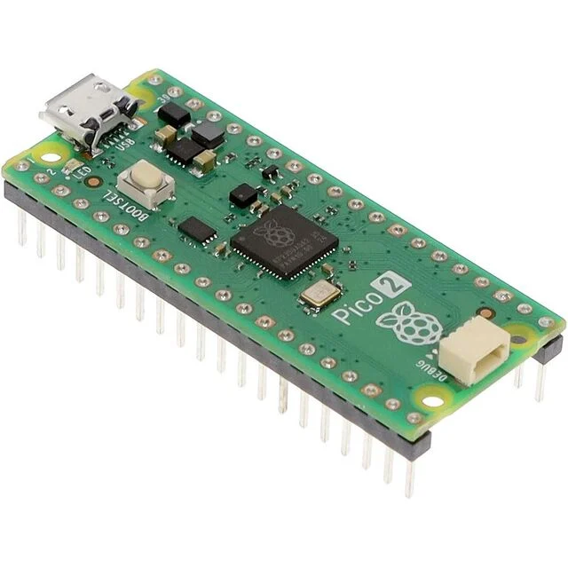

- **개요**: Raspberry Pi Ltd가 자체 설계한 RP2350 칩을 탑재한 저가 MCU 보드(Linux 미탑재)

| 항목 | 내용 |
| :--- | :--- |
| **하드웨어 구성** | Cortex-M33 2개 또는 RISC-V(Hazard3) 2개 중 선택해 부팅 + [PIO](https://tutoduino.fr/en/pio-rp2040-en/) |
| **소프트웨어 환경** | 베어메탈(C/C++ SDK), FreeRTOS, MicroPython |
| **장점** | PIO가 CPU 개입 없이 정밀한 타이밍의 입출력 신호를 생성 |
| **주요 적용 분야** | 임베디드 교육, 사용자 정의 통신 인터페이스 구현, 고속 신호 수집 |

- **PIO**(Programmable I/O): 전용 명령어로 GPIO 신호를 만드는 상태 기계 블록(예: WS2812 LED 구동 신호)

---

## NVIDIA Jetson

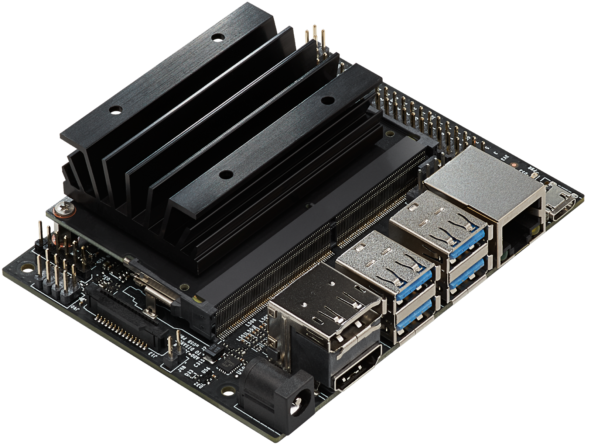

- **개요**: GPU와 신경망 가속기를 내장해 **장치 안에서 AI 추론**을 수행하는 임베디드 모듈

| 항목 | 내용 |
| :--- | :--- |
| **하드웨어 구성** | Arm Cortex-A CPU + CUDA GPU + 딥러닝 가속기(DLA, 일부 모델) |
| **소프트웨어 환경** | Ubuntu 기반 JetPack SDK(CUDA, cuDNN, TensorRT 포함) |
| **장점** | 데스크톱 GPU와 같은 CUDA API를 사용하므로 PC에서 개발한 코드를 옮기기 쉬움 |
| **주요 적용 분야** | 자율 이동 로봇(AMR), 산업용 외관 검사, 드론 비전 |

- **제품군**: 소형·저전력 Orin Nano부터 고성능 AGX Orin까지 같은 소프트웨어 스택 사용

---

## Qualcomm

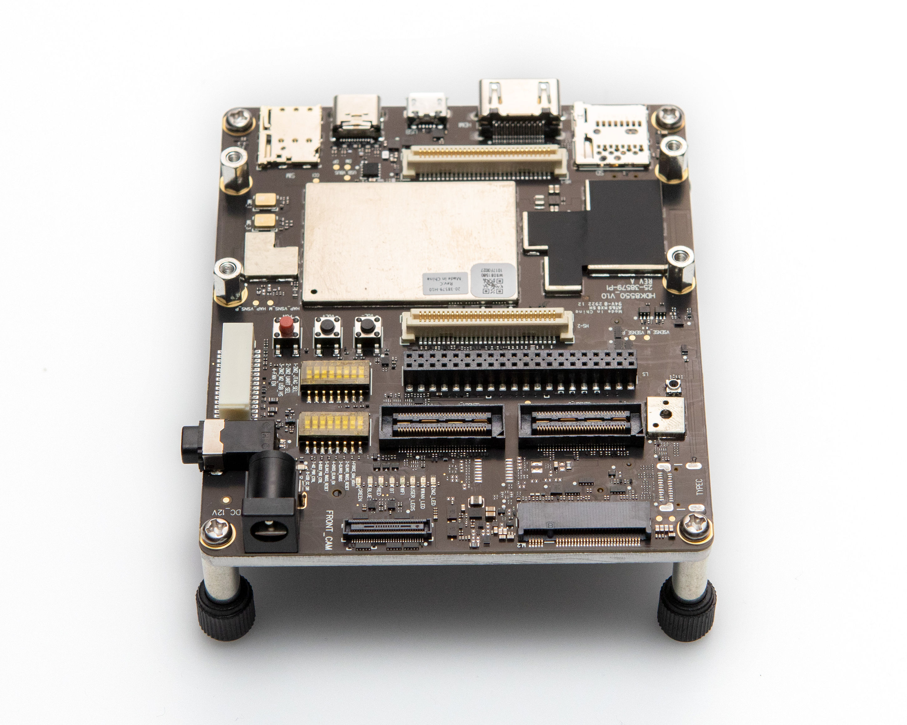

- **개요**: 스마트폰용 프로세서(AP, Application Processor) 기술을 로봇·산업 기기로 확장한 SoC 플랫폼

| 항목 | 내용 |
| :--- | :--- |
| **하드웨어 구성** | Arm 기반 Kryo CPU + Adreno GPU + Hexagon DSP/NPU |
| **소프트웨어 환경** | Embedded Linux, Android, QNX(차량용 실시간 OS) |
| **장점** | 작업 특성에 맞는 연산 장치에 일을 나눠 전력 대비 성능을 높임 |
| **주요 적용 분야** | 서비스 로봇, 차량용 디지털 콕핏, XR 기기, 드론 |

- **이종 컴퓨팅**(heterogeneous computing): 작업마다 알맞은 연산 장치(DSP, NPU, GPU)에 나눠 맡기는 방식

---

## 특화 SoC 사례: Ambarella

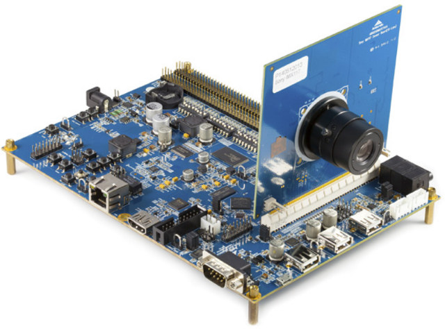

- **도메인 특화 아키텍처**(DSA): 범용 연산 대신 특정 분야(영상 처리·비전)에 맞춰 설계한 하드웨어

| 항목 | 내용 |
| :--- | :--- |
| **하드웨어 구성** | Arm Cortex-A CPU + 고해상도 비디오 인코더 + CVflow AI 비전 엔진 |
| **소프트웨어 환경** | 임베디드 Linux와 제조사 제공 영상 처리 SDK |
| **장점** | 4K/8K 다채널 영상 압축과 AI 객체 인식을 낮은 전력으로 동시에 수행 |
| **주요 적용 분야** | IP CCTV, 차량용 블랙박스·ADAS 카메라, 산업용 비전 검사기 |

- **예**: 차량용 블랙박스가 녹화 영상 압축과 차선·차량 인식을 칩 하나에서 함께 처리

---

## 임베디드 Linux SoC (NXP i.MX / Rockchip RK3588)

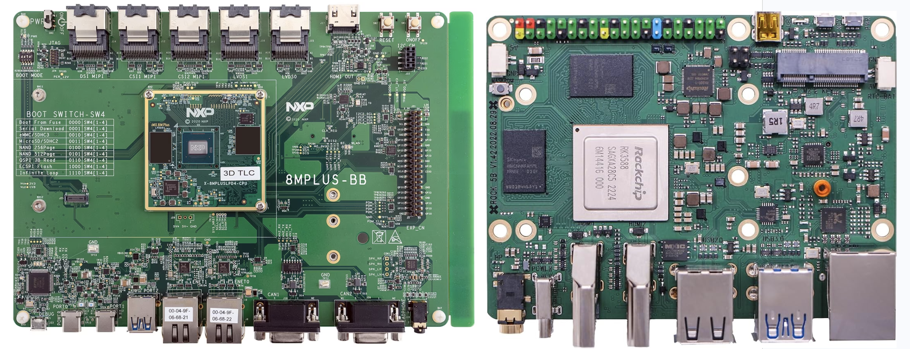

- **공통점**: 라즈베리파이처럼 **Linux를 실행하면서 GPIO·버스를 직접 제어**할 수 있는 SoC

| 비교 항목 | NXP i.MX 시리즈 | Rockchip RK3588 |
| :--- | :--- | :--- |
| **프로세서** | Cortex-A53/A55 + 실시간 제어용 Cortex-M | Cortex-A76 4개 + A55 4개 + 6 TOPS NPU |
| **지원 OS** | Linux(Yocto Project, Buildroot) | Embedded Linux, Android |
| **장점** | 10~15년 장기 공급, CAN-FD·TSN 지원(일부 모델) | 8K 영상 하드웨어 코덱, 다중 카메라 입력 |
| **적용 분야** | 산업 자동화 제어반, 의료 장비, 차량용 제어 모듈 | 고성능 SBC, 키오스크, 엣지 AI 게이트웨이 |

- **산업용 선정 기준**: 양산 제품은 최고 연산 성능보다 **장기 공급 기간과 가혹 환경 신뢰성**을 우선

---

## 임베디드 Linux SoC (Cont'd - 1)

### 관련 용어

- **TOPS**(Tera Operations Per Second): 초당 10¹²회 연산, NPU의 연산 성능을 비교하는 단위
- **Yocto Project·Buildroot**: 커널·라이브러리·응용 프로그램을 소스부터 빌드해 보드용 Linux 이미지를 만드는 도구
- **CAN-FD**: 차량·산업 기기용 CAN 버스의 확장 규격, 프레임당 데이터를 8바이트에서 최대 64바이트로 늘림
- **TSN**(Time-Sensitive Networking): 이더넷에서 전송 지연의 상한을 보장하는 IEEE 802.1 표준 묶음
- **장기 공급 프로그램**: 제조사가 특정 칩을 정해진 기간 동안 계속 생산하겠다고 약속하는 제도
  - 예: NXP Product Longevity 프로그램은 제품별로 10년 또는 15년 공급을 명시

---

## Raspberry Pi

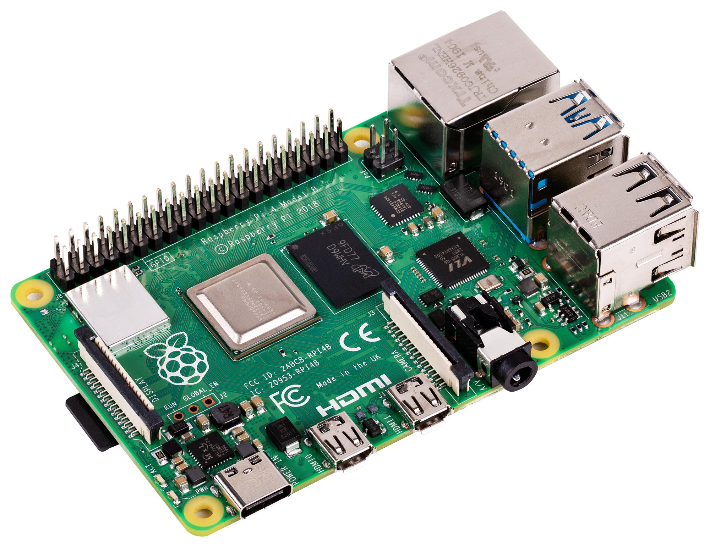

- **개요**: 교육·연구·시제품 제작에 널리 쓰이는 SBC, 이 강의의 실습 플랫폼

| 항목 | 내용 |
| :--- | :--- |
| **하드웨어 구성** | Broadcom BCM2711(Cortex-A72 4코어, Raspberry Pi 4) + VideoCore VI GPU |
| **소프트웨어 환경** | Debian 기반 공식 운영체제 Raspberry Pi OS(64비트) |
| **장점** | Linux 개발 환경과 40핀 GPIO 헤더를 함께 제공 |
| **주요 적용 분야** | 임베디드 소프트웨어 교육, 개념 검증(PoC, Proof of Concept), 시제품 제작 |

- **학습 측면**: Linux 기반 개발(MPU의 특성)과 GPIO 핀 제어(MCU에서 하던 작업)를 한 보드에서 함께 실습

---

## 플랫폼 선택 기준 (How to Choose)

1. **경성 실시간** 마감 보장이 가장 중요한가? → **MCU + 베어메탈/RTOS**
2. **배터리로 수년간 동작**해야 하는가? → **저전력 MCU**(예: STM32 L/U 시리즈)
3. **네트워크, 파일 시스템, 웹 서비스**가 핵심인가? → **Linux 기반 MPU**
4. **다채널 영상 처리나 엣지 AI 추론**이 필요한가? → **가속기 탑재 SoC·모듈**(Ambarella, Jetson)
5. **양산 수량이 많고 원가(BOM) 제약이 엄격**한가? → **기능에 맞춘 특화 SoC가 경제적**

> 기능 요구(통신, UI)와 비기능 제약(실시간성, 소비 전력, 제조 원가)이 플랫폼 선택을 결정
