<!-- _class: lead -->

# 마이크로임베디드프로그래밍

## 임베디드 시스템 개론

### [munseong.jeong@daejin.ac.kr](mailto:munseong.jeong@daejin.ac.kr)

---

## 임베디드 시스템의 정의 (Definition)

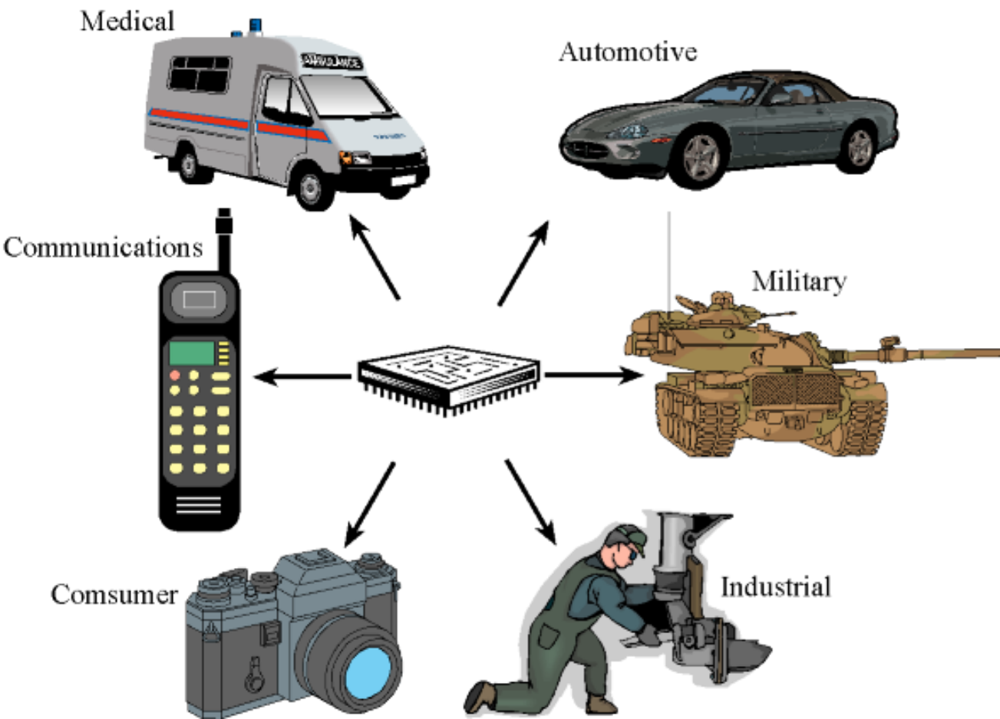

- **핵심 정의**: 가전제품, 산업 설비, 운송 기기 내부에 탑재되어 **특정 목적을 전담 수행하도록 설계된 소형 컴퓨터 시스템**
- **특징**: 다양한 범용 작업을 수행하는 PC·서버와 달리 시스템의 사용 목적과 기능이 엄격히 고정됨

---

## 임베디드 시스템의 정의 (Definition) (Cont'd)

### 범용 시스템과의 비교

| 비교 항목 | 범용 시스템(General-Purpose) | 임베디드 시스템(Embedded System) |
| :--- | :--- | :--- |
| **사용 목적** | 다목적 소프트웨어 실행 | 특정 제어 및 연산 전용 |
| **가용 자원** | 풍부한 자원(고성능 CPU, 대용량 RAM) | 엄격한 제약(제한된 연산력, 수십 KB~수 MB 메모리) |
| **사용자 인터페이스** | 디스플레이, 키보드, 마우스 등 다채널 UI | 최소화된 UI(버튼, LED, 소형 세그먼트) 또는 무인 구동 |
| **실시간성(Real-Time)** | 응답 지연에 상대적으로 유연함 | 엄격한 마감 시간(Deadline) 보장 요구 |
| **전력 공급** | 상시 전원 공급 기반 | 배터리 구동 중심(초저전력 설계 필수) |

---

## 임베디드 시스템의 제약 (Constraints)

- **자원 제약**: CPU 클록 속도, 메모리(SRAM/Flash) 용량, 저장 공간의 물리적 한계
- **전력 제약**: 배터리 구동 장치의 경우 소비 전류가 제품의 수명 및 동작 시간을 직접 결정
- **실시간성 제약**: 정해진 마감 시간(Deadline) 내에 입력을 처리하고 제어 결과를 출력해야 함
  - **경성 실시간(Hard Real-Time)**: 마감 시간 초과 시 시스템의 치명적 실패(Failure) 발생
  - **연성 실시간(Soft Real-Time)**: 마감 시간 초과 시 서비스 품질(QoS)이 저하되나 시스템 기능은 유지
- **동작 환경 제약**: 고온·극저온, 강한 진동, 전자파(EMI), 습도 등 가혹한 산업 현장 환경 극복

### 개발 및 설계에 미치는 영향

- **예측 가능성(Determinism) 확보**: 런타임 동적 메모리 할당 최소화 및 일정한 실행 시간 보장
- **연산 아키텍처 선택**: FPU 유무와 정밀도 요구에 맞춰 부동소수점 또는 고정소수점 연산 채택
- **트레이드오프 고려**: 코드 크기(Footprint) 축소와 실행 속도(Performance) 최적화 간의 지속적 균형 유지

---

## 임베디드 시스템의 구성 (Components)

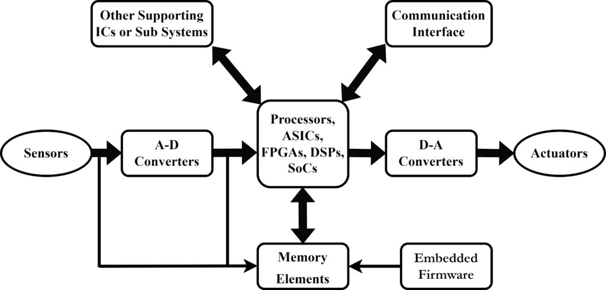

- **프로세서(Processor)**: 초소형 제어용 MCU(Microcontroller Unit) 또는 고성능 MPU(Microprocessor Unit)
- **메모리(Memory)**: 펌웨어 코드 저장용 Flash ROM 및 프로그램 실행용 SRAM/DRAM
- **전원 및 보조 회로**: PMIC(전원 관리 IC), RTC, 리셋 회로, 정밀 클록 오실레이터
- **주변장치(Peripherals)**: GPIO, UART, I2C, SPI, ADC, PWM, 하드웨어 타이머 등
- **센서 및 액추에이터**: 물리량을 계측하는 입력 장치와 물리적 동작을 유발하는 출력 기구
- **소프트웨어 계층**: 베어메탈(Bare-Metal) 펌웨어, 경량 RTOS 태스크, 또는 임베디드 OS 애플리케이션

---

## MCU와 MPU (Microcontroller vs Microprocessor)

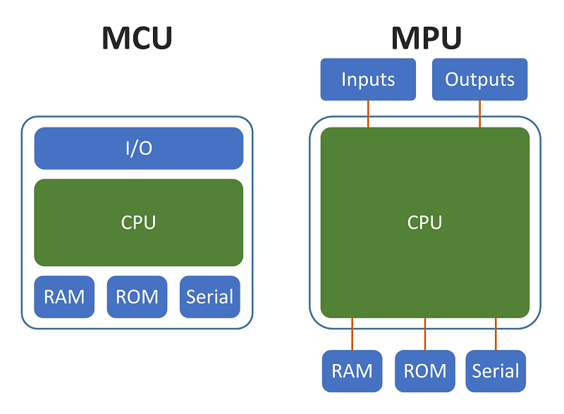

| 비교 항목 | MCU(Microcontroller) | MPU(Microprocessor) |
| :--- | :--- | :--- |
| **대표 제품군** | STM32, ESP32, RP2350 | Raspberry Pi(BCM2711), NXP i.MX, RK3588 |
| **주요 메모리** | 칩 내부 온칩 SRAM 내장(수십 KB ~ 수 MB) | 외부 고용량 DRAM 필수 실장(수백 MB ~ 수 GB) |
| **프로그램 저장** | 내장 Flash ROM(수십 KB ~ 수 MB) | 외부 플래시 메모리(SD 카드, eMMC, NVMe) |
| **운영체제(OS)** | 미탑재(베어메탈) 또는 초경량 RTOS 탑재 | Linux, Android 등 대형 범용 OS 탑재 |
| **부팅 소요 시간** | 수 밀리초(ms) 단위 즉시 구동 | 수 초(s) ~ 수십 초 부팅 절차 소요 |

> - **MCU**: 단일 칩 내부에 연산 코어·메모리·주변장치를 완결한 **원칩(One-Chip) 제어기**
> - **MPU**: 고용량 외부 메모리 및 주변 IC와 결합하여 고속 연산을 수행하는 **소형 컴퓨터**

---

## 임베디드 시스템의 응용 (Applications)

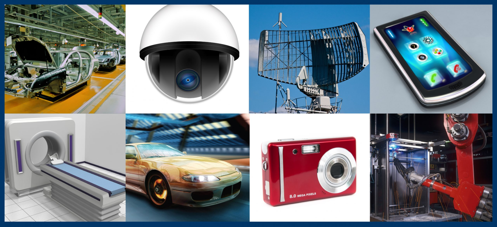

- **스마트 가전**: 세탁기, 냉장고, 에어컨, 스마트 인덕션, 로봇청소기
- **차량 전장**: ECU(파워트레인/섀시 제어), ADAS, 자율주행 모듈, 인포테인먼트(IVI)
- **의료 기기**: 휴대형 혈당측정기, 환자 감시 장치, 정밀 인퓨전 펌프
- **산업 자동화**: 스마트 팩토리 PLC, 산업용 다관절 로봇, 모터 드라이버
- **IoT·스마트홈**: 환경 모니터링 센서 노드, 스마트 도어록, 에너지 미터링 게이트웨이
- **항공·우주·국방**: 비행제어컴퓨터(FCC), 유도항법 시스템, 위성 탑재 데이터 처리기

### 최근 기술 동향

- **엣지 AI(Edge AI)**: 클라우드 의존 없이 단말 장치 자체에서 딥러닝 경량 추론 실시간 수행
- **임베디드 보안(Security)**: 무선 연결 확산에 대응하는 하드웨어 암호화 가속 및 보안 부팅(Secure Boot)
- **소프트웨어 공학 고도화**: 임베디드 펌웨어 복잡도 증가에 따른 **자동화 빌드·CI/CD 배포 파이프라인** 정착

---

## 소프트웨어 실행 환경의 세 가지 선택 (Three Execution Models)

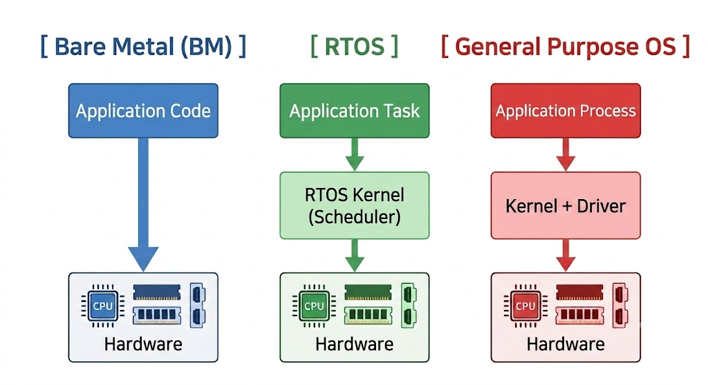

- **타이밍 결정론 vs 생산성**: 하드웨어 직접 제어 정밀도와 소프트웨어 개발 생산성 간의 상충 관계(Trade-off)
- **실시간 요구 수준**: 응답 마감 시간(Deadline)의 엄격성에 따라 베어메탈 또는 RTOS 우선 선정
- **기능적 복잡도**: 고속 네트워크 스택, 파일시스템, 멀티미디어, GUI 요구 시 범용 OS 채택
- **아키텍처 결정 기준**: 하드웨어 제약 조건과 소프트웨어 요구 기능을 종합 평가하여 최적 계층 결정

---

## 베어메탈 (BM, Bare Metal)

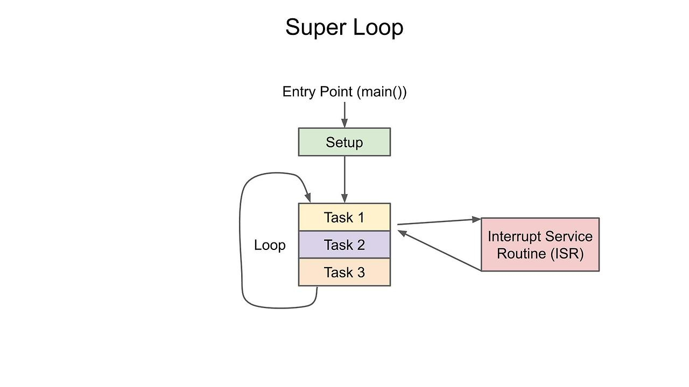

- **개념 정의**: **운영체제(OS) 없이 작성된 응용 코드가 하드웨어 레지스터를 직접 제어**하는 구조
- **자원 독점**: 부팅 완료 즉시 단일 제어 프로그램이 CPU, 메모리, 주변장치 전권을 직접 점유
- **구조적 특성**: 전체 시스템이 단일 실행 바이너리로 패키징되어 런타임 간접 계층(오버헤드) 전무

---

## 베어메탈 (BM, Bare Metal) (Cont'd - 1)

```c
int main() {
  hardware_init();          /* Clocks, GPIO, timers */
  while (1) {               /* Super loop */
    read_sensors();
    update_control();
    drive_outputs();
  }
}
```

- **슈퍼 루프(Super Loop) 구조**: 무한 루프 내에서 센서 입력 ➔ 제어 연산 ➔ 액추에이터 구동을 순차 실행
- **인터럽트 서비스 루틴(ISR)**: 긴급 하드웨어 이벤트만 즉시 처리하고, 복잡한 후속 처리는 메인 루프에 위임
- **공유 데이터 동기화**: ISR과 메인 루프가 공유하는 변수는 컴파일러 최적화 방지
  - `volatile` 지정 및 원자성(Atomicity) 확보 필수

---

## 베어메탈 (BM, Bare Metal) (Cont'd - 2)

### 장단점 비교 (Trade-Offs)

| 장점 | 단점 |
| :--- | :--- |
| OS 스케줄러 지연이 없어 응답 예측성(Determinism) 최고 | 기능 추가 시 슈퍼 루프 내 타이밍 설계 복잡도 급증 |
| 수 밀리초(ms) 단위의 즉각적인 초고속 부팅 가능 | 시분할 멀티태스킹 스케줄링을 자체 구현해야 함 |
| 수 KB 수준의 극소용량 메모리 환경에서도 안정 구동 | 통신 프로토콜, 파일시스템 등 표준 스택 직접 구현 필요 |
| 불필요한 배경 작업 배제로 소비 전력 최적화 용이 | 하드웨어 종속성이 높아 타 칩셋으로의 코드 이식성 낮음 |
| OS 라이선스 비용 및 커널 메모리 풋프린트 전무 | 통합 디버깅 및 런타임 추적 환경이 제한적 |

### 주요 적용 영역 (Use Cases)

- **단순·명확한 단일 기능**: 소형 브러시리스 모터 제어기, 단순 센서 송신기, 전원 제어 시퀀서 등
- **경성 실시간성(Hard Real-Time)**: 마이크로초 단위의 엄격한 타이밍 지연 허용 불가 시스템
- **초저가 양산 제품**: 극단적인 부품 원가(BOM) 절감 및 초소형 풋프린트가 요구되는 대량 양산 기기

---

## RTOS (Real-Time Operating System)

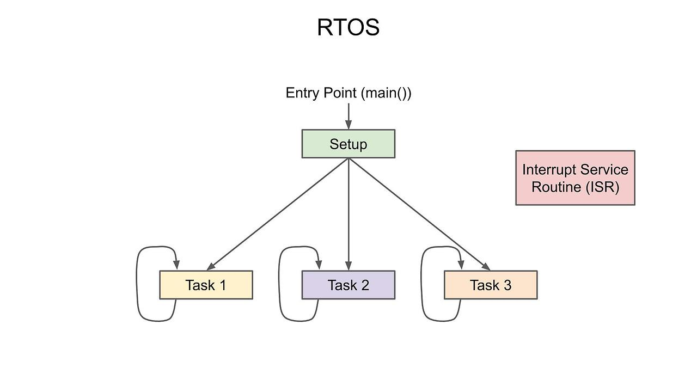

- **계층적 정의**: 베어메탈의 초경량성과 범용 OS의 멀티태스킹 편의성을 결합한 **실시간 운영체제**
- **태스크(Task) 모듈화**: 복잡한 제어 로직을 독립적인 우선순위를 지닌 태스크 단위로 분할하여 병렬성 구현
- **실시간 스케줄러**: 결정론적(Deterministic) 스케줄러가 우선순위에 따라 지연 없이 문맥 교환(Context Switching) 수행

---

## RTOS (Real-Time Operating System) (Cont'd - 1)

```c
#include "projdefs.h"  /* Project definitions, for pdMS_TO_TICKS */

/* Concept: Two tasks run independently at different periods. */
void SensorTask(void* arg) {
  for (;;) {
    ReadSensor();
    vTaskDelay(pdMS_TO_TICKS(100));  /* Every 100 ms */
  }
}

void NetworkTask(void* arg) {
  for (;;) {
    SendPacket();
    vTaskDelay(pdMS_TO_TICKS(1000));  /* Every 1 s */
  }
}
```

- **가상 동시성 관리**: 커널 API(예: `xTaskCreate`)로 태스크를 등록하면 커널이 개별 스택을 할당하여 독립 실행
- **선점형 우선순위 스케줄링(Preemptive Scheduling)**: 고우선순위 태스크 발생 시 실행 중인 태스크 즉시 중단 후 CPU 선점
- **커널 동기화 객체 제공**: 태스크 간 데이터 교환 및 공유 자원 보호용 큐(Queue), 세마포어(Semaphore), 뮤텍스(Mutex) 내장
- **경량 풋프린트**: 수십 KB 수준의 최소 메모리 점유로 자원이 한정된 32비트 MCU 환경에 최적화

---

## RTOS (Real-Time Operating System) (Cont'd - 2)

### 태스크 스케줄링 메커니즘 (Task Scheduling)

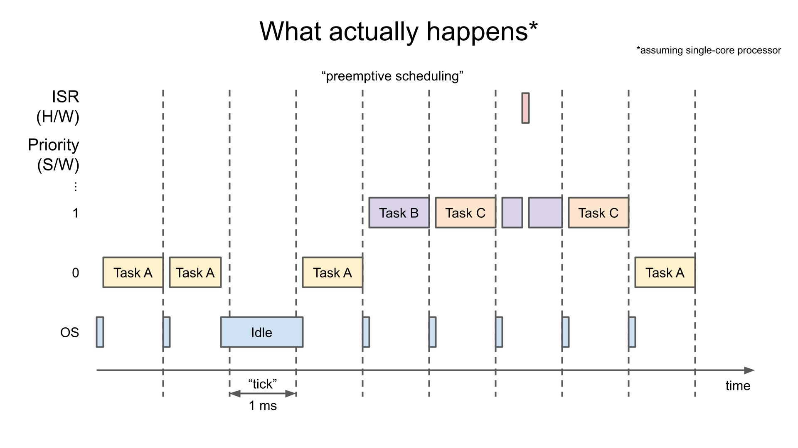

---

## 범용 OS (General-Purpose OS)

- **완전한 운영체제**: Linux, Android 등 대형 커널 기반으로 프로세스 간 메모리 보호 및 복잡한 서브시스템 전반 제공
- **표준 소프트웨어 스택**: 선점형 시분할 스케줄러, 가상 메모리 관리, VFS 기반 파일시스템, TCP/IP 네트워크 스택 완비
- **풍부한 생태계 재사용**: 웹 서버, 데이터베이스, OpenCV, 머신러닝 라이브러리 등 기존 오픈소스 소프트웨어 자산 즉각 활용
- **고도의 개발 생산성**: 표준 POSIX API, GDB 디버거, Valgrind, 프로파일러 등 검증된 데스크톱급 엔지니어링 도구 활용 가능
- **하드웨어 요구조건**: 가상 메모리 매핑을 위한 하드웨어 MMU(Memory Management Unit) 및 대용량 DRAM 필수
- **실시간성 한계**: 비선점형 커널 구간 및 페이지 폴트 등으로 인해 응답 지연 시간(Latency)이 비결정적일 수 있음

> 고화질 영상 처리, 복잡한 원격 통신, 분산 웹 서비스 연동 장치에 최적의 실행 환경 제공

---

## 세 계층 비교 (Comparison)

| 비교 항목 | 베어메탈 | RTOS | 범용 OS(GPOS) |
| :--- | :--- | :--- | :--- |
| **메모리 요구량** | 초소형(수 KB ~ 수십 KB) | 소형(수십 KB ~ 수백 KB) | 대형(수백 MB ~ 수 GB) |
| **부팅 소요 시간** | 즉시 구동(수 ms) | 수십 밀리초(ms) 내외 | 수 초(s) ~ 수십 초 |
| **타이밍 결정론** | 최고 수준(완전 결정적) | 높음(실시간 마감 보장) | 낮음(통계적 처리, 가변적) |
| **멀티태스킹 방식** | 상태 기계 기반 수동 분기 | 선점형 우선순위 스케줄링 | 가상 메모리 기반 시분할 |
| **네트워크·FS** | 라이브러리 직접 포팅 | 경량 서드파티 스택 연동 | 커널 서브시스템 표준 내장 |
| **개발 및 디버깅** | 난이도 높음(HW 밀착) | 중간(동기화 이슈 관리) | 용이함(풍부한 진단 도구) |
| **대표 하드웨어** | RP2350, STM32F1/F4 | ESP32, STM32H7 | Raspberry Pi, NVIDIA Jetson |

---

## 저전력 플랫폼 (Low-Power Platforms)

- **설계 핵심 목표**: 단일 배터리로 수개월에서 수년간 유지보수 없이 동작하는 자립형 시스템 구축
- **평균 소비 전류 최소화**: 활성 동작 시간을 마이크로초 단위로 단축하고 전체 수명의 대부분을 슬립 모드로 유지

### 전력 동작 모드 (Power Modes)

| 동작 모드 | 시스템 내부 상태 | 상대적 전력 소모 |
| :--- | :--- | :---: |
| **Active(동작)** | CPU 코어 클록 인가 및 연산 로직 정상 구동 | 가장 큼 |
| **Sleep(슬립)** | CPU 코어 정지, 필수 주변장치(타이머, 인터럽트 감지) 활성 유지 | 중간 |
| **Deep Sleep(딥슬립)** | 내부 로직 대부분 전원 차단, RTC 타이머나 외부 웨이크업 핀으로 기상 | 매우 작음 |

$$\text{Battery life (h)} \approx \frac{\text{Battery capacity (mAh)}}{\text{Average current (mA)}}$$

---

## 저전력 플랫폼 (Low-Power Platforms) (Cont'd)

### 전류 프로파일 분석 (Current Consumption vs Time)

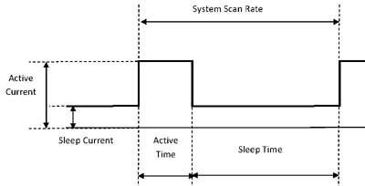

---

## 저전력 설계의 원칙 (Low-Power Design)

- **신속 처리 후 즉시 슬립(Race-to-Sleep 원칙)**: 최고 클록으로 연산을 빠르게 완료하고 즉시 딥슬립 모드로 전환
- **총 에너지 실측 검증**: 연산 최적화(예: SIMD 병렬화) 적용 후 단위 동작당 배터리 소비량이 감소했는지 오실로스코프로 실측
- **이벤트 기반 구동(Event-Driven)**: CPU 폴링(Polling) 대기를 배제하고 하드웨어 인터럽트(Interrupt) 기반 기상 구조 확립
- **무선 통신 트래픽 최소화**: 고전력 소모 구간인 RF 송수신의 주기적 발생 억제 및 페이로드 데이터 경량화
- **클록 게이팅(Clock Gating)**: 미사용 주변장치 블록(UART, SPI, ADC 등)의 클록 공급을 펌웨어에서 능동적 차단

### 운영체제별 저전력 특성

- **범용 OS(Linux)**: 상주 백그라운드 프로세스로 인해 수 밀리와트 이하의 극저전력 딥슬립 진입에 구조적 한계 존재
- **배터리 센서 노드**: 정밀한 슬립 모드 제어가 가능한 **MCU + 베어메탈/RTOS** 조합 채택 필수

---

## 플랫폼 지도 (Platform Map)

| 분류 계층 | 대표 하드웨어 플랫폼 | 권장 실행 환경 |
| :--- | :--- | :--- |
| **교육용 MCU** | Raspberry Pi Pico 2(RP2350) | 베어메탈 / RTOS |
| **산업·범용 MCU** | STMicroelectronics STM32 | 베어메탈 / RTOS |
| **무선 특화 MCU** | Espressif ESP32 | RTOS(ESP-IDF) |
| **산업용 MPU** | NXP i.MX 시리즈 | Embedded Linux |
| **고성능 SBC SoC** | Rockchip RK3588 | Embedded Linux / Android |
| **엣지 AI 모듈** | NVIDIA Jetson | Embedded Linux(JetPack) |
| **고성능 모바일 AP** | Qualcomm Snapdragon | Linux / Android |
| **교육·프로토타이핑** | Raspberry Pi | Raspberry Pi OS(Linux) |

---

## STMicroelectronics STM32

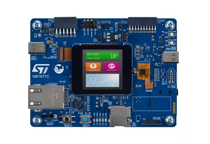

- **산업 표준 플랫폼**: ARM **Cortex-M** 코어를 집적한 32비트 MCU 제품군 — 글로벌 산업 제어 분야의 사실상 표준

| 항목 | 상세 규격 및 기술적 특징 |
| :--- | :--- |
| **하드웨어 구성** | Cortex-M0+ ~ M7/M33 코어 + 정밀 아날로그/산업용 주변장치 내장 |
| **소프트웨어 환경** | 베어메탈(HAL/LL 드라이버), FreeRTOS, Zephyr RTOS 지원 |
| **핵심 경쟁력** | 핀 맵 호환성을 유지하며 성능과 메모리 확장이 용이한 방대한 제품 포트폴리오 |
| **주요 적용 분야** | 공장 자동화, 모터 정밀 제어(FOC), 스마트 가전, 의료 진단 기기 |

- **개발 생산성**: STM32CubeMX 그래픽 툴을 통해 핀 설정 및 클록 트리 구성, 초기화 C 코드 자동 생성

---

## Espressif ESP32

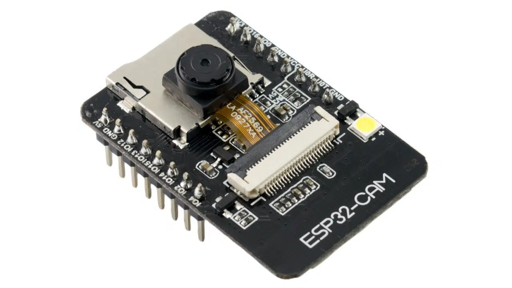

- **무선 통신 특화**: **Wi-Fi(2.4GHz) 및 Bluetooth(BLE) 서브시스템을 내장**한 IoT 표준 연결성 MCU 플랫폼

| 항목 | 상세 규격 및 기술적 특징 |
| :--- | :--- |
| **하드웨어 구성** | Xtensa 듀얼코어 또는 RISC-V 코어 + 통합 2.4GHz 무선 RF 블록 |
| **소프트웨어 환경** | FreeRTOS 기반 공식 프레임워크(ESP-IDF) 표준 제공 |
| **핵심 경쟁력** | 외장 무선 모듈 제거를 통한 기판 실장 면적 및 BOM 단가 대폭 절감, 딥슬립 지원 |
| **주요 적용 분야** | 스마트홈 연결 기기, 무선 환경 센서 노드, IoT 프로토타이핑 |

- **전원 회로 고려사항**: 무선 패킷 송신(TX Burst) 시 순간적인 대전류(수백 mA)가 발생하므로 충분한 전원 디커플링 회로 필수

---

## Raspberry Pi Pico 2 (RP2350)

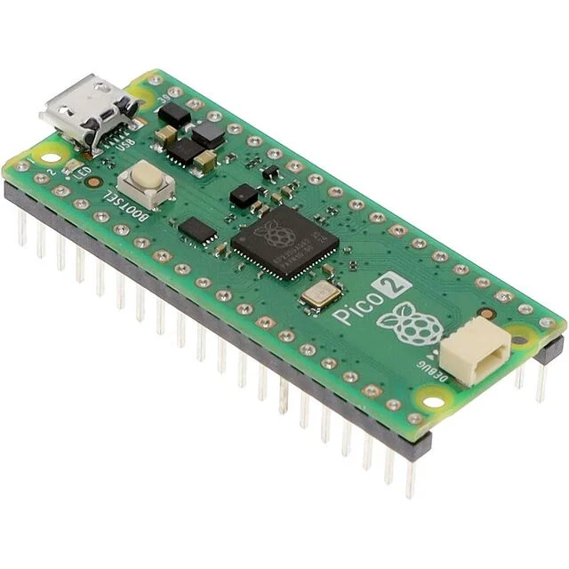

- **독자 설계 실리콘**: 라즈베리파이 재단이 설계한 고성능·초저가 **듀얼 아키텍처 MCU 보드** (Linux 미탑재)

| 항목 | 상세 규격 및 기술적 특징 |
| :--- | :--- |
| **하드웨어 구성** | Cortex-M33 또는 RISC-V(Hazard3) 코어 선택 부팅 + [PIO(Programmable I/O)](https://tutoduino.fr/en/pio-rp2040-en/) |
| **소프트웨어 환경** | 베어메탈(C/C++ SDK), FreeRTOS, MicroPython |
| **핵심 경쟁력** | 독창적인 PIO 상태 기계를 활용하여 CPU 부하 없이 정밀 타이밍 제어 및 커스텀 프로토콜 생성 |
| **주요 적용 분야** | 임베디드 실습 교육, 커스텀 통신 인터페이스 에뮬레이션, 실시간 고속 신호 수집 |

- **유연한 아키텍처**: 부팅 단계에서 표준 Arm 코어와 오픈소스 RISC-V 코어 중 실행 모드를 선택할 수 있는 독자적 구조

---

## NVIDIA Jetson

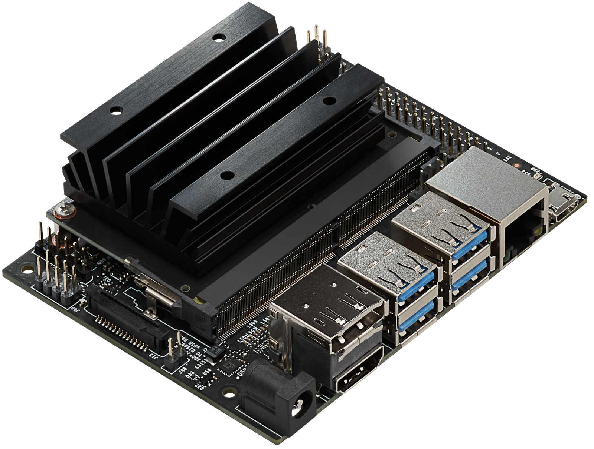

- **임베디드 인공지능 모듈**: 전용 GPU 및 신경망 가속기를 내장하여 **단말 장치에서 실시간 고속 AI 추론** 수행

| 항목 | 상세 규격 및 기술적 특징 |
| :--- | :--- |
| **하드웨어 구성** | Arm Cortex-A CPU + NVIDIA CUDA 아키텍처 GPU + 전용 딥러닝 가속기(DLA) |
| **소프트웨어 환경** | Ubuntu Linux 기반 JetPack SDK(CUDA, cuDNN, TensorRT 가속 라이브러리 완비) |
| **핵심 경쟁력** | 서버/데스크톱에서 학습된 CUDA AI 모델을 코드 변경 없이 엣지 환경에 직접 최적화 배포 |
| **주요 적용 분야** | 자율주행 모바일 로봇(AMR), 산업용 자동 외관 검사, 드론 비전 제어 |

- **스케일업 지원**: 소형 저전력 Orin Nano부터 최고 사양 AGX Orin까지 일관된 소프트웨어 스택으로 단계별 확장 가능

---

## Qualcomm

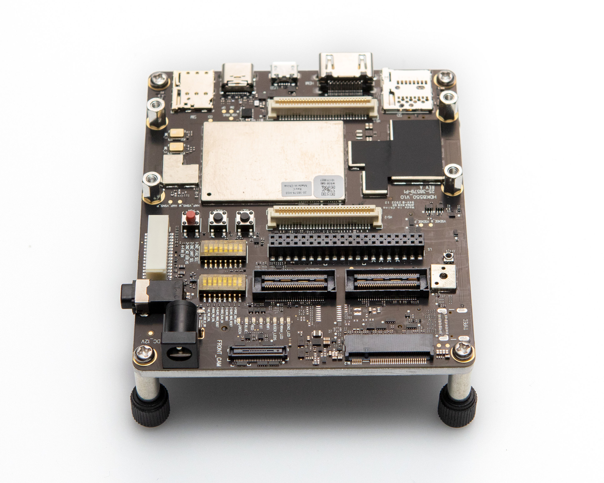

- **고성능 이종(Heterogeneous) 프로세서**: 모바일 AP 아키텍처를 로보틱스 및 스마트 산업 기기로 확장한 고집적 플랫폼

| 항목 | 상세 규격 및 기술적 특징 |
| :--- | :--- |
| **하드웨어 구성** | 고성능 Cortex-A CPU + Adreno GPU + Hexagon DSP + 독립 NPU 신경망 가속 엔진 |
| **소프트웨어 환경** | Embedded Linux, Android, QNX(차량용 전장 OS) |
| **핵심 경쟁력** | 작업 특성에 따른 최적 연산 유닛 분배, 업계 최고 수준의 카메라 ISP 및 5G/Wi-Fi 연결성 |
| **주요 적용 분야** | 고성능 자율주행 서비스 로봇, 지능형 콕핏, 공간 컴퓨팅(XR), 스마트 드론 |

- **제품 포트폴리오**: 모바일 플래그십 기술에 기반한 Snapdragon 로보틱스 및 IoT 전용 파생 라인업 전개

---

## 특화 SoC 사례: Ambarella

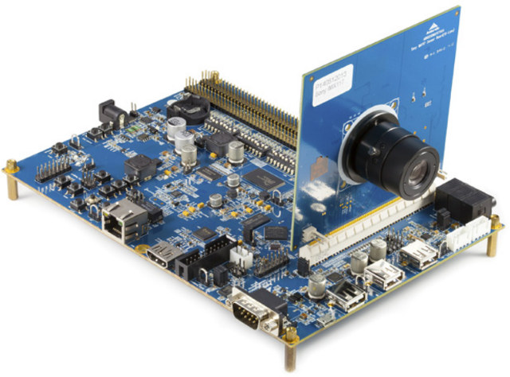

- **도메인 특화 아키텍처(DSA)**: 범용 프로세서 대비 영상 처리 및 비전 분석 영역에 극단적으로 최적화된 하드웨어 설계

| 항목 | 상세 규격 및 기술적 특징 |
| :--- | :--- |
| **하드웨어 구성** | Arm Cortex-A CPU + 전용 초고해상도 비디오 인코더 + CVflow AI 비전 엔진 |
| **소프트웨어 환경** | 최적화된 임베디드 Linux OS 및 전용 영상 처리 툴킷 |
| **핵심 경쟁력** | 초고해상도(4K/8K) 다채널 영상 실시간 압축과 저전력 온디바이스 AI 객체 인식을 동시에 수행 |
| **주요 적용 분야** | 보안 감시용 IP CCTV, 차량용 블랙박스/ADAS 카메라, 산업용 비전 검사기 |

- **상용화 강점**: 저전력·고화질 비디오 인코딩 기술력을 바탕으로 글로벌 보안 카메라 시장 점유율 선도

---

## 임베디드 Linux SoC (NXP i.MX / Rockchip RK3588)

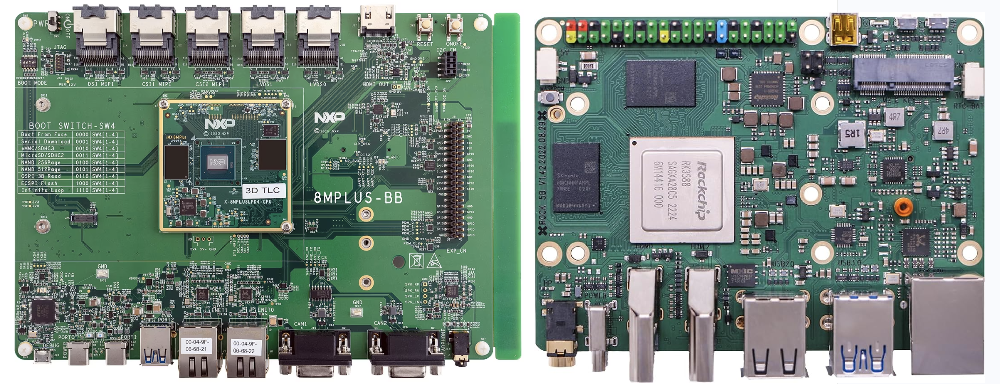

- **공통 아키텍처**: 라즈베리파이와 동일하게 **Linux 운영체제 기반 위에 하드웨어 버스/GPIO 직접 제어** 구조 제공

| 비교 항목 | NXP i.MX 시리즈 | Rockchip RK3588 |
| :--- | :--- | :--- |
| **프로세서** | Cortex-A53/A55 + 실시간 제어 코어(Cortex-M) | 옥타코어(Cortex-A76/A55) + 6 TOPS NPU |
| **지원 OS** | Linux(Yocto Project, Buildroot 표준 지원) | Embedded Linux, Android OS 지원 |
| **핵심 경쟁력** | 10~15년 장기 공급 보증(LTS), CAN-FD·TSN 내장 | 8K 영상 HW 코덱, 다중 카메라 입력 지원 |
| **적용 분야** | 산업 자동화 제어반, 의료 장비, 차량용 제어 모듈 | 고성능 SBC, 키오스크, 엣지 AI 게이트웨이 |

- **산업용 선정 기준**: 산업용 양산 프로젝트에서는 최고 연산 속도보다 **장기 공급 보증(LTS) 및 가혹 환경 동작 신뢰성**이 우선

---

## Raspberry Pi

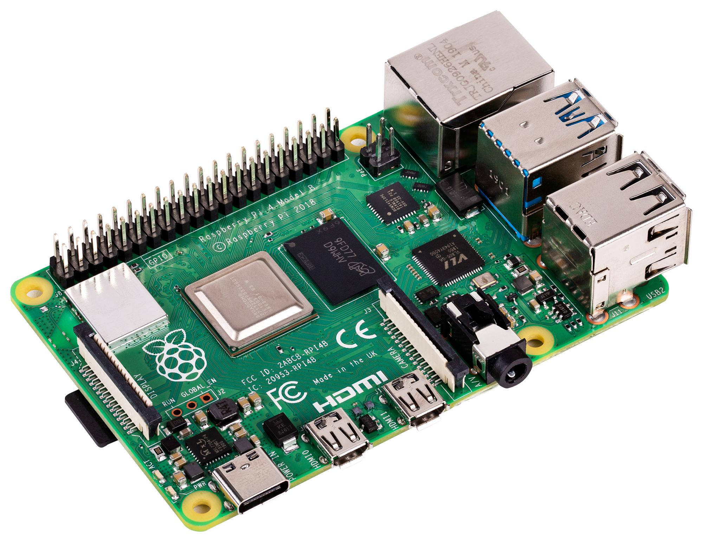

- **단일 보드 컴퓨터(SBC)**: 교육, 연구 및 개념 증명(PoC)을 위해 전 세계적으로 표준화된 대표 SBC — 본 강의 실습 플랫폼

| 항목 | 상세 규격 및 기술적 특징 |
| :--- | :--- |
| **하드웨어 구성** | Broadcom BCM2711(Cortex-A72 쿼드코어) + VideoCore VI 3D GPU |
| **소프트웨어 환경** | Debian 기반 공식 64비트 Raspberry Pi OS(Linux) 탑재 |
| **핵심 경쟁력** | 풍부한 Linux 개발 생태계와 표준 40핀 하드웨어 GPIO를 직관적으로 결합 제어 가능 |
| **주요 적용 분야** | 임베디드 소프트웨어 교육, 개념 검증(PoC), 시제품(Prototype) 제작 및 스마트 허브 |

- **학습적 가치**: 리눅스 기반 고급 소프트웨어 엔지니어링(MPU 특성)과 하드웨어 핀 직접 제어(MCU 특성)를 유기적 동시 습득

---

## 플랫폼 선택 기준 (How to Choose)

1. **엄격한 실시간성(Hard Real-Time)** 마감 시간 보장이 최우선인가? ➔ **MCU + 베어메탈/RTOS**
2. **초저전력 배터리 기반 수년 장기 구동**이 필요한가? ➔ **초저전력 특화 MCU(STM32 L/U 시리즈 등)**
3. **네트워크 프로토콜, 파일시스템, 웹 서비스 연동**이 핵심인가? ➔ **Linux 기반 MPU**
4. **고화질 다채널 비전 처리 및 엣지 AI 추론**이 필요한가? ➔ **전용 가속 SoC/모듈(Ambarella, Jetson, NPU 탑재 SoC)**
5. **양산 수량 및 제품 원가(BOM)** 제약이 엄격한가? ➔ **대량 양산 시 단일 목적 특화 SoC 채택이 경제적으로 유리**

> 시스템의 기능적 요구사항(통신, UI)과 비기능적 제약(실시간성, 전력 소모, 제조 원가)이 최적의 실행 플랫폼을 결정
