<!-- _class: lead -->

# 마이크로임베디드프로그래밍

## 라즈베리파이 플랫폼

### [munseong.jeong@daejin.ac.kr](mailto:munseong.jeong@daejin.ac.kr)

---

## 라즈베리파이란 (What Is Raspberry Pi)

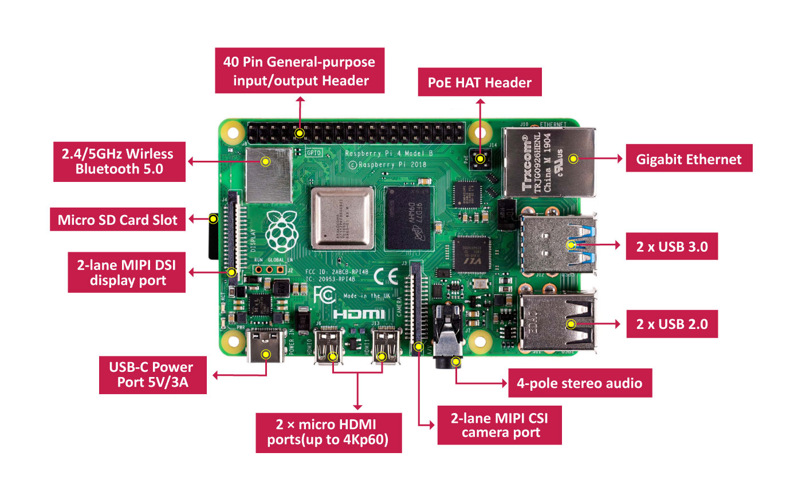

- **정의**: 영국 라즈베리파이 재단이 교육용으로 개발한 **싱글 보드 컴퓨터**(SBC)
- **구성**: 신용카드 크기의 기판 하나에 CPU, 메모리, 입출력 포트를 모두 실장
- **활용**: 낮은 가격과 공개된 자료·소프트웨어 덕분에 교육과 시제품 제작에 널리 사용

---

## 라즈베리파이란 (What Is Raspberry Pi) (Cont'd)

### 싱글 보드 컴퓨터 (SBC, Single Board Computer)

- **정의**: 컴퓨터 동작에 필요한 부품을 기판 한 장에 모두 갖춘 컴퓨터
  - 예: 데스크톱 PC는 메인보드에 메모리·그래픽 카드를 따로 꽂지만, SBC는 기판에 이미 실장
- **범용 OS 구동**: 일반 PC처럼 Linux를 설치해 여러 프로그램을 동시에 실행
- **하드웨어 제어**: **GPIO 헤더**를 통해 MCU처럼 센서·액추에이터를 직접 제어
- **MCU와의 차이**: MCU는 운영체제 없이 펌웨어 하나를 실행하고, SBC는 OS 위에서 여러 프로세스를 실행
  - 예: Raspberry Pi Pico(RP2040, MCU)와 Raspberry Pi 4(BCM2711, SBC)

---

## SoC와 프로세서 (SoC and Processor)

- **SoC**(System on Chip): CPU, GPU, 메모리 컨트롤러, 주변장치 컨트롤러를 칩 하나에 집적한 반도체
  - 예: Raspberry Pi 4는 Broadcom **BCM2711** SoC 사용
- **CPU 코어**: **ARM Cortex-A72** 4개(쿼드코어)
  - 최대 클록 1.5GHz, `config.txt`에 `arm_boost=1`이 설정된 보드는 1.8GHz
- **ISA**(Instruction Set Architecture): CPU가 실행할 수 있는 명령어와 레지스터를 정의한 규격
  - 예: Cortex-A72는 **ARMv8-A** ISA를 구현하므로 `add w0, w1, w0` 같은 ARMv8-A 명령을 실행
- **AArch64**: ARMv8-A의 64비트 실행 상태
  - Raspberry Pi OS 64-bit는 AArch64 상태로 동작하며 `uname -m` 출력은 `aarch64`

---

## SoC와 프로세서 (SoC and Processor) (Cont'd)

### 프로세서 계층 구조 (Processor Hierarchy)

| 계층 | Raspberry Pi 4 | 역할 |
| :--- | :--- | :--- |
| **SoC** | BCM2711 | CPU, GPU, 주변장치 컨트롤러를 한 칩에 통합 |
| **CPU** | Cortex-A72 × 4 | 명령어를 가져와 실행 |
| **ISA** | ARMv8-A(AArch64) | CPU가 실행하는 명령어·레지스터 규격 |
| **ABI** | AArch64 Linux(LP64) | 컴파일된 프로그램 사이의 이진 수준 규약 |

- **ABI**(Application Binary Interface): 컴파일된 코드끼리 지켜야 하는 이진 수준의 규약
  - 전달인자를 넘기는 레지스터: AArch64 Linux는 첫 번째 정수 전달인자를 `x0`(`w0`)로 전달
  - 타입 크기: LP64 모델이므로 `long`과 포인터가 8바이트(AArch64 Clang에서 `sizeof(long)`은 8)
  - 시스템 콜 방법: AArch64 Linux는 `x8`에 시스템 콜 번호를 넣고 `svc #0` 명령 실행
- **ABI가 다르면**: 32비트 `armhf` 라이브러리를 64비트 `arm64` 프로그램에 링크할 수 없음

---

## Raspberry Pi 4의 메모리 (Memory)

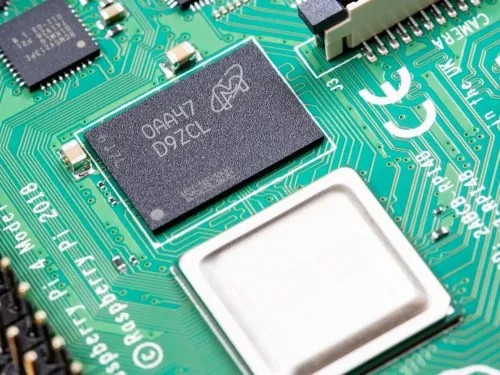

- **주기억장치**: SoC 옆에 실장된 **LPDDR4 SDRAM** 칩 사용
- **LPDDR4**(Low-Power DDR4): 모바일·임베디드 기기용 저전력 DRAM 규격
- **용량**: 1GB, 2GB, 4GB, 8GB 모델이 있으며 기판에 납땜되어 있어 증설 불가
- **휘발성**: 전원이 꺼지면 커널과 실행 중인 프로그램의 데이터가 모두 지워짐
- **용량의 영향**: 여러 프로그램을 동시에 실행하거나 큰 C++ 프로젝트를 컴파일할 때 용량이 클수록 유리
- **저장장치와 구분**: OS와 파일은 microSD 카드나 USB 저장장치에 저장

---

## microSD 카드 슬롯 (microSD Card)


- **기본 저장장치**: OS 이미지(부트 파티션, 루트 파일시스템)와 사용자 데이터를 저장
- **부트 파티션**(FAT32): GPU 펌웨어(`start4.elf`), 설정 파일 `config.txt`, 커널(`kernel8.img`) 저장
- **루트 파티션**(ext4): `/bin`, `/etc`, `/home` 등 Linux 파일시스템 전체 저장
- **부트로더 위치**: Raspberry Pi 4의 부트로더는 SD 카드가 아닌 보드의 EEPROM에 저장
- **카드 선택**: 쓰기 수명이 긴 고내구성(High Endurance) 카드 권장
- **전원 차단 주의**: 언마운트하지 않고 전원을 끊으면 파일시스템이 손상될 수 있음

---

## microSD 카드 슬롯 (microSD Card) (Cont'd)

- **이미지 기록 주의**: 기록 대상(Storage)을 잘못 고르면 PC의 다른 디스크 데이터가 지워짐
- **쓰기가 잦은 경우**: USB SSD로 부팅하거나 로그를 `tmpfs`에 기록
- **`tmpfs`**: RAM을 저장 공간으로 쓰는 파일시스템이며, 재부팅하면 내용이 지워짐
  - 예: `/tmp`를 `tmpfs`로 마운트하면 임시 파일 쓰기가 SD 카드에 기록되지 않음

---

## GPIO 헤더 (General-Purpose Input/Output)

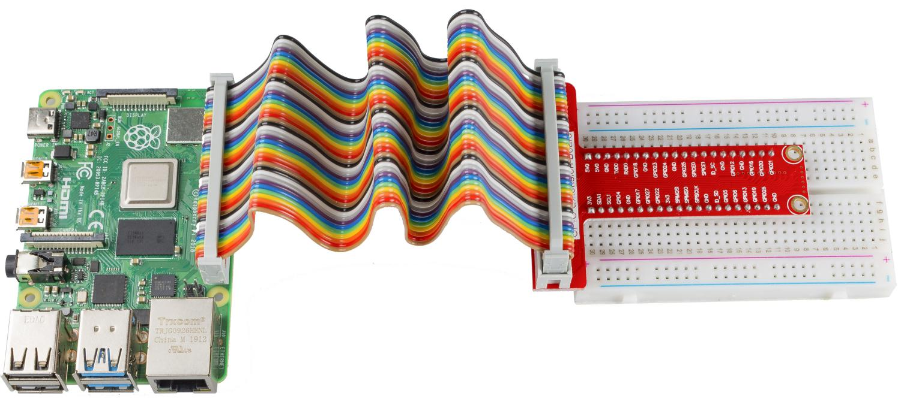

- **GPIO**: 소프트웨어로 HIGH(3.3V)·LOW(0V)를 출력하거나 읽는 범용 디지털 입출력 핀
  - 예: GPIO17에 1을 쓰면 GPIO17에 연결된 LED가 켜짐
- **물리 규격**: **40핀 헤더**(2.54mm 간격), 전원(5V, 3.3V), 접지(GND), GPIO 신호 핀으로 구성
- **로직 전압**: **3.3V** 기준이며, 5V 신호를 직접 연결하면 SoC가 손상됨
- **대체 기능**: 일부 핀은 I2C, SPI, UART, PWM 신호선으로 전환해 사용(뒤의 슬라이드 참조)

> **주의**: GPIO 핀은 신호용이며, 모터·릴레이처럼 전류가 큰 부하는 드라이버 회로와 별도 전원으로 구동

---

## PoE 헤더 (Power over Ethernet Header)

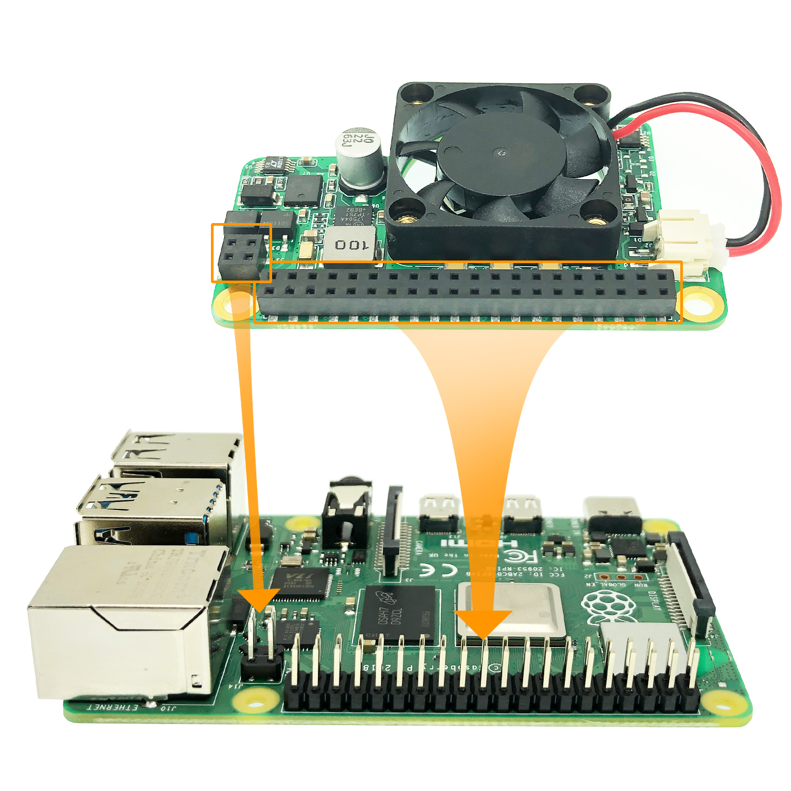

- **PoE**: 이더넷 케이블 하나로 데이터와 직류 전원을 함께 공급하는 기술(IEEE 802.3af)
- **PoE 헤더**: 이더넷 잭 옆의 4핀 헤더이며, 일반 GPIO가 아닌 **PoE HAT** 연결 전용
- **HAT**(Hardware Attached on Top): 40핀 헤더 위에 장착하는 라즈베리파이 규격 확장 보드
- **전력 변환**: PoE HAT가 PoE 스위치·인젝터에서 받은 전원을 보드용 5V로 변환
- **HAT가 없으면**: 보드 단독으로는 이더넷 케이블에서 전원을 받을 수 없음
- **활용 예**: IP 카메라, 천장 매립 센서처럼 전원 콘센트를 설치하기 어려운 장소

---

## 기가비트 이더넷 (Gigabit Ethernet)

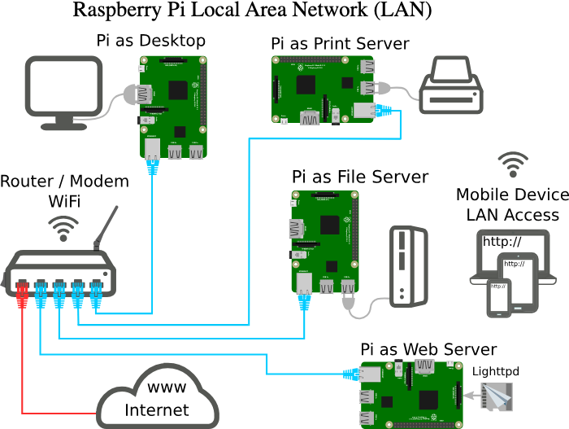

- **규격**: RJ45 포트, **IEEE 802.3ab 1000BASE-T**(기가비트 이더넷)
- **링크 속도**: Cat5e 이상 케이블로 기가비트 스위치에 연결하면 1Gbps로 협상
- **실제 전송 속도**: 프로토콜 오버헤드, 저장장치 속도, CPU 부하 때문에 1Gbps보다 낮음
- **용도**: 무선 간섭이 없어 SSH 원격 개발과 대용량 파일 전송에 적합

```bash
# Inspect Ethernet interface speed and physical link status
ip link show eth0
ethtool eth0 | grep -E 'Speed|Duplex|Link detected'
```

- **기가비트 링크 연결 시**: `Speed: 1000Mb/s`, `Link detected: yes` 출력
- **상대 장비가 100Mbps만 지원하면**: `Speed: 100Mb/s` 출력

---

## USB 인터페이스 (Universal Serial Bus)

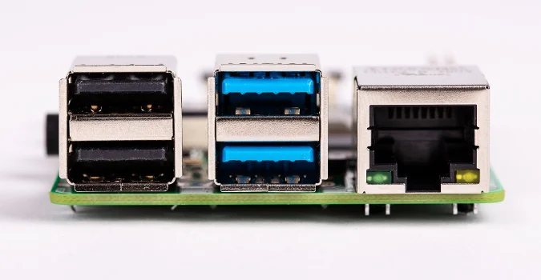

- **포트 구성**: **USB 3.0 포트 2개**(파란색), **USB 2.0 포트 2개**(검은색)
- **최대 속도**: USB 3.0은 5Gbps(SuperSpeed), USB 2.0은 480Mbps(High-Speed)
- **컨트롤러**: 4개 포트 모두 PCIe로 연결된 VL805 USB 컨트롤러에 연결
- **연결 장치 예**: 키보드, 마우스, 외장 SSD, USB 웹캠, 무선 동글

```bash
# List connected USB devices and show the USB bus topology as a tree
lsusb
lsusb -t
```

- **전류 한계**: 4개 포트 합계 최대 1.2A이므로 외장 HDD처럼 전류가 큰 장치는 유전원 허브에 연결
- **무선 간섭**: USB 3.0 신호 잡음이 2.4GHz Wi-Fi를 방해할 수 있으므로 무선 수신기는 USB 2.0 포트에 연결

---

## 4극 스테레오 오디오 (4-pole Stereo Audio)

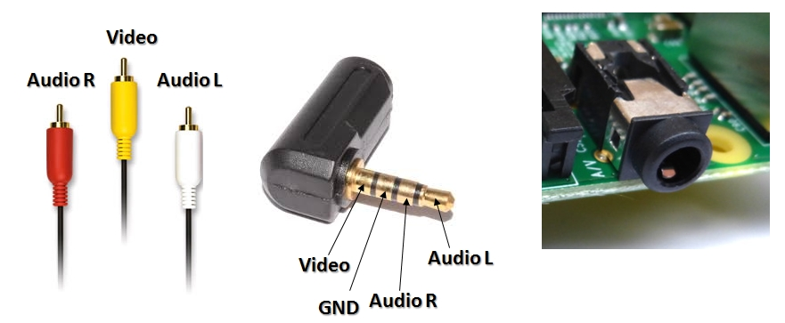

- **단자 규격**: 3.5mm **TRRS**(Tip-Ring-Ring-Sleeve) 4극 잭
- **신호**: 스테레오 아날로그 오디오와 **컴포지트 비디오**(CVBS)를 한 단자로 출력
- **CVBS**(Composite Video, Blanking and Sync): 밝기·색·동기 신호를 선 하나에 합친 아날로그 영상 신호
  - 예: 구형 TV의 노란색 RCA 영상 입력 단자
- **케이블**: 일반 3극 이어폰은 오디오만 연결되며, 영상 출력에는 4극 A/V 케이블 필요

| 접점 | 신호 | 역할 |
| :--- | :--- | :--- |
| **Tip** | Audio L | 왼쪽 아날로그 오디오 |
| **Ring 1** | Audio R | 오른쪽 아날로그 오디오 |
| **Ring 2** | GND / Video | 접지 또는 CVBS 영상 |
| **Sleeve** | Video / GND | CVBS 영상 또는 접지 |

---

## 4극 스테레오 오디오 (4-pole Stereo Audio) (Cont'd)

- **케이블 호환**: A/V 케이블마다 Ring 2와 Sleeve의 배치가 다르므로 영상 사용 전 배치 확인
- **컴포지트 출력 기본값**: 꺼져 있음
  - `config.txt`에 `enable_tvout=1`을 설정하면 컴포지트 출력이 켜지는 대신 HDMI 출력이 꺼짐
- **HDMI 오디오**: 3.5mm 잭과 별개의 사운드 장치로 나타나므로 출력 장치를 선택해 사용

---

## MIPI 카메라·디스플레이 인터페이스 (MIPI CSI and DSI)

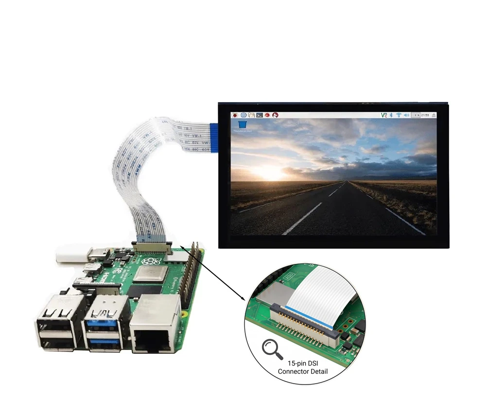

- **MIPI**(Mobile Industry Processor Interface): 모바일 기기의 카메라·디스플레이 연결용 고속 직렬 인터페이스 규격
- **커넥터**: 15핀 FFC(Flexible Flat Cable) 커넥터이며, 리본 케이블의 접점 면 방향을 맞춰 연결

| 인터페이스 | 신호 방향 | 연결 장치 |
| :--- | :--- | :--- |
| **CSI**(Camera Serial Interface) | 카메라 → SoC | Raspberry Pi Camera Module |
| **DSI**(Display Serial Interface) | SoC → 패널 | Raspberry Pi Touch Display |

- **ISP**(Image Signal Processor): 카메라 센서의 원시 데이터를 일반 영상으로 변환하는 SoC 내부 하드웨어
- **USB 카메라와 차이**: CSI 카메라 영상은 SoC의 ISP가 처리하므로 CPU 부하가 적음

---

## micro-HDMI 출력 (Micro High-Definition Multimedia Interface)

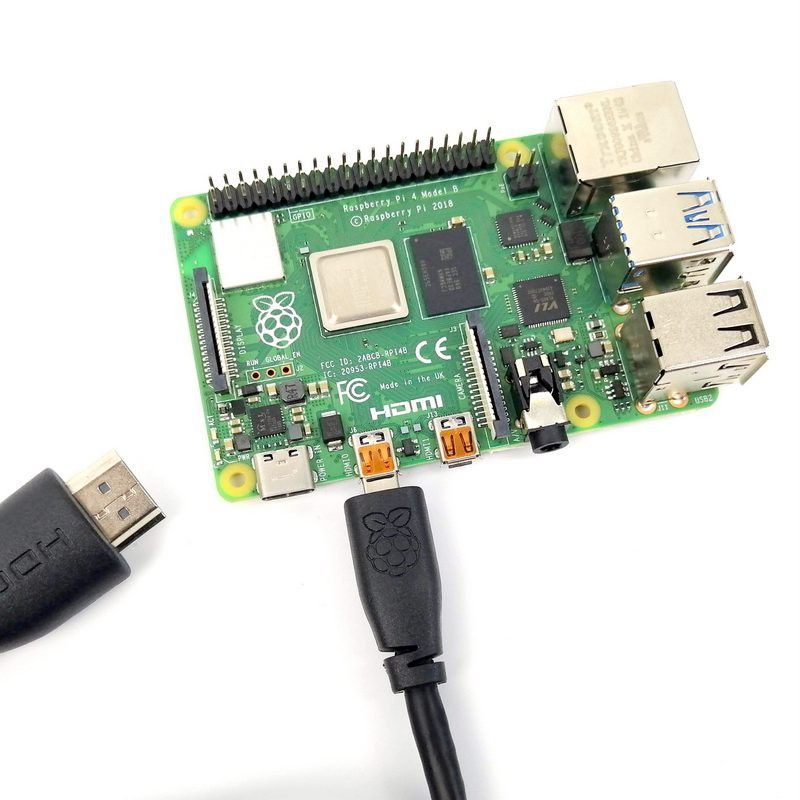

- **HDMI**: 압축하지 않은 디지털 영상과 다채널 오디오를 케이블 하나로 전송하는 규격
- **포트 구성**: **micro-HDMI(Type-D) 포트 2개**, 모니터 2대에 서로 다른 화면 출력 가능
- **해상도**: 모니터 1대는 최대 4K 60Hz, 2대 동시 사용 시 각각 최대 4K 30Hz
- **케이블**: 커넥터 크기만 다르므로 micro-HDMI to HDMI 케이블이나 변환 어댑터 사용

> 4K 60Hz 출력에는 고속 HDMI 케이블과 충분한 전원이 필요

---

## USB-C 전원 입력 (USB Type-C Power)

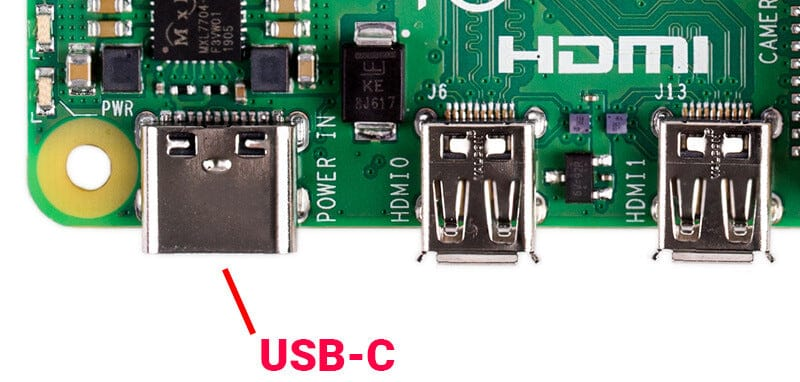

- **용도**: 보드 전원 입력 단자이며, USB 3.0 포트와 별개인 USB 2.0 컨트롤러에 연결
- **데이터 기능**: 기본으로 비활성화되어 있으며, `dtoverlay=dwc2` 설정 시 USB 장치(gadget) 모드로 사용
- **권장 전원**: **5.1V / 3A** 전용 어댑터와 저항이 작은 케이블
- **USB-PD 충전기**: 라즈베리파이 4는 5V만 받으므로 5V에서 3A를 공급하는 제품이어야 함
- **전력 부족 증상**: 저전압 경고, CPU 스로틀링, USB 장치 오작동, SD 카드 손상

> GPIO 배선은 전원을 끈 상태에서 변경하며, 전원을 끄기 전에 `sudo shutdown -h now`로 OS를 종료

---

## USB-C 전원 입력 (USB Type-C Power) (Cont'd - 1)

- **`vcgencmd`**: VideoCore GPU 펌웨어에 질의해 전압, 온도, 클록, 스로틀링 이력을 출력하는 명령
- **스로틀링**(Throttling): 전압·온도 이상 시 펌웨어가 CPU 클록을 낮춰 소비 전력과 발열을 줄이는 동작

```bash
vcgencmd measure_volts         # SoC core supply voltage (VDD_CORE)
vcgencmd measure_temp          # SoC die temperature
vcgencmd measure_clock arm     # Current ARM CPU clock in Hz
vcgencmd get_throttled         # Bitmask of current and past throttling events
# 0x0             : Normal operation (no under-voltage or throttling detected)
# Bit  0 (0x1)    : Under-voltage detected (currently active)
# Bit  1 (0x2)    : ARM frequency capped (currently active)
# Bit  2 (0x4)    : CPU throttling active (currently active)
# Bit  3 (0x8)    : Soft temperature limit reached (currently active)
# Bit 16 (0x10000): Under-voltage has occurred since last boot
# Bit 17 (0x20000): ARM frequency capped has occurred since last boot
# Bit 18 (0x40000): CPU throttling has occurred since last boot
# Bit 19 (0x80000): Soft temperature limit has occurred since last boot
```

- 예: `throttled=0x50000`은 현재는 정상이지만 부팅 후 저전압(bit 16)과 스로틀링(bit 18)이 발생했음을 의미

---

## USB-C 전원 입력 (USB Type-C Power) (Cont'd - 2)

### 전력 부족 증상과 원인

- **전원 품질**: 라즈베리파이는 전압 강하와 순간 전류 부족에 민감

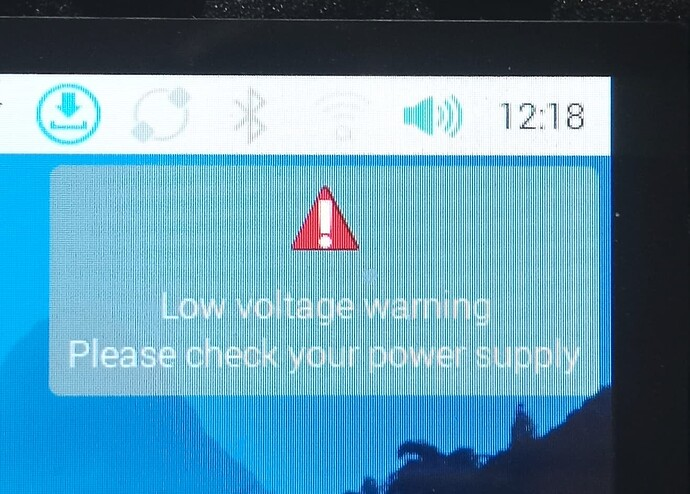

| 증상 | 원인 |
| :--- | :--- |
| **부팅 중단, 반복 재부팅** | 부팅 중 순간 전류 공급 부족 |
| **저전압 경고**(번개 아이콘, 커널 로그) | 입력 전압이 4.63V(±5%) 미만으로 강하 |
| **USB 장치 인식 실패** | USB 포트에 공급할 전류 부족 |
| **파일시스템 손상 반복** | 쓰기 도중 전압 강하로 보드가 리셋됨 |

---

## USB-C 전원 입력 (USB Type-C Power) (Cont'd - 3)

### 전원 공급 권장 사항

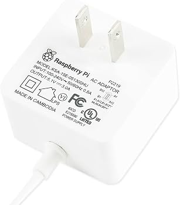

- **전원 어댑터**: 정격 5.1V / 3A 전용 어댑터와 저항이 작은 케이블 사용
  - PC USB 포트는 0.5A(USB 2.0)~0.9A(USB 3.0)만 공급하므로 오작동 원인이 됨

```bash
# Check throttling status (0x0 means no problem has occurred since boot)
vcgencmd get_throttled

# Search kernel logs for under-voltage warnings
sudo dmesg | grep -i voltage
```

---

## 통합 무선 칩셋 (Integrated Wireless Chipset)

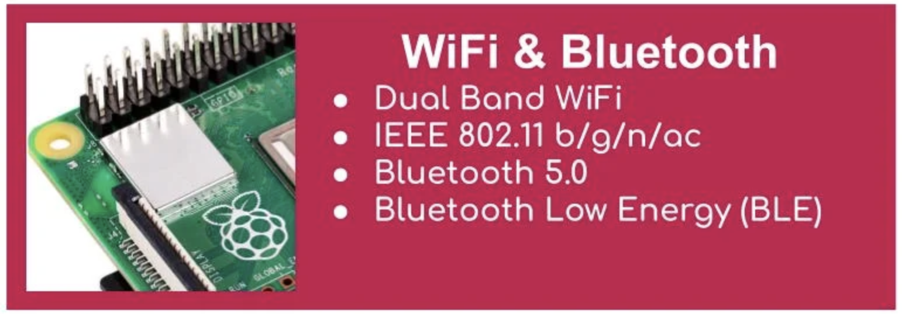

### 듀얼 밴드 무선랜 (Dual-Band Wi-Fi)

- **통신 표준**: **IEEE 802.11ac**, 2.4GHz와 5GHz 두 대역 지원
- **대역별 특성**:
  - **2.4GHz**: 장애물을 잘 돌아가고 도달 거리가 길지만, 사용 기기가 많아 채널이 혼잡
  - **5GHz**: 속도가 빠르고 간섭이 적지만, 장애물에 약하고 도달 거리가 짧음
- **반이중**(Half-Duplex): 같은 채널에서 송신과 수신을 동시에 할 수 없어 실제 처리량은 링크 속도보다 낮음

```bash
# Scan Wi-Fi networks and display link status
nmcli device wifi list
iw dev wlan0 link
```

> **권장**: 이동형 기기는 Wi-Fi, 장시간 SSH 개발과 대용량 배포는 기가비트 이더넷 사용

---

## 통합 무선 칩셋 (Integrated Wireless Chipset) (Cont'd - 1)

### 블루투스 통신 (Bluetooth Classic vs BLE)

- **듀얼 모드**(Dual-Mode): Bluetooth 5.0 칩 하나가 Classic과 BLE 두 방식을 모두 지원

| 비교 항목 | Bluetooth Classic(BR/EDR) | BLE(Bluetooth Low Energy) |
| :--- | :--- | :--- |
| **통신 방식** | 연결을 유지하며 데이터를 연속 전송 | 광고(Advertising) 패킷 또는 짧은 연결로 간헐 전송 |
| **전력 소모** | 중간 | 매우 낮음(코인 전지로 수개월 구동) |
| **주요 용도** | 오디오 스트리밍, 파일 전송 | 센서 데이터, 상태 알림 |

```bash
# Launch the interactive Bluetooth control utility
bluetoothctl
# Commands inside bluetoothctl:
# power on -> scan on -> pair <MAC> -> connect <MAC>
```

> **주의**: `dtoverlay=disable-bt` 설정 시 PL011 UART를 GPIO 헤더에서 쓰는 대신 블루투스 사용 불가

---

## 통합 무선 칩셋 (Integrated Wireless Chipset) (Cont'd - 2)

### 2.4GHz 공존 (Coexistence)


- **콤보 칩**: Wi-Fi와 블루투스 무선 회로가 칩 하나에 집적된 구조
- **같은 대역**: 블루투스는 항상 2.4GHz 대역을 사용
- **간섭**: 2.4GHz Wi-Fi와 블루투스를 동시에 쓰면 패킷 충돌로 처리량이 줄어듦
  - 대책: Wi-Fi를 5GHz 대역으로 연결
- **공존 제어**: 칩이 **TDM**으로 Wi-Fi와 블루투스에 송수신 시간을 번갈아 할당
- **TDM**(Time-Division Multiplexing): 하나의 매체를 짧은 시간 단위로 나눠 여러 통신이 차례로 사용하는 방식

---

## 라즈베리파이 제품 계보 (Model Lineage)

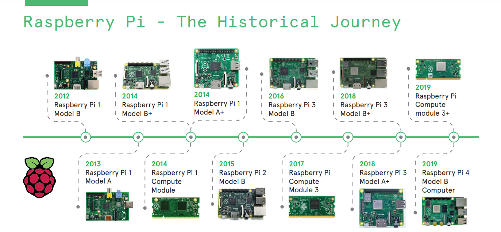

| 모델 | 특징 | 주요 용도 |
| :--- | :--- | :--- |
| **Model B** | 표준 크기, 이더넷·USB 포트 다수 | 실습, 서버, 데스크톱 대체 |
| **Model A** | 이더넷 제거·USB 축소, 작고 전력 소모가 적음 | 임베디드 기기 내장 |
| **Zero/Zero 2 W** | 초소형, 저전력, 무선 지원 | 초소형 IoT, 웨어러블 |
| **Compute Module** | 입출력 단자를 뺀 모듈, 별도 기판에 장착 | 상용 양산 제품 내장 |
| **Pico 시리즈** | RP2040/RP2350 MCU | 베어메탈 하드웨어 제어 |

> 40핀 헤더가 있는 모델(Model B+ 이후)은 핀 배치가 같으며, Pico는 Linux를 실행하지 않는 MCU 보드

---

## GPIO 핀 번호 체계 (Pin Numbering)

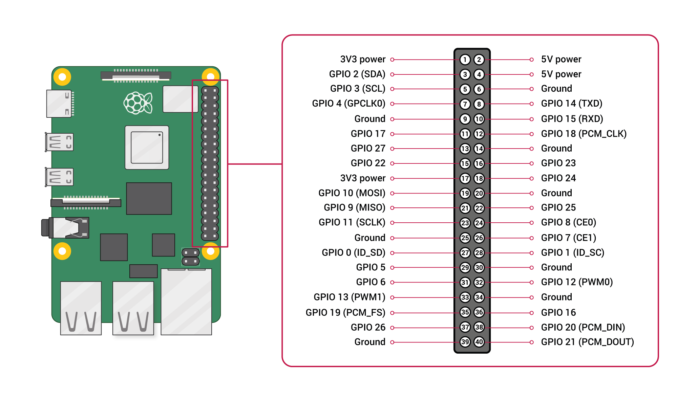

| 체계 | 정의 | 예 | 사용처 |
| :--- | :--- | :--- | :--- |
| **물리 핀 번호** | 40핀 헤더에서 핀의 위치(1~40) | 11번 핀 | 브레드보드 배선 |
| **BCM 번호** | BCM2711 SoC가 GPIO 라인에 붙인 번호 | GPIO17 | 소프트웨어 코드 |

- **대응 예**: 물리 11번 핀은 GPIO17, 물리 12번 핀은 GPIO18
- **혼동 시**: 코드에 `17`을 쓰고 물리 17번 핀(3.3V 전원)에 배선하는 오결선 발생
- **libgpiod**: `/dev/gpiochip0`의 라인 오프셋이 BCM 번호와 같음(오프셋 17 = GPIO17)

> 이 강의의 모든 소스 코드는 **BCM 번호** 기준

---

## GPIO 대체 기능 (Alternate Functions)

- **핀 다중화**: 한 핀을 일반 GPIO 또는 SoC 내부 통신 컨트롤러의 신호선 중 하나로 선택해 사용
  - 예: GPIO2는 일반 GPIO 또는 I2C의 `SDA` 신호로 사용

| 버스 기능 | 주요 용도 |
| :--- | :--- |
| **I2C**(SDA/SCL) | 2선으로 여러 센서 연결 |
| **SPI**(MOSI/MISO/SCLK/CE) | ADC·디스플레이 등 고속 동기식 장치 제어 |
| **UART**(TXD/RXD) | 시리얼 콘솔, GPS 모듈 등 비동기 직렬 통신 |
| **PWM** | LED 밝기 조절, 모터 속도·서보 각도 제어 |

### 핀 배정 시 주의 사항

- 통신 기능을 켠 핀을 일반 GPIO로 쓰면 해당 통신 기능을 함께 쓸 수 없음
- I2C·SPI는 기본으로 꺼져 있으므로 `raspi-config`에서 활성화

---

## GPIO 대체 기능 - I2C 개요 (Inter-Integrated Circuit)

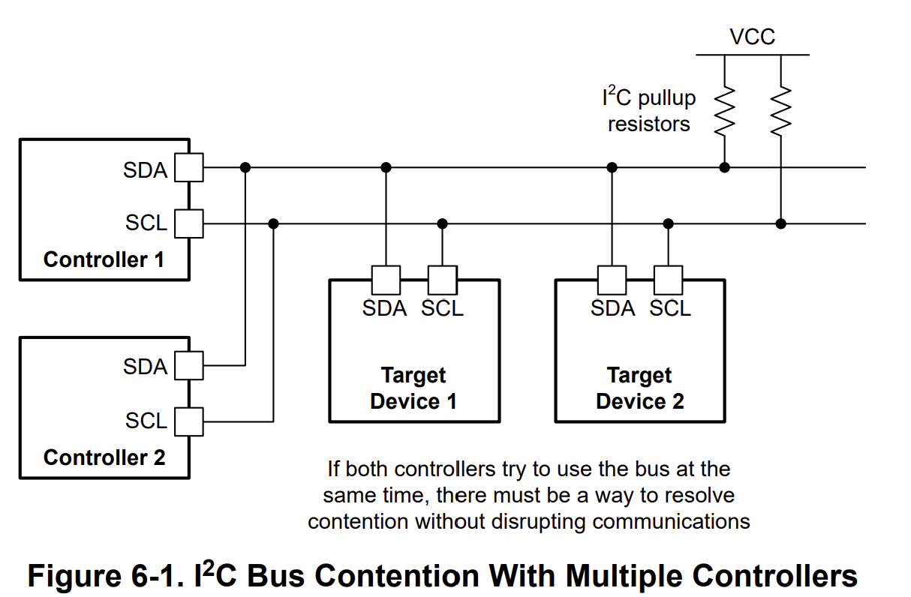

- **I2C**: 두 선(`SDA`, `SCL`)에 여러 장치를 함께 연결하는 동기식 반이중 직렬 버스
- **마스터·슬레이브**: 클록을 만들고 통신을 시작하는 장치(라즈베리파이)와 주소로 선택되어 응답하는 장치(센서)

| 신호 | 공식 명칭 | 버스 내 역할 |
| :--- | :--- | :--- |
| `SDA` | Serial Data | 데이터를 주고받는 양방향 선 |
| `SCL` | Serial Clock | 마스터가 만드는 클록 선 |

- **동기식·반이중**: `SCL` 클록에 맞춰 비트를 전송하며, `SDA` 한 선으로 송신과 수신을 번갈아 수행
- **주소 지정**: 장치마다 7비트 주소가 있어 선을 늘리지 않고 장치를 추가(예: BME280 센서는 `0x76` 또는 `0x77`)
- **풀업 저항 필수**: 두 신호선 모두 오픈 드레인 구조이므로 풀업 저항이 있어야 HIGH가 됨

---

## GPIO 대체 기능 - I2C 오픈 드레인 회로 (Open-Drain Circuit)

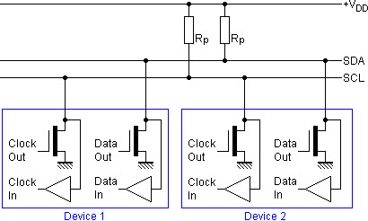

- **오픈 드레인**: 출력 트랜지스터가 신호선을 GND에 연결하거나 끊기만 하고, HIGH는 직접 출력하지 않는 구조
- **MOSFET**: 게이트(Gate) 전압으로 드레인(Drain)과 소스(Source) 사이를 켜고 끄는 트랜지스터

| 단자 | 위치 | 연결 대상 |
| :--- | :--- | :--- |
| **Gate** | 왼쪽 | Data/Clock Out(제어 입력) |
| **Drain** | 위쪽 | SDA/SCL 버스 선 |
| **Source** | 아래쪽 | 시스템 접지(GND) |

---

## GPIO 대체 기능 - I2C 오픈 드레인 동작 (Open-Drain Operation)

- **동작 원리**: 트랜지스터는 버스를 **LOW로만** 끌어내리고, HIGH는 풀업 저항이 만듦

| 게이트 입력 | 스위치 상태 | 버스 선 전압 | 논리값 |
| :--- | :--- | :--- | :---: |
| **Low**(OFF) | 열림(개방) | 풀업 저항($R_p$)을 통해 3.3V로 올라감 | **HIGH(1)** |
| **High**(ON) | 닫힘(도통) | GND에 연결되어 0V 근처로 내려감 | **LOW(0)** |

### 통신 절차와 장점

- **통신 절차**: 마스터가 주소 전송 → 해당 슬레이브가 ACK 응답 → 데이터 송수신
- **ACK**(Acknowledge): 수신 측이 바이트를 받은 뒤 `SDA`를 LOW로 끌어내려 수신을 알리는 응답 비트
- **클록 스트레칭**: 슬레이브가 처리 중이면 `SCL`을 LOW로 붙잡아 마스터를 기다리게 함
- **단락 방지**: 어떤 장치도 3.3V를 직접 출력하지 않으므로 두 장치가 동시에 구동해도 단락이 생기지 않음
- **유선 논리곱**(Wired-AND): 한 장치라도 LOW로 끌어내리면 버스 전체가 LOW

---

## GPIO 대체 기능 - I2C 설정과 확인 (Setup and Check)

| 설정 항목 | Raspberry Pi 4 사양 |
| :--- | :--- |
| **기본 핀** | `SDA` GPIO2(물리 3번), `SCL` GPIO3(물리 5번) |
| **동작 속도** | 표준 모드(Standard-mode) 100kHz(기본값), 패스트 모드(Fast-mode) 400kHz |
| **풀업 저항** | GPIO2·3에 3.3V로 연결된 1.8kΩ 풀업 저항 내장 |
| **활성화** | `raspi-config` → Interface Options → I2C |

```bash
# Enable I2C (Interface Options -> I2C), then scan bus 1 for devices
sudo raspi-config
sudo apt install -y i2c-tools
i2cdetect -y 1
```

- **`i2cdetect -y 1`**: 확인 질문 없이(`-y`) 헤더에 연결된 버스 `/dev/i2c-1`을 검사
- **출력 읽기**: 표에 나타난 16진수(예: `76`)가 응답한 장치의 7비트 주소이며, `--`는 응답 없음
- **장치가 보이지 않으면**: 배선과 전원을 먼저 점검

---

## GPIO 대체 기능 - SPI (Serial Peripheral Interface)

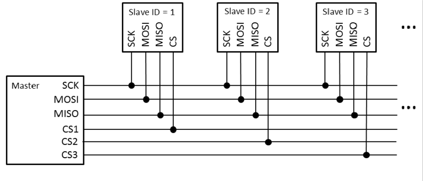

- **SPI**: 클록에 맞춰 송신과 수신을 동시에 수행하는 4선식 동기식 전이중 직렬 버스
- **전이중**: `MOSI`로 보내는 동안 `MISO`로 받음(I2C의 반이중과 대비)
- **칩 선택**: 주소 대신 **CE**(Chip Enable, 일반 명칭 CS) 선을 LOW로 내려 통신할 장치를 선택

| 신호 | 신호 방향 | 핀 매핑 |
| :--- | :--- | :--- |
| `MOSI` | 마스터 → 슬레이브 | GPIO10(물리 19번) |
| `MISO` | 슬레이브 → 마스터 | GPIO9(물리 21번) |
| `SCLK` | 마스터 → 슬레이브 | GPIO11(물리 23번) |
| `CE0` / `CE1` | 마스터 → 슬레이브 | GPIO8(물리 24번) / GPIO7(물리 26번) |

---

## GPIO 대체 기능 - SPI (Serial Peripheral Interface) (Cont'd)

### SPI 활성화와 장치 파일

```bash
# Enable SPI (Interface Options -> SPI), then list SPI device files
sudo raspi-config
ls -l /dev/spidev0.*
```

- **`/dev/spidev0.0`**: SPI0 버스의 CE0에 연결된 장치(예: CE0에 연결한 MCP3008 ADC)
- **`/dev/spidev0.1`**: SPI0 버스의 CE1에 연결된 장치
- **장치 파일이 없으면**: `raspi-config`에서 SPI를 활성화했는지 확인

---

## GPIO 대체 기능 - UART (Universal Asynchronous Receiver/Transmitter)

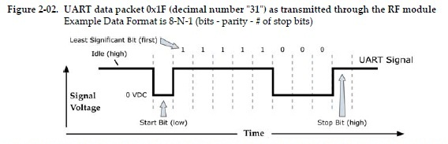

- **UART**: 클록선 없이 양쪽이 미리 정한 **보율**(Baud Rate)에 맞춰 비트를 주고받는 비동기 직렬 통신
  - 예: 보율 115200이면 1비트의 길이는 약 8.7μs
- **결선**: 상대 장치와 `TXD`와 `RXD`를 서로 교차 연결하고 GND를 공통으로 연결(1:1 통신)
- **핀**: `TXD` GPIO14(물리 8번), `RXD` GPIO15(물리 10번)
- **로직 전압**: **3.3V**만 지원하며, 5V TTL이나 RS-232(최대 ±15V) 신호를 직접 연결하면 파손

---

## GPIO 대체 기능 - UART (Universal Asynchronous Receiver/Transmitter) (Cont'd)

### Raspberry Pi 4의 기본 UART 컨트롤러

| 컨트롤러 | 동작 특성 | 기본 연결 |
| :--- | :--- | :--- |
| **PL011** | 전용 클록을 사용하므로 보율이 안정적 | 온보드 블루투스 |
| **mini UART** | VPU 코어 클록에서 보율을 만들므로 코어 클록이 바뀌면 보율도 바뀜 | 40핀 헤더(GPIO14·15) |

- **`enable_uart=1`**: `config.txt`에 설정하면 헤더 UART가 켜지고 코어 클록이 고정되어 mini UART 보율이 안정됨
- **`dtoverlay=disable-bt`**: 블루투스를 끄고 PL011을 GPIO14·15에 연결

---

## GPIO 대체 기능 - PWM (Pulse Width Modulation)

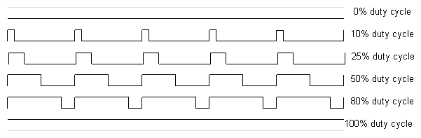

- **PWM**: 주기는 일정하게 두고 한 주기 중 HIGH 구간의 비율(**듀티 사이클**)을 바꾸는 신호 생성 방식
- **평균 전압**: 부하가 스위칭 속도를 따라가지 못하면 평균 전압 = 3.3V × 듀티 사이클
  - 예: 듀티 사이클 25%이면 평균 약 0.83V, LED는 켜진 시간이 25%이므로 어둡게 보임

| 항목 | Raspberry Pi 4 사양 |
| :--- | :--- |
| **하드웨어 PWM** | GPIO12·18(PWM0), GPIO13·19(PWM1), SoC의 PWM 컨트롤러가 파형 생성 |
| **소프트웨어 PWM** | 프로그램이 일반 GPIO를 직접 켜고 끄므로 OS 스케줄링 지연으로 파형이 흔들림 |
| **주요 용도** | LED 밝기 조절, 모터 속도 제어, 서보 각도 제어 |

---

## 전기적 주의 사항 (Electrical Cautions)

- **로직 전압**: GPIO는 **3.3V**를 사용하며, 5V 신호를 직접 연결하면 SoC 파손 위험
- **전류 한계**: 핀 하나는 최대 16mA, 모든 GPIO 핀의 합계는 최대 50mA
- **LED 보호**: LED에는 반드시 **전류 제한 저항**을 직렬 연결

### 저항값 계산 예시

- 조건: 전원 전압($V_{\text{CC}}$) **3.3V**, 적색 LED 순방향 전압($V_f$) 약 **2.0V**, 목표 전류($I_f$) **4mA**

$$R = \frac{V_{\text{CC}} - V_f}{I_f} = \frac{3.3 - 2.0}{0.004} = 325\,\Omega \approx 330\,\Omega$$

- **330Ω 선택**: 표준 저항값(E12 계열) 중 325Ω보다 큰 가장 가까운 값이며, 이때 전류는 약 3.9mA
- **유도성 부하**: 모터·릴레이처럼 코일이 있는 부하는 **트랜지스터나 드라이버 회로**로 구동

---

## 라즈베리파이 운영체제 (Raspberry Pi OS)

- **Raspberry Pi OS**: 라즈베리파이 하드웨어에 맞춘 Debian 기반 공식 Linux 배포판(이전 이름 Raspbian)

### 에디션과 아키텍처 선택

| 선택 항목 | 선택지 | 특징 |
| :--- | :--- | :--- |
| **에디션** | Desktop | GUI 데스크톱 환경 포함, 모니터를 연결해 사용 |
| | Lite | GUI 없이 명령행만 제공, 원격 접속으로 운용 |
| **아키텍처** | 32-bit(`armhf`) | 구형 모델과 호환 |
| | 64-bit(`arm64`) | AArch64 프로그램 실행, **이 강의의 실습 환경** |

- **임베디드 배포 권장**: **Lite 64-bit**
  - 불필요한 서비스(데몬)가 없어 저장 공간과 메모리 사용량이 적고 부팅이 빠름
  - 외부에서 접속할 수 있는 서비스가 적어 공격받을 수 있는 지점이 줄어듦

---

## 장치 파일과 GPIO (Device Files)

- **장치 파일**: 하드웨어를 일반 파일처럼 `open`·`read`·`write`로 접근하게 하는 `/dev` 아래의 특수 파일
- **문자 디바이스**: 데이터를 바이트 단위로 순서대로 주고받는 장치 파일(예: `/dev/ttyS0`)
- **GPIO 문자 디바이스**: Linux 4.8부터 제공되는 표준 GPIO 인터페이스
  - `/dev/gpiochip0`: Raspberry Pi 4의 온보드 GPIO 컨트롤러
- **`ioctl`**: `read`·`write`로 표현하기 어려운 제어 명령을 장치 파일에 보내는 시스템 콜
  - 예: "라인 17을 출력으로 요청", "라인 17의 값을 1로 설정"
- **sysfs 방식**: `/sys/class/gpio` 아래의 텍스트 파일을 읽고 쓰는 이전 방식이며, 커널에서 폐기 예정(deprecated)

---

## 장치 파일과 GPIO (Device Files) (Cont'd)

### 문자 디바이스 도입 배경

| 비교 항목 | sysfs 방식(deprecated) | 문자 디바이스 방식(libgpiod) |
| :--- | :--- | :--- |
| **접근 방식** | `value` 파일에 문자열 `"1"` 쓰기 | `ioctl`로 라인을 요청한 뒤 값 설정 |
| **라인 소유권** | 어느 프로세스든 같은 핀에 쓸 수 있음 | 라인을 요청한 프로세스만 사용 |
| **자원 정리** | 프로세스가 종료돼도 export 상태가 남음 | 프로세스 종료 시 커널이 라인을 회수 |
| **속도** | 값을 바꿀 때마다 문자열 변환과 파일 쓰기 | 요청 후에는 `ioctl` 한 번으로 값 변경 |

- **libgpiod**: GPIO 문자 디바이스를 감싼 C 라이브러리와 명령행 도구(`gpiodetect`, `gpioset` 등) 모음
- 이 강의는 **libgpiod v2** API를 표준으로 사용

---

## GPIO 라이브러리 구성 (GPIO Libraries)

| 라이브러리 | 패키지명 | 링크 플래그 | 주요 역할 |
| :--- | :--- | :---: | :--- |
| `libgpiod` | `libgpiod-dev` | `-lgpiod` | 문자 디바이스 기반 GPIO 입출력, 에지 이벤트 감지 |
| `lgpio` | `liblgpio-dev` | `-llgpio` | 마이크로초 단위 펄스 출력, 소프트웨어 PWM |

- **`libgpiod`의 한계**: 라인 값 읽기·쓰기와 에지 감지만 제공하며, 정해진 폭의 펄스를 출력하는 함수는 없음
- **`lgpio` 병행 사용**: HC-SR04 초음파 센서의 10μs 트리거 펄스처럼 정밀한 타이밍이 필요한 실습
  - 예: `lgTxPulse()`로 HIGH 10μs 펄스 출력
- **`lgpio`의 PWM**: `lgTxPwm()`은 소프트웨어 타이밍 방식이며, SoC의 하드웨어 PWM 컨트롤러를 쓰지 않음
- **함께 사용**: 두 라이브러리를 **한 프로그램에 함께 링크 가능**하지만, 같은 라인을 두 라이브러리가 동시에 요청할 수는 없음

---

## lgpio 설치와 링크 (Installing lgpio)

```bash
# Install the development package from the distribution archive
sudo apt install -y liblgpio-dev

# Alternative: build and install from source if the package is unavailable
wget https://github.com/joan2937/lg/archive/master.zip
unzip master.zip && cd lg-master
make && sudo make install && sudo ldconfig

# Build an application linked with both libgpiod and lgpio
clang++ -std=c++14 -Wall -Wextra -I./common main.cc -o run -lgpiod -llgpio -pthread
```

- **헤더가 없으면**: **컴파일 단계**에서 실패 — `fatal error: 'lgpio.h' file not found`
- **`-llgpio`를 빠뜨리면**: **링크 단계**에서 실패 — ``undefined reference to `lgGpiochipOpen'``

---

## 초기 설정 (Initial Setup)

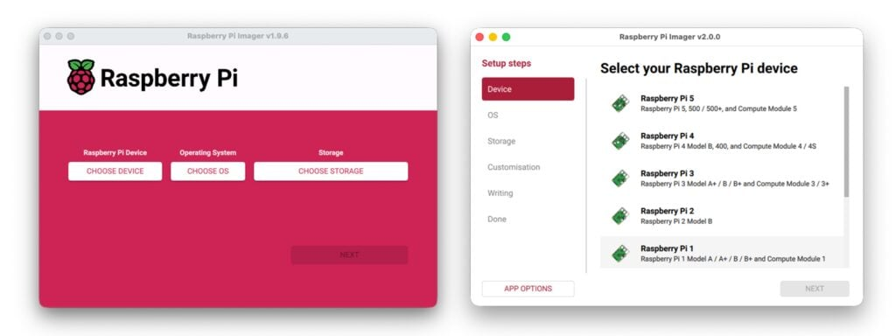

- OS 이미지는 공식 도구 [**Raspberry Pi Imager**](https://www.raspberrypi.com/software/)로 microSD 카드에 기록

### Raspberry Pi Imager를 통한 OS 설치 절차

1. 호스트 PC에 Raspberry Pi Imager 설치 후 실행
2. `Raspberry Pi Device`에서 `Raspberry Pi 4` 선택
3. `Operating System`에서 `Raspberry Pi OS (other)` → `Raspberry Pi OS Lite (64-bit)` 선택
4. `Storage`에서 기록할 microSD 카드를 정확히 선택
5. OS 사용자 설정에서 호스트명, 계정·비밀번호, Wi-Fi 정보, SSH 활성화를 미리 지정
6. 설정을 확인한 뒤 microSD 카드에 이미지 기록
7. 기록한 카드를 슬롯에 넣고 이더넷과 전원(USB-C)을 연결해 부팅

- **64-bit**를 선택해야 64비트(`aarch64`) 실습 환경이 구성됨

---

## 초기 설정 (Initial Setup) (Cont'd - 1)

### 설치 결과 확인

```bash
uname -m                    # aarch64: 64-bit kernel
getconf LONG_BIT            # 64: 64-bit user space
dpkg --print-architecture   # arm64: 64-bit packages
cat /etc/os-release         # Distribution name and release
```

- **커널과 사용자 영역 구분**: Raspberry Pi 4는 `arm_64bit=1`이 기본값이므로 32-bit OS도 64비트 커널로 부팅
  - 따라서 `uname -m`이 `aarch64`여도 32-bit OS일 수 있음
- **판정 기준**: `getconf LONG_BIT`가 `64`, `dpkg --print-architecture`가 `arm64`이면 64-bit OS
- **`hostnamectl`**: 호스트 이름, OS 버전, 커널 버전을 한 번에 출력

---

## 초기 설정 (Initial Setup) (Cont'd - 2)

### 헤드리스 운용 (Headless Operation)

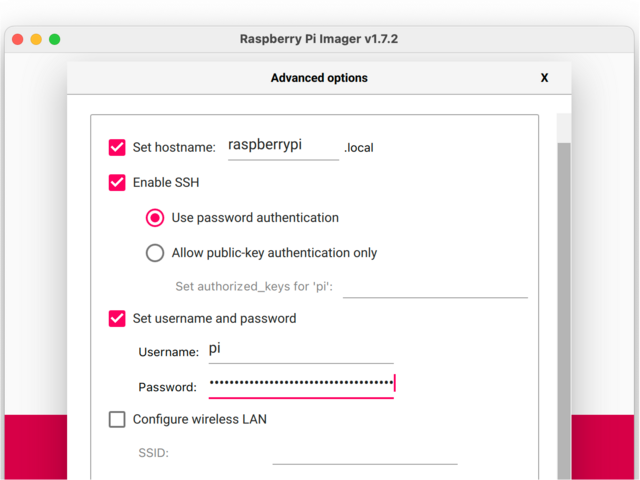

- **헤드리스**: 모니터·키보드 없이 네트워크로 원격 접속해 장치를 운용하는 방식
- **SSH**(Secure Shell): 암호화된 연결로 원격 장치의 셸을 사용하는 프로토콜(기본 TCP 22번 포트)
- 상용 임베디드 Linux 장비도 같은 방식으로 개발·관리

---

## 초기 설정 (Initial Setup) (Cont'd - 3)

### SSH 원격 접속 예시

```bash
# Connect using the mDNS hostname (replace raspberrypi with your hostname)
ssh <user>@raspberrypi.local

# Connect using the IPv4 address (static or DHCP-assigned)
ssh <user>@192.168.0.10

# Connect when a custom SSH port is assigned
ssh -p <port> <user>@<host>

# Close the remote shell session
exit
```

- **mDNS**(Multicast DNS): DNS 서버 없이 같은 네트워크 안에서 `<호스트명>.local`을 IP 주소로 변환
- **첫 접속**: 호스트 키 확인 질문에 `yes`를 입력하면 `~/.ssh/known_hosts`에 등록
- **접속 실패 시**: 라즈베리파이에서 `systemctl status ssh`와 `ip addr`로 SSH 서비스와 IP 주소 확인
- **보안**: 기본 비밀번호를 바꾸고 SSH 공개키 인증 사용 권장

---

## 네트워크 구성 (Network Configuration)

- **NetworkManager**: Raspberry Pi OS(Bookworm 이후)의 기본 네트워크 관리 서비스
- **`nmcli`**: NetworkManager의 명령행 도구
- **연결 프로필**: SSID, 비밀번호, IP 설정을 묶어 저장한 단위이며 `nmcli connection show`의 `NAME` 열로 식별

```bash
# Scan available Wi-Fi networks and connect to one
nmcli device wifi list
sudo nmcli device wifi connect "<SSID>" password "<PASSWORD>"

# Show connection profiles and the IPv4 address of wlan0
nmcli connection show
ip -4 addr show wlan0

# Show the routing table and DNS servers
ip route
nmcli device show wlan0 | grep DNS
```

---

## 네트워크 구성 (Network Configuration) (Cont'd)

### 무선랜 고정 IP 설정 예시

```bash
# 1. Identify the Wi-Fi connection profile name
nmcli connection show

# 2. Configure static IPv4 parameters for the profile
sudo nmcli connection modify "Campus Wi-Fi" \
  ipv4.method manual \
  ipv4.addresses 192.168.0.42/24 \
  ipv4.gateway 192.168.0.1 \
  ipv4.dns "192.168.0.1 8.8.8.8"

# 3. Reactivate the profile to apply the configuration
sudo nmcli connection down "Campus Wi-Fi"
sudo nmcli connection up "Campus Wi-Fi"
```

- **DHCP**: 공유기가 접속한 장치에 IP 주소를 자동으로 할당하는 프로토콜이며, 할당에 쓰는 주소 범위를 DHCP 풀이라 함
- **고정 주소 선택**: `192.168.0.42`처럼 DHCP 풀과 겹치지 않는 주소로 지정
- **주소 고정 방법**: **[고정 IP](https://ohyaan.github.io/basic-operations/networking_setup_and_management_for_raspberry_pi/#static-ipv4-with-networkmanager)**, 공유기의 **DHCP 예약**, mDNS 이름(`<호스트명>.local`) 중 선택

---

## 안전한 종료와 SD 카드 (Shutdown and SD Card)

- **종료 전 전원 차단의 위험**: 메모리의 쓰기 버퍼가 카드에 기록되기 전에 끊기면 파일시스템 손상·부팅 실패 발생

```bash
# Flush filesystem buffers and halt the system
sudo shutdown -h now

# Flush filesystem buffers and reboot the system
sudo reboot
```

### SD 카드 수명 관리

- **P/E 사이클**(Program/Erase): 플래시 메모리 블록을 지우고 다시 쓸 수 있는 횟수이며, 한도가 있음
- **쓰기를 줄이는 방법**(상용 제품):
  - 임시 파일과 잦은 로그는 RAM 기반 파일시스템(`tmpfs`)에 기록
  - 루트 파일시스템을 읽기 전용으로 마운트(예: `raspi-config`의 Overlay File System)
  - 중요한 데이터는 외부 저장장치나 원격 서버로 주기적으로 전송
