<!-- _class: lead -->

# 마이크로임베디드프로그래밍

## 라즈베리파이 플랫폼

### [munseong.jeong@daejin.ac.kr](mailto:munseong.jeong@daejin.ac.kr)

---

## 라즈베리파이란 (What Is Raspberry Pi)

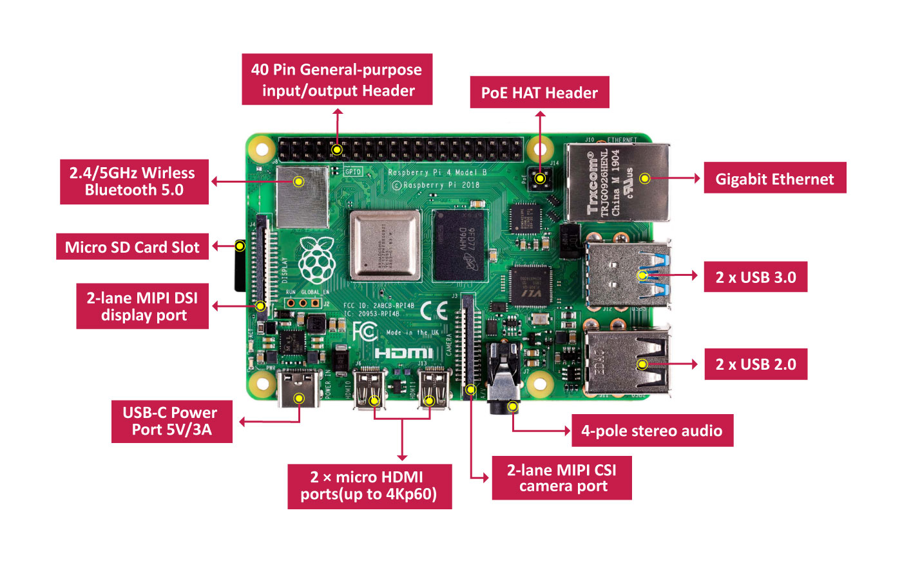

- **개발 배경**: 영국 라즈베리파이 재단이 교육 및 연구용으로 개발한 **싱글 보드 컴퓨터(SBC)**
- **특징**: 신용카드 크기 단일 기판에 CPU, 메모리, 입출력 포트를 집적한 고성능 플랫폼
- **활용성**: 우수한 가성비와 방대한 오픈소스 생태계로 교육 및 시제품 제작의 표준 활용

### 싱글 보드 컴퓨터 (Single Board Computer)

- **일체형 구조**: 단일 기판 내에 메인보드 및 핵심 입출력 장치 완결
- **범용 OS 구동**: 일반 PC와 동일하게 Linux 등 **완전한 형태의 범용 운영체제** 구동
- **하드웨어 제어**: **GPIO 헤더**를 탑재하여 MCU처럼 외부 센서·액추에이터 직접 제어

---

### Raspberry Pi 4의 SoC와 프로세서 (SoC and Processor)

- **SoC(System on Chip)**: CPU, GPU, 메모리·주변장치 컨트롤러를 단일 칩셋에 고집적한 반도체
- **탑재 SoC**: 64비트 **Broadcom BCM2711** 쿼드코어 프로세서 탑재
- **CPU 코어**: **ARM Cortex-A72** 쿼드코어(최대 1.5GHz 동작 클록 지원)
- **ISA(Instruction Set Architecture)**: ARMv8-A 기반으로 명령어, 레지스터 규약 및 메모리 모델 정의
- **64비트 실행 환경**: Raspberry Pi OS 64-bit는 ARMv8-A의 64비트 실행 모드인 **AArch64**(`aarch64`) 사용

#### 프로세서 계층 구조 (Processor Hierarchy)

| 계층 | 구성 | 역할 |
| :--- | :--- | :--- |
| **SoC** | BCM2711 | CPU·GPU 및 주변장치 제어 통합 |
| **CPU** | Cortex-A72 | 연산 처리 및 명령어 실행 |
| **ISA** | ARMv8-A | 64비트 명령어 집합 규격 |
| **ABI** | Linux `arm64` | 커널 시스템 콜 규약 |

---

## Raspberry Pi 4의 메모리 (Memory)

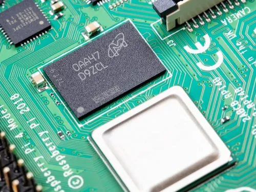

- **메모리 구성**: 온칩 SRAM이 아닌 기판에 실장된 **LPDDR4 SDRAM** 주기억장치 사용
- **용량 옵션**: 1GB, 2GB, 4GB, 8GB 모델로 출시되며 구매 시 용량 고정(증설 불가)
- **LPDDR4(Low-Power DDR4)**: 임베디드 저전력 환경에 최적화된 동기식 동적 RAM
- **휘발성 저장**: 전원 차단 시 적재 데이터 소실(프로그램 및 커널의 실행 공간)
- **성능 영향**: 멀티태스킹, 메모리 집중 작업, 대규모 컴파일 시 대용량 메모리가 유리
- **스토리지 분리**: OS 및 파일 저장은 microSD 카드나 USB 외장 저장장치 활용

---

## microSD 카드 슬롯 (microSD Card)


- **기본 저장장치**: 부트로더, 커널, 루트 파일시스템, 사용자 데이터 저장
- **파티션 분할**: 부트 파티션(FAT32)과 Linux 루트 파티션(ext4) 자동 생성
- **신뢰성 확보**: 속도 등급뿐 아니라 쓰기 수명이 검증된 고내구성 카드 권장
- **데이터 보호**: 정상 언마운트 없는 전원 강제 차단 시 파일시스템 손상 유의
- **설치 주의**: 이미지 기록 시 대상 장치(Storage) 확인 필수(오선택 시 PC 데이터 삭제)
- **서버 환경 권장**: 쓰기 빈도가 높을 경우 USB SSD 부팅 또는 `tmpfs` 램 디스크 활용

---

## GPIO 헤더 (General-Purpose Input/Output)

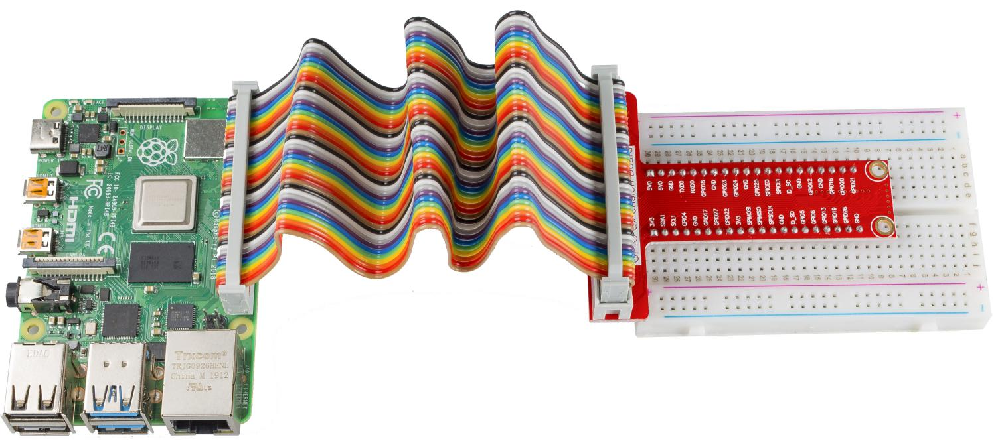

- **개요**: 소프트웨어로 디지털 입출력을 제어하는 범용 인터페이스(GPIO)
- **물리 규격**: **40핀 헤더(2.54mm 피치)** — 전원(5V/3.3V), 접지(GND), 신호 핀 배치
- **로직 전압**: **3.3V CMOS 로직** 기준 — 5V 신호 직접 인가 시 SoC 내부 손상
- **대체 기능**: I2C, SPI, UART, PWM 지원 — 제어 시 **BCM 번호** 사용

> **주의**: GPIO는 신호 제어용 핀임 — 모터·릴레이 등 대전류 부하는 드라이버 및 외장 전원 연계

---

## PoE 헤더 (Power over Ethernet Header)

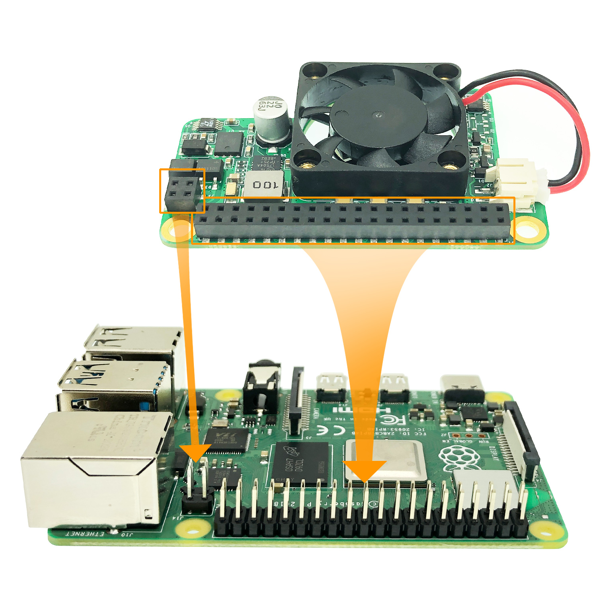

- **PoE(Power over Ethernet)**: 이더넷 케이블 하나로 데이터 통신과 직류 전원을 동시 공급
- **전용 인터페이스**: 보드상의 4핀 헤더는 일반 GPIO가 아닌 **PoE HAT 전용 인터페이스**
- **전력 변환**: PoE 스위치나 인젝터의 IEEE 802.3af/at 규격 전력을 시스템용 5V로 변환
- **활용 사례**: IP 감시 카메라, 원격 키오스크, 천장 매립 센서 등 전원 공사가 어려운 환경에 적합

---

## 기가비트 이더넷 (Gigabit Ethernet)

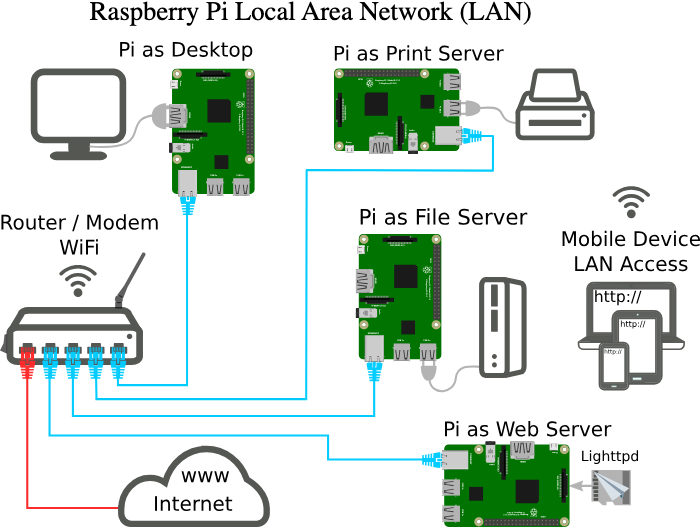

- **규격**: RJ45 포트 기반 **IEEE 802.3ab 1000BASE-T** 기가비트 이더넷
- **전송 속도**: Cat5e 이상 케이블 및 기가비트 스위치 연결 시 최대 **1Gbps** 협상
- **실효 대역**: 프로토콜 오버헤드, 저장장치 I/O 및 CPU 성능에 따라 결정
- **용도**: 무선 간섭이 배제되어 SSH 원격 개발 및 대용량 전송에 적합

```bash
# Inspect Ethernet interface speed and physical link status
ip link show eth0
ethtool eth0 | grep -E 'Speed|Duplex|Link detected'
```

> `Speed: 1000Mb/s`, `Link detected: yes`: 기가비트 링크 활성 (미지원 시 100Mb/s 자동 협상)

---

## USB 인터페이스 (Universal Serial Bus)

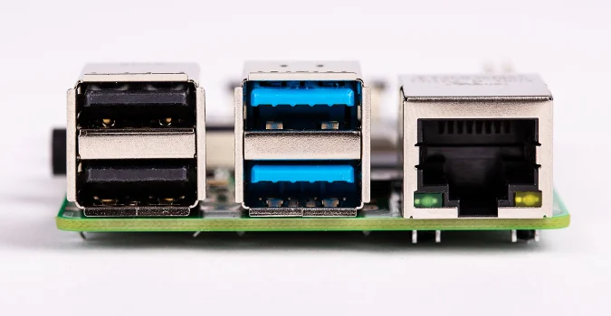

- **포트 구성**: Raspberry Pi 4는 **USB 3.0(파란색) 2포트** 및 **USB 2.0(검은색) 2포트** 탑재
- **전송 속도**: USB 3.0은 최대 5Gbps(SuperSpeed), USB 2.0은 최대 480Mbps 지원
- **주변기기 연동**: 키보드, 마우스, 외장 SSD, USB 웹캠, 무선 동글 등 확장

```bash
# List connected USB devices and device tree topology
lsusb
lsusb -t
```

- **전력 관리**: 고전력 소모 장치 연결 시 포트 전원 부족 방지를 위해 유전원 허브 권장
- **무선 간섭**: USB 3.0 고주파 노이즈가 2.4GHz Wi-Fi에 간섭 유발 가능 — 수신기는 2.0 포트 사용

---

## 4극 스테레오 오디오 (4-pole Stereo Audio)

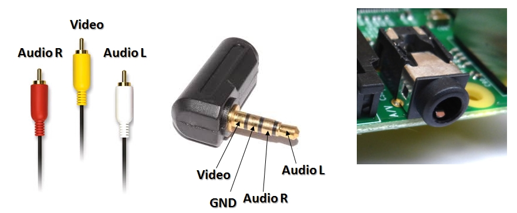

- **단자 규격**: 3.5mm **TRRS(Tip-Ring-Ring-Sleeve)** 4극 복합 오디오 잭 탑재
- **신호 통합**: 스테레오 음성 출력과 **컴포지트 비디오(CVBS)** 신호를 단일 단자에서 동시 제공
- **케이블 호환**: 일반 3극 이어폰은 오디오만 지원되며 영상 출력 시 전용 4극 A/V 케이블 필수

| 접점 | 신호 | 역할 |
| :--- | :--- | :--- |
| **Tip** | Audio L | 좌측 아날로그 오디오 |
| **Ring 1** | Audio R | 우측 아날로그 오디오 |
| **Ring 2** | GND / Video | 접지 또는 CVBS 영상 |
| **Sleeve** | Video / GND | CVBS 영상 또는 접지 |

> 제조사별 접점 배치가 다를 수 있으므로 비디오 사용 전 확인 (HDMI 오디오는 별도 경로)

---

## MIPI 카메라·디스플레이 인터페이스

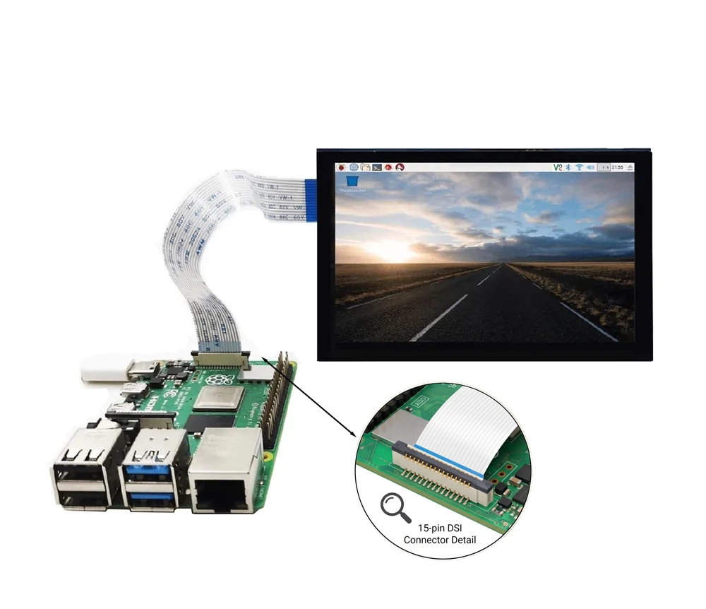

- **MIPI 규격**: 모바일·임베디드 프로세서용 고속 산업 표준 인터페이스
- **결선 방식**: 15핀 FFC 커넥터 사용 — 리본 케이블 결선 방향(접촉면) 확인 필수

| 인터페이스 | 신호 방향 | 연결 장치 |
| :--- | :--- | :--- |
| **CSI** | 카메라 ➔ SoC | Raspberry Pi Camera Module |
| **DSI** | SoC ➔ 패널 | Raspberry Pi Touch Display |

- **하드웨어 가속**: USB 카메라 대비 CPU 오버헤드 없이 온보드 ISP 직접 활용

---

## micro-HDMI 출력 (Micro High-Definition Multimedia Interface)

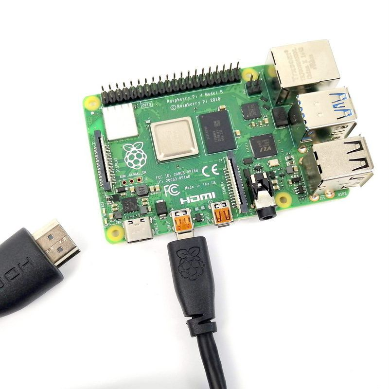

- **HDMI 규격**: 비압축 고화질 디지털 영상 및 다채널 오디오 동시 전송
- **포트 구성**: **micro-HDMI(Type-D) 2포트** 탑재 — 독립 듀얼 모니터 구성 지원
- **해상도 지원**: 단일 디스플레이 최대 4K 60Hz, 듀얼 디스플레이 최대 4K 30Hz 출력
- **케이블 연결**: 커넥터 크기만 다르며 표준 HDMI 변환 케이블 또는 젠더 어댑터 사용

> 4K 디스플레이 연결 시 고품질 케이블 및 충분한 전원 공급 필수 (HDMI 오디오는 ALSA 독립 장치)

---

## USB-C 전원 입력 (USB Type-C Power)

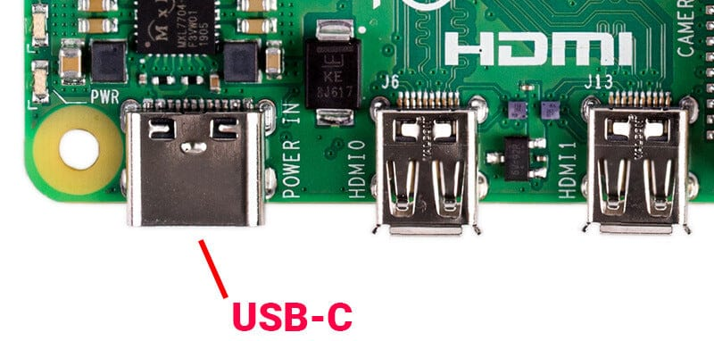

- **전용 전원 단자**: 데이터 통신 기능이 배제된 **순수 전원 입력 전용** Type-C 단자
- **정격 전원**: **5V / 3A(최소 15W)** 정격 전원 어댑터 및 저저항 케이블 사용 권장
- **PD 호환성**: 일반 USB-PD 충전기 사용 시 기본 5V 프로파일이 안정적인 어댑터 권장
- **전력 부족 증상**: 저전압 발생 시 번개 아이콘, CPU 쓰로틀링, USB 오작동, SD 카드 손상 유발

> 보드 동작 중 GPIO 배선 변경 금지 — 시스템 종료는 반드시 `sudo shutdown -h now` 수행

---

## USB-C 전원 입력 (USB Type-C Power) (Cont'd - 1)

- **하드웨어 모니터링 (`vcgencmd`)**: VideoCore 펌웨어와 통신하여 전압, 온도, 클록 및 저전압 발생 이력을 실시간 조회

```bash
# Measure SoC internal core supply voltage (VDD_CORE)
vcgencmd measure_volts

# Measure internal die temperature of the SoC (CPU/GPU)
vcgencmd measure_temp

# Measure current operating frequency of the ARM CPU core (in Hz)
vcgencmd measure_clock arm

# Retrieve bitmask of active and historical throttling/under-voltage events
vcgencmd get_throttled
# Bitmask meanings:
# 0x0             : Normal operation (no under-voltage or throttling detected)
# Bit  0 (0x1)    : Under-voltage detected (currently active)
# Bit  1 (0x2)    : ARM frequency capped (currently active)
# Bit  2 (0x4)    : CPU throttling active (currently active)
# Bit  3 (0x8)    : Soft temperature limit reached (currently active)
# Bit 16 (0x10000): Under-voltage has occurred since last boot
# Bit 17 (0x20000): ARM frequency capped has occurred since last boot
# Bit 18 (0x40000): CPU throttling has occurred since last boot
# Bit 19 (0x80000): Soft temperature limit has occurred since last boot
```

---

## USB-C 전원 입력 (USB Type-C Power) (Cont'd - 2)

### 전원 공급

- **품질 민감도**: 라즈베리파이는 전원 전압 및 순간 공급 전류 안정성에 매우 민감

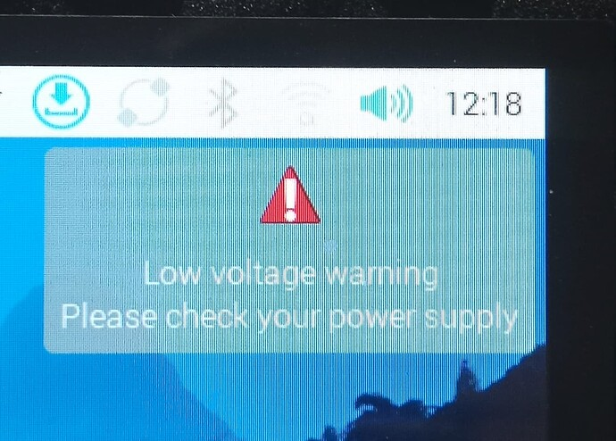

| 저전원 이상 징후 | 주요 원인 |
| :--- | :--- |
| **부팅 중단 및 재부팅** | 순간 피크 전류 공급 부족 |
| **화면 우측 상단 번개 아이콘** | 입력 전압 강하(4.63V 이하) |
| **USB 외장 장치 인식 실패** | 포트 공급 전류 용량 한계 |
| **파일시스템 손상 반복** | 비정상 전원 차단으로 인한 버퍼 오류 |

---

## USB-C 전원 입력 (USB Type-C Power) (Cont'd - 3)

### 전원 공급 권장 사항

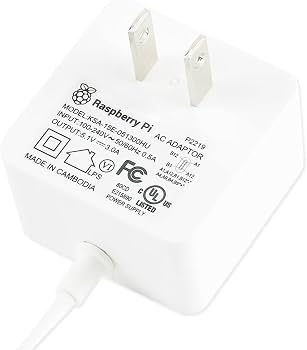

- **정격 전원 사용**: 정격 5V / 3A 이상 전용 어댑터 및 저저항 케이블 사용 권장
  - PC USB 포트는 전력 공급 능력이 부족하여 오작동 유발 가능

```bash
# Check system throttling status (0x0 indicates optimal status)
vcgencmd get_throttled

# Inspect kernel logs for under-voltage warnings
dmesg | grep -i voltage
```

---

## 통합 무선 칩셋 (Integrated Wireless Chipset)

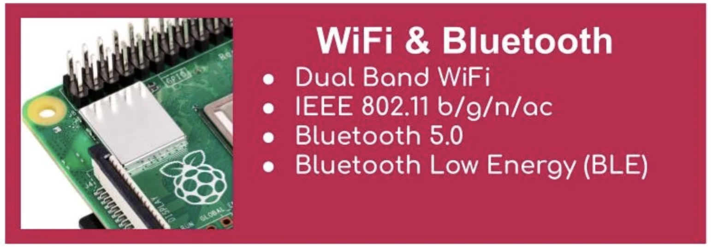

### 듀얼 밴드 무선랜 (Dual-Band Wi-Fi)

- **통신 표준**: **IEEE 802.11ac** 기반 2.4GHz / 5.0GHz 듀얼 밴드 지원
- **대역별 특성**:
  - **2.4GHz**: 장애물 회절·장거리 유리, 기기 밀집으로 인한 채널 혼잡
  - **5.0GHz**: 고속 전송·낮은 간섭, 장애물 투과율 및 도달 거리 취약
- **실효 처리량**: 반이중(Half-Duplex) 매체 특성상 링크 표시 속도 대비 실제 전송량 감소

```bash
# Scan Wi-Fi networks and display link status
nmcli device wifi list
iw dev wlan0 link
```

> **권장 사항**: 이동형 기기는 Wi-Fi, 장시간 SSH 개발 및 대용량 배포는 기가비트 이더넷 권장

---

## 통합 무선 칩셋 (Integrated Wireless Chipset) (Cont'd - 1)

### 블루투스 통신 (Bluetooth Classic vs BLE)

- **듀얼 모드(Dual-Mode)**: 라즈베리파이는 두 가지 블루투스 방식을 단일 칩셋에서 모두 지원

| 비교 항목 | Bluetooth Classic (BR/EDR) | BLE (Bluetooth Low Energy) |
| :--- | :--- | :--- |
| **연결 특성** | 상시 연결 기반 스트림 통신 | 비연결형 브로드캐스트 및 간헐적 데이터 전송 |
| **전력 소모** | 중간 | 초저전력 (코인 셀 배터리로 장기 구동 가능) |
| **주요 용도** | 고음질 오디오 스트리밍, 대용량 파일 | 센서 노드 데이터, 상태 알림(Advertising) 패킷 |

```bash
# Launch interactive Bluetooth control utility
bluetoothctl
# Available commands inside bluetoothctl:
# power on -> scan on -> pair <MAC> -> connect <MAC>
```

> **주의**: 하드웨어 UART(PL011) 확보를 위해 `dtoverlay=disable-bt` 설정 시 온보드 블루투스 사용 불가

---

## 통합 무선 칩셋 (Integrated Wireless Chipset) (Cont'd - 2)

### 2.4GHz 공존 (Coexistence)


- **콤보 칩셋 구조**: Wi-Fi와 Bluetooth 무선 모뎀이 단일 칩셋에 집적된 형태
- **대역 간섭(Interference)**:
  - 블루투스는 기본적으로 2.4GHz 주파수를 사용
  - 따라서 **2.4GHz Wi-Fi와 동시 사용 시** 상호 패킷 충돌 및 성능 저하 발생 가능 (5.0GHz Wi-Fi 권장)
- **공존 제어(TDM)**:
  - 시분할 다중화 스케줄링을 통해 Wi-Fi 수신과 Bluetooth 통신을 매우 짧은 단위로 번갈아 처리하여 상호 간섭 최소화

---

## 라즈베리파이 제품 계보 (Model Lineage)

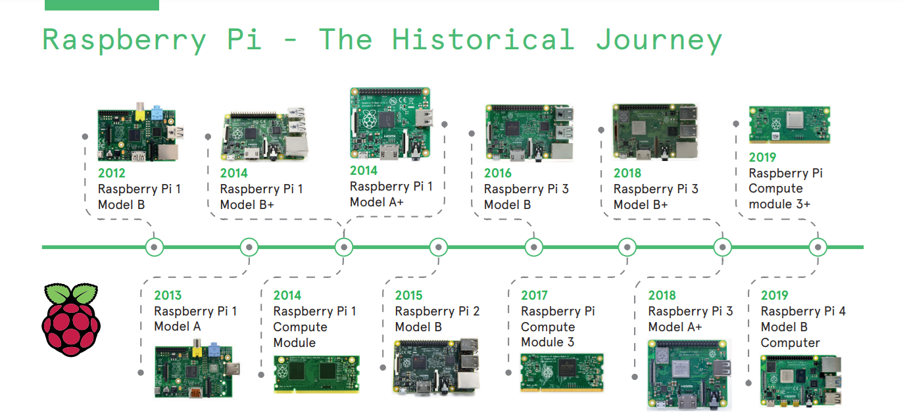

| 모델 | 특징 | 주요 용도 |
| :--- | :--- | :--- |
| **Model B** | 표준 규격, 풍부한 I/O 포트 | 실습, 서버, 데스크톱 대체 |
| **Model A** | 이더넷·USB 축소, 경량·저전력 | 임베디드 기기 내장 |
| **Zero/Zero 2 W** | 초소형, 저전력, 무선 지원 | 초소형 IoT, 웨어러블 |
| **Compute Module** | 기판 체결 모듈(I/O 분리) | 상용 양산 제품 내장 |
| **Pico 시리즈** | RP2040/RP2350 MCU | 베어메탈 하드웨어 제어 |

> 40핀 GPIO 헤더 배치는 세대 간 호환되며, Pico는 Linux가 구동되지 않는 MCU 형태임

---

## GPIO 핀 번호 체계 (Pin Numbering)

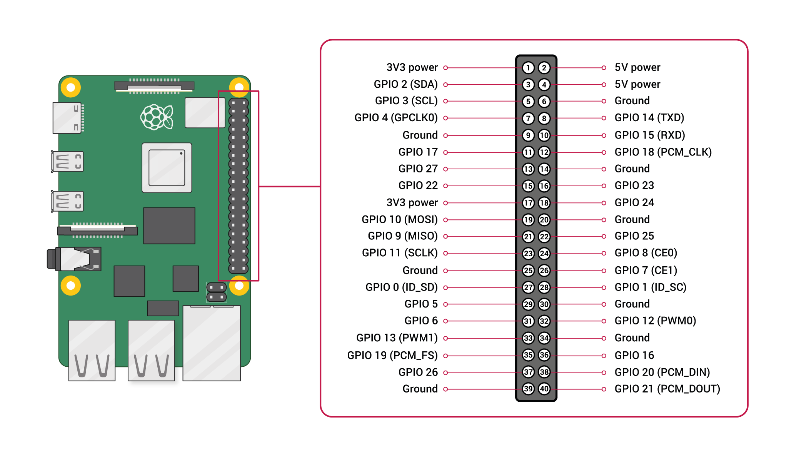

| 체계 | 정의 | 적용 대상 |
| :--- | :--- | :--- |
| **물리 핀 번호** | 헤더 커넥터 상의 물리 위치(1~40) | 브레드보드 실물 결선 |
| **BCM 번호** | SoC 내부 GPIO 레지스터 번호 | 소프트웨어 제어 코드 |

> 두 체계 혼동 시 오결선 발생 유의 (본 강의의 모든 소스 코드는 **BCM 번호 기준**으로 작성)

---

## GPIO 대체 기능 (Alternate Functions)

- **핀 다중화**: 단순 디지털 I/O 외에 내부 하드웨어 컨트롤러와 연계된 특수 통신 기능 겸용

| 버스 기능 | 주요 용도 |
| :--- | :--- |
| **I2C(SDA/SCL)** | 2선식 다중 센서 인터페이싱 |
| **SPI(MOSI/MISO/SCLK/CE)** | 고속 동기식 센서·ADC 제어 |
| **UART(TXD/RXD)** | 시리얼 비동기 콘솔 및 통신 |
| **PWM** | LED 디밍, 모터 속도·각도 제어 |

### 핀 배정 시 유의사항

- 특수 기능 핀을 일반 GPIO로 사용하면 해당 통신 기능은 사용 불가
- 보드 핀 기능표를 사전 확인하고, SPI·I2C는 `raspi-config`에서 명시적 활성화 필요

---

## GPIO 대체 기능 - I2C 개요 (Inter-Integrated Circuit)

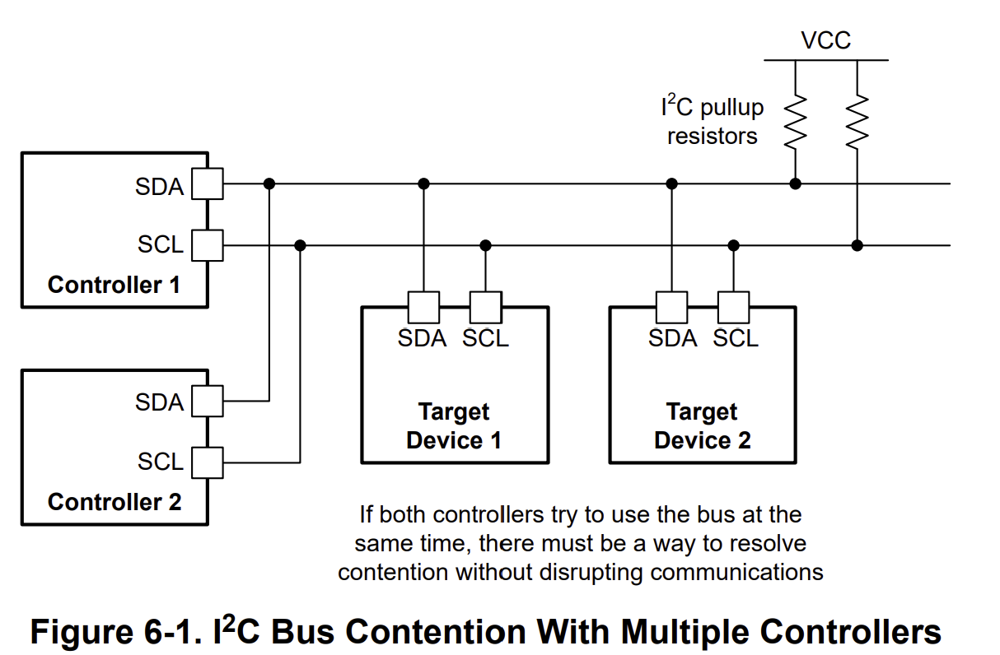

- **버스 특성**: **단 두 선(SDA, SCL)으로 다수의 기기를 연결**하는 동기식 반이중 버스

| 신호 | 공식 명칭 | 버스 내 역할 |
| :--- | :--- | :--- |
| `SDA` | Serial Data | 양방향 데이터 송수신 선로 |
| `SCL` | Serial Clock | 마스터 생성 동기 클록 선로 |

- **주소 기반 식별**: 장치마다 고유 주소를 부여받아 선로 추가 없이 버스 확장 가능
- **오픈 드레인**: 두 신호선 모두 반드시 **풀업 저항** 연결 필수

---

## GPIO 대체 기능 - I2C 오픈 드레인 회로 (Open-Drain Circuit)

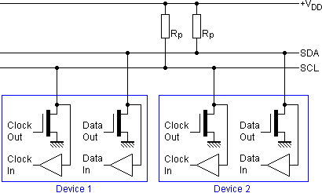

- **스위칭 구조**: 트랜지스터를 능동 출력이 아닌 접지 방향 스위치로만 구동하는 오픈 드레인 구조

| 단자 | 위치 | 연결 대상 |
| :--- | :--- | :--- |
| **Gate** | 좌측 | Data/Clock Out(제어 입력) |
| **Drain** | 상단 | SDA/SCL 버스 라인 |
| **Source** | 하단 | 시스템 접지(GND) |

---

## GPIO 대체 기능 - I2C 오픈 드레인 동작 (Open-Drain Operation)

- **구동 원리**: 트랜지스터는 버스를 **LOW로만 능동 구동**하며, HIGH는 풀업 저항이 복원

| 게이트 입력 | 스위치 상태 | 버스 선로 전위 | 논리 판정 |
| :--- | :--- | :--- | :---: |
| **Low (OFF)** | 열림(개방) | 풀업 저항($R_p$)에 의해 3.3V 복원 | **HIGH(1)** |
| **High (ON)** | 닫힘(도통) | 접지(GND)로 전류 방전 | **LOW(0)** |

### 통신 절차 및 장점

- **동작 절차**: 마스터 주소 송출 ➔ 대상 슬레이브 ACK(LOW) 응답 ➔ 데이터 송수신
- **클럭 스트레칭**: 슬레이브 처리 지연 시 SCL을 LOW로 유지하여 마스터 일시 정지 유도
- **단락 방지**: 어떤 장치도 3.3V를 직접 출력하지 않아 다중 기기 충돌 시에도 쇼트 방지
- **유선 논리곱(Wired-AND)**: 한 장치라도 LOW 구동 시 전체 버스가 LOW로 유지

---

## GPIO 대체 기능 - I2C 설정과 확인 (Setup and Check)

| 설정 항목 | 라즈베리파이 4 하드웨어 사양 |
| :--- | :--- |
| **기본 핀** | `SDA` GPIO2(물리 3번), `SCL` GPIO3(물리 5번) |
| **동작 속도** | 표준 모드 100kHz, 고속 모드 400kHz |
| **풀업 저항** | 온보드 1.8kΩ 풀업 저항 내장 |
| **활성화** | `raspi-config` ➔ Interface Options ➔ I2C |

```bash
# Enable I2C interface and scan active slave addresses
sudo raspi-config
i2cdetect -y 1
```

- `i2cdetect`의 출력 번호가 장치 **주소**이며, 미검출 시 배선과 전원 공급 우선 점검

---

## GPIO 대체 기능 - SPI (Serial Peripheral Interface)

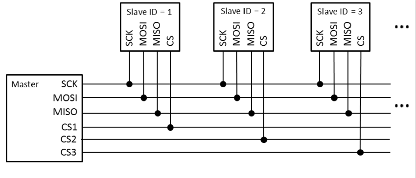

- **고속 전이중 버스**: 4개 신호선을 통해 송수신을 동시에 수행하는 고속 동기식 버스
- **칩 선택(CS)**: 주소 대신 **CE(Chip Enable)** 라인으로 대상 기기 직접 선택

| 신호 | 신호 방향 | 핀 매핑 |
| :--- | :--- | :--- |
| `MOSI` | 마스터 ➔ 슬레이브 | GPIO10(물리 19번) |
| `MISO` | 슬레이브 ➔ 마스터 | GPIO9(물리 21번) |
| `SCLK` | 마스터 ➔ 슬레이브 | GPIO11(물리 23번) |
| `CE0` / `CE1` | 마스터 ➔ 슬레이브 | GPIO8(24번) / GPIO7(26번) |

```bash
# Enable SPI interface and inspect device nodes
sudo raspi-config
ls -l /dev/spidev0.*
```

---

## GPIO 대체 기능 - UART (Universal Asynchronous Receiver/Transmitter)

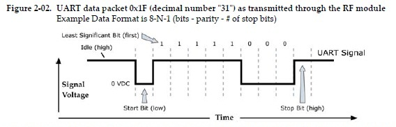

- **비동기 통신**: 클록선 없이 사전에 설정된 **보율(Baud Rate)** 기준으로 송수신 타이밍 결정
- **결선 방식**: 호스트와 장치의 `TXD`와 `RXD`를 상호 **교차 연결**(1:1 점대점 통신)
- **로직 주의**: **3.3V 로직 레벨**만 지원 — 5V TTL 또는 RS-232 직접 연결 시 파손

### 라즈베리파이 4 내장 UART 컨트롤러

| 컨트롤러 | 동작 특성 | 기본 인터페이스 |
| :--- | :--- | :--- |
| **PL011** | 독립 고정 클록 기반 안정적 고속 통신 | Bluetooth 모듈 전용 할당 |
| **mini UART** | 코어 클록 종속(클록 변동 시 지터 발생) | 40핀 GPIO 헤더 기본 할당 |

- Bluetooth 비활성화(`dtoverlay=disable-bt`) 시 고성능 PL011을 GPIO 헤더로 용도 전환 가능

---

## GPIO 대체 기능 - PWM (Pulse Width Modulation)

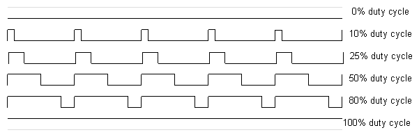

- **펄스 폭 변조**: 주기는 일정하게 유지하면서 HIGH 구간 비율인 **듀티 사이클** 조절
- **모의 아날로그**: 스위칭 주파수가 부하 반응보다 빠를 경우 전압 평균값으로 동작

| 항목 | 라즈베리파이 4 사양 |
| :--- | :--- |
| **하드웨어 PWM** | 전용 핀: GPIO12·18(PWM0), GPIO13·19(PWM1) |
| **소프트웨어 PWM** | 일반 GPIO 핀 에뮬레이션(OS 지연 영향) |
| **주요 용도** | LED 디밍, 모터 속도 제어, 서보 각도 제어 |

---

## 전기적 주의사항 (Electrical Cautions)

- **로직 전압**: GPIO는 **3.3V 로직 레벨**을 사용하며, 5V 신호 직접 인가 시 SoC 파손 위험
- **전류 한계**: 핀당 권장 전류(약 16mA) 및 전체 합산 한계를 준수하여 회로 설계
- **소자 보호**: LED 연결 시 과전류 방지를 위해 **반드시 전류 제한 저항을 직렬 연결**

### 저항값 계산 예시

- 전원 전압($V_{\text{CC}}$): **3.3V**, LED 순방향 전압($V_f$): 약 **2.0V**, 목표 전류($I_f$): 약 **4mA**

$$R = \frac{V_{\text{CC}} - V_f}{I_f} = \frac{3.3 - 2.0}{0.004} = 325\,\Omega \approx 330\,\Omega$$

- **330Ω 저항 선정**: 핀 보호 안전 마진과 충분한 시인성을 확보하는 최적 규격
- 모터 등 인덕티브 대전류 부하는 **트랜지스터 또는 드라이버 회로** 연계 필수

---

## 라즈베리파이 운영체제 (Raspberry Pi OS)

- **공식 운영체제**: 데비안(Debian) 리눅스 기반 하드웨어 최적화 배포판 (구 Raspbian)

### 배포판 에디션 선택

| 에디션 | 주요 특징 | 권장 용도 |
| :--- | :--- | :--- |
| **Desktop** | GUI 데스크톱 환경 제공 | 일반 학습 및 개발용 |
| **Lite** | 경량 CLI 전용 환경(헤드리스) | 임베디드 배포 및 서버 구축 |
| **64-bit** | `arm64` 아키텍처 지원 | **본 강의 실습 표준 환경** |

- **임베디드 배포 권장**: 불필요한 데몬이 제거된 **Lite 64-bit 버전** 사용
  - 스토리지 절약, 부팅 시간 단축, 메모리 확보, 보안 공격 표면 축소 이점

---

## 장치 파일과 GPIO (Device Files)

- 최신 커널은 GPIO 제어를 전용 **문자 디바이스(Character Device)** 인터페이스로 표준화
- 노드 경로: `/dev/gpiochip0`(온보드 GPIO 컨트롤러)
- 레거시 방식인 `/sys/class/gpio`(sysfs) 방식은 폐기(Deprecated)되어 신규 사용 금지

### 문자 디바이스 도입 배경

| 비교 항목 | sysfs 방식(Deprecated) | 문자 디바이스 방식(libgpiod) |
| :--- | :--- | :--- |
| **접근 방식** | 파일 경로 문자열 I/O | `ioctl` 시스템 콜 기반 바이너리 제어 |
| **라인 소유권** | 프로세스 간 소유권 불분명 | 프로세스 단위 배타적 점유 |
| **자원 정리** | 수동 해제 필요(누수 위험) | 프로세스 종료 시 커널 자동 회수 |
| **제어 성능** | 잦은 파일 I/O로 상대적 느림 | 경량 시스템 콜로 고속 제어 가능 |

- 본 실습에서는 문자 디바이스 API를 추상화한 `libgpiod` 라이브러리를 표준 채택

---

## GPIO 라이브러리 구성 (GPIO Libraries)

| 라이브러리 | 패키지명 | 링크 플래그 | 주요 역할 |
| :--- | :--- | :---: | :--- |
| `libgpiod` | `libgpiod-dev` | `-lgpiod` | 표준 문자 디바이스 기반 I/O 제어 |
| `lgpio` | `liblgpio-dev` | `-llgpio` | 마이크로초 정밀 타이밍, 하드웨어 PWM |

- `libgpiod`는 표준 인터페이스를 제공하나 마이크로초 단위 타이밍 지연 제어는 미지원
- 초음파 거리 센서(HC-SR04)처럼 정밀 펄스 계측이 필요한 실습은 `lgpio`를 병행 사용
- 두 라이브러리는 상호 배타적이지 않으므로 **동일 프로그램에서 동시 링크 가능**

---

## lgpio 설치와 링크 (Installing lgpio)

```bash
# Install the development package from official distribution archive
sudo apt install -y liblgpio-dev

# Alternative: compile and install from source if package is unavailable
wget https://github.com/joan2937/lg/archive/master.zip
unzip master.zip && cd lg-master
make && sudo make install && sudo ldconfig

# Build application linking both libgpiod and lgpio libraries
clang++ -std=c++14 -Wall -Wextra -I./common main.cc -o run -lgpiod -llgpio -pthread
```

- 헤더 누락 시 `#include <lgpio.h>` 에러로 **컴파일 단계**에서 실패
- 링크 누락 시 `undefined reference to lgGpiochipOpen`으로 **링크 단계**에서 실패

---

## 초기 설정 (Initial Setup)

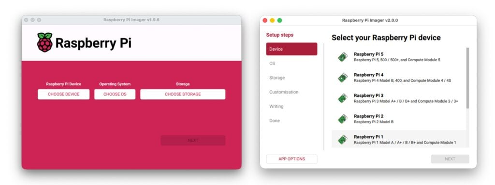

- OS 이미지는 공식 툴 [**Raspberry Pi Imager**](https://www.raspberrypi.com/software/)로 microSD 카드에 기록

### Raspberry Pi Imager를 통한 OS 설치 절차

1. 호스트 PC에 Raspberry Pi Imager 설치 및 실행
2. `Raspberry Pi Device`에서 `Raspberry Pi 4` 지정
3. `Operating System`에서 `Raspberry Pi OS (other)` ➔ `Raspberry Pi OS Lite (64-bit)` 선택
4. `Storage` 메뉴에서 기록 대상 microSD 카드 정확히 지정
5. 사용자 설정에서 호스트명, 계정·비밀번호, Wi-Fi 접속 정보, SSH 활성화 사전 구성
6. 설정 확인 후 microSD 카드 플래싱 진행
7. 완료된 카드를 슬롯에 장착하고 전원(USB-C) 및 이더넷 연결 후 부팅

- 반드시 **64-bit** 버전을 선택해야 64비트 바이너리(`aarch64`) 실습 환경 구축 가능

---

## 초기 설정 (Initial Setup) (Cont'd - 1)

### 설치 결과 검증

```bash
# Verify 64-bit kernel architecture
uname -a
getconf LONG_BIT         # Returns 64

# Verify operating system distribution release
cat /etc/os-release
```

- `uname -a`에 `aarch64`, `getconf LONG_BIT` 결과가 `64`로 출력되면 정상 설치 완료
- `hostnamectl` 명령어로 호스트 이름 및 시스템 커널 세부 정보를 한눈에 조회 가능

---

## 초기 설정 (Initial Setup) (Cont'd - 2)

### 헤드리스 (Headless) 운용: SSH 기반 원격 개발

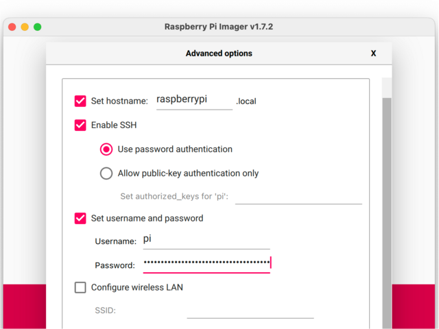

- 실제 상용 임베디드 리눅스 장비 운용 및 개발의 기본 환경

---

## 초기 설정 (Initial Setup) (Cont'd - 3)

### SSH 원격 접속 예시

```bash
# Connect to target board via mDNS local hostname
ssh <user>@raspberrypi.local

# Connect to target board via static/DHCP IPv4 address
ssh <user>@192.168.0.10

# Connect when custom SSH port is assigned
ssh -p <port> <user>@<host>

# Terminate remote shell session
exit
```

- 첫 접속 시 호스트 키 확인에 `yes` 입력하여 신뢰 호스트 등록
- 접속 실패 시 라즈베리파이에서 `systemctl status ssh` 및 `ip addr` 상태 확인
- 보안 수칙: 기본 비밀번호를 변경하고 SSH 공개키 기반 인증 사용 권장

---

## 네트워크 구성 (Network Configuration)

- 최신 Raspberry Pi OS는 **NetworkManager**(`nmcli`)를 통해 시스템 네트워크 환경 일원 관리

```bash
# Scan available Wi-Fi networks and establish connection
nmcli device wifi list
sudo nmcli device wifi connect "<SSID>" password "<PASSWORD>"

# Check current active network connections
nmcli connection show
ip addr show wlan0

# Configure static IPv4 address using connection profile name
sudo nmcli connection modify "<NAME>" \
  ipv4.addresses 192.168.0.10/24 \
  ipv4.gateway 192.168.0.1 \
  ipv4.dns "192.168.0.1 8.8.8.8" \
  ipv4.method manual
sudo nmcli connection down "<NAME>"
sudo nmcli connection up "<NAME>"

# Verify configured IP address, routing table, and DNS resolvers
ip -4 addr show wlan0
ip route
nmcli dev show wlan0 | grep DNS
```

---

## 네트워크 구성 (Network Configuration) (Cont'd)

### 무선랜 고정 IP 설정 예시

```bash
# 1. Identify Wi-Fi connection profile name
nmcli connection show

# 2. Configure static IPv4 parameters for the active profile
sudo nmcli connection modify "Campus Wi-Fi" \
  ipv4.method manual \
  ipv4.addresses 192.168.0.42/24 \
  ipv4.gateway 192.168.0.1 \
  ipv4.dns "192.168.0.1 8.8.8.8"

# 3. Reload connection profile to apply configuration
sudo nmcli connection down "Campus Wi-Fi"
sudo nmcli connection up "Campus Wi-Fi"
```

- 지정 주소(`192.168.0.42`)는 공유기 DHCP 풀과 중복되지 않는 고정 영역 선정
- 접속 유실 방지를 위해 **[고정 IP](https://ohyaan.github.io/basic-operations/networking_setup_and_management_for_raspberry_pi/#static-ipv4-with-networkmanager)**, 공유기 **DHCP 예약**, mDNS(`raspberrypi.local`) 중 선택

---

## 안전한 종료와 SD 카드 (Shutdown and SD Card)

- 비정상 전원 차단 시 버퍼 미반영으로 인한 파일시스템 손상 및 부팅 불가 유발

```bash
# Gracefully flush filesystem buffers and halt the system
sudo shutdown -h now

# Gracefully flush filesystem buffers and reboot the system
sudo reboot
```

### SD 카드 수명 관리 전략

- 플래시 메모리 특성상 P/E 쓰기 수명이 제한되므로 과도한 디스크 쓰기는 수명 단축 초래
- **상용화 고려사항**:
  - 시스템 임시 파일 및 잦은 로그 기록은 램 기반 파일시스템(`tmpfs`) 활용
  - 배포 환경에서 루트 파일시스템을 읽기 전용(Read-Only)으로 마운트
  - 주요 데이터는 외부 저장 매체나 원격 서버로 주기적 전송
