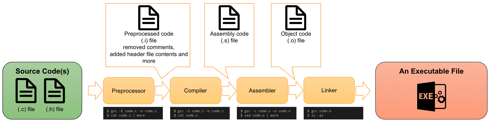
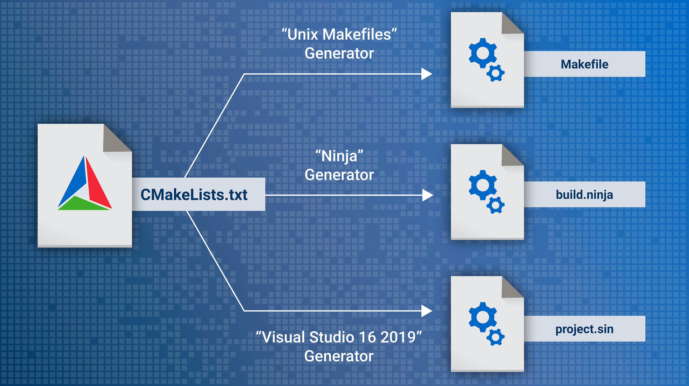
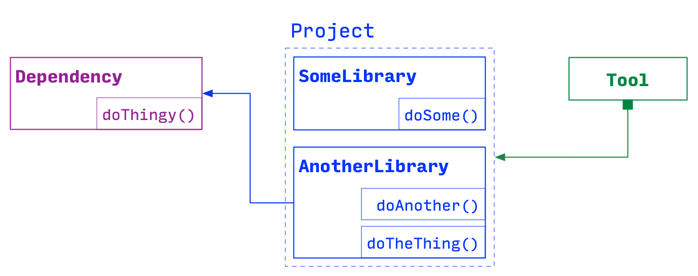
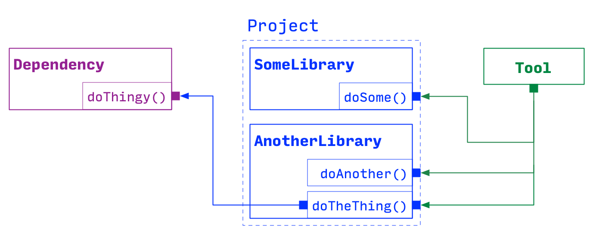
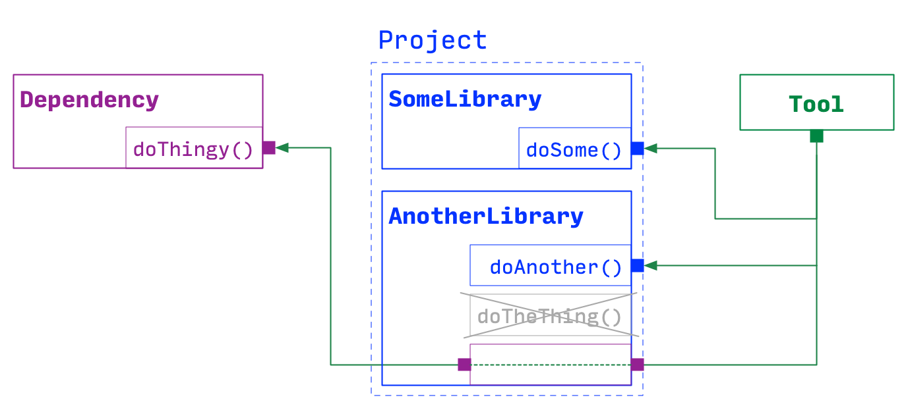
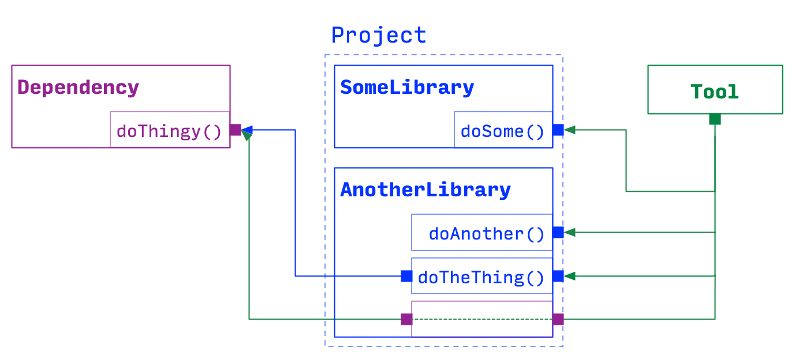
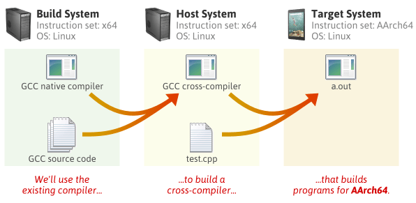

<!-- _class: lead -->

# 마이크로임베디드프로그래밍

## 빌드 시스템과 크로스 컴파일

### [munseong.jeong@daejin.ac.kr](mailto:munseong.jeong@daejin.ac.kr)

---

## 컴파일 과정 (Compilation Pipeline)



| 단계 | 실행 명령 | 산출물 |
| :--- | :--- | :--- |
| **전처리** | `clang++ -E` | `.i` — 헤더 전개 소스 |
| **컴파일** | `clang++ -S` | `.s` — 어셈블리 소스 |
| **어셈블** | `clang++ -c` | `.o` — 오브젝트 파일 |
| **링크** | `clang++` | 실행 파일 또는 라이브러리 |

- **단계별 오류 원인 판별**:
  - 헤더 탐색 실패 ➔ 전처리 단계 오류
  - 구문·문법 오류 ➔ 컴파일 단계 오류
  - 심볼 미정의(`undefined reference`) ➔ 링크 단계 오류

---

## 빌드 시스템이 필요한 이유 (Why a Build System)

- 단일 소스 파일은 명령줄에서 직접 빌드 가능

```bash
clang++ -std=c++14 main.cc -o app
```

- **소스 규모 증가 시 관리 한계**:
  - 변경된 소스 파일만 선별하는 재컴파일 판단 필요
  - 모듈 간 컴파일 순서 및 복잡한 의존 관계 관리 필요
  - 타깃 보드별 컴파일러 플래그 및 아키텍처 다변화 대응
  - 외부 서드파티 라이브러리 탐색 및 링크 자동화 필요

> 빌드 시스템은 **무엇을, 언제, 어떤 옵션으로 빌드할지** 자동으로 결정

---

## CMake란 (What CMake Is)



- **빌드 시스템 생성기(Build-System Generator)**: 네이티브 빌드 파일(Makefile, Ninja)을 자동 생성
- `CMakeLists.txt`를 기반으로 플랫폼 독립적 빌드 명세 정의

### 2단계 워크플로 (Two-Phase Workflow)

1. **Configure**(`cmake -B build`): 컴파일러 검출, 옵션 평가, 네이티브 빌드 파일 생성
2. **Build**(`cmake --build build`): 실제 빌드 도구 구동 및 바이너리 컴파일

> 빌드 옵션이나 프로젝트 구조 변경 시 Configure 단계 재수행 필수

---

## 타깃 중심 설계 (Target-Centric Design)

- **타깃(Target)**: 실행 파일, 라이브러리 등 명명된 빌드 산출물 단위
- 인클루드 경로, 컴파일 플래그, 링크 속성을 **타깃 단위로 개별 바인딩**

```cmake
add_library(sensors SHARED src/dht11.cc src/hcsr04.cc)

target_include_directories(sensors
  PUBLIC  include/      # Visible to anything linking sensors
  PRIVATE src/          # Visible to sensors itself only
)

target_compile_features(sensors PUBLIC cxx_std_14)
target_link_libraries(sensors PRIVATE gpiod)
```

- `PUBLIC`, `PRIVATE`, `INTERFACE` 스코프로 **전이 전파(Transitive Propagation)** 제어

---

## 전이 전파 (Transitive Propagation)

### 의존성 체인 (Dependency Chain)

- **다단계 의존 구조**: Consumer A ➔ Target B ➔ Target C
- **전파 속성**: 라이브러리 링크, Include 경로, 컴파일 정의, 언어 표준
- **Scope 역할**: Target B가 Target C의 빌드 속성을 Consumer A로 전파할지 결정

### Scope 핵심 요약

| Scope | 자체 빌드 | 상위 전파 | 주요 사용 목적 |
| :--- | :---: | :---: | :--- |
| **`PRIVATE`** | **O** | **X** | 내부 구현 은닉 및 캡슐화 |
| **`INTERFACE`** | **X** | **O** | Header-only 라이브러리 전파 |
| **`PUBLIC`** | **O** | **O** | 공개 인터페이스 규격 유지 |

- **자체 빌드**: Target B 컴파일 시 Target C 속성 적용
- **상위 전파**: Target B를 사용하는 Consumer A에게 Target C 속성 전달

---

## 전이 전파 (Transitive Propagation) (Cont'd - 1)

### 의존성 시나리오 (Dependency Scenario)



- **구성 요소**:
  - **`Tool`**: 최상위 응용 프로그램(Consumer)
  - **`Project`**: 라이브러리 집합(`AnotherLibrary`, `SomeLibrary`)
  - **`Dependency`**: 하위 외부 라이브러리(`doThingy()` 제공)
- **의존 구조**:
  - 직접 의존성: `Tool` ➔ `Project`, `AnotherLibrary` ➔ `Dependency`
  - 전이 의존성: `Tool` ➔ `Dependency`(`AnotherLibrary` 경유 구조)

> `AnotherLibrary`의 스코프 설정에 따라 `Tool`의 `Dependency` 접근성 결정

---

## 전이 전파 (Transitive Propagation) (Cont'd - 2)

### `PRIVATE` 스코프



- **자체 사용**: `AnotherLibrary` 내부(`doTheThing()`)에서만 `Dependency` 호출
- **상위 차단**: `Tool`의 `Dependency` 직접 접근을 차단하여 내부 캡슐화 유지
- **헤더 분리**: `Dependency` 헤더가 소스 파일(`.cc`)에만 포함될 때 사용
- **빌드 최적화**: `Dependency` 변경 시 `Tool`의 불필요한 재컴파일 차단

```cmake
add_library(AnotherLibrary AnotherLibrary.cc)
target_link_libraries(AnotherLibrary PRIVATE Dependency)

add_executable(Tool main.cc)
target_link_libraries(Tool PRIVATE AnotherLibrary SomeLibrary)
```

---

## 전이 전파 (Transitive Propagation) (Cont'd - 3)

### `INTERFACE` 스코프



- **자체 미사용**: `AnotherLibrary` 자체 빌드 시 `Dependency`를 직접 사용하지 않음
- **상위 전파**: `Tool`이 `AnotherLibrary` 링크 시 `Dependency`가 자동 연결됨
- **전달 전용**: 자체 컴파일 소스 없이 상위 소비자에 의존성 속성만 전달
- **주요 활용**: Header-only 라이브러리(nlohmann/json 등) 및 공통 플래그 타깃

```cmake
add_library(AnotherLibrary INTERFACE)
target_link_libraries(AnotherLibrary INTERFACE Dependency)

add_executable(Tool main.cc)
target_link_libraries(Tool PRIVATE AnotherLibrary SomeLibrary)
```

---

## 전이 전파 (Transitive Propagation) (Cont'd - 4)

### `PUBLIC` 스코프



- **자체 사용 및 전파**: 내부 빌드에 사용하면서 상위 `Tool`에도 접근 권한 전파
- **공개 헤더 노출**: `AnotherLibrary` 공개 헤더(`.h`)에 `Dependency` 타입 노출 시 채택
- **이중 접근**: `Tool`에서 `doTheThing()` 및 `doThingy()` 직접 호출 가능
- **주의사항**: 불필요한 남용 시 결합도 증가 및 빌드 속도 저하 유발

```cmake
add_library(AnotherLibrary AnotherLibrary.cc)
target_link_libraries(AnotherLibrary PUBLIC Dependency)

add_executable(Tool main.cc)
target_link_libraries(Tool PRIVATE AnotherLibrary SomeLibrary)
```

---

## 전이 전파 (Transitive Propagation) (Cont'd - 5)

### Scope 선택 가이드

- **`PRIVATE` 우선 채택**:
  - 의존성 헤더가 소스 파일(`.cc`)에만 포함될 때
  - 모듈 캡슐화 유지 및 재컴파일 전파 범위를 최소화할 때
- **`PUBLIC` 제한적 채택**:
  - 의존성 타입이 공개 헤더(`.h`)의 함수 인자, 반환형, 멤버 변수로 노출될 때
- **`INTERFACE` 특수 채택**:
  - 빌드할 소스 파일이 없는 Header-only 라이브러리 연동 시
  - 공통 플래그나 매크로 정의만 전파하는 인터페이스 타깃 구성 시

> 기본값으로 **`PRIVATE`** 우선 고려 (`PUBLIC` 남용은 의존성 결합도 증가 초래)

- 출처: <https://decovar.dev/blog/2023/07/22/cmake-target-link-libraries-scopes/>

---

## 최소 예제 (Minimal Example)

```cmake
cmake_minimum_required(VERSION 3.20)
project(mep_lab LANGUAGES CXX)

set(CMAKE_CXX_STANDARD 14)
set(CMAKE_CXX_STANDARD_REQUIRED ON)

find_package(PkgConfig REQUIRED)
pkg_check_modules(GPIOD REQUIRED libgpiod)

add_executable(blink src/blink.cc)
target_include_directories(blink PRIVATE ${GPIOD_INCLUDE_DIRS})
target_link_libraries(blink PRIVATE ${GPIOD_LIBRARIES})
```

```bash
# Configure, build, and run application
cmake -B build -DCMAKE_BUILD_TYPE=Release
cmake --build build -j
./build/blink
```

- 빌드 시 `-v` 옵션을 추가하면 실행된 실제 상세 컴파일 명령어 확인 가능

---

## 의존성과 증분 빌드 (Incremental Build)

- **핵심 원리**: 변경이 발생한 파일 및 영향받는 타깃만 **선별 재컴파일**

```text
main.cc   -> main.o   --+
                        +--> app
sensor.cc -> sensor.o --+
     ^
sensor.hpp (if sensor.hpp changes, you must recreate sensor.o)
```

- CMake는 헤더 의존성을 자동 추적하여 헤더 수정 시 관련 파일만 갱신

### 병렬 빌드 (Parallel Build)

```bash
cmake --build build -j        # Compile in parallel across CPU cores
```

- 상호 의존성이 없는 번역 단위는 CPU 코어별로 병렬 빌드 수행
- 타깃 보드는 연산 자원이 한정되어 있으므로 크로스 컴파일 병행 권장

---

## 빌드 옵션 (Build Options)

- Configure 단계에서 `-D<OPTION>=<VALUE>` 형식으로 조건부 빌드 설정

```cmake
option(MEP_SIMD "Enable SIMD kernels" ON)
option(BUILD_TESTS "Build unit tests" ON)

if(MEP_SIMD)
  target_compile_definitions(sensors PRIVATE MEP_SIMD=1)
endif()
```

```bash
# Disable SIMD kernels and unit tests during configuration
cmake -B build -DMEP_SIMD=OFF -DBUILD_TESTS=OFF
```

---

## 빌드 타입 (Build Types)

| 타입 | GCC/Clang 플래그 | 주요 용도 |
| :--- | :--- | :--- |
| `Debug` | `-g -O0` | 디버깅 및 심볼 보존 |
| `Release` | `-O3 -DNDEBUG` | 상용 배포 및 성능 최적화 |
| `RelWithDebInfo` | `-O2 -g` | 디버그 정보 포함 배포본 |
| `MinSizeRel` | `-Os -DNDEBUG` | 바이너리 크기 최적화 |

```bash
# Configure build tree with Release mode
cmake -B build -DCMAKE_BUILD_TYPE=Release
```

- 빌드 타입 미지정 시 기본 최적화 플래그가 누락될 수 있으므로 명시 필수
- 성능 벤치마크 수행 전 반드시 `Release` 모드 설정 여부 확인

---

## 컴파일러 최적화 플래그 (Compiler Optimization Flags)

- **트레이드오프**: 실행 속도, 코드 크기, 컴파일 시간, 디버깅 용이성 간 절충

### 옵션별 요약 비교

| 옵션 | 주요 목적 | 실행 속도 | 바이너리 크기 | 디버깅 | 컴파일 시간 |
| :--- | :--- | :---: | :---: | :---: | :---: |
| **`-O0`** | 디버깅 및 개발 | 가장 느림 | 큼 | 매우 쉬움 | 가장 빠름 |
| **`-O1`** | 기본 최적화 | 보통 | 보통 | 비교적 쉬움 | 빠름 |
| **`-O2`** | 상용 배포 표준 | 빠름 | 적절함 | 어려움 | 보통 |
| **`-O3`** | 실행 속도 극대화 | 가장 빠름 | 커질 수 있음 | 매우 어려움 | 느림 |
| **`-Os`** | 코드 크기 최소화 | 보통~빠름 | 가장 작음 | 어려움 | 보통 |

> CMake의 `CMAKE_BUILD_TYPE` 설정에 따라 해당 최적화 플래그 자동 적용

---

## 컴파일러 최적화 플래그 (Compiler Optimization Flags) (Cont'd - 1)

### `-O0` (최적화 미적용)

- **주요 목적**: 디버깅 및 초기 기능 개발 단계(`Debug` 빌드)
- **특징**: 코드 변형을 억제하여 변수 추적 및 중단점(Breakpoint) 설정 용이
- **단점**: 실행 속도가 느리고 생성되는 바이너리 크기가 비대함

### `-O1` (기본 최적화)

- **주요 목적**: 최소한의 컴파일 시간 증가로 기초 런타임 성능 개선
- **특징**: 데드 코드 제거, 단순 함수 인라이닝 등 안전한 기본 최적화 수행

### `-O2` (권장 프로덕션 최적화)

- **주요 목적**: 일반적인 상용 릴리스 표준(`Release` 빌드)
- **특징**: 코드 크기를 과도하게 키우지 않으면서 명령어 스케줄링 및 루프 최적화 집중

---

## 컴파일러 최적화 플래그 (Compiler Optimization Flags) (Cont'd - 2)

### `-O3` (최대 속도 최적화)

- **주요 목적**: 실행 연산 속도 극대화
- **특징**: 공격적인 루프 언롤링, SIMD 자동 벡터화, 대규모 인라이닝 적용
- **유의점**: 코드 크기 급증으로 L1 I-Cache 미스 발생 시 오히려 성능 저하 가능

### `-Os` (바이너리 크기 최적화)

- **주요 목적**: 바이너리 풋프린트 최소화(`MinSizeRel` 빌드)
- **특징**: `-O2` 기법 중 코드 크기를 증가시키는 인라이닝 및 정렬 패딩 억제
- **활용**: Flash/RAM 용량이 엄격히 제한된 임베디드 MCU 및 펌웨어 환경

> 임베디드 실무: 디버깅 시 `-O0`, 일반 배포 시 `-O2`, 플래시 제약 시 `-Os` 채택

---

## 아웃오브소스 빌드 (Out-of-Source Build)

- **개념**: 소스 트리와 빌드 산출물 디렉터리를 엄격히 분리

```text
project/
├── CMakeLists.txt
├── src/
├── include/
└── build/  <- Keep build artifacts separate from source tree
```

### 주요 장점

- **소스 트리 보호**: 소스 디렉터리를 오염시키지 않고 버전 관리 상태 청결 유지
- **다중 빌드 유지**: 빌드 설정을 독립적으로 동시 유지(`build-debug`, `build-pi`)
- **손쉬운 초기화**: 빌드 디렉터리 삭제만으로 클린 상태 복원

```bash
# Clean and re-configure build directory
rm -rf build && cmake -B build && cmake --build build
```

---

## 호스트와 타깃 (Host and Target)



- **호스트(Host)**: 컴파일러를 실행하는 개발 시스템(x86_64 워크스테이션, CI 서버)
- **타깃(Target)**: 바이너리가 실제 배포되어 구동되는 임베디드 보드(라즈베리파이 AArch64)

> **크로스 컴파일**: 호스트에서 실행되어 타깃 아키텍처용 기계어 바이너리를 생성

### 크로스 컴파일 채택 이유

1. **빌드 성능**: 고성능 호스트 CPU와 대용량 RAM을 활용하여 컴파일 시간 단축
2. **CI/CD 연계**: 물리 보드가 없는 클라우드 서버(GitHub Actions)에서 자동 빌드
3. **환경 재현성**: 컨테이너 기반 빌드 환경 구축으로 일관된 결과 도출

---

## 툴체인과 sysroot (Toolchain and sysroot)

- **툴체인(Toolchain)**: 크로스 컴파일러, 어셈블러, 링커, 표준 라이브러리 도구 모음
- 데비안 계열 크로스 컴파일러 패키지: `g++-aarch64-linux-gnu`

```bash
aarch64-linux-gnu-g++ -std=c++14 hello.cc -o hello_pi
```

- **`sysroot`**: 타깃 보드의 루트 파일시스템 구조를 모방한 호스트 디렉터리

```text
sysroot/
├── usr/
│   ├── include/                  # Target header files
│   └── lib/aarch64-linux-gnu/    # Target shared libraries
└── lib/
    └── aarch64-linux-gnu/
```

> `sysroot`가 없으면 타깃 전용 서드파티 라이브러리(`libgpiod` 등) 링크 불가

---

## 툴체인 파일 (CMake Toolchain File)

- CMake는 **툴체인 파일**을 통해 크로스 컴파일 파라미터를 주입받음

```cmake
# cmake/toolchains/aarch64-linux-gnu.cmake
set(CMAKE_SYSTEM_NAME      Linux)
set(CMAKE_SYSTEM_PROCESSOR aarch64)

set(CMAKE_C_COMPILER   aarch64-linux-gnu-gcc)
set(CMAKE_CXX_COMPILER aarch64-linux-gnu-g++)

set(CMAKE_FIND_ROOT_PATH_MODE_PROGRAM NEVER)
set(CMAKE_FIND_ROOT_PATH_MODE_LIBRARY ONLY)
set(CMAKE_FIND_ROOT_PATH_MODE_INCLUDE ONLY)
```

- `FIND_ROOT_PATH_MODE_*`: 호스트 빌드 도구와 타깃 라이브러리·헤더 탐색 경로 분리
- `CMAKE_SYSROOT`: Configure 단계에서 실제 타깃 루트 디렉터리 경로 지정

---

## 크로스 빌드 수행 (Running a Cross Build)

```bash
# Configure and build with toolchain file
cmake -B build-pi \
  -DCMAKE_TOOLCHAIN_FILE=cmake/toolchains/aarch64-linux-gnu.cmake \
  -DCMAKE_BUILD_TYPE=Release
cmake --build build-pi -j
```

### 빌드 결과 검증

```bash
# Inspect binary architecture and machine type
file build-pi/app
# ELF 64-bit LSB executable, ARM aarch64 ...

readelf -h build-pi/app | grep Machine
# Machine: AArch64
```

> 타깃 전송 전 **바이너리 아키텍처 검증 필수**(호스트용 바이너리 오작성 방지)

---

## Docker란 (What Docker Is)


- **도커(Docker)**: 애플리케이션과 실행 환경을 이미지로 격리하여 컨테이너로 구동
- **이미지(Image)**: 툴체인과 의존 패키지가 고정된 읽기 전용 템플릿
- **컨테이너(Container)**: 이미지로부터 인스턴스화되어 격리 실행되는 프로세스
- **볼륨 마운트**: 호스트의 소스 트리와 빌드 폴더를 컨테이너 내부로 직접 연결
- **Dockerfile**: 호스트 OS 차이를 배제하고 동일한 빌드 환경을 완벽히 재현

---

## Docker 설치 (Installing Docker)

| 호스트 OS | 설치 링크 및 가이드 |
| :--- | :--- |
| **Windows** | [Docker Desktop for Windows](https://docs.docker.com/desktop/setup/install/windows-install/) |
| **macOS** | [Docker Desktop for Mac](https://docs.docker.com/desktop/setup/install/mac-install/) |
| **Linux** | [Docker Engine 설치 안내](https://docs.docker.com/engine/install/) |

- Windows / macOS: Docker Desktop의 가상화 Linux 환경 구동
- Linux: Docker Engine 및 Buildx CLI 플러그인 연동
- 정상 설치 검증: `docker run --rm hello-world`

---

## Docker 이미지와 아키텍처 (Image and Architecture)

- **베이스 환경**: Ubuntu 24.04 LTS 공식 이미지 기반 구성
- **컨테이너 아키텍처**: 호스트 CPU와 동일하게 설정하여 에뮬레이션 오버헤드 방지
- **타깃 산출물**: 호스트 플랫폼과 무관하게 두 경우 모두 Linux AArch64 바이너리 생성

| 호스트 CPU | 컨테이너 플랫폼 | 실행 방식 |
| :--- | :--- | :--- |
| `x86_64` | `linux/amd64` | x86_64 네이티브 컨테이너 구동 |
| `aarch64` | `linux/arm64` | AArch64 네이티브 컨테이너 구동 |

- 컨테이너 빌더 플랫폼과 최종 타깃 아키텍처를 명확히 구분하여 운용

---

## Docker 크로스 빌드 이미지 (Docker Cross-Build Image)

[//]: # "INCLUDE: ./mep/03/Dockerfile"

- `cmake`: 빌드 파일 생성 및 컴파일 제어 총괄
- `g++-aarch64-linux-gnu`: 라즈베리파이용 AArch64 크로스 컴파일러
- `file`: 빌드 결과물의 실제 아키텍처 검증 도구
- 이미지 내부에 CMake와 툴체인을 사전 패키징하여 빌드 환경 일관성 보장

---

## Docker 이미지 빌드 (Building the Image)

- 작업 디렉터리: `mep/03`
- `--platform`: 빌더 컨테이너의 CPU 아키텍처 지정
- `--load`: 빌드 완료된 이미지를 로컬 도커 저장소에 등록

```bash
# Build builder image on x86_64 host
docker buildx build \
  --platform linux/amd64 \
  -t mep03-cross:amd64 \
  --load .
```

- Apple Silicon 등 AArch64 호스트: `--platform linux/arm64 -t mep03-cross:arm64` 적용

---

## sysroot 구성 (Preparing a sysroot)

- 표준 C++ 코드: 이미지 내장 크로스 툴체인만으로 빌드 완료
- 외장 라이브러리(`libgpiod` 등): 타깃 보드 라이브러리를 `sysroot`로 동기화

```bash
# Sync header files and libraries from Raspberry Pi
mkdir -p sysroot/usr sysroot/lib
rsync -a pi@raspberrypi.local:/usr/include/ sysroot/usr/include/
rsync -a pi@raspberrypi.local:/usr/lib/ sysroot/usr/lib/
rsync -a pi@raspberrypi.local:/lib/ sysroot/lib/
```

- 타깃 보드와 `sysroot` 간 라이브러리 바이너리 버전 일치 필수
- 호스트의 `sysroot`를 컨테이너 내부 `/sysroot`로 읽기 전용 연결

---

## 컨테이너 실행과 볼륨 (Running the Container)

```bash
# Run builder container with mounted volumes
mkdir -p build-docker-amd64
docker run --rm --platform linux/amd64 \
  -v "$PWD:/src:ro" \
  -v "$PWD/build-docker-amd64:/out" \
  mep03-cross:amd64
```

- `/src`: 소스 트리를 읽기 전용(`:ro`)으로 마운트하여 원본 보호
- `/out`: 빌드 아티팩트 및 캐시가 호스트에 기록되는 출력 경로
- AArch64 호스트: 이미지 `mep03-cross:arm64`, 플랫폼 `linux/arm64` 지정

---

## 실습 프로젝트 (Practice Project)

- 크로스 빌드 실습 프로젝트 디렉터리 구조

```text
mep/03/
├── CMakeLists.txt                           # Project build definition
├── src/00_hello_pi.cc                       # Application source
├── cmake/toolchains/aarch64-linux-gnu.cmake # Cross-toolchain config
└── Dockerfile                               # Pinned build environment
```

- `CMakeLists.txt`: 프로젝트 및 타깃 실행 파일 정의
- `src/00_hello_pi.cc`: 빌드 대상 C++ 소스 코드
- `cmake/toolchains/`: 타깃 시스템 및 크로스 컴파일러 명세
- `Dockerfile`: 격리 빌드 환경 및 실행 도구 패키징

---

## CMakeLists.txt

[//]: # "INCLUDE: ./mep/03/CMakeLists.txt"

---

## 소스 코드와 타깃 (Source and Target)

[//]: # "INCLUDE: ./mep/03/src/00_hello_pi.cc"

- `project()`: 프로젝트 명칭 및 CXX 언어 환경 선언
- `set()`: C++14 표준 요구사항 지정
- `add_executable()`: 실행 타깃 `hello_pi`와 입력 소스 매핑

---

## 툴체인 파일 적용 (Applying the Toolchain File)

[//]: # "INCLUDE: ./mep/03/cmake/toolchains/aarch64-linux-gnu.cmake"

- `CMAKE_SYSTEM_NAME` 및 `PROCESSOR`: 타깃 환경(Linux AArch64) 정의
- `CMAKE_C/CXX_COMPILER`: 크로스 컴파일러 바이너리 지정
- `CMAKE_FIND_ROOT_PATH_MODE_*`: 호스트 도구와 타깃 라이브러리 탐색 격리
- `sysroot` 사용 시 Configure 단계에서 `-DCMAKE_SYSROOT=/sysroot` 추가

---

## 컨테이너에서 CMake 빌드 (Building with CMake)

```bash
# Configure and build target inside container
cmake -S /src -B /out \
  -DCMAKE_TOOLCHAIN_FILE=/src/cmake/toolchains/aarch64-linux-gnu.cmake \
  -DCMAKE_BUILD_TYPE=Release
cmake --build /out --parallel
```

- Configure 단계: `CMakeLists.txt`를 해석하여 네이티브 빌드 파일 생성
- Build 단계: 컨테이너 내부 `g++-aarch64-linux-gnu`로 AArch64 실행 바이너리 생성

---

## sysroot를 사용하는 빌드 (Building with a sysroot)

```bash
# Build linking external libraries via sysroot
docker run --rm --platform linux/amd64 \
  -v "$PWD:/src:ro" \
  -v "$PWD/sysroot:/sysroot:ro" \
  -v "$PWD/build-docker-amd64:/out" \
  mep03-cross:amd64 \
  sh -c 'cmake -S /src -B /out \
    -DCMAKE_TOOLCHAIN_FILE=/src/cmake/toolchains/aarch64-linux-gnu.cmake \
    -DCMAKE_SYSROOT=/sysroot -DCMAKE_BUILD_TYPE=Release && \
    cmake --build /out --parallel'
```

- 타깃 의존성 헤더 및 라이브러리를 `/sysroot` 마운트 경로에서 탐색
- 표준 라이브러리만 사용하는 단일 소스는 `sysroot` 생략 가능

---

## 빌드 결과 검증 (Verifying the Output)

```bash
# Verify output binary architecture with containerized tools
docker run --rm --platform linux/amd64 \
  -v "$PWD/build-docker-amd64:/out:ro" \
  mep03-cross:amd64 file /out/hello_pi

docker run --rm --platform linux/amd64 \
  -v "$PWD/build-docker-amd64:/out:ro" \
  mep03-cross:amd64 sh -c \
  'readelf -h /out/hello_pi | grep Machine'
```

- `Machine: AArch64` 출력 확인
- 호스트용 x86_64 실행 파일이 오작성되지 않았는지 검증

---

## 라즈베리파이로 전송 (Sending to Raspberry Pi)

```bash
# Transfer binary to Raspberry Pi and execute
scp build-docker-amd64/hello_pi \
  pi@raspberrypi.local:~/mep03/
ssh pi@raspberrypi.local '~/mep03/hello_pi'
```

- `scp`: SSH 프로토콜을 통해 빌드 산출물 원격 전송
- 타깃 보드에서 실행 권한 및 라이브러리 정상 로드 여부 확인
- 호스트의 빌드 디렉터리와 타깃의 런타임 디렉터리 분리 운용

---

## 증분 빌드 확인 (Checking Incremental Builds)

```bash
# Modify source timestamp to trigger incremental build
touch src/00_hello_pi.cc
docker run --rm --platform linux/amd64 \
  -v "$PWD:/src:ro" \
  -v "$PWD/build-docker-amd64:/out" \
  mep03-cross:amd64
```

- 변경된 소스 및 해당 소스에 의존하는 타깃만 선별 재컴파일
- 격리된 컨테이너 환경에서 일관된 반복 빌드 및 생산성 보장
