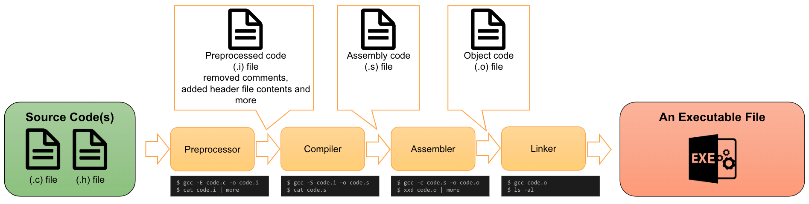
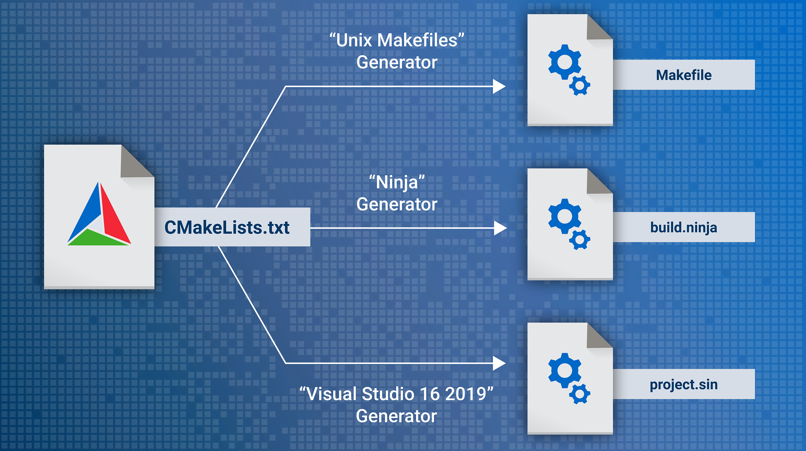
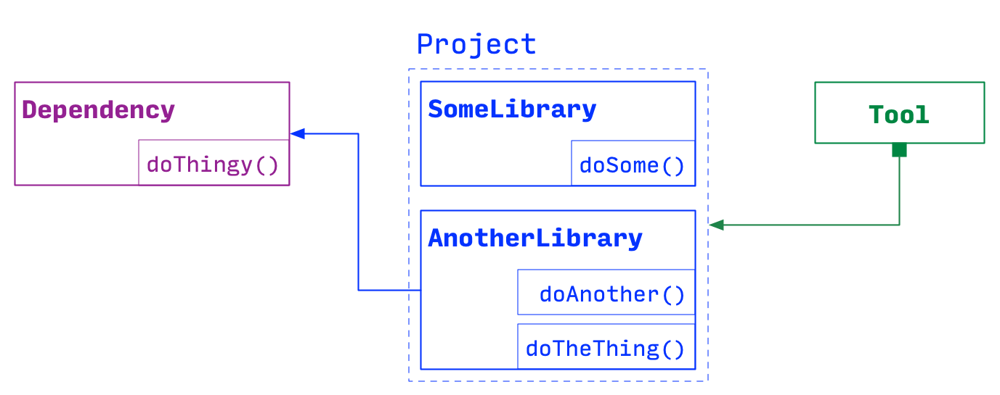
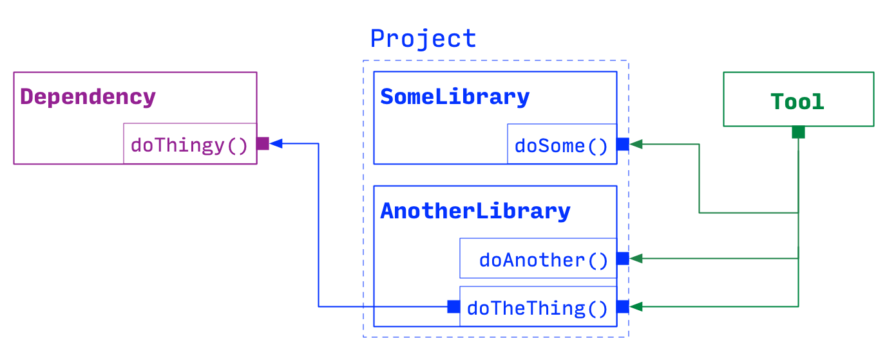
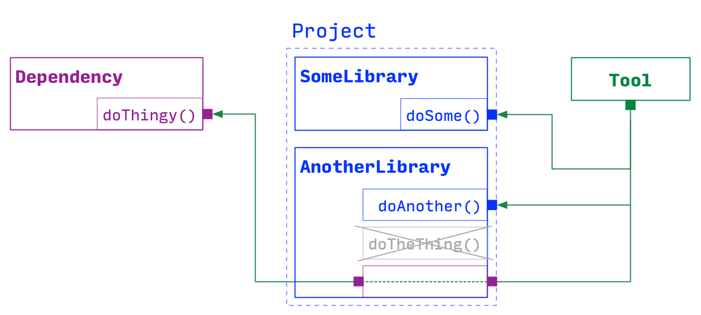
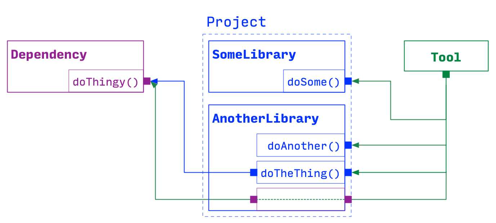
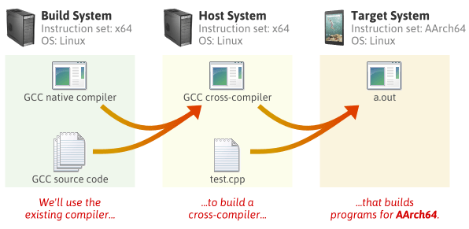

<!-- _class: lead -->

# 마이크로임베디드프로그래밍

## 빌드 시스템과 크로스 컴파일

### [munseong.jeong@daejin.ac.kr](mailto:munseong.jeong@daejin.ac.kr)

---

## 컴파일 과정 (Compilation Pipeline)



| 단계 | 실행 명령 | 산출물 |
| :--- | :--- | :--- |
| **전처리** | `clang++ -E main.cc -o main.ii` | `.ii`: `#include`와 매크로를 전개한 소스 |
| **컴파일** | `clang++ -S main.ii` | `.s`: 어셈블리 소스 |
| **어셈블** | `clang++ -c main.s` | `.o`: 오브젝트 파일 |
| **링크** | `clang++ main.o -o app` | 실행 파일 또는 라이브러리 |

---

## 컴파일 과정 (Compilation Pipeline) (Cont'd)

### 단계별 오류 구분

- **번역 단위**(Translation Unit): 전처리를 마친 소스 파일 1개이며, 컴파일러는 번역 단위마다 `.o` 1개를 생성
- **심볼**(Symbol): 링커가 오브젝트 파일 사이에서 연결하는 함수·전역 변수의 이름

| 오류 메시지(Clang) | 발생 단계 | 원인 |
| :--- | :--- | :--- |
| `fatal error: 'sensor.hpp' file not found` | 전처리 | 헤더 탐색 경로에 파일이 없음 |
| `error: expected ';' at end of declaration` | 컴파일 | 구문 오류 |
| ``undefined reference to `ReadSensor()'`` | 링크 | 선언만 있고 정의가 없는 심볼 |

- **예**: `undefined reference`는 링크 단계 오류이므로 헤더가 아니라 정의(`.cc`)와 링크 대상을 확인

---

## 빌드 시스템이 필요한 이유 (Why a Build System)

- **단일 소스 파일**: 명령 한 줄로 빌드할 수 있음

```bash
clang++ -std=c++14 main.cc -o app
```

- **소스 파일이 늘어날 때 수동 빌드의 문제**:
  - 수정된 파일만 다시 컴파일하려면 파일마다 변경 여부를 직접 확인해야 함
  - 라이브러리를 먼저 빌드해야 실행 파일을 링크할 수 있는 순서를 직접 관리해야 함
  - 호스트용·라즈베리파이용 빌드마다 컴파일러와 플래그를 바꿔 입력해야 함
  - `libgpiod` 같은 외부 라이브러리의 헤더 경로와 링크 옵션을 직접 지정해야 함

> 빌드 시스템: **무엇을, 언제, 어떤 옵션으로 빌드할지** 자동으로 결정하는 도구

---

## CMake란 (What CMake Is)



- **빌드 시스템 생성기**(Build-System Generator): 네이티브 빌드 파일을 생성하는 도구
- **네이티브 빌드 도구**: 빌드 파일을 읽어 컴파일러를 호출하는 프로그램(예: `make`, `ninja`)
- **`CMakeLists.txt`**: 타깃·소스·옵션을 플랫폼과 무관하게 기술하는 CMake 입력 파일

---

## CMake란 (What CMake Is) (Cont'd)

### 2단계 워크플로 (Two-Phase Workflow)

1. **Configure**(`cmake -B build`): 컴파일러 검출, 옵션 평가, 네이티브 빌드 파일 생성
2. **Build**(`cmake --build build`): 네이티브 빌드 도구를 실행하여 바이너리 생성

- **Configure 산출물**: `build/` 아래의 `Makefile`(또는 `build.ninja`)과 설정값을 저장한 `CMakeCache.txt`
- **옵션 변경**: `-D` 옵션을 바꾸려면 Configure 단계를 다시 실행
- **`CMakeLists.txt` 수정**: Build 단계에서 변경을 감지하여 Configure를 자동으로 다시 실행

---

## 타깃 중심 설계 (Target-Centric Design)

- **타깃**(Target): 실행 파일, 라이브러리처럼 이름이 붙은 빌드 산출물 단위
- **타깃별 속성**: 인클루드 경로, 컴파일 플래그, 링크할 라이브러리를 타깃마다 따로 지정

```cmake
add_library(sensors SHARED src/dht11.cc src/hcsr04.cc)

target_include_directories(sensors
  PUBLIC  include/      # Visible to anything linking sensors
  PRIVATE src/          # Visible to sensors itself only
)

target_compile_features(sensors PUBLIC cxx_std_14)
target_link_libraries(sensors PRIVATE gpiod)
```

- `SHARED`: 공유 라이브러리(`libsensors.so`)로 빌드
- `PUBLIC`·`PRIVATE`·`INTERFACE`: 속성을 이 타깃을 사용하는 다른 타깃에도 전달할지 정하는 스코프

---

## 전이 전파 (Transitive Propagation)

- **정의**: 타깃 B에 지정한 속성이 B를 링크하는 타깃 A에도 자동으로 적용되는 동작
- **의존성 체인**: Consumer A → Target B → Target C
- **전파 대상 속성**: 링크 라이브러리, 인클루드 경로, 컴파일 정의(`-D`), 언어 표준
- **스코프의 역할**: B가 C에서 받은 속성을 A에도 전달할지 결정

### 스코프별 동작

| 스코프 | B 자체 빌드에 적용 | A로 전파 | 사용 목적 |
| :--- | :---: | :---: | :--- |
| **`PRIVATE`** | **O** | **X** | 내부 구현 숨김 |
| **`INTERFACE`** | **X** | **O** | 헤더 전용 라이브러리 |
| **`PUBLIC`** | **O** | **O** | 공개 헤더에 노출된 의존성 |

---

## 전이 전파 (Transitive Propagation) (Cont'd - 1)

### 의존성 시나리오 (Dependency Scenario)



- **구성 요소**:
  - **`Tool`**: 최상위 응용 프로그램(Consumer)
  - **`Project`**: 라이브러리 집합(`AnotherLibrary`, `SomeLibrary`)
  - **`Dependency`**: `doThingy()`를 제공하는 하위 외부 라이브러리
- **의존 구조**:
  - 직접 의존성: `Tool` → `Project`, `AnotherLibrary` → `Dependency`
  - 전이 의존성: `AnotherLibrary`를 거친 `Tool` → `Dependency`

> `AnotherLibrary`의 스코프 설정에 따라 `Tool`이 `Dependency`를 사용할 수 있는지 결정

---

## 전이 전파 (Transitive Propagation) (Cont'd - 2)

### `PRIVATE` 스코프



- **자체 사용**: `AnotherLibrary` 내부의 `doTheThing()`에서만 `Dependency`를 호출
- **전파 차단**: `Tool`은 `Dependency`의 인클루드 경로를 받지 못해 직접 호출할 수 없음
- **사용 조건**: `Dependency` 헤더를 소스 파일(`.cc`)에서만 포함할 때
- **재컴파일 범위**: `Dependency` 헤더가 바뀌어도 `Tool`의 `main.cc`는 다시 컴파일되지 않음

```cmake
add_library(AnotherLibrary AnotherLibrary.cc)
target_link_libraries(AnotherLibrary PRIVATE Dependency)

add_executable(Tool main.cc)
target_link_libraries(Tool PRIVATE AnotherLibrary SomeLibrary)
```

---

## 전이 전파 (Transitive Propagation) (Cont'd - 3)

### `INTERFACE` 스코프



- **자체 미사용**: `AnotherLibrary`는 컴파일할 소스가 없어 `Dependency`를 직접 사용하지 않음
- **전파**: `Tool`이 `AnotherLibrary`를 링크하면 `Dependency`의 속성도 함께 적용
- **헤더 전용 라이브러리**: `.cc` 없이 헤더만으로 구성된 라이브러리(예: nlohmann/json)
- **활용**: 헤더 전용 라이브러리, 공통 컴파일 플래그만 묶은 타깃

```cmake
add_library(AnotherLibrary INTERFACE)
target_link_libraries(AnotherLibrary INTERFACE Dependency)

add_executable(Tool main.cc)
target_link_libraries(Tool PRIVATE AnotherLibrary SomeLibrary)
```

---

## 전이 전파 (Transitive Propagation) (Cont'd - 4)

### `PUBLIC` 스코프



- **사용과 전파**: `AnotherLibrary`가 직접 사용하면서 `Tool`에도 같은 속성을 전달
- **사용 조건**: `AnotherLibrary`의 공개 헤더(`.h`)에 `Dependency`의 타입이 나타날 때
- **결과**: `Tool`에서 `doTheThing()`과 `doThingy()`를 모두 직접 호출할 수 있음
- **주의**: 불필요한 `PUBLIC`은 `Dependency`가 바뀔 때 `Tool`까지 다시 컴파일하게 만듦

```cmake
add_library(AnotherLibrary AnotherLibrary.cc)
target_link_libraries(AnotherLibrary PUBLIC Dependency)

add_executable(Tool main.cc)
target_link_libraries(Tool PRIVATE AnotherLibrary SomeLibrary)
```

---

## 전이 전파 (Transitive Propagation) (Cont'd - 5)

### 예: 스코프에 따른 빌드 결과

- **실험 조건**: `Tool`의 `main.cc`가 `#include "dependency.h"` 후 `doThingy()`를 호출
- **`Dependency`**: `target_include_directories(... INTERFACE dep/include)`로 헤더 경로만 제공

| `AnotherLibrary`의 링크 스코프 | `Tool`의 빌드 결과 |
| :--- | :--- |
| `PRIVATE` | `fatal error: dependency.h: No such file or directory` |
| `PUBLIC` | 빌드 성공 |

- **원인**: `PRIVATE`이면 `dep/include`가 `Tool`의 컴파일 명령에 `-I` 옵션으로 추가되지 않음
- **확인 환경**: CMake 4.3, GCC 11.4

---

## 전이 전파 (Transitive Propagation) (Cont'd - 6)

### 스코프 선택 기준

- **`PRIVATE` 우선 사용**:
  - 의존성 헤더를 소스 파일(`.cc`)에서만 포함할 때
  - 캡슐화를 유지하고 재컴파일 범위를 줄일 때
- **`PUBLIC` 제한적 사용**:
  - 의존성 타입이 공개 헤더(`.h`)의 매개변수 타입, 반환 타입, 멤버 변수에 나타날 때
- **`INTERFACE` 특수한 경우**:
  - 빌드할 소스 파일이 없는 헤더 전용 라이브러리를 연결할 때
  - 공통 플래그나 매크로 정의만 전달하는 타깃을 구성할 때

> 기본값은 **`PRIVATE`**: `PUBLIC`을 남용하면 타깃 간 결합도가 높아짐

- 출처: <https://decovar.dev/blog/2023/07/22/cmake-target-link-libraries-scopes/>

---

## 최소 예제 (Minimal Example)

```cmake
cmake_minimum_required(VERSION 3.20)
project(mep_lab LANGUAGES CXX)

set(CMAKE_CXX_STANDARD 14)
set(CMAKE_CXX_STANDARD_REQUIRED ON)

find_package(PkgConfig REQUIRED)
pkg_check_modules(GPIOD REQUIRED libgpiod)

add_executable(blink src/blink.cc)
target_include_directories(blink PRIVATE ${GPIOD_INCLUDE_DIRS})
target_link_libraries(blink PRIVATE ${GPIOD_LIBRARIES})
```

- **pkg-config**: 설치된 라이브러리의 헤더 경로와 링크 옵션을 알려 주는 도구
- `find_package(PkgConfig REQUIRED)`: CMake에서 pkg-config를 사용할 수 있게 함
- `pkg_check_modules(GPIOD ...)`: 결과를 `GPIOD_INCLUDE_DIRS`, `GPIOD_LIBRARIES` 변수에 저장

---

## 최소 예제 (Minimal Example) (Cont'd)

```bash
# Configure, build, and run application
cmake -B build -DCMAKE_BUILD_TYPE=Release
cmake --build build -j
./build/blink
```

- `-DCMAKE_BUILD_TYPE=Release`: 최적화 플래그를 적용하는 빌드 타입 지정
- `-j`: 여러 소스 파일을 동시에 컴파일하는 병렬 빌드
- `-v`: `cmake --build build -v`처럼 추가하면 실제로 실행된 컴파일 명령을 출력

---

## 의존성과 증분 빌드 (Incremental Build)

- **증분 빌드**: 마지막 빌드 이후 바뀐 파일과 그 파일에 의존하는 산출물만 다시 만드는 방식

```text
main.cc   -> main.o   --+
                        +--> app
sensor.cc -> sensor.o --+
     ^
sensor.hpp (if sensor.hpp changes, you must recreate sensor.o)
```

- **헤더 의존성 추적**: 컴파일러가 `-MD` 옵션으로 `.o`마다 포함한 헤더 목록(`.d` 파일)을 기록
- **예**: `sensor.hpp`를 수정하면 `sensor.o`와 `app`만 다시 만들고 `main.o`는 그대로 사용

---

## 의존성과 증분 빌드 (Incremental Build) (Cont'd)

### 병렬 빌드 (Parallel Build)

```bash
cmake --build build -j        # Compile in parallel across CPU cores
```

- **병렬 컴파일**: 서로 의존하지 않는 번역 단위(`main.cc`, `sensor.cc`)를 여러 CPU 코어에서 동시에 컴파일
- **작업 수 지정**: `-j 4`처럼 숫자를 붙이면 동시에 실행할 컴파일 작업 수를 제한
- **라즈베리파이에서의 한계**: 호스트보다 CPU 코어와 메모리가 적어 빌드 시간이 김
- **대안**: 호스트에서 라즈베리파이용 바이너리를 만드는 크로스 컴파일(이 장 후반부)

---

## 빌드 옵션 (Build Options)

- **`option()`**: Configure 단계에서 `ON`/`OFF`로 바꿀 수 있는 불리언 옵션 선언
- **SIMD**(Single Instruction, Multiple Data): 명령 하나로 여러 데이터를 동시에 처리하는 CPU 기능

```cmake
option(MEP_SIMD "Enable SIMD kernels" ON)
option(BUILD_TESTS "Build unit tests" ON)

if(MEP_SIMD)
  target_compile_definitions(sensors PRIVATE MEP_SIMD=1)
endif()
```

```bash
# Disable SIMD kernels and unit tests during configuration
cmake -B build -DMEP_SIMD=OFF -DBUILD_TESTS=OFF
```

- **`ON`(기본값)**: `sensors`의 컴파일 명령에 `-DMEP_SIMD=1`이 추가되어 `#if MEP_SIMD` 구간 포함
- **`OFF`**: `MEP_SIMD` 매크로가 정의되지 않아 SIMD 코드가 빠진 구현으로 빌드

---

## 빌드 타입 (Build Types)

| 타입 | CMake 기본 플래그(GCC/Clang) | 주요 용도 |
| :--- | :--- | :--- |
| `Debug` | `-g` | 디버깅(최적화 옵션이 없으므로 `-O0`으로 동작) |
| `Release` | `-O3 -DNDEBUG` | 실행 속도 우선 배포 |
| `RelWithDebInfo` | `-O2 -g -DNDEBUG` | 디버그 정보를 포함한 배포 |
| `MinSizeRel` | `-Os -DNDEBUG` | 바이너리 크기 우선 배포 |

```bash
# Configure build tree with Release mode
cmake -B build -DCMAKE_BUILD_TYPE=Release
```

- `-g`: 디버거가 소스 줄과 변수를 찾을 수 있도록 디버그 정보를 바이너리에 포함
- `-DNDEBUG`: `NDEBUG` 매크로를 정의하여 `assert()` 검사를 제거
- **빌드 타입 미지정**: 최적화 플래그가 붙지 않아 `-O0`으로 빌드됨(Makefile·Ninja 생성기)
- **확인 환경**: CMake 4.3, GCC 11.4의 `CMakeCache.txt`와 `cmake --build build -v` 출력

---

## 컴파일러 최적화 플래그 (Compiler Optimization Flags)

- **트레이드오프**: 실행 속도, 코드 크기, 컴파일 시간, 디버깅 용이성 사이의 절충

### 옵션별 비교

| 옵션 | 주요 목적 | 실행 속도 | 바이너리 크기 | 디버깅 | 컴파일 시간 |
| :--- | :--- | :---: | :---: | :---: | :---: |
| **`-O0`** | 디버깅과 개발 | 가장 느림 | 큼 | 매우 쉬움 | 가장 빠름 |
| **`-O1`** | 기본 최적화 | 보통 | 보통 | 비교적 쉬움 | 빠름 |
| **`-O2`** | 일반 배포 | 빠름 | 적절함 | 어려움 | 보통 |
| **`-O3`** | 실행 속도 우선 | 가장 빠름 | 커질 수 있음 | 매우 어려움 | 느림 |
| **`-Os`** | 코드 크기 최소화 | 보통~빠름 | 가장 작음 | 어려움 | 보통 |

- **CMake 빌드 타입과의 대응**: `Debug` → `-O0`, `RelWithDebInfo` → `-O2`, `Release` → `-O3`, `MinSizeRel` → `-Os`

---

## 컴파일러 최적화 플래그 (Compiler Optimization Flags) (Cont'd - 1)

### `-O0` (최적화 미적용)

- **주요 목적**: 디버깅과 초기 기능 개발(`Debug` 빌드)
- **특징**: 소스 코드를 변형하지 않으므로 변수 값 추적과 중단점(Breakpoint) 설정이 쉬움
- **단점**: 실행 속도가 느리고 바이너리가 큼

### `-O1` (기본 최적화)

- **주요 목적**: 컴파일 시간을 크게 늘리지 않고 실행 성능 개선
- **특징**: 사용되지 않는 코드 제거, 한 번만 호출되는 함수의 인라이닝 등 기본 최적화 수행
- **인라이닝**(Inlining): 함수 호출을 함수 본문으로 대체하여 호출 비용을 제거하는 최적화

### `-O2` (일반 배포용 최적화)

- **주요 목적**: 일반적인 배포 빌드(CMake에서는 `RelWithDebInfo` 빌드)
- **특징**: 코드 크기를 크게 늘리지 않는 범위에서 명령어 스케줄링과 루프 최적화 수행

---

## 컴파일러 최적화 플래그 (Compiler Optimization Flags) (Cont'd - 2)

### `-O3` (최대 속도 최적화)

- **주요 목적**: 실행 속도 우선(CMake `Release` 빌드)
- **특징**: 루프 언롤링, 자동 벡터화, 적극적인 인라이닝 적용
- **루프 언롤링**(Loop Unrolling): 루프 본문을 여러 번 복제하여 반복 횟수와 분기 수를 줄임
- **자동 벡터화**(Auto-Vectorization): 루프를 SIMD 명령으로 변환(예: `int` 4개를 NEON `add` 1개로 덧셈)
- **유의점**: 코드가 커져 명령어 캐시(I-Cache)에 다 들어가지 않으면 오히려 느려질 수 있음

### `-Os` (바이너리 크기 최적화)

- **주요 목적**: 바이너리 크기 최소화(`MinSizeRel` 빌드)
- **특징**: `-O2` 최적화 중 코드 크기를 늘리는 인라이닝과 정렬 패딩을 억제
- **활용**: 플래시·RAM 용량이 작은 MCU 펌웨어

> 임베디드 실무: 디버깅 시 `-O0`, 일반 배포 시 `-O2`, 플래시 용량 제약 시 `-Os`

---

## 컴파일러 최적화 플래그 (Compiler Optimization Flags) (Cont'd - 3)

### 예: `-O2`와 `-O3`의 자동 벡터화 비교

[//]: # "INCLUDE: ./mep/03/src/01_vector_add.cc --from 4 --to 9 --no-comment"

```bash
# Generate AArch64 assembly at -O2 and -O3
aarch64-linux-gnu-g++ -std=c++14 -O2 -S mep/03/src/01_vector_add.cc -o vector_add_o2.s
aarch64-linux-gnu-g++ -std=c++14 -O3 -S mep/03/src/01_vector_add.cc -o vector_add_o3.s
```

| 컴파일러 | `-O2`의 `AddArrays()` | `-O3`의 `AddArrays()` |
| :--- | :--- | :--- |
| **GCC 11.4** | 스칼라 `add w4, w4, w5`로 1개씩 덧셈 | NEON `add v0.4s, v0.4s, v1.4s`로 4개씩 덧셈 |
| **Clang 14** | NEON `add`로 4개씩 덧셈 | NEON `add`로 4개씩 덧셈 |

- **결론**: 자동 벡터화가 적용되는 최적화 수준은 컴파일러와 버전에 따라 다름

---

## 아웃오브소스 빌드 (Out-of-Source Build)

- **정의**: 빌드 산출물을 소스 트리와 분리된 디렉터리(`build/`)에 생성하는 방식
- **인소스 빌드**: 소스 디렉터리에서 `cmake .`를 실행하여 산출물을 소스와 같은 위치에 생성
  - 예: `CMakeCache.txt`, `CMakeFiles/`, `Makefile`이 `CMakeLists.txt` 옆에 생김

```text
project/
├── CMakeLists.txt
├── src/
├── include/
└── build/  <- Keep build artifacts separate from source tree
```

---

## 아웃오브소스 빌드 (Out-of-Source Build) (Cont'd)

### 주요 장점

- **소스 트리 보호**: 생성 파일이 소스와 섞이지 않아 `git status`에 빌드 산출물이 나타나지 않음
- **다중 빌드 유지**: 설정이 다른 빌드 디렉터리를 동시에 유지(예: `build-debug`, `build-pi`)
- **간단한 초기화**: 빌드 디렉터리를 삭제하면 처음 상태로 돌아감

```bash
# Clean and re-configure build directory
rm -rf build && cmake -B build && cmake --build build
```

---

## 호스트와 타깃 (Host and Target)



- **호스트**(Host): 컴파일러를 실행하는 개발 시스템(예: x86_64 노트북, CI 서버)
- **타깃**(Target): 생성된 바이너리가 실행되는 시스템(예: AArch64 라즈베리파이)
- **용어 구분**: CMake의 타깃(빌드 산출물 단위)과는 다른 의미

> **크로스 컴파일**: 호스트에서 실행되는 컴파일러로 아키텍처가 다른 타깃용 바이너리를 생성하는 방식

---

## 호스트와 타깃 (Host and Target) (Cont'd)

### 크로스 컴파일을 사용하는 이유

1. **빌드 시간**: 호스트의 더 많은 CPU 코어와 메모리로 컴파일 시간을 줄임
2. **CI/CD 연계**: 라즈베리파이가 없는 클라우드 서버(예: GitHub Actions)에서 자동 빌드
3. **환경 재현성**: 컨테이너로 빌드 환경을 고정하여 누가 빌드해도 같은 결과를 얻음

- **CI/CD**(Continuous Integration/Delivery): 코드가 바뀔 때마다 빌드·테스트·배포를 자동 수행하는 체계

---

## 툴체인과 sysroot (Toolchain and sysroot)

- **툴체인**(Toolchain): 타깃용 컴파일러, 어셈블러, 링커, 표준 라이브러리를 묶은 도구 모음
- **예**: Debian·Ubuntu의 `g++-aarch64-linux-gnu` 패키지가 `aarch64-linux-gnu-g++` 명령을 제공

```bash
aarch64-linux-gnu-g++ -std=c++14 hello.cc -o hello_pi
```

- **툴체인의 범위**: C·C++ 표준 라이브러리만 포함하므로 표준 라이브러리만 쓰는 코드는 바로 빌드 가능

---

## 툴체인과 sysroot (Toolchain and sysroot) (Cont'd)

- **`sysroot`**: 타깃의 헤더와 라이브러리를 타깃과 같은 디렉터리 구조로 복사해 둔 호스트 디렉터리

```text
sysroot/
├── usr/
│   ├── include/                  # Target header files
│   └── lib/aarch64-linux-gnu/    # Target shared libraries
└── lib/
    └── aarch64-linux-gnu/
```

- **필요한 경우**: `libgpiod`처럼 타깃에만 설치된 라이브러리를 사용할 때
- **`sysroot`가 없는 경우**: 컴파일러가 `gpiod.h`를 찾지 못하고 링커가 `-lgpiod`를 찾지 못함

---

## 툴체인 파일 (CMake Toolchain File)

- **툴체인 파일**: 크로스 컴파일에 사용할 컴파일러와 탐색 규칙을 지정하는 CMake 스크립트

```cmake
# cmake/toolchains/aarch64-linux-gnu.cmake
set(CMAKE_SYSTEM_NAME      Linux)
set(CMAKE_SYSTEM_PROCESSOR aarch64)

set(CMAKE_C_COMPILER   aarch64-linux-gnu-gcc)
set(CMAKE_CXX_COMPILER aarch64-linux-gnu-g++)

set(CMAKE_FIND_ROOT_PATH_MODE_PROGRAM NEVER)
set(CMAKE_FIND_ROOT_PATH_MODE_LIBRARY ONLY)
set(CMAKE_FIND_ROOT_PATH_MODE_INCLUDE ONLY)
```

- **전달 방법**: Configure 단계에서 `-DCMAKE_TOOLCHAIN_FILE=<경로>`로 지정

---

## 툴체인 파일 (CMake Toolchain File) (Cont'd)

- `CMAKE_SYSTEM_NAME`, `CMAKE_SYSTEM_PROCESSOR`: 타깃의 OS와 CPU 아키텍처
- `CMAKE_C_COMPILER`, `CMAKE_CXX_COMPILER`: 사용할 크로스 컴파일러 명령
- `CMAKE_FIND_ROOT_PATH_MODE_PROGRAM NEVER`: 빌드 중 실행할 프로그램은 호스트에서 탐색
- `CMAKE_FIND_ROOT_PATH_MODE_LIBRARY ONLY`: 라이브러리는 `sysroot` 안에서만 탐색
- `CMAKE_FIND_ROOT_PATH_MODE_INCLUDE ONLY`: 헤더는 `sysroot` 안에서만 탐색
- `CMAKE_SYSROOT`: `sysroot` 경로이며 Configure 단계에서 `-DCMAKE_SYSROOT=<경로>`로 지정
- **탐색을 분리하는 이유**: 호스트의 x86_64 라이브러리를 AArch64 바이너리에 잘못 링크하는 오류 방지

---

## 크로스 빌드 수행 (Running a Cross Build)

```bash
# Configure and build with toolchain file
cmake -B build-pi \
  -DCMAKE_TOOLCHAIN_FILE=cmake/toolchains/aarch64-linux-gnu.cmake \
  -DCMAKE_BUILD_TYPE=Release
cmake --build build-pi -j
```

### 빌드 결과 검증

```bash
# Inspect binary architecture and machine type
file build-pi/app
# ELF 64-bit LSB pie executable, ARM aarch64, ...

readelf -h build-pi/app | grep Machine
# Machine: AArch64
```

- `file`: 파일 형식을 판별하는 명령
- `readelf -h`: ELF(Linux 실행 파일 형식)의 헤더를 출력하는 명령
- **대조**: 호스트 컴파일러로 잘못 빌드하면 `Machine: Advanced Micro Devices X86-64` 출력

---

## Docker란 (What Docker Is)


- **Docker**: 애플리케이션과 실행 환경을 컨테이너로 격리하여 실행하는 플랫폼
- **이미지**(Image): 툴체인과 패키지가 설치된 상태를 고정한 읽기 전용 템플릿
- **컨테이너**(Container): 이미지로부터 생성되어 격리된 환경에서 실행되는 프로세스
- **볼륨 마운트**: 호스트의 디렉터리를 컨테이너 내부 경로에 연결(`-v 호스트경로:컨테이너경로`)
- **Dockerfile**: 베이스 이미지와 설치 명령을 기술하여 이미지를 만드는 텍스트 파일
- **장점**: 호스트 OS가 달라도 같은 Dockerfile로 같은 빌드 환경을 구성

---

## Docker 설치 (Installing Docker)

| 호스트 OS | 설치 링크 및 가이드 |
| :--- | :--- |
| **Windows** | [Docker Desktop for Windows](https://docs.docker.com/desktop/setup/install/windows-install/) |
| **macOS** | [Docker Desktop for Mac](https://docs.docker.com/desktop/setup/install/mac-install/) |
| **Linux** | [Docker Engine 설치 안내](https://docs.docker.com/engine/install/) |

- **Windows·macOS**: Docker Desktop이 내부 Linux 가상 머신에서 컨테이너를 실행
- **Linux**: Docker Engine과 Buildx 플러그인(`docker buildx` 명령)을 설치
- **설치 확인**: `docker run --rm hello-world`가 안내 메시지를 출력하면 정상

---

## Docker 이미지와 아키텍처 (Image and Architecture)

- **베이스 이미지**: Ubuntu 24.04 LTS 공식 이미지(`ubuntu:24.04`)
- **컨테이너 플랫폼**: 호스트 CPU와 같게 지정하여 CPU 에뮬레이션 없이 실행
- **타깃 산출물**: 두 경우 모두 Linux AArch64 바이너리를 생성

| 호스트 CPU | 컨테이너 플랫폼 | 실행 방식 |
| :--- | :--- | :--- |
| `x86_64` | `linux/amd64` | x86_64 네이티브 컨테이너 실행 |
| `aarch64` | `linux/arm64` | AArch64 네이티브 컨테이너 실행 |

- **구분**: 컨테이너 플랫폼은 빌드 도구가 실행되는 CPU, 타깃 아키텍처는 산출물이 실행될 CPU

---

## Docker 크로스 빌드 이미지 (Docker Cross-Build Image)

[//]: # "INCLUDE: ./mep/03/Dockerfile"

- `binutils`: ELF 헤더를 출력하는 `readelf` 명령 제공
- `file`: 산출물의 파일 형식과 아키텍처 판별
- `g++-aarch64-linux-gnu`: 라즈베리파이용 AArch64 크로스 컴파일러
- `CMD`: `docker run`에서 명령을 생략하면 실행되는 기본 명령(Configure 후 Build)

---

## Docker 이미지 빌드 (Building the Image)

- **작업 디렉터리**: `mep/03`
- `docker buildx build`: 현재 디렉터리의 `Dockerfile`로 이미지를 생성
- `--platform`: 빌드 도구를 실행할 컨테이너의 CPU 아키텍처 지정
- `-t`: 이미지 이름과 태그 지정(`이름:태그`)
- `--load`: 생성한 이미지를 로컬 Docker 이미지 목록에 등록

```bash
# Build builder image on x86_64 host
docker buildx build \
  --platform linux/amd64 \
  -t mep03-cross:amd64 \
  --load .
```

- **AArch64 호스트**(예: Apple Silicon): `--platform linux/arm64 -t mep03-cross:arm64` 적용

---

## sysroot 구성 (Preparing a sysroot)

- **표준 C++만 사용하는 코드**: 이미지에 포함된 크로스 툴체인만으로 빌드
- **외부 라이브러리**(`libgpiod` 등): 라즈베리파이의 헤더와 라이브러리를 `sysroot`로 복사

```bash
# Sync header files and libraries from Raspberry Pi
mkdir -p sysroot/usr sysroot/lib
rsync -a pi@raspberrypi.local:/usr/include/ sysroot/usr/include/
rsync -a pi@raspberrypi.local:/usr/lib/ sysroot/usr/lib/
rsync -a pi@raspberrypi.local:/lib/ sysroot/lib/
```

- `rsync -a`: 원격 디렉터리를 권한과 심볼릭 링크를 유지하며 복사
- **버전 일치**: 라즈베리파이의 라이브러리를 갱신하면 `sysroot`도 다시 복사
- **컨테이너 연결**: 호스트의 `sysroot`를 컨테이너 내부 `/sysroot`에 읽기 전용으로 마운트

---

## 컨테이너 실행과 볼륨 (Running the Container)

```bash
# Run builder container with mounted volumes
mkdir -p build-docker-amd64
docker run --rm --platform linux/amd64 \
  -v "$PWD:/src:ro" \
  -v "$PWD/build-docker-amd64:/out" \
  mep03-cross:amd64
```

- `--rm`: 실행이 끝나면 컨테이너를 삭제
- `/src`: 소스 트리를 읽기 전용(`:ro`)으로 마운트하여 원본 보호
- `/out`: 빌드 산출물과 CMake 캐시가 호스트에 기록되는 출력 경로
- **명령 생략**: 이미지 이름 뒤에 명령이 없으므로 Dockerfile의 `CMD`가 실행됨
- **AArch64 호스트**: 이미지 `mep03-cross:arm64`, 플랫폼 `linux/arm64` 지정

---

## 실습 프로젝트 (Practice Project)

- 크로스 빌드 실습 프로젝트의 디렉터리 구조

```text
mep/03/
├── CMakeLists.txt                           # Project build definition
├── src/00_hello_pi.cc                       # Application source
├── cmake/toolchains/aarch64-linux-gnu.cmake # Cross-toolchain config
└── Dockerfile                               # Pinned build environment
```

- `CMakeLists.txt`: 프로젝트와 실행 타깃 정의
- `src/00_hello_pi.cc`: 빌드 대상 C++ 소스 코드
- `cmake/toolchains/`: 타깃 시스템과 크로스 컴파일러 지정
- `Dockerfile`: 빌드 도구를 설치한 격리 빌드 환경

---

## 빌드 정의 파일 (CMakeLists.txt)

[//]: # "INCLUDE: ./mep/03/CMakeLists.txt"

- `project()`: 프로젝트 이름과 사용 언어(`CXX`, C++) 선언
- `CMAKE_CXX_STANDARD 14`: C++14 표준으로 컴파일
- `CMAKE_CXX_STANDARD_REQUIRED ON`: C++14 미지원 컴파일러이면 이전 표준으로 낮추지 않고 오류 처리
- `CMAKE_CXX_EXTENSIONS OFF`: `-std=gnu++14` 대신 `-std=c++14`를 사용하여 GNU 확장 문법 제외
- `add_executable()`: 실행 타깃 `hello_pi`와 소스 파일 `src/00_hello_pi.cc` 연결

---

## 소스 코드 (Source Code)

[//]: # "INCLUDE: ./mep/03/src/00_hello_pi.cc"

- **사용 라이브러리**: C++ 표준 라이브러리(`iostream`)만 사용하므로 `sysroot` 없이 빌드 가능
- **실행 결과**: 라즈베리파이에서 실행하면 `Hello from Raspberry Pi target` 출력

---

## 툴체인 파일 적용 (Applying the Toolchain File)

[//]: # "INCLUDE: ./mep/03/cmake/toolchains/aarch64-linux-gnu.cmake"

- `CMAKE_SYSTEM_NAME`, `CMAKE_SYSTEM_PROCESSOR`: 타깃 환경(Linux, AArch64) 지정
- `CMAKE_C_COMPILER`, `CMAKE_CXX_COMPILER`: 크로스 컴파일러 명령 지정
- `CACHE FILEPATH`: 캐시 변수로 저장하므로 `-DCMAKE_CXX_COMPILER=<경로>`로 지정한 값이 우선
- `CMAKE_FIND_ROOT_PATH_MODE_*`: 호스트 도구와 타깃 라이브러리·헤더·패키지의 탐색 경로 분리
- **`sysroot` 사용 시**: Configure 단계에서 `-DCMAKE_SYSROOT=/sysroot` 추가

---

## 컨테이너에서 CMake 빌드 (Building with CMake)

```bash
# Configure and build target inside container
cmake -S /src -B /out \
  -DCMAKE_TOOLCHAIN_FILE=/src/cmake/toolchains/aarch64-linux-gnu.cmake \
  -DCMAKE_BUILD_TYPE=Release
cmake --build /out --parallel
```

- `-S /src -B /out`: 소스 디렉터리와 빌드 디렉터리를 각각 지정
- **Configure 단계**: `CMakeLists.txt`를 해석하여 네이티브 빌드 파일 생성
- **Build 단계**: 컨테이너 내부의 `aarch64-linux-gnu-g++`로 AArch64 실행 파일 생성
- `--parallel`: `-j`와 같은 병렬 빌드 옵션

---

## sysroot를 사용하는 빌드 (Building with a sysroot)

```bash
# Build linking external libraries via sysroot
docker run --rm --platform linux/amd64 \
  -v "$PWD:/src:ro" \
  -v "$PWD/sysroot:/sysroot:ro" \
  -v "$PWD/build-docker-amd64:/out" \
  mep03-cross:amd64 \
  sh -c 'cmake -S /src -B /out \
    -DCMAKE_TOOLCHAIN_FILE=/src/cmake/toolchains/aarch64-linux-gnu.cmake \
    -DCMAKE_SYSROOT=/sysroot -DCMAKE_BUILD_TYPE=Release && \
    cmake --build /out --parallel'
```

- **탐색 경로**: 타깃 라이브러리의 헤더와 라이브러리를 `/sysroot` 아래에서 탐색
- **생략 조건**: 표준 라이브러리만 사용하는 `00_hello_pi.cc`는 `sysroot` 없이 빌드 가능

---

## 빌드 결과 검증 (Verifying the Output)

```bash
# Verify output binary architecture with containerized tools
docker run --rm --platform linux/amd64 \
  -v "$PWD/build-docker-amd64:/out:ro" \
  mep03-cross:amd64 file /out/hello_pi

docker run --rm --platform linux/amd64 \
  -v "$PWD/build-docker-amd64:/out:ro" \
  mep03-cross:amd64 sh -c \
  'readelf -h /out/hello_pi | grep Machine'
```

- **정상 결과**: `Machine: AArch64` 출력
- **잘못된 결과**: `Advanced Micro Devices X86-64`가 출력되면 호스트용 컴파일러로 빌드된 것

---

## 라즈베리파이로 전송 (Sending to Raspberry Pi)

```bash
# Transfer binary to Raspberry Pi and execute
ssh pi@raspberrypi.local 'mkdir -p ~/mep03'
scp build-docker-amd64/hello_pi \
  pi@raspberrypi.local:~/mep03/
ssh pi@raspberrypi.local '~/mep03/hello_pi'
```

- `ssh`: 원격 시스템에 접속하거나 원격에서 명령 1개를 실행
- `scp`: SSH 연결을 통해 파일을 원격 시스템으로 복사
- **사전 준비**: 대상 디렉터리 `~/mep03`이 없으면 `scp`가 실패하므로 먼저 생성
- **호환성 조건**: 툴체인의 glibc·libstdc++가 타깃보다 새로우면 `GLIBC_2.xx not found` 오류가 발생할 수 있음

---

## 증분 빌드 확인 (Checking Incremental Builds)

```bash
# Modify source timestamp to trigger incremental build
touch src/00_hello_pi.cc
docker run --rm --platform linux/amd64 \
  -v "$PWD:/src:ro" \
  -v "$PWD/build-docker-amd64:/out" \
  mep03-cross:amd64
```

- `touch`: 파일 내용은 그대로 두고 수정 시각만 갱신
- **결과**: `00_hello_pi.cc.o`만 다시 컴파일하고 `hello_pi`를 다시 링크
- **변경이 없는 경우**: 컴파일과 링크를 모두 생략
