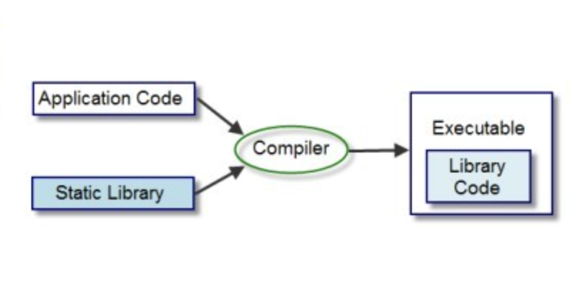
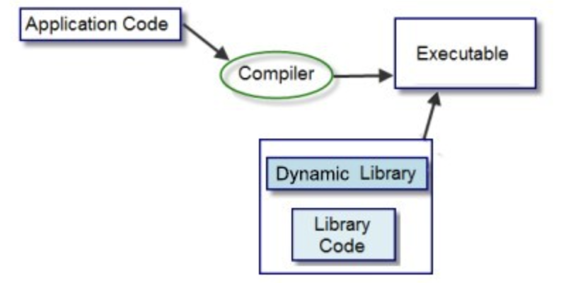
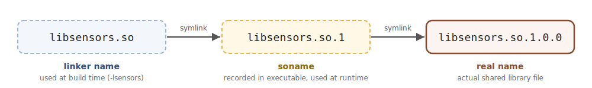
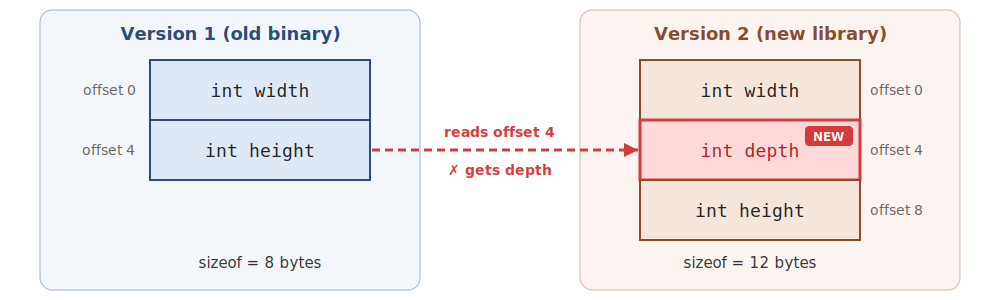
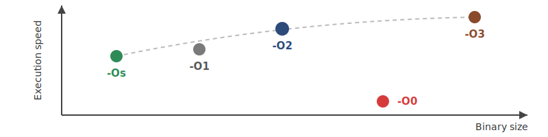
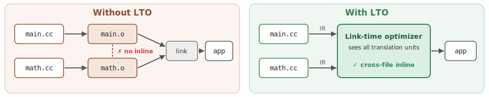
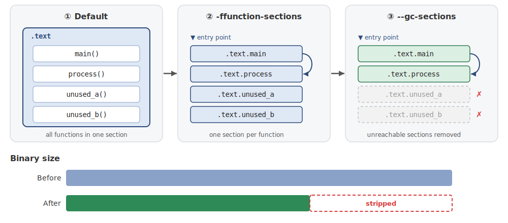
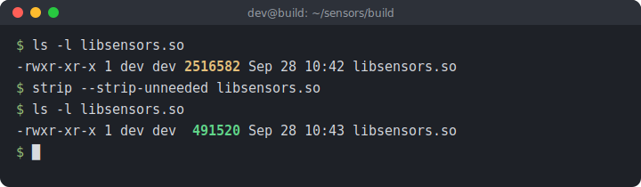

<!-- _class: lead -->

# 마이크로임베디드프로그래밍 - 전체 보강

## 라이브러리 설계와 최적화

### [munseong.jeong@daejin.ac.kr](mailto:munseong.jeong@daejin.ac.kr)

---

## 라이브러리로 나누는 이유 (Why Libraries)

- **라이브러리**: 여러 프로그램이 함께 쓰는 함수·데이터를 미리 컴파일해 묶어 둔 파일
  - 예: `libgpiod`는 GPIO 라인 제어 함수를 `libgpiod.so` 파일로 제공

| 이유      | 효과                                                   |
| --------- | ------------------------------------------------------ |
| 재사용    | 여러 프로그램이 같은 센서 변환 함수를 공유             |
| 빌드 시간 | 수정한 소스 파일만 다시 컴파일                         |
| 경계 설정 | 공개 API와 내부 구현을 분리                            |
| 독립 배포 | 응용 프로그램과 별도로 라이브러리만 갱신               |
| 언어 연동 | C API로 공개한 함수를 Python `ctypes` 등에서 호출      |

---

## 라이브러리로 나누는 이유 (Cont'd - 1)

### 라이브러리의 구성: 인터페이스와 구현

- **인터페이스**: 헤더 파일에 선언된 함수·타입으로, 호출자가 의존하는 공개 약속
  - 예: `float RawToCelsius(int raw);` 선언을 바꾸면 모든 호출자를 다시 컴파일
- **구현**: 인터페이스를 만족하는 내부 코드로, 선언을 유지하는 한 자유롭게 수정 가능
  - 예: 보정 계수 `0.1f`를 바꿔도 호출자 소스는 수정할 필요 없음
- **소비자**: 라이브러리를 포함·링크하여 사용하는 응용 프로그램이나 다른 라이브러리

> 좋은 라이브러리 설계: **인터페이스는 작게, 구현은 바꿀 수 있게**

---

## 연계 실습 - 03장 구조를 라이브러리로 확장 (Lab Overview)

- **출발점**: 03장 `hello_pi`의 CMake 구조(`CMakeLists.txt` + `src/`)
- **추가 작업**: 센서 원시값을 섭씨로 바꾸는 함수를 `sensors` 라이브러리로 작성
- **규칙**: 응용 프로그램은 공개 헤더만 포함하고 구현 파일은 직접 참조하지 않음

```text
sensors_lab/
├── CMakeLists.txt
├── include/sensors/convert.hpp    # public API
├── src/convert.cc                 # private implementation
└── app/main.cc                    # consumer
```

> 목표: **같은 기능을 유지한 채 빌드 경계와 공개 경계를 분리**

---

## 연계 실습 - 공개 API와 소비자 (Public API)

[//]: # "INCLUDE: ./mep/04/src/sensors_lab/include/sensors/convert.hpp"

[//]: # "INCLUDE: ./mep/04/src/sensors_lab/app/main.cc"

- **`convert.hpp`**: 소비자에게 공개하는 유일한 선언
- **`main.cc`**: `"sensors/convert.hpp"`만 포함하며 `convert.cc`의 존재를 모름
- **공개 헤더 수정의 영향**: 이 헤더를 포함하는 모든 소비자 소스 파일을 다시 컴파일

---

## 연계 실습 - 구현은 라이브러리 내부에 유지 (Private Implementation)

[//]: # "INCLUDE: ./mep/04/src/sensors_lab/src/convert.cc"

- **`src/`에 두는 것**: 보정식, 플랫폼 헤더(`gpiod.h` 등), 내부 헬퍼 함수
- **효과**: `0.1f`를 다른 보정식으로 바꿔도 `main.cc`는 다시 컴파일되지 않고 다시 링크만 됨

---

## 연계 실습 - CMake 타깃으로 정적 라이브러리 만들기 (Static Target)

```cmake
add_library(sensors STATIC src/convert.cc)
target_include_directories(sensors PUBLIC include)
target_compile_features(sensors PUBLIC cxx_std_14)

add_executable(sensor_app app/main.cc)
target_link_libraries(sensor_app PRIVATE sensors)
```

- **`STATIC`**: `libsensors.a` 정적 라이브러리 생성
- **`PUBLIC include`**: `sensors` 자신과 이를 링크하는 소비자 모두에 `-Iinclude` 적용
- **`PUBLIC cxx_std_14`**: 소비자도 C++14 이상으로 컴파일하도록 요구 사항 전파
- **`PRIVATE sensors`**: `sensor_app`만 `sensors`를 링크하며, 이 의존성은 다른 타깃에 전파되지 않음

---

## 연계 실습 - 정적 라이브러리 빌드와 확인 (Static Build)

```bash
cmake -S . -B build-static -DCMAKE_BUILD_TYPE=Release
cmake --build build-static --parallel
file build-static/sensor_app build-static/libsensors.a
./build-static/sensor_app
```

```text
build-static/sensor_app:   ELF 64-bit LSB pie executable, ARM aarch64, ...
build-static/libsensors.a: current ar archive
25.3 C
```

- **`-S`/`-B`**: 소스 디렉터리와 빌드 디렉터리 지정
- **`file`**: 실행 파일은 ELF, 정적 라이브러리는 `ar` 아카이브임을 확인
- **기준**: AArch64 Linux(Ubuntu 22.04), Clang 14에서 실행한 결과

---

## 연계 실습 - 공유 라이브러리로 전환하고 관찰하기 (Shared Build)

```cmake
add_library(sensors SHARED src/convert.cc)
set_target_properties(sensors PROPERTIES
  VERSION 1.0.0
  SOVERSION 1)
```

```bash
cmake -S . -B build-shared -DCMAKE_BUILD_TYPE=Release
cmake --build build-shared --parallel
readelf -d build-shared/sensor_app | grep NEEDED
readelf -d build-shared/libsensors.so.1.0.0 | grep SONAME
```

- **변경점**: `STATIC`을 `SHARED`로 바꾸고 버전 속성 2개를 추가
- **관찰 1**: `NEEDED` 항목에 `libsensors.so.1`이 기록됨
- **관찰 2**: 보정 계수를 `0.2f`로 바꾸고 `--target sensors`로 라이브러리만 다시 빌드
  - `sensor_app`은 다시 링크되지 않았는데도 `50.6 C`를 출력

---

## 정적 라이브러리 (Static Library)



- **정의**: 컴파일된 오브젝트 파일(`.o`)을 하나로 묶은 아카이브 파일(`.a`)
- **링크 결과**: 필요한 오브젝트 코드가 실행 파일 안에 복사됨
- **실행 시**: `.a` 파일이 없어도 실행됨

```bash
clang++ -std=c++14 -c sensors.cc -o sensors.o
ar rcs libsensors.a sensors.o
clang++ -std=c++14 main.cc -L. -lsensors -o app
```

- **`ar rcs`**: 아카이브 생성(`c`), 오브젝트 추가·교체(`r`), 심볼 색인 기록(`s`)
- **`-L.`·`-lsensors`**: 현재 디렉터리에서 `libsensors.a`(또는 `.so`)를 찾아 링크

---

## 정적 링크의 처리 순서 (Static Link Order)

1. `sensors.cc`를 `sensors.o`로 컴파일
2. `ar`로 `libsensors.a` 생성
3. 링커가 아직 정의를 찾지 못한 심볼을 제공하는 오브젝트만 아카이브에서 추출
4. 추출한 오브젝트 코드가 실행 파일에 포함

- **미해결 심볼**: 참조는 있으나 정의를 아직 찾지 못한 심볼(예: `main.o`의 `SensorRead()`)
- **참조되지 않는 오브젝트**: 아카이브에서 추출되지 않으므로 실행 파일에 포함되지 않음

---

## 정적 링크의 처리 순서 (Cont'd - 1)

```bash
# Success: main.o leaves SensorRead() unresolved, then the archive resolves it
clang++ main.o -L. -lsensors -o app

# Failure: the archive is scanned before any symbol is unresolved
clang++ -L. -lsensors main.o -o app
```

```text
/usr/bin/ld: main.o: in function `main':
main.cc:(.text+0x10): undefined reference to `SensorRead()'
```

- **GNU ld의 순차 처리**: 명령행을 왼쪽에서 오른쪽으로 한 번 읽으며 그 시점의 미해결 심볼만 추출
- **배치 규칙**: 정적 아카이브는 **그 심볼을 참조하는 오브젝트 뒤**에 배치
- **기준**: AArch64 Ubuntu 22.04, GNU ld 2.38에서 Clang·GCC 드라이버 모두 같은 결과

---

## 정적 라이브러리의 장점과 비용 (Trade-offs)

| 장점                               | 비용                                      |
| ---------------------------------- | ----------------------------------------- |
| 실행 파일 하나로 배포 가능         | 여러 실행 파일에 같은 코드가 중복 저장됨  |
| 실행 시 라이브러리 검색 경로 불필요 | 라이브러리 수정 후 모든 소비자를 재링크   |
| 루트 파일 시스템이 작은 환경에 적합 | 실행 파일 크기 증가                       |

- **같은 실행 파일을 여러 번 실행**: 읽기 전용 코드 페이지를 프로세스끼리 공유
- **서로 다른 실행 파일에 복사된 같은 코드**: 각각 별도의 물리 메모리를 차지

---

## 공유 라이브러리 (Shared Library)



- **정의**: 실행 파일과 별도 파일(`.so`)로 배포되고 실행 시 메모리에 적재되는 라이브러리
- **동적 링커**: 프로그램 시작 시 필요한 `.so`를 찾아 적재하는 프로그램
  - 예: AArch64 Linux의 `/lib/ld-linux-aarch64.so.1`
- **실행 파일에 기록되는 정보**: 필요한 공유 객체의 이름과 외부 심볼 목록

```bash
clang++ -std=c++14 -shared -fPIC \
  -Wl,-soname,libsensors.so.1 \
  sensors.cc -o libsensors.so.1.0.0
ln -s libsensors.so.1.0.0 libsensors.so.1
ln -s libsensors.so.1 libsensors.so
```

- **`-shared`**: 실행 파일 대신 공유 객체 생성
- **`-fPIC`**: 어느 주소에 적재되어도 실행되는 위치 독립 코드 생성(뒤의 PIC 절)
- **`-Wl,-soname,...`**: 링커에 전달하는 옵션으로, 공유 객체의 SONAME을 기록

---

## 공유 객체의 세 이름 (Three Names)



- **ABI**(Application Binary Interface): 별도로 컴파일한 기계 코드끼리 지키는 이진 수준의 약속
  - 예: 전달인자를 넣는 레지스터, 구조체 필드의 오프셋, 함수의 심볼 이름

| 이름      | 예                    | 사용 시점                        | 바뀌는 시점         |
| --------- | --------------------- | -------------------------------- | ------------------- |
| 링커 이름 | `libsensors.so`       | 빌드 시 `-lsensors`              | 개발 패키지 설치 시 |
| SONAME    | `libsensors.so.1`     | 실행 파일 `NEEDED`, 실행 시 탐색 | ABI 주 버전 변경 시 |
| real name | `libsensors.so.1.0.0` | 실제 공유 객체 파일              | 릴리스마다          |

- **링커 이름과 SONAME**: real name을 가리키는 심볼릭 링크
- **실행 파일에 기록되는 이름**: real name이 아닌 SONAME

---

## ELF와 동적 섹션 (ELF and the Dynamic Section)

- **ELF**(Executable and Linkable Format): Linux 실행 파일·오브젝트 파일·공유 라이브러리의 파일 형식
- **섹션**: 코드·데이터·심볼·적재 정보를 목적별로 나누어 담는 ELF 파일의 구역
- **동적 섹션**(`.dynamic`): 동적 링커가 적재와 심볼 해석에 사용하는 항목 목록

```text
ELF shared library
├── .text, .data        program code and data
├── .dynsym             dynamic symbol table
├── .dynstr             dynamic string table
└── .dynamic            dynamic linker entries: DT_*
```

- **`DT_`**: 동적 섹션 항목 이름의 접두사(Dynamic Tag)
- **`readelf -d`**: `.dynamic`의 `DT_*` 항목을 읽기 쉬운 형태로 출력

---

## ELF 동적 섹션 - `DT_SONAME`과 `DT_NEEDED` (Dynamic Entries)

```text
$ readelf -d build-shared/libsensors.so.1.0.0 | grep SONAME
 0x000000000000000e (SONAME)    Library soname: [libsensors.so.1]

$ readelf -d build-shared/sensor_app | grep NEEDED
 0x0000000000000001 (NEEDED)    Shared library: [libsensors.so.1]
 0x0000000000000001 (NEEDED)    Shared library: [libc.so.6]
```

| 항목        | 기록 위치           | 의미                          |
| ----------- | ------------------- | ----------------------------- |
| `DT_SONAME` | 공유 객체           | 이 파일이 제공하는 ABI 이름   |
| `DT_NEEDED` | 실행 파일·공유 객체 | 실행 시 필요한 공유 객체 이름 |

- **링커**: `libsensors.so`를 찾은 뒤 그 파일의 `DT_SONAME`을 소비자의 `DT_NEEDED`로 기록
- **동적 링커**: 소비자의 `DT_NEEDED` 이름으로 적재할 파일을 탐색

---

## 동적 링커의 라이브러리 선택 흐름 (Library Lookup)

```text
Build time
  clang++ app.o -lsensors
  └── copies DT_SONAME of libsensors.so into DT_NEEDED of app

Run time
  app DT_NEEDED: libsensors.so.1
  └── searches RPATH, LD_LIBRARY_PATH, RUNPATH, ld.so.cache, default paths
      └── follows the symbolic link and loads libsensors.so.1.0.0
```

- **`libsensors.so`**: 빌드할 때만 쓰는 이름
- **`libsensors.so.1`**: 이미 빌드된 실행 파일이 요구하는 ABI 이름
- **real name**: 배포자가 교체하는 실제 파일

---

## 동적 링커의 라이브러리 선택 흐름 (Cont'd - 1)

### 탐색 순서 (glibc `ld.so`)

1. `DT_RPATH`: 실행 파일에 기록된 경로(`DT_RUNPATH`가 없을 때만 사용)
2. `LD_LIBRARY_PATH`: 실행 시 환경 변수로 지정한 경로
3. `DT_RUNPATH`: 실행 파일에 기록된 경로(직접 의존성에만 적용)
4. `/etc/ld.so.cache`: `ldconfig`가 만든 라이브러리 목록 캐시
5. 기본 경로: `/lib`, `/usr/lib`

- **`ldconfig`**: `/etc/ld.so.conf`의 디렉터리를 검사해 캐시와 SONAME 링크를 갱신하는 명령
- **CMake 빌드 트리**: `sensor_app`에 빌드 디렉터리를 `RUNPATH`로 기록하므로 바로 실행됨
- **근거**: Linux man-pages ld.so(8) — "DESCRIPTION"

---

## SONAME 유지 - 호환 릴리스 업데이트 (Compatible Update)

```text
VERSION   1.0.0 → 1.1.0 (or 1.0.1)
SOVERSION 1     → 1

libsensors.so.1 ──> libsensors.so.1.0.0
                     ↓ package update and ldconfig
libsensors.so.1 ──> libsensors.so.1.1.0
```

- **적용 대상**: 함수 내부 수정, 버그 수정, 기존 ABI를 유지한 함수 추가
- **기존 `app`**: `DT_NEEDED`가 그대로 `libsensors.so.1`
- **패키지 관리자**: 새 real name을 설치하고 `ldconfig`로 SONAME 링크·캐시 갱신
- **다음 실행부터**: 동적 링커가 새 real name을 적재
- **이미 실행 중인 프로세스**: 기존 파일의 매핑을 유지하므로 재시작해야 새 라이브러리 사용

---

## SONAME 증가 - ABI 비호환 릴리스 (Incompatible Update)

```text
1.x ABI                         2.x ABI
libsensors.so.1 ──> 1.1.0       libsensors.so.2 ──> 2.0.0
        ↑                                  ↑
    existing app                      newly linked app
```

- **`SOVERSION 2` 설정**: 새 real name에 `DT_SONAME=libsensors.so.2` 기록
- **기존 실행 파일**: 계속 `.so.1`을 요구하므로 1.x 라이브러리로 실행
- **새로 링크한 실행 파일**: `libsensors.so`가 `.so.2`를 가리키므로 `NEEDED=libsensors.so.2` 기록
- **주의**: `.so.1`을 지우면 기존 실행 파일이 적재 단계에서 실패
- **장점**: 두 주 버전을 한 시스템에 함께 설치 가능

---

## 정적과 공유 - 배포와 비용 비교 (Static vs Shared)

| 관점      | 정적 라이브러리(`.a`)    | 공유 라이브러리(`.so`)           |
| --------- | ------------------------ | -------------------------------- |
| 코드 결합 | 링크 시 실행 파일에 포함 | `NEEDED` 기록 후 적재 시 해석    |
| 갱신      | 소비자 재링크 필요       | ABI 호환 시 재링크 없이 교체     |
| 자원      | 바이너리별 코드 복사본   | 여러 프로세스의 코드 페이지 공유 |
| 운영 비용 | 실행 파일 하나로 배포    | SONAME·검색 경로·공개 ABI 관리   |

- **정적 링크가 적합한 경우**: 실행 파일 하나만 복사해 배포하거나 루트 파일 시스템이 작을 때
- **공유 링크가 적합한 경우**: 여러 응용이 같은 코드를 쓰거나 라이브러리만 따로 패치할 때

---

## 공유 객체 적재와 점검 (Inspecting Shared Objects)

```bash
readelf -d ./app | grep NEEDED
readelf -d libsensors.so.1.0.0 | grep SONAME
file ./app libsensors.so.1.0.0
```

```text
./app:               ELF 64-bit LSB pie executable, ARM aarch64, ...
libsensors.so.1.0.0: ELF 64-bit LSB shared object, ARM aarch64, ...
```

- **`NEEDED`**: 실행 파일이 요구하는 공유 객체
- **`SONAME`**: 라이브러리가 제공하는 ABI 이름
- **`file`**: ELF 클래스(32/64비트)와 타깃 아키텍처 확인
  - 예: x86_64용으로 빌드한 `.so`를 라즈베리파이에 복사하는 실수를 발견

---

## 적재 실패의 원인 (Load Failures)

```text
$ ./app
./app: error while loading shared libraries: libsensors.so.1:
  cannot open shared object file: No such file or directory

$ LD_LIBRARY_PATH=. ./app      # after replacing the library
./app: symbol lookup error: ./app: undefined symbol: _Z11SensorResetv
```

| 메시지                         | 원인                                                 |
| ------------------------------ | ---------------------------------------------------- |
| `cannot open shared object file` | 탐색 경로에 SONAME 파일이 없음(미설치 또는 경로 누락) |
| `undefined symbol`             | 교체한 라이브러리에 실행 파일이 쓰는 함수가 없음     |

- **점검 위치**: 개발 PC가 아니라 **타깃의 루트 파일 시스템**에 설치된 파일
- **기준**: AArch64 Ubuntu 22.04 glibc에서 직접 실행한 출력

---

## 공유 라이브러리의 두 이진 계약 (PIC and ABI)

| 구분 | 계약 대상           | 질문                                               | 위반 시 결과                |
| ---- | ------------------- | -------------------------------------------------- | --------------------------- |
| PIC  | 코드와 적재 주소    | 어느 가상 주소에서도 같은 코드를 실행할 수 있는가  | 링크 거부 또는 텍스트 재배치 |
| ABI  | 호출자와 라이브러리 | 따로 컴파일한 기계 코드가 같은 방식으로 통신하는가 | 적재 실패 또는 오동작       |

- **PIC**(Position-Independent Code): **프로세스 메모리** 안에서 코드 위치에 대한 독립성
- **ABI**: **번역 단위·라이브러리 경계**에서 이진 호환성
- **번역 단위**: 전처리를 마친 `.cc` 파일 하나로, 컴파일러가 한 번에 컴파일하는 단위
- **공통점**: 소스 코드가 아닌 컴파일된 기계 코드의 성질

---

## PIC - `-fPIC` 옵션과 위치 독립 코드 (Position-Independent Code)

```bash
clang++ -std=c++14 -fPIC -c sensors.cc -o sensors.o
clang++ -shared sensors.o -o libsensors.so
```

- **`-fPIC`**: 위치 독립 코드를 생성하는 컴파일 옵션
- **주소 계산 방식**: 절대 주소 대신 PC 상대 주소와 GOT(전역 오프셋 테이블)를 사용
- **ELF 기반 Linux**: 공유 라이브러리에 들어가는 모든 오브젝트를 `-fPIC` 옵션으로 컴파일

### PIC의 효과

- **임의의 적재 주소**: 프로세스마다 다른 가상 주소에 같은 `.so`를 적재
- **코드 페이지 공유**: 적재 후에도 코드가 바뀌지 않으므로 물리 페이지 하나를 공유
- **ASLR**(Address Space Layout Randomization): 실행할 때마다 적재 주소를 무작위로 바꾸는 보안 기법

---

## PIC - PC 상대 주소 지정, GOT, PLT

| 용어                 | 역할                                      | PIC에서의 사용                      |
| -------------------- | ----------------------------------------- | ----------------------------------- |
| PC 상대 주소 지정    | 실행 중인 PC + 링크 시 정해진 변위        | 라이브러리 내부 위치·GOT 슬롯 계산  |
| 전역 오프셋 테이블   | 실행 시 실제 주소를 담는 쓰기 가능 테이블 | 외부·가로채기 가능한 심볼 주소 보관 |
| 프로시저 연결 테이블 | GOT를 거쳐 외부 함수로 점프하는 코드 조각 | 외부 함수 호출과 지연 바인딩        |

- **PC 상대 주소 지정**(PC-relative addressing): 현재 명령어 주소(PC) + 변위(displacement)
  - **PC**: 실행 중인 명령어의 가상 주소로, 적재 기준 주소에 따라 프로세스마다 다름
  - **변위**: 정적 링커가 라이브러리 내부 배치를 마친 뒤 명령어에 기록하는 상수
- **GOT**(Global Offset Table): 동적 링커가 프로세스별 실제 주소로 채우는 표
- **가로채기**(interposition): 같은 이름의 심볼을 실행 파일이나 먼저 적재된 라이브러리가 대신 제공하는 동작

---

## PIC - PC 상대 주소 지정, GOT, PLT (Cont'd - 1)

- **PLT**(Procedure Linkage Table): 외부 함수의 주소를 코드에 직접 쓰지 않고 호출하는 코드 조각
- **지연 바인딩**(lazy binding): 프로그램 시작 시가 아니라 함수를 처음 호출할 때 주소를 결정
  - **첫 호출**: PLT 조각이 동적 링커를 호출하고, 동적 링커가 찾은 주소를 GOT 슬롯에 기록
  - **이후 호출**: PLT 조각이 GOT 슬롯의 주소를 읽어 곧바로 외부 함수로 점프

```text
hidden symbol   : code → PC-rel disp → symbol
external data   : code → PC-rel disp → GOT slot (.got) → data
external call   : call → PLT stub → PC-rel disp → GOT slot (.got.plt) → function
```

- **숨김 심볼**: PC 상대 변위만으로 직접 접근
- **외부 데이터**: 적재 시점에 동적 링커가 GOT 슬롯을 채움
- **외부 함수**: 지연 바인딩으로 첫 호출 때 GOT 슬롯을 채움

---

## PIC - AArch64 컴파일 결과 (Compiler Output)

[//]: # "INCLUDE: ./mep/04/src/00_pic_access.cc"

```asm
_Z10ReadScaledi:
    bl      _Z7ReadRawi                  // external call: routed through PLT
    adrp    x9, :got:g_offset            // page of the GOT slot
    adrp    x8, g_scale                  // page of the hidden variable
    ldr     x9, [x9, :got_lo12:g_offset] // load address from GOT slot
    ldr     w8, [x8, :lo12:g_scale]      // load value directly
    ldr     w9, [x9]                     // load value through that address
    madd    w0, w8, w0, w9               // raw * g_scale + g_offset
```

- **`adrp`**: PC가 속한 4KiB 페이지 기준으로 대상 페이지 주소를 계산하는 PC 상대 명령
- **`g_scale`**(숨김): `adrp` + `ldr` 2개 명령으로 값을 읽음
- **`g_offset`**(외부): GOT에서 주소를 먼저 읽으므로 `ldr`이 1개 더 필요
- **기준**: Clang 14 `--target=aarch64-linux-gnu -O2 -fPIC -S`, 프롤로그·에필로그 생략

---

## PIC - 두 적재 주소에서 같은 주소 계산 (Same Code, Two Bases)

```text
library offsets: instruction = 0x1200, GOT slot = 0x4000
PC-relative displacement: 0x4000 - 0x1200 = 0x2e00

process A: load base L = 0x7f20_4000_0000
  PC  = L + 0x1200  = 0x7f20_4000_1200
  GOT = PC + 0x2e00 = 0x7f20_4000_4000

process B: load base L = 0x7f91_8000_0000
  PC  = L + 0x1200  = 0x7f91_8000_1200
  GOT = PC + 0x2e00 = 0x7f91_8000_4000
```

- **적재 기준 주소**(load base): 동적 링커가 라이브러리 첫 적재 구간에 배정한 가상 주소
- **ASLR**: 프로세스마다 다른 load base를 선택
- **명령어의 `0x2e00`**: 두 프로세스에서 동일하며, 실행 중 PC 값만 다름
- **각 GOT 슬롯**: 해당 프로세스의 실제 전역 변수·함수 주소를 보관

---

## PIC - non-PIC의 텍스트 재배치 (Text Relocation)

```text
non-PIC instruction contains absolute address A = 0x4000_6000
  (linked assuming load base 0x4000_0000)
actual address after load = load base L + 0x6000

dynamic linker patches .text: A <- L + 0x6000
  -> writes to code page
```

- **non-PIC 코드**: 링크 시 가정한 적재 주소를 기준으로 절대 주소를 명령어에 기록
- **텍스트 재배치**: 적재 후 코드(`.text`) 안의 절대 주소를 실제 적재 주소에 맞게 고쳐 쓰는 작업
- **문제**: 읽기 전용이어야 할 코드 페이지에 쓰기가 발생

---

## PIC - 텍스트 재배치와 코드 페이지 공유 (Page Sharing)

```text
PIC shared library
process A virtual .text ---\
process B virtual .text ----> one read-only physical page
process C virtual .text ---/

non-PIC text relocation at load time
process A: patch .text -> Copy-on-Write -> private physical page A
process B: patch .text -> Copy-on-Write -> private physical page B
```

- **Copy-on-Write**: 공유 페이지에 처음 쓸 때 커널이 그 프로세스 전용 사본을 만드는 방식
- **PIC 적재**: 코드 수정이 없으므로 읽기 전용 물리 페이지 하나를 여러 프로세스가 공유
- **non-PIC 적재**: 코드 쓰기로 Copy-on-Write가 발생해 프로세스마다 물리 페이지가 생김
- **GOT·전역 데이터**: 원래 쓰기 가능 영역이므로 PIC 여부와 관계없이 프로세스별 페이지 사용

> PIC의 메모리 절감 대상: 여러 프로세스가 공유하는 라이브러리의 읽기 전용 코드 페이지

---

## PIC - AArch64 링커의 non-PIC 거부 (Linker Rejection)

```bash
clang++ -std=c++14 -c g.cc -o g.o      # default: PIE, not PIC
clang++ -shared g.o -o libg.so
```

```text
/usr/bin/ld: g.o: relocation R_AARCH64_ADR_PREL_PG_HI21 against symbol
`g_count' which may bind externally can not be used when making a shared
object; recompile with -fPIC
```

- **`g.cc`**: 전역 변수 `int g_count;`를 정의하고 이를 읽는 함수 1개
- **원인**: non-PIC 코드는 `g_count`를 GOT 없이 `adrp`로 직접 찾지만, 공유 객체에서는 가로채기될 수 있음
- **결과**: 텍스트 재배치를 만들지 않고 링크 자체를 거부하므로 `-fPIC` 재컴파일 필요
- **PIE**(Position-Independent Executable): 실행 파일용 위치 독립 코드로, 자기 심볼이 가로채기되지 않는다고 가정
- **기준**: AArch64 Ubuntu 22.04, Clang 14 + GNU ld 2.38, `-fno-pic`도 같은 오류

---

## ABI - API 선언과 이진 계약 (API vs ABI)

```cpp
// public header, source-level API
int SensorRead(int channel, float* value);
```

| 구분 | 호출자가 아는 정보                                    | 확인 시점   |
| ---- | ----------------------------------------------------- | ----------- |
| API  | 함수 이름, 매개변수 타입, 반환 타입                   | 소스 컴파일 |
| ABI  | 심볼 이름, 전달인자·반환값 위치, 타입의 크기·오프셋 | 링크·실행   |

- **API 호환**: 기존 소스 코드를 새 헤더로 **다시 컴파일할 수 있음**
- **ABI 호환**: **다시 컴파일하지 않은** 기존 실행 파일이 새 라이브러리와 함께 실행됨
- **예**: `int` 매개변수를 `long`으로 바꾸면 소스는 그대로 컴파일되지만 심볼 이름이 바뀌어 ABI가 깨짐

---

## ABI - AArch64 호출 규약 예시 (Calling Convention)

- **호출 규약**: 전달인자와 반환값을 어느 레지스터·스택 위치로 주고받을지 정한 규칙
- **AAPCS64**: Arm이 정한 AArch64의 표준 호출 규약
- **`x0`~`x7`**: 첫 8개 정수·포인터 전달인자를 담는 64비트 레지스터
- **`w0`~`w7`**: 같은 레지스터의 하위 32비트로, `int` 전달인자·반환값에 사용

```text
C++ declaration
  int SensorRead(int channel, float* value);

AArch64 caller                       AArch64 library function
  w0 = channel                  -->    reads int channel from w0
  x1 = value                    -->    writes float through pointer in x1
  expects int result in w0      <--    returns int status in w0

Itanium C++ ABI symbol: _Z10SensorReadiPf
```

---

## ABI - AArch64 호출 규약 예시 (Cont'd - 1)

- **이름 맹글링**(name mangling): 함수 이름에 매개변수 타입을 덧붙여 심볼 이름을 만드는 규칙
  - 예: `SensorRead(int, float*)` → `_Z10SensorReadiPf`
  - `10`은 이름 길이, `i`는 `int`, `Pf`는 `float*`
- **Itanium C++ ABI**: Linux의 GCC·Clang이 따르는 C++ ABI 규격(맹글링·클래스 배치·예외 처리)

| 불일치 항목        | 결과                                                  |
| ------------------ | ----------------------------------------------------- |
| 호출 규약          | 잘못된 레지스터·스택 위치에서 전달인자를 읽음         |
| 이름 맹글링        | 링크 시 `undefined reference`, 실행 시 `undefined symbol` |
| 클래스·구조체 배치 | 링크는 성공하지만 잘못된 오프셋의 메모리에 접근       |

- **C API**(`extern "C"`): 맹글링 없는 이름을 써서 C++ ABI에 대한 의존을 줄임

---

## ABI가 깨지는 경우 (ABI Breakage)



- **이전 바이너리**: 오프셋 4를 `height`로 알고 읽도록 컴파일됨
- **새 라이브러리**: 오프셋 4에 `depth`가 들어가고 `height`는 오프셋 8로 이동
- **결과**: 이전 바이너리는 `depth` 값을 `height`로 잘못 읽음
- **크기 변화**: `sizeof`가 8에서 12로 커져 라이브러리가 호출자의 8바이트 버퍼 범위를 넘어 쓸 수 있음
- **증상**: 컴파일·링크 오류 없이 잘못된 값이나 메모리 손상이 발생

---

## ABI 노출을 줄이는 설계 (Opaque Handle)

- **불투명 핸들**(opaque handle): 정의를 숨긴 구조체의 포인터로, 호출자는 크기·필드를 모름
- **공개 헤더에 두는 것**: 구조체 전방 선언, 생성·사용·파괴 함수
- **라이브러리 내부에 두는 것**: 파일 디스크립터, 버퍼, 락, 구현 클래스

```c
// include/sensors/sensor.h: public contract for consumers
struct SensorCtx;

struct SensorCtx* SensorCreate(void);
int SensorRead(struct SensorCtx* context, float* out);
void SensorDestroy(struct SensorCtx* context);
```

---

## ABI 노출을 줄이는 설계 (Cont'd - 1)

```c
// src/sensor.c: implementation compiled only by the library
struct SensorCtx {
  int file_descriptor;
  void* sample_buffer;
  unsigned int calibration_revision;
};
```

- **호출자에 노출되는 정보**: `struct SensorCtx*` 포인터 타입뿐
- **필드 추가 시**: `sizeof`·오프셋을 아는 코드가 라이브러리 내부뿐이므로 기존 호출자의 ABI 유지
- **할당 위치**: `SensorCreate()`가 라이브러리 안에서 할당하므로 호출자는 크기를 알 필요 없음
- **해제 규칙**: 생성한 핸들은 반드시 같은 라이브러리의 `SensorDestroy()`로 해제

---

## CMake의 SONAME·버전·링크 생성 (CMake Versioning)

```cmake
set_target_properties(sensors PROPERTIES
  VERSION 1.0.0
  SOVERSION 1)
install(TARGETS sensors LIBRARY DESTINATION lib)
```

- **`VERSION`**: real name에 붙는 전체 릴리스 버전
- **`SOVERSION`**: `DT_SONAME`에 붙는 ABI 주 버전

```text
build-shared/                    install/lib/
libsensors.so     -> .so.1       libsensors.so     -> .so.1
libsensors.so.1   -> .so.1.0.0   libsensors.so.1   -> .so.1.0.0
libsensors.so.1.0.0              libsensors.so.1.0.0
```

- **`cmake --build`**: 빌드 디렉터리에 real name과 두 심볼릭 링크를 생성
- **`cmake --install`**: 설치 디렉터리에 같은 링크 구조를 설치
- **효과**: 앞의 수동 `ln -s` 두 줄이 필요 없음

---

## ABI 변경과 SONAME - 릴리스 판단표 (Release Decisions)

| 변경                         | 기존 실행 파일                       | SONAME       |
| ---------------------------- | ------------------------------------ | ------------ |
| 함수 내부 보정식 수정        | 그대로 실행                          | 유지         |
| 새 함수 추가                 | 기존 호출은 그대로 실행              | 유지         |
| 함수 삭제·시그니처 변경      | 실행 시 `undefined symbol`로 실패    | 주 버전 증가 |
| 공개 구조체의 필드 배치 변경 | 오류 없이 오동작 가능                | 주 버전 증가 |

```cmake
set_target_properties(sensors PROPERTIES
  VERSION 2.0.0
  SOVERSION 2)  # increment only for ABI-breaking releases
```

- **판단 기준**: 소스 호환성이 아니라 **이미 빌드된 소비자 실행 파일**의 동작
- **불투명 핸들 내부 변경**: 호출자가 배치를 모르므로 표의 구조체 변경에 해당하지 않음

---

## 공개 헤더와 의존성 (Header Dependencies)

- **공개 헤더의 선언**: 이를 포함하는 모든 소비자 번역 단위의 컴파일 의존성
- **헤더 수정**: 그 헤더를 직간접적으로 포함한 모든 `.cc` 파일의 재컴파일 유발
- **내부 헬퍼·플랫폼 헤더**: 공개 헤더가 아닌 구현 파일에서만 포함

```cpp
#include "gpio_device.hpp"  // every consumer now depends on this header

class Sensor {
 public:
  explicit Sensor(GpioDevice* device);
};
```

- **문제**: `gpio_device.hpp`를 수정하면 `Sensor`만 쓰는 소비자도 모두 다시 컴파일

---

## 공개 헤더와 의존성 (Cont'd - 1)

### 전방 선언으로 의존성 줄이기

```cpp
class GpioDevice;  // forward declaration: no #include needed

class Sensor {
 public:
  explicit Sensor(GpioDevice* device);
};
```

- **전방 선언**: 정의 없이 이름만 알리는 선언으로, 해당 타입은 불완전 타입이 됨
- **허용**: 포인터·참조 타입의 매개변수와 멤버
- **불가**: `sizeof`, 멤버 접근, 값 타입 멤버 선언
- **효과**: `gpio_device.hpp`는 `sensor.cc`만 포함하므로 소비자의 재컴파일 범위가 줄어듦

---

## 라이브러리 의존성의 방향 (Dependency Direction)

```text
application
  |
public API library
  |
platform adapter
  |
libgpiod / lgpio / Linux
```

- **상위 계층**: 바로 아래 계층의 공개 인터페이스만 사용
- **플랫폼 어댑터**: `libgpiod`·`lgpio` 호출을 이 계층에만 모아 둠
- **테스트**: 호스트 PC에서는 실제 GPIO 대신 가짜 어댑터를 링크해 상위 계층을 시험

---

## C++ ABI와 C API 경계 (C API Boundary)

- **이름 맹글링**: 컴파일러·표준 라이브러리 설정에 따라 심볼 이름이 달라질 수 있음
- **예외·RTTI·`std::string`**: 라이브러리 경계를 넘으면 양쪽이 같은 C++ ABI를 써야 함
  - **RTTI**(Run-Time Type Information): `dynamic_cast`·`typeid`가 쓰는 실행 시 타입 정보
  - 예: GCC 5의 libstdc++는 `std::string` 구조를 바꾸어 `_GLIBCXX_USE_CXX11_ABI`로 구분
- **위험**: 서로 다른 툴체인으로 빌드한 C++ 객체를 섞으면 ABI 불일치 가능

```cpp
extern "C" {

int mep_sensor_open(int* handle);
int mep_sensor_read(int handle, float* value);
void mep_sensor_close(int handle);

}
```

- **C API의 효과**: 맹글링 없는 함수 이름 제공, 예외 대신 반환값의 상태 코드로 오류 전달

---

## 공개 심볼과 ABI 안정성 확인 (ABI Checks)

```bash
nm -D --defined-only libsensors.so.1.0.0 > symbols-1.0.0.txt
nm -D --defined-only libsensors.so.1.1.0 > symbols-1.1.0.txt
diff symbols-1.0.0.txt symbols-1.1.0.txt
```

- **`nm -D --defined-only`**: 동적 심볼 중 이 라이브러리가 정의한 심볼만 출력
- **`diff` 결과**: `<`로 시작하는 줄은 새 버전에서 사라진 심볼
- **추가 확인**: 공개 구조체의 크기·필드 배치 변경 여부
- **통합 시험**: 이전 버전으로 빌드한 실행 파일을 새 라이브러리로 실행
- **시점**: 릴리스 전 매번 수행

---

## 성능 측정과 기준선 (Performance Measurement and Baselines)

- **최적화 대상 선정 기준**: **추측이 아닌 측정 결과**

```bash
time ./app
perf stat -r 10 ./app
perf record ./app
perf report
size build/libsensors.so
```

- **`time`**: 전체 실행 시간(실제·사용자·커널 시간) 출력
- **`perf`**: Linux 커널의 성능 카운터를 읽는 프로파일링 도구
  - **`perf stat -r 10`**: 10회 실행한 사이클·명령어 수의 평균과 변동 폭
  - **`perf record`/`perf report`**: 시간을 가장 많이 쓴 함수 목록
- **`size`**: `text`·`data`·`bss` 섹션의 바이트 크기

---

## 측정 항목과 기준선 (Metrics)

| 항목          | 질문                                  |
| ------------- | ------------------------------------- |
| 처리량        | 단위 시간에 몇 개를 처리하는가        |
| 지연 시간     | 한 작업이 끝날 때까지 몇 ms 걸리는가  |
| 메모리        | 실행 중 최대 몇 KiB를 사용하는가      |
| 바이너리 크기 | 저장 공간을 몇 KiB 차지하는가         |

```text
# baseline record format (example values)
commit: 1a2b3c
flags: -O2
input: 640 x 480 frame
median: 8.4 ms
binary: 184 KiB
```

- **기준선**: 최적화 전에 기록해 두는 비교 기준 측정값
- **함께 기록**: 입력 데이터, 컴파일 옵션, 타깃 장치
- **비교 조건**: 최적화 전후를 같은 입력·같은 장치에서 측정

---

## 최적화 우선순위 (Optimization Priorities)

1. 알고리즘과 데이터 이동량(예: 선형 탐색을 해시 테이블 조회로 교체)
2. 불필요한 I/O와 메모리 할당(예: 루프 안의 `new`·파일 열기 제거)
3. 컴파일러 최적화 옵션(예: `-O2`, LTO)
4. SIMD와 플랫폼 특화 명령(예: NEON)

- **SIMD**(Single Instruction, Multiple Data): 한 명령으로 여러 데이터를 동시에 처리하는 방식
- **NEON**: AArch64의 128비트 SIMD 명령어 집합

> 암달의 법칙: 전체 실행 시간의 1% 구간을 절반으로 줄여도 전체 개선은 0.5%

---

## 최적화 수준 (Optimization Levels)



| 상황        | 시작 옵션  | 확인 항목        |
| ----------- | ---------- | ---------------- |
| 디버깅      | `-O0 -g`   | 소스 수준 추적   |
| 일반 배포   | `-O2`      | 속도·크기 기준선 |
| 연산 커널   | `-O3` 후보 | 처리량·전력      |
| 플래시 제약 | `-Os`      | 크기·속도 손실   |

- **원칙**: 옵션을 바꿀 때마다 같은 입력으로 다시 측정

---

## 최적화 수준 (Cont'd - 1)

[//]: # "INCLUDE: ./mep/04/src/01_scale_samples.cc"

| 옵션  | `.text` 크기 | 특징                                            |
| ----- | ------------ | ----------------------------------------------- |
| `-O0` | 176 B        | 최적화 없음, 변수를 매번 스택에서 읽고 씀       |
| `-O2` | 96 B         | 스칼라 루프로 최적화                            |
| `-O3` | 248 B        | NEON 벡터화로 4개씩 처리하고 나머지 루프를 추가 |
| `-Os` | 92 B         | 크기를 우선하는 최적화                          |

- **기준**: `aarch64-linux-gnu-g++` 11.4 `-c` 후 `size`로 측정
- **해석**: `-O3`는 루프 하나의 코드가 `-O2`의 약 2.6배이므로 측정으로 이득을 확인해야 함
- **주의**: Clang 14는 `-O2`에서도 벡터화하므로(200 B) 컴파일러마다 결과가 다름

---

## `-O3` 적용 전 확인 (Before Using `-O3`)

- **병목 여부**: `perf report`에서 해당 루프가 실제로 시간을 차지하는지 확인
- **명령 캐시**: 코드 크기 증가로 다른 코드가 명령 캐시에서 밀려나는지 확인
- **디버깅**: 인라인·벡터화로 소스 줄과 기계 명령의 대응 관계를 추적하기 어려움
- **부동소수점**: `-O3`는 계산 순서를 바꾸지 않음, 순서를 바꾸는 옵션은 `-ffast-math`(`-Ofast`에 포함)
  - 예: `float` 합계 루프는 `-O3`에서 스칼라 `fadd`, `-O3 -ffast-math`에서 NEON 벡터 `fadd`

> `-O3`: 기본값이 아닌 측정 기반 후보

---

## LTO (Link-Time Optimization)



- **일반 컴파일**: 번역 단위별로 따로 최적화하므로 다른 `.cc`의 함수 본문을 모름
- **LTO**: 컴파일러가 중간 표현을 오브젝트에 담고, 링크 시 모든 번역 단위를 함께 최적화
  - **중간 표현**: 기계어로 바꾸기 전의 컴파일러 내부 코드(예: Clang의 LLVM 비트코드)
- **효과**: 파일 경계를 넘는 인라인·상수 전파

```cmake
include(CheckIPOSupported)
check_ipo_supported(RESULT ipo_supported)

if(ipo_supported)
  set(CMAKE_INTERPROCEDURAL_OPTIMIZATION TRUE)
endif()
```

- **`check_ipo_supported()`**: 현재 컴파일러·링커가 LTO를 지원하는지 검사

---

## LTO (Cont'd - 1)

### 예: `main.cc` + `convert.cc`의 `main()` 비교

```asm
// clang++ -O2 (no LTO)
    mov     w0, #0xfd                 // 253
    bl      _Z12RawToCelsiusi         // call into convert.cc

// clang++ -O2 -flto
    ldr     d0, [x8, #2008]           // 25.3 computed at link time
```

- **LTO 없음**: `main.cc`는 `RawToCelsius()`의 본문을 모르므로 호출 명령을 생성
- **LTO 사용**: 링크 시 함수를 인라인하고 `253 * 0.1f`를 미리 계산해 상수만 읽음
- **기준**: AArch64 Clang 14 + GNU ld 2.38, `objdump -d`로 확인

---

## LTO 적용 후 확인 (After Enabling LTO)

- **빌드 비용**: 최적화 작업이 링크 단계에 모이므로 링크 시간·메모리 사용량 증가
- **디버깅**: 인라인된 함수는 중단점·호출 스택에 별도 프레임으로 나타나지 않을 수 있음
- **기능 회귀**: 최적화 전후에 같은 테스트를 실행해 결과 비교

```bash
time cmake --build build --clean-first
size build/libsensors.so
```

- **`--clean-first`**: 이전 산출물을 지우고 전체를 다시 빌드하여 빌드 시간을 공정하게 비교

---

## 불필요한 코드 제거 (Dead-Strip)



- **링커의 제거 단위**: 섹션이므로 함수·데이터가 각자 별도 섹션에 있어야 개별 제거 가능
- **`-ffunction-sections`**: 함수마다 `.text.<심볼 이름>` 섹션을 따로 만듦
- **주의**: 코드에서 참조하지 않고 이름·위치로만 쓰는 섹션은 보존 설정 필요

---

## 불필요한 코드 제거 (Cont'd - 1)

```cmake
add_compile_options(-ffunction-sections -fdata-sections)
add_link_options(-Wl,--gc-sections)  # GNU ld
# macOS: -Wl,-dead_strip
```

- **`-fdata-sections`**: 전역 변수마다 별도 섹션 생성
- **`--gc-sections`**: `main()` 등 시작점에서 도달할 수 없는 섹션을 링커가 삭제
- **보존 설정 예**: 링커 스크립트의 `KEEP(*(.my_table))`

---

## Dead-Strip 결과 확인 (Checking the Result)

```bash
size app
nm -C app | grep UnusedHelper
```

| 빌드                          | `text` 크기 | `UnusedHelper(int)` |
| ----------------------------- | ----------- | ------------------- |
| `-O2`                         | 1730 B      | 남아 있음           |
| `-O2` + 섹션 분리·`--gc-sections` | 1650 B      | 제거됨              |

- **기준**: AArch64 Clang 14 + GNU ld 2.38
- **제거된 코드**: `UnusedHelper()`와, `main()`에 인라인되어 따로 호출되지 않는 `UsedHelper()` 사본
- **확인 1**: 제거 전후 바이너리 크기 비교
- **확인 2**: 등록 테이블처럼 간접적으로만 쓰는 함수가 남았는지 실행 시험

---

## 심볼 가시성 (Symbol Visibility)

- **심볼 가시성**: 공유 객체의 심볼을 외부 모듈에 공개할지 정하는 속성
  - **`default`**: 동적 심볼 테이블에 올라가 다른 모듈이 호출 가능
  - **`hidden`**: 같은 공유 객체 안에서만 사용 가능

```cmake
set(CMAKE_CXX_VISIBILITY_PRESET hidden)
set(CMAKE_VISIBILITY_INLINES_HIDDEN ON)
```

```cpp
#define MEP_API __attribute__((visibility("default")))

extern "C" MEP_API int mep_sensor_read(int handle, float* out);
```

- **`CMAKE_CXX_VISIBILITY_PRESET hidden`**: 모든 심볼을 기본으로 숨김(`-fvisibility=hidden`)
- **`MEP_API`**: 외부 호출이 필요한 함수만 `default`로 다시 공개

---

## 심볼 가시성 (Cont'd - 1)

```bash
nm -D --defined-only libsensors.so
```

```text
# default visibility (addresses omitted)   # -fvisibility=hidden
T _Z8ClampRawi                             T mep_sensor_read
T _Z9ApplyGaini
T mep_sensor_read
```

- **효과 1**: 내부 헬퍼 `ClampRaw()`·`ApplyGain()`이 공개 ABI에서 빠짐
- **효과 2**: 동적 심볼·재배치 수가 줄어 적재 시 심볼 탐색 비용 감소
- **효과 3**: 숨긴 함수의 호출은 PLT를 거치지 않는 직접 호출(`bl`)로 생성
- **부작용**: 내부 함수를 직접 호출하던 단위 테스트·다른 모듈은 링크 실패
- **기준**: AArch64 Clang 14 `-O2 -fPIC -shared`

---

## Strip과 디버그 심볼 보관 (Strip and Debug Symbols)



```bash
objcopy --only-keep-debug app app.debug
strip --strip-unneeded app
objcopy --add-gnu-debuglink=app.debug app
```

- **디버그 심볼**: 기계어와 소스 줄·변수를 연결하는 정보(DWARF 형식, `.debug_*` 섹션)
- **`--only-keep-debug`**: 디버그 섹션만 `app.debug`로 복사
- **`strip --strip-unneeded`**: 실행에 필요 없는 심볼·디버그 섹션 삭제
- **`--add-gnu-debuglink`**: `app`에 `app.debug`의 이름과 체크섬을 기록해 GDB가 찾게 함

---

## Strip과 디버그 심볼 보관 (Cont'd - 1)

| 파일             | 크기     |
| ---------------- | -------- |
| `app`(`-O2 -g`)  | 14656 B  |
| `app`(strip 후)  | 6304 B   |
| `app.debug`      | 11168 B  |

- **기준**: AArch64 Clang 14로 빌드한 작은 예제, `ls -l`로 측정
- **배포**: strip한 `app`만 타깃에 설치
- **보관**: `app.debug`는 같은 커밋의 빌드 산출물로 보관
- **분석**: 현장에서 수집한 코어 덤프를 분석할 때 버전이 같은 `app.debug` 필요
- **크로스 빌드**: 타깃용 바이너리는 `aarch64-linux-gnu-strip`·`aarch64-linux-gnu-objcopy` 사용

---

## 라이브러리 설계와 최적화 점검표 (Checklist)

| 단계 | 점검 항목                              | 확인 방법                     |
| ---- | -------------------------------------- | ----------------------------- |
| 설계 | 공개 헤더 최소화, 플랫폼 계층 격리     | 공개 선언과 내부 헤더 대조    |
| 배포 | API·ABI 변경 구분, `SONAME`·심볼 관리  | 이전 실행 파일 통합 시험      |
| 선택 | 정적·공유 링크를 배포 조건에 맞게 선택 | 설치 파일·의존성 목록 확인    |
| 측정 | 기준선·병목·바이너리 크기 기록         | 동일 입력의 반복 측정         |
| 적용 | LTO·dead-strip·가시성 비용 평가        | 빌드 시간·크기·기능 회귀 비교 |
| 검증 | 타깃 적재와 디버그 심볼 보관           | 타깃 실행·소스 버전 연결      |

> 순서: **설계 → 배포 계약 → 링크 방식 선택 → 측정 → 최적화 적용 → 타깃 검증**
