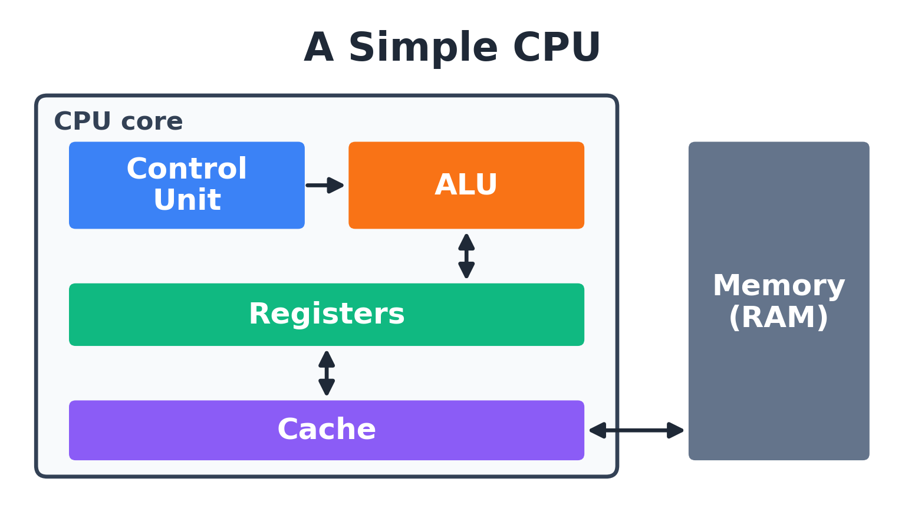
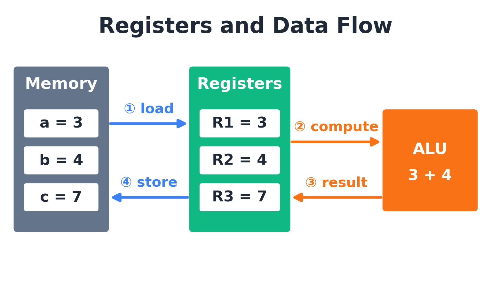
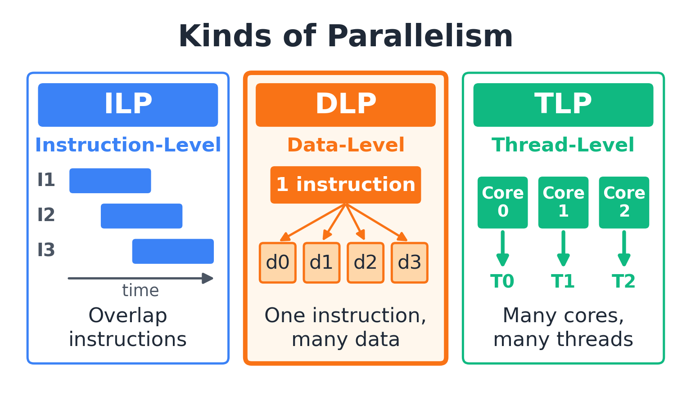
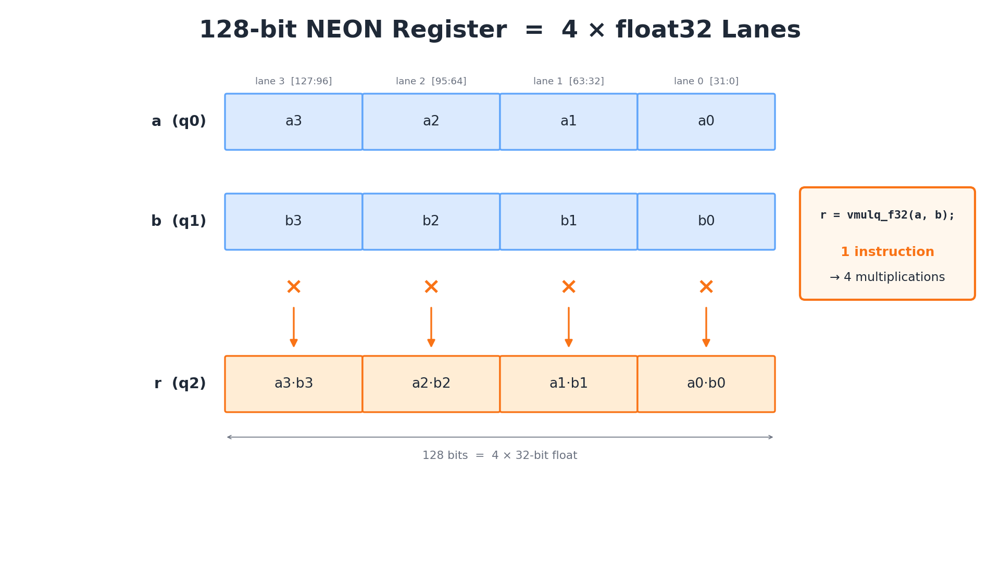
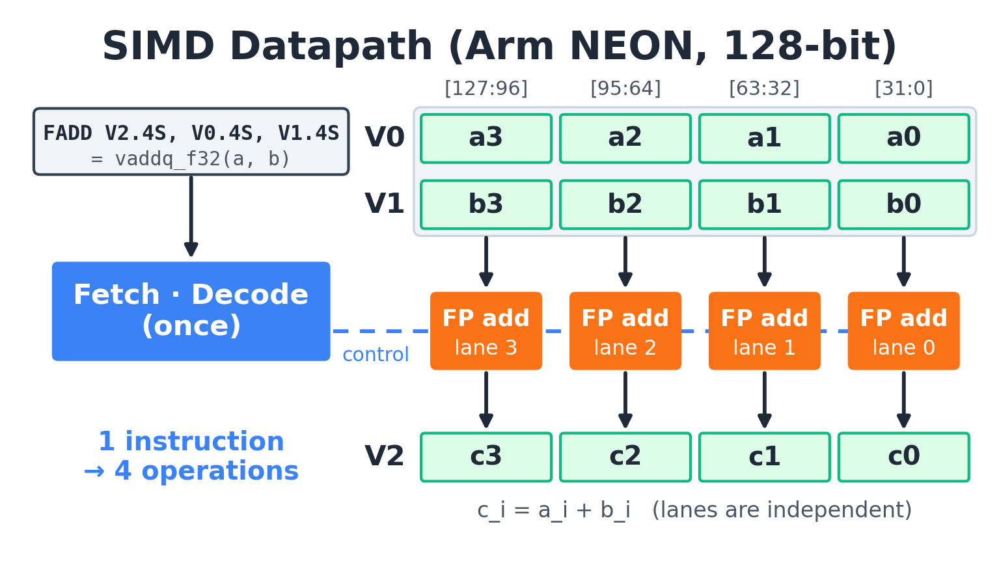
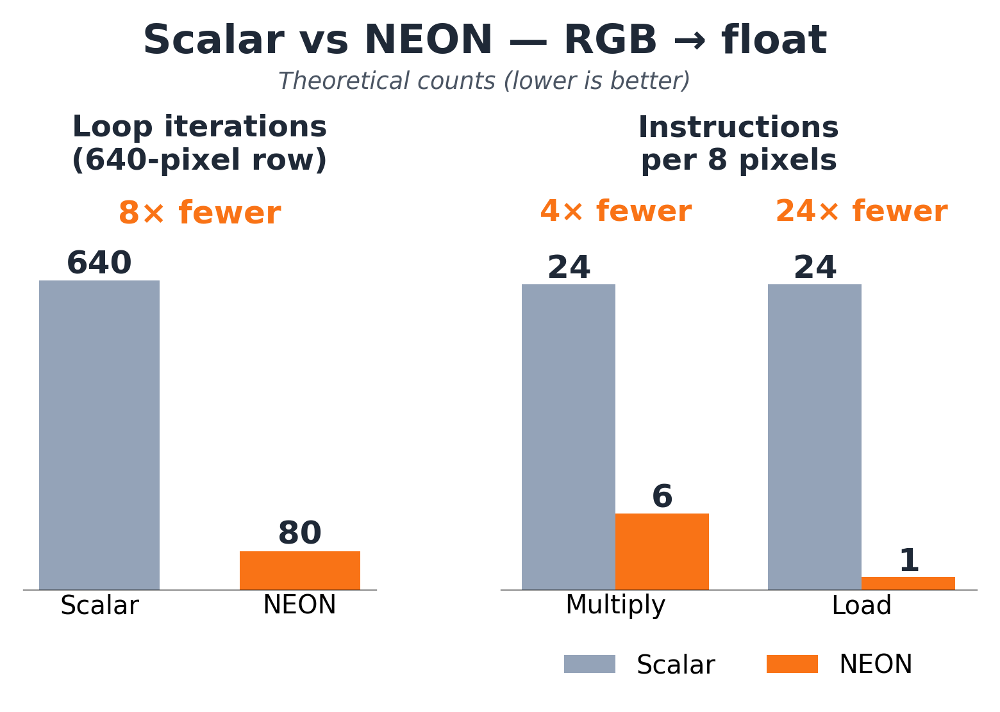

<!-- _class: lead -->

# 마이크로임베디드프로그래밍

## 데이터 병렬 처리 최적화

### [munseong.jeong@daejin.ac.kr](mailto:munseong.jeong@daejin.ac.kr)

---

## CPU의 기본 구조 (A Simple CPU Overview)



- **제어 장치**(control unit): 명령어를 해석해 다른 구성 요소에 동작 신호를 보내는 회로
- **연산 장치**(ALU, Arithmetic Logic Unit): 덧셈·비교·비트 연산 같은 정수·논리 연산 회로
- **FPU**(Floating-Point Unit): `float`·`double` 연산을 전담하는 부동소수점 연산 장치
- **레지스터**(register): 피연산자와 결과를 담는 CPU 내부 저장 공간(예: AArch64 범용 레지스터 `x0`~`x30`)
- **캐시**(cache): 최근 사용한 명령어·데이터의 사본을 CPU 가까이에 두어 DRAM 접근 시간을 줄이는 메모리
- **연산 흐름**: 명령어 인출(fetch) → 해석(decode) → 실행(execute) → 결과를 레지스터나 메모리에 저장

---

## 레지스터와 연산 흐름 (Registers and Data Flow)



- **데이터 흐름**: 레지스터에서 피연산자를 읽어 연산하고 결과를 다시 레지스터에 씀
- **적재와 저장**: 레지스터 수가 적으므로 메모리에서 적재(load)해 연산한 뒤 메모리에 저장(store)
  - 예: `a[i] = b[i] * k`는 AArch64에서 `ldr`(적재) → `fmul`(곱셈) → `str`(저장) 순서로 실행
- **벡터 레지스터**: 여러 데이터를 담아 명령어 하나로 같은 연산을 동시에 수행하는 레지스터
  - 예: AArch64의 128비트 레지스터 `v0`에는 `float` 4개를 담을 수 있음

---

## 병렬성의 종류 (Kinds of Parallelism)



| 병렬성 계층 | 동작 방식 | 대표 구현 예시 |
| :--- | :--- | :--- |
| **명령어 수준(ILP)** | CPU가 서로 독립된 명령어를 겹쳐 실행 | 파이프라이닝, 비순차 실행 |
| **데이터 수준(DLP)** | 명령어 하나로 여러 데이터를 동시에 연산 | **SIMD**(이 장의 주제) |
| **스레드 수준(TLP)** | 여러 코어가 서로 다른 명령어 흐름을 실행 | 멀티스레드(`std::thread`) |

- **SIMD에 맞는 작업**: 같은 연산을 많은 데이터에 반복하며, 반복 사이에 의존성이 없는 작업
- **맞지 않는 작업**: 루프 안 조건 분기가 많거나, 이전 반복의 결과를 다음 반복이 사용하는 작업

---

## 병렬성의 종류 (Cont'd - 1)

### 용어와 예 (Terms and Examples)

- **ILP**(Instruction-Level Parallelism): 한 명령어 흐름 안의 독립된 명령어를 동시에 실행
  - 예: `a = b + c`와 `d = e * f`는 서로 결과를 쓰지 않으므로 CPU가 겹쳐 실행
- **파이프라이닝**(pipelining): 인출·해석·실행 단계를 겹쳐 여러 명령어를 동시에 진행하는 구조
- **비순차 실행**(out-of-order execution): 앞 명령어가 데이터를 기다리는 동안 준비된 뒤 명령어를 먼저 실행
- **DLP**(Data-Level Parallelism): 여러 데이터에 같은 연산을 적용
  - 예: 픽셀 8개의 밝기 값에 같은 계수를 곱함
- **TLP**(Thread-Level Parallelism): 여러 스레드가 서로 다른 작업을 동시에 실행
  - 예: 한 스레드는 카메라 프레임을 캡처하고, 다른 스레드는 이전 프레임을 압축
- **적용 분야**: 영상 프레임 차분(CCTV 움직임 감지), 오디오 필터, 행렬 연산

---

## SIMD란 (What SIMD Is)



- **SIMD**(Single Instruction, Multiple Data): 명령어 하나로 여러 레인(lane)의 데이터를 동시에 처리하는 방식

---

## SIMD란 (Cont'd - 1)



- **레인**(lane): 벡터 레지스터를 같은 크기로 나눈 칸 하나, 레인마다 원소 하나를 담음
- **단일 제어 흐름**: 명령어를 한 번 인출·해석하면 모든 레인이 같은 연산을 동시에 수행
- **레인 독립성**: 한 레인의 결과가 이웃 레인에 영향을 주지 않음
  - 예: `vadd_u8`로 8비트 레인끼리 200 + 100을 더하면 이웃 레인으로 올림 없이 44(300 − 256)가 됨

---

## SIMD란 (Cont'd - 2)

### 명령어 형식과 인트린식 (Instruction Format and Intrinsics)

- **명령어 형식**: `FADD Vd.T, Vn.T, Vm.T` → 모든 레인 `i`에 대해 `Vd[i] = Vn[i] + Vm[i]`(목적지 `Vd`가 먼저 옴)
- **배치 지정자**(arrangement specifier, `.T`): 레인 수와 원소 크기(B: 8비트, H: 16비트, S: 32비트, D: 64비트)
  - 128비트: `.4S`(32비트 4개, 예: `float` 4개), `.2D`(64비트 2개) / 64비트: `.2S`(32비트 2개)
- **인트린식**(intrinsic): SIMD 명령어 하나에 대응하도록 컴파일러가 제공하는 C/C++ 함수
  - 예: AArch64 Clang `-O2`에서 `vaddq_f32(a, b)`는 `fadd v0.4s, v0.4s, v1.4s` 명령 1개로 컴파일
- **이름 규칙**: `vaddq_f32` = `v`(vector) + `add`(연산) + `q`(128비트) + `_f32`(32비트 `float`)
  - `q`가 없으면 64비트 연산: `vadd_f32` → `fadd v0.2s, v0.2s, v1.2s`

---

## SIMD 확장과 벡터 레지스터 (SIMD Extensions and Vector Registers)

- **SIMD 확장**: CPU 제조사가 기본 명령어 집합에 추가한 SIMD 명령어 집합
- **NEON과 AVX2**: 레지스터 이름이 아니라 각각 Arm과 x86의 SIMD 명령어 집합 이름
  - AArch64에서 NEON의 공식 명칭은 Advanced SIMD

| 하드웨어 플랫폼 | 벡터 확장 | 레지스터 규격 |
| :--- | :--- | :--- |
| **Raspberry Pi 4(Cortex-A72, AArch64)** | **NEON** | 128비트 × 32개(`v0`~`v31`) |
| **x86_64 개발 호스트** | **AVX2** | 256비트 × 16개(`ymm0`~`ymm15`) |

---

## SIMD 확장과 벡터 레지스터 (Cont'd - 1)

### 128비트 레지스터의 레인 분할

- 16 × `uint8_t`: 8비트 픽셀 값 16개를 동시에 처리
- 8 × `uint16_t`: 16비트 오디오 샘플 8개를 동시에 처리
- 4 × `float`: 32비트 단정밀도 부동소수점 4개를 동시에 처리
- 2 × `double`: 64비트 배정밀도 부동소수점 2개를 동시에 처리
- **원소 크기와 처리량**: 원소가 작을수록 한 명령어로 처리하는 원소 수가 많아짐
  - 예: 같은 128비트 덧셈이라도 `uint8_t`는 16개, `float`는 4개를 처리

---

## 스칼라 구현 (Scalar Implementation)

- **실습 문제**: RGB 픽셀 데이터를 채널별 `float` 배열로 바꾸고 `[0, 1]` 범위로 정규화
- **입력 배치**: `R0 G0 B0 R1 G1 B1 ...`처럼 세 채널이 번갈아 저장된 인터리브(interleaved) 형식
- **정규화**: 0~255 정수에 `1/255`를 곱해 0.0~1.0 실수로 변환(예: 255 → 1.0, 51 → 0.2)

[//]: # "INCLUDE: ./mep/05/src/00_rgb_to_float_scalar.cc --from 6 --to 14 --no-comment"

- **연산 횟수**: 픽셀 1개당 적재·변환·곱셈이 각각 3회(8픽셀이면 곱셈 24회)
- **기준선**: 벤치마크에서는 자동 벡터화를 끈 상태로 빌드해 비교 기준으로 사용

---

## NEON 구현 (NEON Implementation)

[//]: # "INCLUDE: ./mep/05/src/01_rgb_to_float_neon.cc --from 9 --to 20 --no-comment"

- **`vld3_u8`**: 24바이트를 읽어 R·G·B를 서로 다른 레지스터로 분리(디인터리브, de-interleave)
  - 이름: `v`(vector) + `ld`(load) + `3`(채널 3개) + `_u8`(부호 없는 8비트)
- **`uint8x8x3_t`**: 8레인 `uint8_t` 벡터 3개를 묶은 반환 타입, `.val[0]`~`.val[2]`가 R·G·B
- **`vdupq_n_f32`**: 스칼라 `1/255`를 `float` 레인 4개에 복제(`dup` = duplicate, `_n` = 스칼라 전달인자)

---

## NEON 구현 (Cont'd - 1)

[//]: # "INCLUDE: ./mep/05/src/01_rgb_to_float_neon.cc --from 24 --to 43 --no-comment"

- **변환 순서**: `uint8_t` 8개 → `uint16_t` 8개 → `uint32_t` 4개씩 두 벡터 → `float` 4개씩 두 벡터
- **넓히는 이유**: NEON의 정수 → `float` 변환 명령(`ucvtf`)은 32비트 레인 단위로 동작

---

## NEON 구현 (Cont'd - 2)

[//]: # "INCLUDE: ./mep/05/src/01_rgb_to_float_neon.cc --from 47 --to 66 --no-comment"

- **저장 위치**: R 값의 하위 4개는 `r_out[0..3]`, 상위 4개는 `r_out[4..7]`
- `rgb.val[1]`의 G 값도 같은 4 + 4 순서로 변환해 `g_out[0..7]`에 저장

---

## NEON 구현 (Cont'd - 3)

[//]: # "INCLUDE: ./mep/05/src/01_rgb_to_float_neon.cc --from 70 --to 90 --no-comment"

- `rgb.val[2]`의 B 값까지 `b_out[0..7]`에 저장하면 8픽셀 변환 완료

---

## NEON 구현 (Cont'd - 4)

### 컴파일 결과 (AArch64 Clang 14, `-O2 -mcpu=cortex-a72`)

| 명령어 | 개수 | 역할 |
| :--- | :---: | :--- |
| `ld3` | 1 | 24바이트를 읽어 R·G·B 벡터 3개로 분리 |
| `ushll`·`ushll2` | 9 | 8비트 → 16비트, 16비트 → 32비트로 넓힘 |
| `ucvtf` | 6 | `uint32_t` 4개를 `float` 4개로 변환 |
| `fmul` | 6 | `float` 4개에 `1/255`를 곱함 |
| `stp` | 3 | 128비트 레지스터 2개(`float` 8개)를 한 번에 저장 |

- **스칼라 구현과 비교**: 같은 8픽셀에 대해 스칼라 코드는 `ldr`·`ucvtf`·`fmul`·`str`을 각각 24회 실행

---

## 성능 비교 (Performance Comparison)



| 비교 항목 | 스칼라(Scalar) | NEON 벡터 |
| :--- | :--- | :--- |
| **루프 1회 처리량** | 1픽셀 | 8픽셀 |
| **`float` 곱셈** | 24회 | 6회(`vmulq_f32`) |
| **입력 적재** | 24회(1바이트씩) | 1회(`vld3_u8`) |
| **640픽셀 행의 반복 횟수** | 640회 | 80회 |

---

## 성능 비교 (Cont'd - 1)

- **나머지 픽셀**: 픽셀 수가 8의 배수가 아니면 남은 픽셀은 이어지는 스칼라 루프에서 처리
- **에너지 관점**: 같은 작업을 빨리 끝내면 슬립 상태로 일찍 전환 가능(Race-to-Sleep, 1장 참조)
- **주의**: 명령어 수가 줄어도 가속률은 CPU, 메모리 대역폭, 함수 호출 비용에 따라 달라짐
  - 메모리 접근이 병목이면 가속률이 1배 미만일 수도 있으므로 타깃 보드에서 직접 측정

---

## 실제 성능 측정 (Benchmarking)

- **입력 크기**: 1920×1080 프레임 + 3픽셀(총 2,073,603픽셀)
  - 1920×1080은 8의 배수이므로 나머지 처리 경로를 검증하기 위해 3픽셀을 추가
- **결과 검증**: 시간 측정 전에 두 구현의 출력이 픽셀마다 10⁻⁶ 이내로 같은지 비교, 다르면 종료
- **측정 방법**: 스칼라와 NEON을 번갈아 9회씩 실행해 중앙값(median)과 가속률(speedup) 계산
  - **중앙값을 쓰는 이유**: 다른 프로세스의 간섭으로 생긴 한두 번의 느린 측정값에 영향을 덜 받음
- **가속률**: 스칼라 중앙값 ÷ NEON 중앙값(예: 2.0이면 NEON이 2배 빠름)

---

## 실제 성능 측정 (Cont'd - 1)

```bash
# Compile benchmark with scalar auto-vectorization disabled
clang++ -std=c++14 -O3 -mcpu=cortex-a72 \
  -fno-vectorize -fno-slp-vectorize \
  mep/05/src/00_rgb_to_float_scalar.cc \
  mep/05/src/01_rgb_to_float_neon.cc \
  mep/05/src/02_rgb_to_float_benchmark.cc \
  -o /tmp/mep05-benchmark
/tmp/mep05-benchmark
```

- `-fno-vectorize`: 루프 자동 벡터화를 꺼서 스칼라 기준선이 SIMD 코드로 바뀌지 않게 함
- `-fno-slp-vectorize`: [SLP(Superword-Level Parallelism)](https://www.cs.cornell.edu/courses/cs6120/2020fa/blog/slp/) 벡터화도 끔
  - **SLP 벡터화**: 루프가 아니어도 나란히 놓인 같은 종류의 스칼라 연산 여러 개를 SIMD 명령어 하나로 묶는 최적화
- NEON 인트린식은 **직접 작성한 벡터 명령어**이므로 두 옵션의 영향을 받지 않음

---

## 벤치마크 구현 (Benchmark Implementation)

[//]: # "INCLUDE: ./mep/05/src/02_rgb_to_float_benchmark.cc --to 22"

---

## 벤치마크 구현 (Cont'd - 1)

[//]: # "INCLUDE: ./mep/05/src/02_rgb_to_float_benchmark.cc --from 23 --to 44"

---

## 벤치마크 구현 (Cont'd - 2)

[//]: # "INCLUDE: ./mep/05/src/02_rgb_to_float_benchmark.cc --from 45 --to 66"

---

## 벤치마크 구현 (Cont'd - 3)

[//]: # "INCLUDE: ./mep/05/src/02_rgb_to_float_benchmark.cc --from 67 --to 88"

---

## 벤치마크 구현 (Cont'd - 4)

[//]: # "INCLUDE: ./mep/05/src/02_rgb_to_float_benchmark.cc --from 89 --to 110"

---

## 벤치마크 구현 (Cont'd - 5)

[//]: # "INCLUDE: ./mep/05/src/02_rgb_to_float_benchmark.cc --from 111"

---

## 연계 실습 - 모듈 구조와 구현 교체 (Library Integration)

- **구조**: 공개 API 헤더 하나 아래에 스칼라 구현과 NEON 구현을 별도 소스 파일로 분리
- **인터페이스 유지**: 최적화는 API를 바꾸지 않고 **같은 함수 선언의 구현만 교체**

```text
include/sensors/convert.hpp     # Unified public API declaration
src/convert_scalar.cc           # Portable scalar baseline
src/convert_neon.cc             # ARMv8-A NEON optimized path
app/benchmark.cc                # Execution time benchmark tool
tests/compare.cc                # Numeric precision verification
```

- **구현 선택**: 같은 `app/benchmark.cc`를 스칼라 라이브러리 또는 NEON 라이브러리와 링크
- **링크 시점 교체**: 가상 함수 없이 링크할 라이브러리만 바꾸므로 실행 시간 비용이 없음

---

## 연계 실습 - CMake 빌드 설정 (Build Configuration)

```cmake
# Scalar baseline: keep auto-vectorization off even in Release (-O3)
add_library(convert_scalar STATIC src/convert_scalar.cc)
target_include_directories(convert_scalar PUBLIC include)
target_compile_options(convert_scalar PRIVATE -fno-vectorize -fno-slp-vectorize)
add_executable(benchmark_scalar app/benchmark.cc)
target_link_libraries(benchmark_scalar PRIVATE convert_scalar)

# NEON path: only when the target CPU is AArch64
if(CMAKE_SYSTEM_PROCESSOR MATCHES "aarch64")
  add_library(convert_neon STATIC src/convert_neon.cc)
  target_include_directories(convert_neon PUBLIC include)
  target_compile_options(convert_neon PRIVATE -mcpu=cortex-a72)
  add_executable(benchmark_neon app/benchmark.cc)
  target_link_libraries(benchmark_neon PRIVATE convert_neon)
endif()
```

---

## 연계 실습 - CMake 빌드 설정 (Cont'd - 1)

```bash
# Configure and build out-of-source Release targets with Clang
cmake -S . -B build-release -DCMAKE_BUILD_TYPE=Release -DCMAKE_CXX_COMPILER=clang++
cmake --build build-release --parallel
```

- **`CMAKE_BUILD_TYPE=Release`**: GCC·Clang에서 `-O3 -DNDEBUG` 옵션을 자동으로 추가
- **`-fno-vectorize`·`-fno-slp-vectorize`**: Release의 `-O3`에서도 스칼라 기준선을 스칼라 코드로 유지(Clang 전용 옵션)
- **`CMAKE_SYSTEM_PROCESSOR`**: 빌드 대상 CPU 이름, `aarch64`일 때만 NEON 타깃 생성
  - 결과: 라즈베리파이에서는 `benchmark_scalar`·`benchmark_neon` 둘 다, x86_64 호스트에서는 `benchmark_scalar`만 생성

---

## 연계 실습 - 결과 검증과 측정 기록 (Validation and Metrics)

- **정확성 먼저 확인**: 스칼라 결과를 정답으로 삼아 NEON 출력이 허용 오차 이내인지 비교
- **측정 기록**: 하드웨어, 컴파일 옵션, 입력 크기, 중앙값을 함께 기록해 같은 측정을 재현할 수 있게 함

| 기록 항목 | 실습 측정 기준값 |
| :--- | :--- |
| **타깃 플랫폼** | Raspberry Pi 4(Cortex-A72) |
| **컴파일 옵션** | Clang `Release`(`-O3`), `-mcpu=cortex-a72` |
| **입력 데이터** | RGB 1920×1080 프레임 + 나머지 3픽셀 |
| **측정 지표** | 스칼라·NEON 중앙값, 가속률($\text{Time}_{\text{scalar}} / \text{Time}_{\text{NEON}}$) |

- 출력 검증에 실패하면 시간 측정 결과를 버리고 구현을 먼저 수정

---

## 컴파일러 자동 벡터화 (Auto-Vectorization)

- **자동 벡터화**(auto-vectorization): 컴파일러가 스칼라 루프를 분석해 SIMD 명령어로 바꾸는 최적화
- **적용 최적화 수준**: Clang 14는 `-O2`부터, GCC 11은 `-O3`부터 적용(GCC 12부터는 `-O2`에서도 일부 적용)
  - 예: `00_rgb_to_float_scalar.cc`를 AArch64 Clang 14 `-O2`로 빌드하면 "vectorized loop (vectorization width: 4)" 보고

```bash
# Report loops that were vectorized
clang++ -O3 -mcpu=cortex-a72 -Rpass=loop-vectorize image.cc -c

# Report loops that were not vectorized
clang++ -O3 -mcpu=cortex-a72 -Rpass-missed=loop-vectorize image.cc -c
```

---

## 컴파일러 자동 벡터화 (Cont'd - 1)

### 자동 벡터화 실패 주요 원인

| 실패 원인 | 설명 |
| :--- | :--- |
| **포인터 별칭(aliasing)** | 두 포인터가 겹친 메모리를 가리킬 수 있어 실행 시 검사를 추가하거나 벡터화 포기 |
| **반복 간 의존성(RAW)** | 이전 반복이 쓴 값을 다음 반복이 읽음(RAW: Read After Write) |
| **부동소수점 연산 순서** | 합계처럼 덧셈 순서를 바꿔야 하는 루프는 `-ffast-math` 없이 벡터화되지 않음 |
| **반복 횟수 미정** | 데이터에 따라 끝나는 루프처럼 반복 횟수를 루프 진입 전에 알 수 없음 |
| **복잡한 분기** | 루프 안 조건문 때문에 레인마다 다른 경로를 실행해야 함 |

---

## 컴파일러 자동 벡터화 (Cont'd - 2)

### 예: 벡터화되는 루프와 되지 않는 루프

[//]: # "INCLUDE: ./mep/05/src/03_vectorize_report.cc --from 5 --to 17 --no-comment"

---

## 컴파일러 자동 벡터화 (Cont'd - 3)

[//]: # "INCLUDE: ./mep/05/src/03_vectorize_report.cc --from 21 --to 37 --no-comment"

---

## 컴파일러 자동 벡터화 (Cont'd - 4)

### 진단 결과 (AArch64 Clang 14, `-O2 -mcpu=cortex-a72`)

```bash
clang++ -O2 -mcpu=cortex-a72 -Rpass=loop-vectorize \
  -Rpass-missed=loop-vectorize -c mep/05/src/03_vectorize_report.cc
```

| 함수 | 결과 | 원인 |
| :--- | :--- | :--- |
| `Scale()` | 벡터화(폭 4) | 반복 사이 의존성 없음 |
| `PrefixSum()` | 벡터화되지 않음 | `a[i - 1]`을 읽는 RAW 의존성 |
| `Sum()` | 벡터화되지 않음 | `float` 덧셈 순서 유지, `-ffast-math` 추가 시 벡터화(폭 4) |
| `FindZero()` | 벡터화되지 않음 | 반복 횟수를 결정할 수 없음 |

---

## 벡터화 진단 보고서 (Vectorization Reports)

- **진단 옵션**: 컴파일러가 루프별 자동 벡터화 성공 여부와 실패 원인을 출력하게 하는 옵션

| 진단 목적 | GCC 플래그 | Clang 플래그 |
| :--- | :--- | :--- |
| **벡터화 성공 루프** | `-fopt-info-vec` | `-Rpass=loop-vectorize` |
| **벡터화 실패 원인** | `-fopt-info-vec-missed` | `-Rpass-missed=loop-vectorize` |
| **상세 판단 분석** | `-fopt-info-vec-all` | `-Rpass-analysis=loop-vectorize` |

- **최적화 순서**: 자동 벡터화 결과 확인 → 벡터화되지 않은 병목 루프에만 NEON 인트린식 적용

---

## 최적화 수준과 타깃 지정 (Optimization Flags)

| 컴파일 옵션 | 최적화 특성 | 권장 선택 기준 |
| :--- | :--- | :--- |
| **`-O0`** | 최적화 없음, 소스 코드와 기계어의 대응이 쉬움 | 디버깅 |
| **`-O2`** | 코드 크기를 크게 늘리지 않는 최적화 대부분 적용 | 일반 배포 바이너리 |
| **`-O3`** | `-O2` + 적극적인 인라이닝·루프 변환 | 연산 속도가 중요할 때(코드 크기 증가 가능) |
| **`-Os`** | 코드 크기(footprint) 우선 최적화 | Flash 용량이 작을 때 |
| **`-flto`** | 링크 시점 최적화(LTO): 소스 파일 경계를 넘어 인라이닝 | 빌드 시간·메모리 증가를 감수할 때 |

```bash
# Use Cortex-A72 instructions and schedule for its pipeline
clang++ -O3 -mcpu=cortex-a72 image.cc -c
```

---

## 최적화 수준과 타깃 지정 (Cont'd - 1)

- **`-mcpu=cortex-a72`**: Cortex-A72가 지원하는 명령어 사용과 그 파이프라인에 맞춘 명령어 배치를 함께 지정
- **`-mfpu=neon` 불필요**: AArch64에서 NEON은 필수 기능이므로 32비트 Arm용 옵션을 지정하지 않음
  - AArch64 Clang 14에 지정하면 "argument unused during compilation" 경고만 출력
- **`-ffast-math`**: IEEE 754 규칙(연산 순서, NaN·무한대 처리)을 벗어나는 변환을 허용
  - 예: `Sum()`의 덧셈 순서가 바뀌어 결과의 마지막 자릿수가 스칼라 결과와 달라질 수 있음
  - 정확성 검증의 기준이 되는 코드에는 사용하지 않음

---

## 나머지 데이터 처리 (Remainder Handling)

- **나머지 픽셀**: 픽셀 수가 8의 배수가 아니면 마지막 `count % 8`개는 스칼라 루프로 처리

[//]: # "INCLUDE: ./mep/05/src/04_rgb_to_float_dispatch.cc --from 12 --to 25 --no-comment"

- **누락 시 결과**: 나머지 루프가 없으면 마지막 1~7픽셀이 변환되지 않은 채 남음
- **x86 빌드**: `__ARM_NEON`이 정의되지 않으므로 스칼라 루프가 모든 픽셀을 처리

---

## SIMD 적용 시 고려사항 (Caveats)

- **이식성**: NEON 코드는 x86에서 컴파일되지 않으므로 `__ARM_NEON` 매크로로 분기(앞 슬라이드의 `RgbToFloat()`)
  - `__ARM_NEON`: NEON을 지원하는 타깃으로 빌드할 때 컴파일러가 정의하는 매크로
- **메모리 정렬**(alignment): 데이터 시작 주소가 16바이트 같은 경계의 배수인지 여부
  - AArch64의 NEON 적재 명령은 비정렬 주소도 허용하지만, 캐시 라인 경계를 넘는 접근은 느려질 수 있음
- **유지보수**: 스칼라 구현을 함께 유지해 SIMD 결과를 검증하는 참조 모델로 사용
- **단계적 최적화**: 자동 벡터화로 부족한 병목 구간에만 인트린식 도입

---

## 임베디드 관점의 SIMD 최적화 (Why It Matters Here)

- **에너지**: 소비 에너지는 평균 소비 전력과 실행 시간의 곱

$$\text{Energy} = \text{Power} \times \text{Time}$$

- **Race-to-Sleep**: 연산을 빨리 끝내고 저전력 상태로 전환해 총 에너지를 줄이는 전략
  - SIMD 실행 중 순간 전력이 높아져도 실행 시간이 그보다 더 많이 줄면 총 에너지 감소

| 개선 효과 | 하드웨어 동작 특성 |
| :--- | :--- |
| **발열 감소** | 연산 시간이 줄어 칩이 고온 상태로 머무는 시간 감소 |
| **스로틀링 방지** | 칩 온도를 낮게 유지해 클록 주파수 저하를 피함 |
| **프레임률 확보** | 프레임당 처리 시간이 줄어 실시간 영상 처리에 필요한 FPS 달성 |

- **스로틀링**(throttling): 칩 온도가 한계에 가까워지면 클록 주파수를 낮춰 발열을 줄이는 보호 동작
