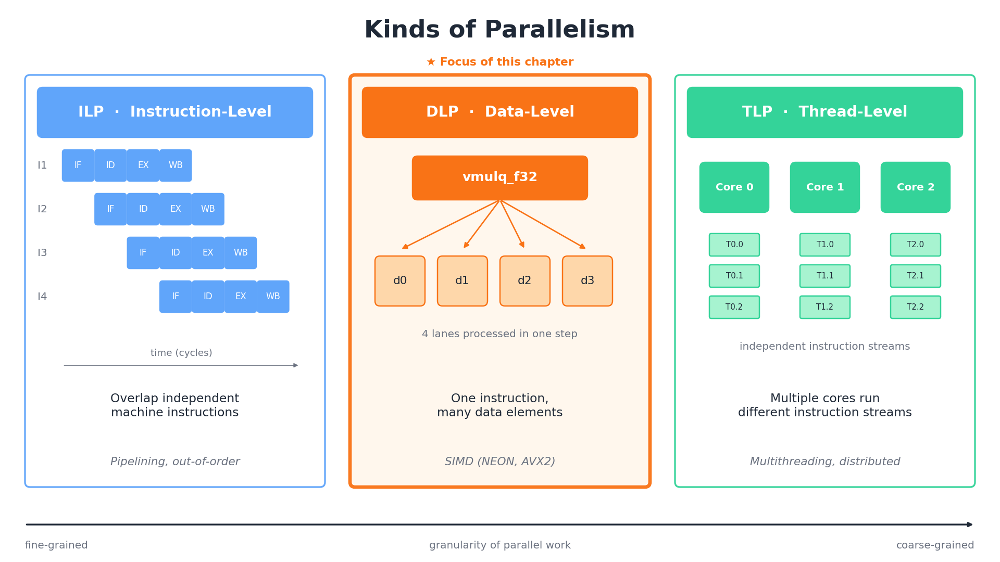
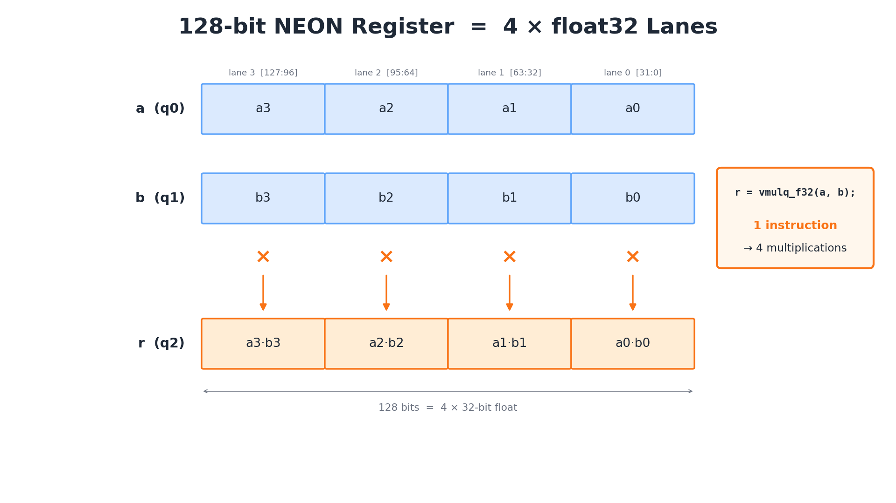
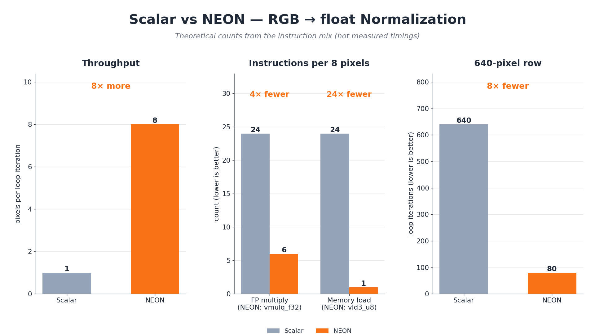

<!-- _class: lead -->

# 마이크로임베디드프로그래밍

## 데이터 병렬 처리 최적화

### [munseong.jeong@daejin.ac.kr](mailto:munseong.jeong@daejin.ac.kr)

---

## 병렬성의 종류 (Kinds of Parallelism)



| 병렬성 계층 | 동작 방식 | 대표 구현 예시 |
| :--- | :--- | :--- |
| **명령 수준(ILP)** | CPU가 독립된 기계어 명령을 중첩 실행 | 파이프라이닝, 비순차 실행 |
| **데이터 수준(DLP)** | 단일 명령으로 다수 데이터를 동시 연산 | **SIMD(본 장의 핵심 주제)** |
| **스레드 수준(TLP)** | 다중 코어가 서로 다른 작업 흐름 수행 | 멀티스레드, 분산 처리 |

- **SIMD 적합 연산**: 동일 연산이 대량 반복되며 데이터 간 상호 의존성이 없는 작업
- **적용 한계**: 루프 내부 조건 분기가 빈번하거나 이전 연산 결과에 종속적인 경우 부적합
- **대표 적용 분야**: 영상 프레임 차분(CCTV 움직임 감지), 오디오 필터링, 행렬 연산

---

## SIMD란 (What SIMD Is)



- **SIMD(Single Instruction, Multiple Data)**: 단일 명령어로 여러 데이터 레인을 동시 제어

---

## SIMD란 (What SIMD Is) (Cont'd)

- **하드웨어 벡터 확장**: CPU 아키텍처별로 128~512비트 폭의 전용 벡터 레지스터 제공

| 하드웨어 플랫폼 | 벡터 확장 | 레지스터 규격 |
| :--- | :--- | :--- |
| **라즈베리파이 4(Cortex-A72)** | **NEON** | 128비트 × 32개 |
| **x86_64 개발 호스트** | **AVX2** | 256비트 × 16개 |

- **128비트 레지스터 레인 분할**:
  - 16 × `uint8_t` (8비트 픽셀 데이터 16개 동시 처리)
  - 8 × `uint16_t` (16비트 오디오 샘플 8개 동시 처리)
  - 4 × `float` (32비트 단정밀도 부동소수점 4개 동시 처리)
  - 2 × `double` (64비트 배정밀도 부동소수점 2개 동시 처리)

---

## 스칼라 구현 (Scalar Implementation)

- **실습 문제**: 패킹된 RGB 24비트 정수(`uint8_t`)를 `[0, 1]` 범위의 `float`로 정규화

[//]: # "INCLUDE: ./mep/05/src/00_rgb_to_float_scalar.cc --from 6 --to 14 --no-comment"

- **동작 특성**: 픽셀당 R·G·B 3회 연산 수행(8픽셀 기준 총 24회 스칼라 연산)
- **최적화 기준선**: 컴파일러 자동 벡터화를 배제하여 순수 직렬 연산 기준으로 활용

---

## NEON 구현 (NEON Implementation)

[//]: # "INCLUDE: ./mep/05/src/01_rgb_to_float_neon.cc --from 9 --to 22 --no-comment"

- **구조체 인터리빙 적재**: `vld3_u8` 인트린식으로 24바이트를 읽으며 R·G·B 채널 즉각 분리

---

## NEON 구현 (NEON Implementation) (Cont'd)

[//]: # "INCLUDE: ./mep/05/src/01_rgb_to_float_neon.cc --from 26 --to 39 --no-comment"

- **벡터 병렬 연산**: `vmulq_f32` 명령 한 번으로 4개 `float` 레인을 동시에 스케일링
- **형 변환 파이프라인**: 8비트 정수 ➔ 16비트 확장 ➔ 32비트 부동소수점 2단계 변환

---

## 성능 비교 (Performance Comparison)



| 비교 항목 | 스칼라(Scalar) | NEON 벡터 |
| :--- | :--- | :--- |
| **루프당 처리량** | 1픽셀 처리 | 8픽셀 일괄 처리 |
| **부동소수점 곱셈** | 24회 개별 곱셈 | 6회 벡터 곱셈(`vmulq_f32`) |
| **메모리 적재 횟수** | 24회 단일 적재 | 1회 인터리빙 적재(`vld3_u8`) |
| **640픽셀 행 루프** | 640회 반복 | 80회 반복 |

- **잔여 픽셀 처리**: 8의 배수가 아닌 자투리 데이터는 후속 스칼라 루프에서 마무리
- **에너지 관점**: 동일 연산을 빠르게 마쳐 저전력 대기 상태로 즉시 복귀(Race-to-Sleep)

---

## 실제 성능 측정 (Benchmarking)

- **벤치마크 환경**: 1920×1080 FHD 프레임 및 나머지 3픽셀을 대상으로 수행
- **검증 절차**: 시간 측정 전 출력 채널 무결성 비교(오차 발생 시 즉시 중단)
- **신뢰성 확보**: 9회 반복 실행의 중앙값(Median) 및 가속률(Speedup) 도출

```bash
# Compile benchmark with scalar auto-vectorization disabled
clang++ -std=c++14 -O3 -mcpu=cortex-a72 \
  -fno-vectorize -fno-slp-vectorize \
  mep/05/src/00_rgb_to_float_scalar.cc \
  mep/05/src/01_rgb_to_float_neon.cc \
  mep/05/src/02_rgb_to_float_benchmark.cc \
  -o /tmp/mep05-benchmark
/tmp/mep05-benchmark
```

- `-fno-vectorize`: 스칼라 기준선 코드의 컴파일러 자동 벡터화 차단
- NEON 인트린식은 명시적 벡터 호출이므로 비활성화 플래그의 영향을 받지 않음

---

## 벤치마크 구현 (Benchmark Implementation)

[//]: # "INCLUDE: ./mep/05/src/02_rgb_to_float_benchmark.cc --to 22"

---

## 벤치마크 구현 (Cont'd - 1)

[//]: # "INCLUDE: ./mep/05/src/02_rgb_to_float_benchmark.cc --from 23 --to 44"

---

## 벤치마크 구현 (Cont'd - 2)

[//]: # "INCLUDE: ./mep/05/src/02_rgb_to_float_benchmark.cc --from 45 --to 66"

---

## 벤치마크 구현 (Cont'd - 3)

[//]: # "INCLUDE: ./mep/05/src/02_rgb_to_float_benchmark.cc --from 67 --to 88"

---

## 벤치마크 구현 (Cont'd - 4)

[//]: # "INCLUDE: ./mep/05/src/02_rgb_to_float_benchmark.cc --from 89 --to 110"

---

## 벤치마크 구현 (Cont'd - 5)

[//]: # "INCLUDE: ./mep/05/src/02_rgb_to_float_benchmark.cc --from 111"

---

## 연계 실습 - 모듈 구조 및 다형성 (Library Integration)

- **모듈 구조화**: 단일 공개 API 헤더 아래 스칼라와 NEON 구현체를 분리 배치
- **인터페이스 계약**: 최적화는 API 변경이 아닌 **동일 규약 아래 구현 교체** 원칙 준수

```text
include/sensors/convert.hpp     # Unified public API declaration
src/convert_scalar.cc           # Portable scalar baseline
src/convert_neon.cc             # ARMv8-A NEON optimized path
app/benchmark.cc                # Execution time benchmark tool
tests/compare.cc                # Numeric precision verification
```

- x86_64 호스트에서는 스칼라 구현을, 라즈베리파이에서는 NEON 구현을 링크

---

## 연계 실습 - CMake 측정 환경 고정 (Build Configuration)

```cmake
# Define independent targets for scalar and NEON implementations
add_library(convert_scalar STATIC src/convert_scalar.cc)
target_include_directories(convert_scalar PUBLIC include)

add_library(convert_neon STATIC src/convert_neon.cc)
target_include_directories(convert_neon PUBLIC include)
target_compile_options(convert_neon PRIVATE -O3 -mcpu=cortex-a72)

add_executable(benchmark_scalar app/benchmark.cc)
target_link_libraries(benchmark_scalar PRIVATE convert_scalar)

add_executable(benchmark_neon app/benchmark.cc)
target_link_libraries(benchmark_neon PRIVATE convert_neon)
```

```bash
# Configure and build out-of-source Release targets
cmake -S . -B build-release -DCMAKE_BUILD_TYPE=Release
cmake --build build-release --parallel
```

---

## 연계 실습 - 결과 검증 및 측정 기록 (Validation and Metrics)

- **무결성 선행 검증**: 스칼라 결과를 정답 기준으로 삼아 NEON 출력과 허용 오차 이내 비교
- **실측 기록 양식**: 하드웨어, 컴파일 옵션, 입력 크기, 실측 중앙값을 함께 기록

| 기록 항목 | 실습 측정 기준값 |
| :--- | :--- |
| **타깃 플랫폼** | Raspberry Pi 4(Broadcom BCM2711, Cortex-A72) |
| **컴파일 옵션** | Clang `Release` 모드, `-O3 -mcpu=cortex-a72` |
| **입력 데이터** | RGB 1920×1080 프레임 + 자투리 3픽셀 고정 데이터 |
| **측정 지표** | 스칼라/NEON 중앙값, 가속률($\text{Time}_{\text{scalar}} / \text{Time}_{\text{NEON}}$) |

- 결과 데이터 검증 실패 시 시간 측정 결과를 폐기하고 구현 디버깅 수행

---

## 컴파일러 자동 벡터화 (Auto-Vectorization)

- **개념**: 컴파일러가 `-O3` 최적화 시 단순 루프를 분석하여 SIMD 명령어로 자동 변환

```bash
# Vectorize loops with Clang and output diagnostic report
clang++ -O3 -mcpu=cortex-a72 -Rpass=loop-vectorize image.cc -c

# Diagnose loops where vectorization failed
clang++ -O3 -mcpu=cortex-a72 -Rpass-missed=loop-vectorize image.cc -c
```

### 자동 벡터화 실패 주요 원인

| 실패 원인 | 기술적 발생 배경 |
| :--- | :--- |
| **포인터 별칭(Aliasing)** | 포인터 간 메모리 영역 중첩 가능성으로 의존성 발생 |
| **데이터 의존성(RAW)** | 이전 반복 루프의 계산 결과가 다음 반복에 영향을 미침 |
| **복잡한 내부 분기** | 루프 내 조건문 분기로 인해 일관된 벡터 레인 구성 불가 |
| **비정형 반복 경계** | 런타임 루프 트립 카운트(Trip Count) 예측 불가 |

---

## 벡터화 진단 보고서 (Vectorization Reports)

- 컴파일러별 진단 플래그를 통해 자동 벡터화 성공 여부와 실패 사유 추적

| 진단 목적 | GCC 플래그 | Clang 플래그 |
| :--- | :--- | :--- |
| **벡터화 성공 루프** | `-fopt-info-vec` | `-Rpass=loop-vectorize` |
| **벡터화 실패 원인** | `-fopt-info-vec-missed` | `-Rpass-missed=loop-vectorize` |
| **상세 판단 분석** | `-fopt-info-vec-all` | `-Rpass-analysis=loop-vectorize` |

- **최적화 워크플로**: 1단계 컴파일러 자동 벡터화 검토 ➔ 2단계 미진 구간 수동 NEON 인트린식 적용

---

## 최적화 수준과 타깃 지정 (Optimization Flags)

| 컴파일 옵션 | 최적화 특성 및 대상 | 권장 선택 기준 |
| :--- | :--- | :--- |
| **`-O2`** | 안전한 표준 최적화 적용 | 일반 배포 바이너리의 시작점 |
| **`-O3`** | 루프 언롤링 및 공격적 벡터화 | 연산 처리 속도 극대화 필요 시 |
| **`-Os`** | 코드 크기(Footprint) 최소화 | 플래시 메모리 용량이 협소할 때 |
| **`-flto`** | 링크 시점 전역 최적화(LTO) | 빌드 시간 증가를 감수하고 전체 최적화 |

```bash
# Enable Cortex-A72 microarchitecture pipeline scheduling
clang++ -O3 -mcpu=cortex-a72 image.cc -c
```

- `aarch64`는 NEON이 하드웨어 기본 사양이므로 `-mfpu=neon` 불필요
- `-ffast-math`는 부동소수점 엄격성을 훼손하므로 정확성 검증 코드에서 배제

---

## 나머지 데이터 처리 (Remainder Handling)

- 벡터 레지스터 폭(8픽셀 단위)의 배수가 아닌 잔여 데이터는 필수 스칼라 처리

```cpp
// 1. Vectorized main loop (8 pixels per iteration)
int i = 0;
for (; i + 8 <= count; i += 8) {
  ProcessEightPixelsSimd(src + i * 3, r + i, g + i, b + i);
}
// 2. Remainder scalar loop
for (; i < count; ++i) {
  ProcessOnePixelScalar(src + i * 3, r + i, g + i, b + i);
}
```

- **누락 위험**: 자투리 루프 누락 시 이미지 우측 끝단 픽셀 미처리 버그 발생
- **정확도 대조**: 스칼라 참조 결과와 SIMD 출력을 단위 테스트로 상호 검증

---

## SIMD 적용 시 고려사항 (Caveats)

- **플랫폼 이식성**: NEON 전용 코드는 x86 환경 미지원 — 전처리기 분기 구현

```cpp
#if defined(__ARM_NEON)
  // ARM NEON vectorized path
#else
  // Generic portable scalar fallback
#endif
```

- **메모리 정렬(Alignment)**: 비정렬 메모리 접근은 추가 버스 사이클 유발 가능
- **코드 유지보수성**: 직관적인 스칼라 기준 코드를 함께 유지하여 참조 모델 확보
- **단계적 최적화**: 자동 벡터화 한계 도달 시 병목 구간에 한해 인트린식 도입

---

## 임베디드 관점의 SIMD 최적화 (Why It Matters Here)

- **에너지 소비 공식**: 에너지 소모량은 순간 소비 전력과 총 수행 시간의 곱

$$\text{Energy} = \text{Power} \times \text{Time}$$

- **신속 처리 후 대기(Race-to-Sleep)**: 연산을 빠르게 완료하고 즉시 저전력 슬립 모드 전환

| 개선 효과 | 하드웨어 동작 특성 |
| :--- | :--- |
| **발열 억제** | 고부하 연산 시간 단축으로 칩셋 누적 발열 감소 |
| **쓰로틀링 방지** | 다이 온도 상승을 억제하여 코어 동작 주파수 유지 |
| **프레임률 확보** | CCTV 비전 처리 등 실시간 파이프라인의 실효 FPS 달성 |
