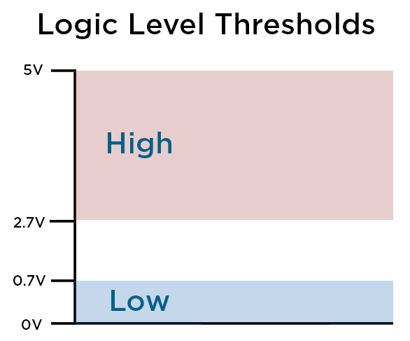
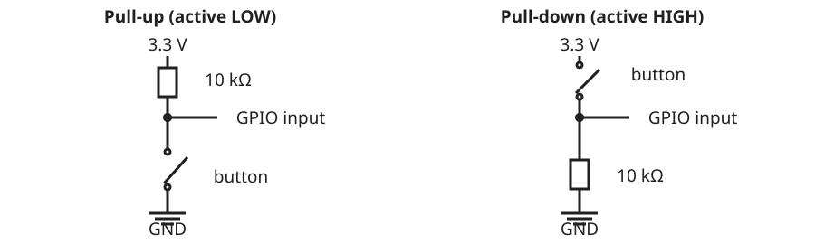
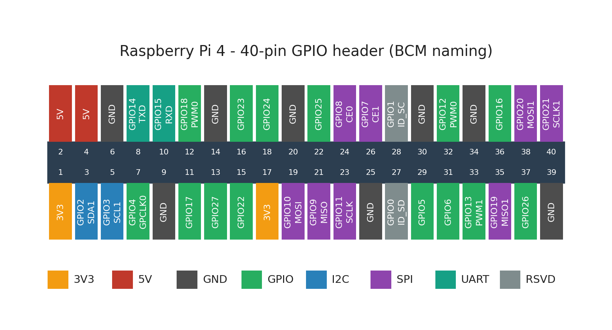
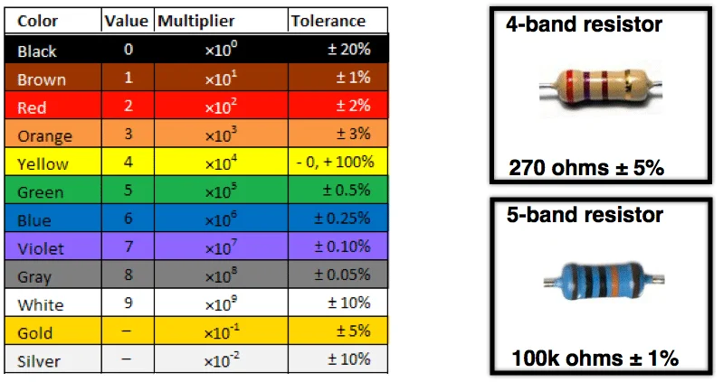
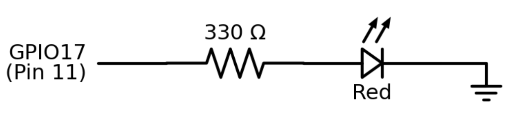

<!-- _class: lead -->

# 마이크로임베디드프로그래밍

## 실습 준비와 GPIO 기초

### [munseong.jeong@daejin.ac.kr](mailto:munseong.jeong@daejin.ac.kr)

---

## 실습 공통 규칙 (Common Rules)

- **조 구성**: 3인 1조로 실습을 수행
- **전원 안전**: 회로와 배선을 바꿀 때는 **라즈베리파이 전원을 먼저 차단**
  - 전원이 켜진 상태에서 점퍼선이 3.3V·5V 핀과 GND 핀을 잇게 되면 단락으로 보드가 손상될 수 있음
- **소자 보호**: LED에는 반드시 전류 제한 저항(이 실습에서는 330Ω)을 직렬로 연결
- **전압 규격**: 라즈베리파이 GPIO는 **3.3V 로직**이며 5V 신호를 직접 연결하지 않음
  - **분압 회로**: 저항 두 개를 직렬로 연결하여 입력 전압을 저항 비율만큼 낮추는 회로
  - 예: 초음파 거리 센서의 5V `Echo` 출력에 1kΩ·2kΩ 분압을 거치면 5V × 2/3 ≈ 3.3V

---

## 실습 공통 규칙 (Common Rules) (Cont'd - 1)

### 보고서 제출 안내

- **보고서 구성**: 실습 목표 → 회로 구성 → 핵심 코드 → 실행 결과 → 고찰 순서로 작성
- **동작 검증**: **직접 촬영한 시연 영상**을 첨부하며, 조원 1인 이상이 화면에 보이도록 촬영
- **코드 설명**: 전체 코드를 붙여 넣지 않고 핵심 로직만 발췌하여 설명
  - 예: LED 토글 실습이면 버튼 입력을 판정하는 조건문과 LED 출력을 바꾸는 부분만 발췌
- **고찰**: 예상과 다른 결과가 나온 원인과 해결 과정을 기록

---

## 공통 개발 흐름 (Workflow)

- **공유 헤더 위치**: `mep/common/` 디렉터리의 헤더를 모든 실습에서 함께 사용
- **실습 디렉터리**: `labNN`은 실습 번호이며, 예를 들어 `lab02`는 11장의 실습 2

```text
mep/
├── common/
│   ├── gpio.hpp           # one GPIO line, RAII
│   └── signal_stop.hpp    # Ctrl-C stop flag
├── lab02/src/             # LED, PWM, state machine
├── lab03/src/             # sensors
├── lab04/src/             # web service
...
```

---

## 공통 개발 흐름 (Workflow) (Cont'd - 1)

```bash
cd mep/lab02/src

# Build -- -I points at the shared headers
clang++ -std=c++14 -Wall -Wextra -I../../common 00_led_button.cc -o led -lgpiod

./led                    # run
gpioinfo -c gpiochip0    # libgpiod v2: inspect the selected chip
```

- `-I../../common`: `#include "gpio.hpp"`가 공유 헤더를 찾도록 헤더 검색 디렉터리를 추가
  - 이 옵션이 없으면 `fatal error: 'gpio.hpp' file not found`로 컴파일 실패
- `-lgpiod`: GPIO 제어 라이브러리 libgpiod를 링크
- `gpioinfo -c gpiochip0`: 지정한 GPIO 칩의 라인 목록과 각 라인의 사용 여부·방향을 출력

---

## 패키지 설치 (Packages)

| 패키지 | 주요 용도 |
| ------ | --------- |
| `clang` | C++ 컴파일러(모든 실습 공통) |
| `libgpiod-dev` | 문자 디바이스 기반 GPIO 제어 라이브러리(v2 C API) |
| `gpiod` | GPIO 진단 명령(`gpioinfo`, `gpiodetect` 등) |
| `liblgpio-dev` | 마이크로초 단위 타이밍이 필요한 센서 제어 라이브러리(예: HC-SR04) |
| `libasound2-dev` | 리눅스 오디오 계층 ALSA를 C에서 제어하는 라이브러리(오디오 실습) |
| `alsa-utils` | 오디오 장치 진단 명령(`arecord`, `aplay`) |
| `v4l-utils` | 리눅스 카메라 인터페이스 V4L2의 진단 명령(`v4l2-ctl`) |
| `pkg-config` | 설치된 라이브러리의 버전과 컴파일·링크 옵션을 조회하는 도구 |

---

## 패키지 설치 (Packages) (Cont'd - 1)

```bash
sudo apt update
sudo apt install -y \
    clang libgpiod-dev gpiod \
    liblgpio-dev libasound2-dev alsa-utils \
    v4l-utils pkg-config
```

- **`-dev` 패키지**: 라이브러리의 헤더 파일과 링크용 파일을 담은 개발용 패키지
  - 예: `libgpiod-dev`가 없으면 `#include <gpiod.h>`에서 컴파일 실패
- **ALSA**(Advanced Linux Sound Architecture): 리눅스 커널의 사운드 장치 드라이버와 사용자 공간 라이브러리
- **V4L2**(Video4Linux2): 웹캠 같은 영상 장치를 `/dev/video0` 같은 장치 파일로 제어하는 리눅스 커널 인터페이스

---

## GPIO 기초 (Prerequisites)

### 디지털 입출력



| 논리 상태 | 라즈베리파이(3.3V 로직 기준) |
| --------- | ----------------------------- |
| **LOW(0)** | 0V에 가까운 전압 |
| **HIGH(1)** | 3.3V에 가까운 전압 |
| **불확정(Undefined)** | LOW와 HIGH의 보장 범위 사이로, 0과 1 중 어느 쪽으로 읽힐지 알 수 없음 |

- **GPIO**(General-Purpose Input/Output): 소프트웨어로 입력·출력 방향을 정하는 범용 디지털 핀
- **임계 전압**: 그림의 2.7V·0.7V는 5V 로직의 예이며, 라즈베리파이의 기준값은 SoC 데이터시트를 따름

---

## GPIO 기초 (Prerequisites) (Cont'd - 1)

### 풀업·풀다운



| 방식 | 저항 연결 | 버튼 연결 | 평상시(개방) | 입력 시(닫힘) |
| ---- | --------- | --------- | ------------- | -------------- |
| **풀업(Pull-Up)** | 입력 ↔ 3.3V | 입력 ↔ GND | HIGH | LOW |
| **풀다운(Pull-Down)** | 입력 ↔ GND | 입력 ↔ 3.3V | LOW | HIGH |

---

## GPIO 기초 (Prerequisites) (Cont'd - 2)

### 플로팅과 풀 저항의 역할

- **플로팅**(floating): 입력 핀이 3.3V와 GND 어느 쪽에도 연결되지 않은 상태
  - 주변 노이즈와 누설 전류로 입력 전압이 떠다녀 논리값이 무작위로 바뀜
  - 예: 풀 저항 없이 버튼을 연결하면 손가락을 가까이 대기만 해도 입력값이 바뀔 수 있음
- **풀업·풀다운 저항**: 버튼이 열려 있을 때 입력을 3.3V 또는 GND에 약하게 연결하여 기본 논리값을 고정
  - 예: 11장 실습 2는 10kΩ 외장 풀업 저항을 사용
- **액티브 LOW**: 풀업 회로는 버튼을 누르면 LOW가 되므로 0을 "눌림"으로 해석
- **액티브 HIGH**: 풀다운 회로는 버튼을 누르면 HIGH가 되므로 1을 "눌림"으로 해석

---

## GPIO 기초 (Prerequisites) (Cont'd - 3)

### 공용 GPIO 래퍼 API (`Gpio` Class)

| API | 설명 및 반환값 |
| --- | -------------- |
| `Gpio(line, mode, chip)` | 칩의 라인 하나를 요청(기본 칩: `/dev/gpiochip0`) |
| `ok()` | 라인 요청 성공 여부 반환(`bool`) |
| `Get()` | 현재 핀 레벨 반환(`0`: LOW, `1`: HIGH, `-1`: 오류) |
| `Set(value)` | 출력 레벨 설정(`0`: LOW, 그 외: HIGH), 성공 여부(`bool`) 반환 |
| `Reconfigure(mode)` | 기존 요청을 해제하고 새 모드로 다시 요청 |
| `Release()` | 라인 요청 해제(여러 번 호출해도 안전) |

- **지원 모드**: `kOutputLow`, `kOutputHigh`, `kInput`, `kInputPullUp`

---

## GPIO 기초 (Prerequisites) (Cont'd - 4)

### RAII와 라인 오프셋

- **RAII**(Resource Acquisition Is Initialization): 생성자에서 자원을 얻고 소멸자에서 반납하는 C++ 관용 기법
  - `Gpio` 객체가 범위를 벗어나면 소멸자가 라인 요청과 칩 파일을 자동으로 닫음
  - RAII가 없으면 `return`이 있는 모든 경로에 해제 코드를 직접 써야 하고, 하나라도 빠지면 라인이 계속 점유됨
- **libgpiod**: 커널의 GPIO 문자 디바이스(`/dev/gpiochipN`)를 다루는 C 라이브러리이며, `gpio.hpp`는 v2 API를 사용
- **라인 오프셋**(line offset): GPIO 칩 안에서 라인을 구분하는 번호이며, 헤더의 물리 핀 번호가 아님
  - Raspberry Pi 4 이하의 `gpiochip0`에서는 라인 오프셋이 BCM 번호와 같음
  - 예: BCM 17 = `gpiochip0`의 라인 17 = 물리 핀 11
- **대응 확인**: `gpioinfo -c gpiochip0`가 출력하는 라인 이름(`GPIO17` 등)으로 확인

---

## GPIO 기초 (Prerequisites) (Cont'd - 5)

### 수명 주기 및 재설정

[//]: # "INCLUDE: ./mep/11/src/00_led_button.cc --from 27 --to 32 --no-comment"

- **생성과 검증**: 생성자가 라인 요청을 시도하므로 사용 전에 반드시 **`ok()`로 성공 여부를 확인**
- **재설정**(`Reconfigure`): 기존 요청을 먼저 해제한 뒤 다시 요청하므로, 실패하면 이전 설정으로 돌아가지 않음
- **복사 금지**: 복사본이 같은 라인을 두 번 해제하지 않도록 복사 생성자와 복사 대입 연산자를 `delete`
- **반환값 검사**: `Get()`의 `-1`과 `Set()`의 `false`를 확인하여 오류를 처리

---

## GPIO 기초 (Prerequisites) (Cont'd - 6)

### 라인 점유 기간

- **라인 점유**: 생성자나 `Reconfigure()`가 성공하면 커널로부터 `gpiod_line_request`를 받아 라인을 독점
- **점유 기간**: `Release()`, `Reconfigure()`, 소멸자 중 하나가 호출될 때까지 라인을 유지
- **충돌**: 다른 프로세스가 이미 점유한 라인을 요청하면 `Device or resource busy` 오류로 실패
  - 예: 실습 프로그램이 실행 중일 때 같은 라인에 `gpioset`을 실행하는 경우

---

## GPIO 기초 (Prerequisites) (Cont'd - 7)

### 해제 순서와 비정상 종료

- **해제 순서**: 획득의 역순(LIFO, Last In First Out)
  - 획득: 칩 열기 → 라인 요청, 해제: 라인 요청 해제 → 칩 닫기
- **조기 반환·예외**: 함수 중간의 `return`이나 처리되는 예외로 범위를 벗어나도 소멸자가 역순으로 자원을 반납
- **강제 종료**: `SIGKILL`로 종료되면 소멸자가 실행되지 않으며, 라인은 프로세스 종료 시 커널이 회수
- **출력 레벨 주의**: 라인을 해제해도 출력이 LOW로 바뀐다는 보장이 없음
  - 예: LED를 켠 채 해제하면 LED가 계속 켜져 있을 수 있으므로, 위험한 부하는 회로에서 기본 상태를 정함

---

## GPIO 기초 (Prerequisites) (Cont'd - 8)

### GPIO 헤더 핀 배치



---

## GPIO 기초 (Prerequisites) (Cont'd - 9)

### 저항



- **색 띠 읽는 법**(4색 띠): 첫째·둘째 띠는 숫자, 셋째 띠는 곱할 10의 거듭제곱, 넷째 띠는 허용 오차
  - 예: 주황(3)·주황(3)·갈색(×10¹)·금색(±5%)은 330Ω ±5%

---

## GPIO 기초 (Prerequisites) (Cont'd - 10)

### LED 회로




- **극성**: LED는 다이오드이므로 애노드(Anode, `+`)에서 캐소드(Cathode, `-`) 방향으로만 전류가 흐름
  - 긴 다리와 둥근 쪽이 애노드, 짧은 다리와 테두리가 평평한 쪽이 캐소드
- **전류 제한 저항**: 저항이 없으면 전류가 제한되지 않아 LED와 SoC의 GPIO 핀이 손상될 수 있음
  - 예: 330Ω이면 빨간 LED 전류는 약 (3.3V − 2V) / 330Ω ≈ 4mA

---

## 실습 환경 확인 (Environment Check)

```bash
# 1. Check architecture and OS (64-bit aarch64 required)
uname -m
cat /etc/os-release
clang++ --version

# 2. Inspect GPIO devices and libraries
gpiodetect                 # Identify the gpiochip controlling header GPIO lines
pkg-config --modversion libgpiod
ldconfig -p | grep lgpio

# 3. Inspect multimedia devices (Camera & Microphone)
v4l2-ctl --list-devices
arecord -l

# 4. Grant device access permissions (takes effect after re-login)
getent group gpio video audio
sudo usermod -aG gpio,video,audio "$USER"
```

---

## 실습 환경 확인 (Environment Check) (Cont'd - 1)

| 명령 | 기대 결과 |
| ---- | --------- |
| `uname -m` | `aarch64`(64비트 ARM) |
| `pkg-config --modversion libgpiod` | `2.`으로 시작하는 버전(v2 API) |
| `ldconfig -p \| grep lgpio` | `liblgpio.so`가 한 줄 이상 출력 |
| `v4l2-ctl --list-devices` | 웹캠과 `/dev/video0` 같은 장치 파일 |
| `arecord -l` | 마이크가 `card N`으로 표시 |

- **그룹 권한**: `gpio`·`video`·`audio` 그룹에 속해야 `sudo` 없이 해당 장치 파일을 열 수 있음
- **적용 시점**: `usermod -aG`로 추가한 그룹은 다시 로그인한 뒤의 셸부터 적용

---

## 부록 - 공용 코드 (Appendix: Shared Code)

- **공유 헤더의 범위**: GPIO 라인 관리와 종료 신호 처리만 담당
- **센서 통신 프로토콜**: DHT11의 비트 판정처럼 센서마다 다른 절차는 각 실습에서 **직접 구현**

| 헤더 파일 | 주요 역할 및 기능 |
| --------- | ----------------- |
| `gpio.hpp` | GPIO 라인 하나를 요청·제어하고 소멸자에서 자동으로 해제 |
| `signal_stop.hpp` | Ctrl-C 같은 종료 신호를 받으면 정지 플래그를 설정 |

---

## 부록 - gpio.hpp

[//]: # "INCLUDE: ./mep/common/gpio.hpp --to 19"

- **`Mode`**: 방향과 초기 상태를 함께 지정(`kOutputLow`·`kOutputHigh`는 출력과 초기 레벨, `kInputPullUp`은 입력과 내부 풀업)

---

## 부록 - gpio.hpp (Cont'd - 1)

[//]: # "INCLUDE: ./mep/common/gpio.hpp --from 20 --to 33"

- **생성자·소멸자**: 생성자는 칩을 열고 라인을 요청하며, 소멸자는 라인 요청 해제 → 칩 닫기 순서로 반납
- **`= delete`·`ok()`**: 복사를 금지하여 중복 해제를 막고, `ok()`로 라인 요청 성공 여부를 확인

---

## 부록 - gpio.hpp (Cont'd - 2)

[//]: # "INCLUDE: ./mep/common/gpio.hpp --from 34 --to 51"

- **`Get()`**: 핀 레벨을 `0`(LOW) 또는 `1`(HIGH)로 반환하고, 라인이 없거나 읽기에 실패하면 `-1` 반환
- **`Set()`**: `0`이면 LOW, 그 외 값이면 HIGH로 설정하고 성공 여부(`bool`) 반환

---

## 부록 - gpio.hpp (Cont'd - 3)

[//]: # "INCLUDE: ./mep/common/gpio.hpp --from 52 --to 68"

- **`Reconfigure()`**: 기존 라인 요청을 해제한 뒤 새 모드로 다시 요청
- **용도**: DHT11처럼 선 하나로 시작 신호를 출력한 뒤 같은 핀으로 응답을 입력받는 센서

---

## 부록 - gpio.hpp (Cont'd - 4)

[//]: # "INCLUDE: ./mep/common/gpio.hpp --from 69 --to 85"

- **설정 객체 해제**: 요청 성공 여부와 관계없이 임시 설정 객체 3개를 해제하고 성공 여부(`bool`) 반환
- **`Release()`**: 라인 요청을 해제하고 포인터를 `nullptr`로 바꿔 두 번 호출해도 안전

---

## 부록 - gpio.hpp (Cont'd - 5)

[//]: # "INCLUDE: ./mep/common/gpio.hpp --from 86 --to 99"

- **`Apply()`**: 방향을 지정하고, `kInputPullUp`이면 내부 풀업 바이어스(bias)를 활성화
- **조기 반환**: 방향 지정이나 바이어스 설정이 실패하면 즉시 `false` 반환

---

## 부록 - gpio.hpp (Cont'd - 6)

[//]: # "INCLUDE: ./mep/common/gpio.hpp --from 100"

- **`kInput`**: 바이어스를 지정하지 않으므로 외장 풀 저항이 없으면 입력이 플로팅될 수 있음
- **초기 출력값**: `kOutputHigh`는 `ACTIVE`(HIGH), `kOutputLow`는 `INACTIVE`(LOW)로 요청 시점부터 출력

---

## 부록 - signal_stop.hpp

[//]: # "INCLUDE: ./mep/common/signal_stop.hpp --to 20"

- **비동기 신호 안전**(async-signal-safe): 신호 처리기 안에서 호출해도 안전하다고 POSIX가 정한 함수의 성질
- **금지 호출**: `printf`·`malloc`·libgpiod 함수는 실행 도중 신호가 끼어들면 교착 상태가 생길 수 있음

---

## 부록 - signal_stop.hpp (Cont'd - 1)

[//]: # "INCLUDE: ./mep/common/signal_stop.hpp --from 21 --to 28"

- **처리기의 동작**: 정지 플래그 `g_stop_requested`를 1로 설정하는 일만 수행
- **RAII와의 연계**: 메인 루프가 플래그를 보고 빠져나오면 `Gpio` 소멸자가 라인을 반납

---

## 부록 - signal_stop.hpp (Cont'd - 2)

[//]: # "INCLUDE: ./mep/common/signal_stop.hpp --from 29"

- **등록 신호**: Ctrl-C(`SIGINT`), `kill` 기본 신호(`SIGTERM`), SSH 세션 종료(`SIGHUP`)
- **한계**: 네트워크가 끊겨 SSH가 비정상 종료되면 `SIGHUP`이 늦거나 오지 않고, `SIGKILL`은 처리기로 받을 수 없음
