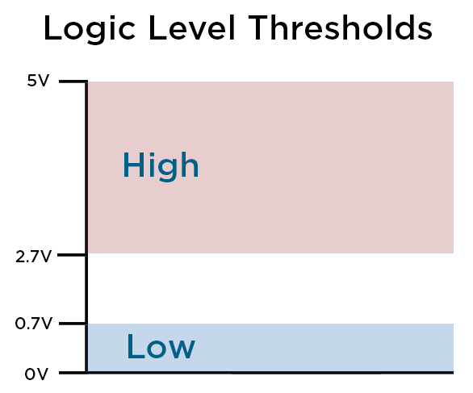
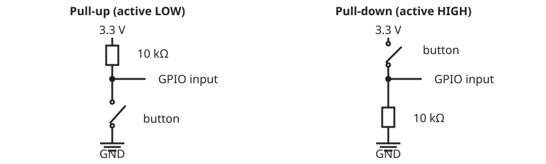
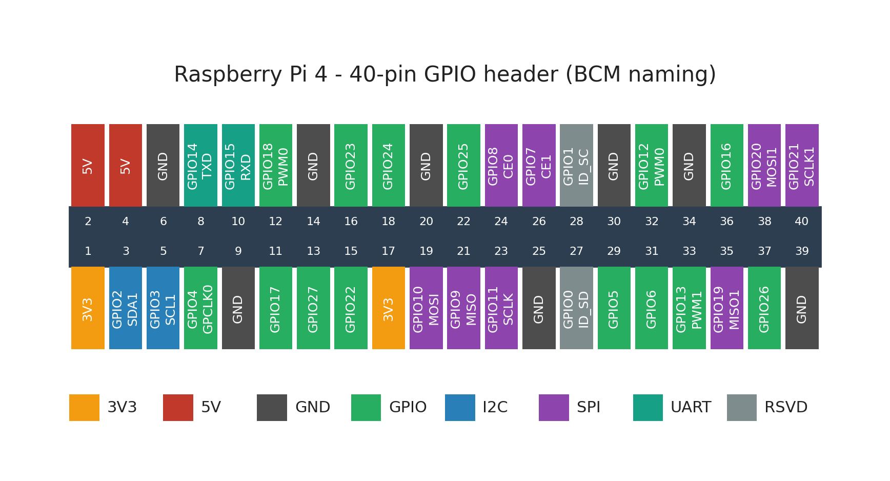
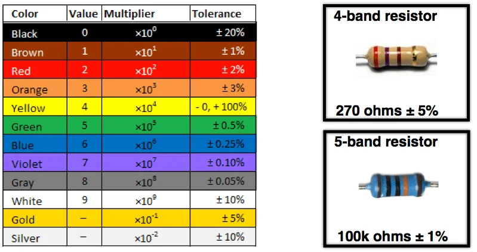
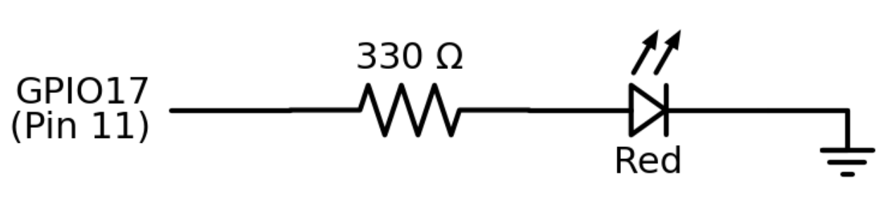
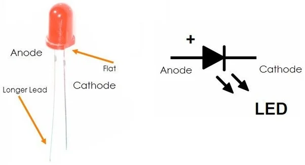

<!-- _class: lead -->

# 마이크로임베디드프로그래밍

## 실습 준비와 GPIO 기초

### [munseong.jeong@daejin.ac.kr](mailto:munseong.jeong@daejin.ac.kr)

---

## 실습 공통 규칙 (Common Rules)

- **조별 실습**: 3인 1조로 구성 및 수행
- **전원 안전**: 회로 및 배선 변경 시 **반드시 전원 차단 후 작업**
- **소자 보호**: LED 연결 시 반드시 전류 제한 저항을 직렬로 연결
- **전압 규격**: GPIO는 **3.3V 로직** 사용 — 5V 신호 직접 인가 금지
  - 초음파 거리 센서 등의 5V Echo 신호는 전압 분압 회로를 거쳐 연결

### 보고서 제출 안내

- **보고서 구성**: 실습 목표 ➔ 회로 구성 ➔ 핵심 코드 ➔ 실행 결과 ➔ 고찰 순 작성
- **동작 검증**: **직접 촬영한 시연 영상** 첨부 (조원 1인 이상 식별 가능하도록 촬영)
- **코드 설명**: 전체 코드 복사 지양, 핵심 구현 로직만 발췌하여 설명 작성

---

## 공통 개발 흐름 (Workflow)

- 공유 헤더 위치: `mep/common/` (모든 실습에서 공통 참조)

```text
mep/
├── common/
│   ├── gpio.hpp           # one GPIO line, RAII
│   └── signal_stop.hpp    # Ctrl-C stop flag
├── lab02/src/             # LED, PWM, state machine
├── lab03/src/             # sensors
├── lab04/src/             # web service
...
```

```bash
cd mep/lab02/src

# Build -- -I points at the shared headers
clang++ -std=c++14 -Wall -Wextra -I../../common 00_led_button.cc -o led -lgpiod

./led                    # run
gpioinfo -c gpiochip0    # libgpiod v2: inspect the selected chip
```

---

## 패키지 설치 (Packages)

| 패키지 | 주요 용도 |
| ------ | --------- |
| `clang` | C++ 컴파일러 (모든 실습 공통) |
| `libgpiod-dev` | GPIO 제어 라이브러리 (v2 C API) |
| `gpiod` | GPIO CLI 진단 도구 (`gpioinfo`, `gpiodetect` 등) |
| `liblgpio-dev` | 고정밀 타이밍 제어 (마이크로초 단위 센서 제어) |
| `libasound2-dev` | ALSA 오디오 제어 라이브러리 (오디오 실습) |
| `alsa-utils` | 오디오 진단 도구 (`arecord`, `aplay`) |
| `v4l-utils` | V4L2 카메라 진단 도구 (`v4l2-ctl`) |
| `pkg-config` | 라이브러리 버전 확인 및 빌드 플래그 탐색 도구 |

```bash
sudo apt update
sudo apt install -y \
    clang libgpiod-dev gpiod \
    liblgpio-dev libasound2-dev alsa-utils \
    v4l-utils pkg-config
```

---

## GPIO 기초 (Prerequisites)

### 디지털 입출력



| 논리 상태 | 라즈베리파이 (3.3V 로직 기준) |
| --------- | ----------------------------- |
| **LOW (0)** | 0V에 인접한 유효 입력 전압 |
| **HIGH (1)** | 3.3V에 인접한 유효 입력 전압 |
| **불확정 (Undefined)** | LOW·HIGH 보장 범위 사이 — 논리 판정 불가 구간 |

- **임계 전압**: 논리값(0/1) 판정 기준 전압은 라즈베리파이 SoC 데이터시트 참조

---

## GPIO 기초 (Prerequisites) (Cont'd - 1)

### 풀업·풀다운



| 방식 | 저항 연결 | 버튼 연결 | 평상시 (개방) | 입력 시 (닫힘) |
| ---- | --------- | --------- | ------------- | -------------- |
| **풀업 (Pull-Up)** | 입력 ↔ 3.3V | 입력 ↔ GND | HIGH | LOW |
| **풀다운 (Pull-Down)** | 입력 ↔ GND | 입력 ↔ 3.3V | LOW | HIGH |

- **플로팅(Floating) 현상**: 기준 전압이 연결되지 않으면 주변 노이즈·누설 전류로 인해 논리값이 임의로 변동
- **풀업·풀다운 역할**: 버튼 개방 상태에서도 입력을 3.3V 또는 GND에 묶어(Tie) 안정적인 기본 논리값 유지
- **동작 논리**: 풀업은 **액티브 LOW**(누르면 LOW), 풀다운은 **액티브 HIGH**(누르면 HIGH)

---

## GPIO 기초 (Prerequisites) (Cont'd - 2)

### Wrapper API

| API | 설명 및 반환값 |
| --- | -------------- |
| `Gpio(line, mode, chip)` | 칩의 라인 오프셋 요청 (기본 칩: `/dev/gpiochip0`) |
| `ok()` | 라인 점유 및 초기화 성공 여부 반환 (`bool`) |
| `Get()` | 현재 핀 레벨 반환 (`0`: LOW, `1`: HIGH, `-1`: 오류) |
| `Set(value)` | 출력 레벨 설정 (`0`: LOW, 그 외: HIGH, 성공 여부 `bool` 반환) |
| `Reconfigure(mode)` | 기존 요청 해제 후 신규 모드(In/Out) 재할당 |
| `Release()` | 점유 중인 라인 자원 명시적 반환 (안전한 중복 호출 지원) |

- **RAII 패턴**: `gpio.hpp`가 라인 확보와 해제를 전담하여 자원 누수 방지
- **라인 지정**: 헤더의 물리 핀 번호가 아닌 **gpiochip 기준 라인 오프셋(Line Offset)** 지정
- **핀 매핑**: BCM 번호와 라인 오프셋의 대응 관계는 보드 커널 정보에서 확인
- **지원 모드**: `kOutputLow`, `kOutputHigh`, `kInput`, `kInputPullUp`

---

## GPIO 기초 (Prerequisites) (Cont'd - 3)

### 수명 주기 및 재설정

[//]: # "INCLUDE: ./mep/11/src/00_led_button.cc --from 27 --to 32 --no-comment"

- **생성 및 유효성 검증**: 생성자 호출 시 라인 점유를 시도하며, 반드시 **`ok()`로 초기화 성공 확인**
- **동적 재설정 (`Reconfigure`)**: 기존 자원을 선(先)해제한 뒤 재요청 (실패 시 이전 상태 복구 불가)
- **소멸자 및 복사 제한**: 소멸자에서 자원 자동 정리, 중복 해제 방지를 위해 복사 생성·대입 차단(`delete`)
- **방어적 프로그래밍**: 제어 전 유효성 검증 필수 및 모든 `Get()`·`Set()` 반환값 처리 권장

---

## GPIO 기초 (Prerequisites) (Cont'd - 4)

### 자원 점유 주기

- **라인 점유**: 생성 또는 `Reconfigure()` 성공 시 커널로부터 `gpiod_line_request`를 획득하여 라인 독점
- **점유 기간**: 객체 수명 기간(`Release()`, 재설정, 소멸자 호출 전까지) 동안 라인 유지
- **충돌 방지**: 이미 점유된 라인을 다른 프로세스가 요청하면 `Device or resource busy` 오류 발생

### 해제 순서와 예외 처리

- **자원 처리 순서 (LIFO)**: 칩 열기 ➔ 라인 요청 순 획득, 라인 반환 ➔ 칩 닫기 순 해제
- **소멸자 보장**: 함수 조기 반환(`return`)이나 예외 발생 시에도 소멸자가 **획득 역순으로 자원 자동 반환**
- **강제 종료 유의**: `SIGKILL` 등으로 비정상 종료 시 소멸자가 호출되지 않음 (커널 회수와 무관하게 출력 레벨 유의)
- **출력 안전성**: 라인 해제 시 핀 출력이 LOW로 내려간다는 보장이 없으므로 회로 차원의 안전 설계 필요

---

## GPIO 기초 (Prerequisites) (Cont'd - 5)

### GPIO 헤더 핀 배치



---

## GPIO 기초 (Prerequisites) (Cont'd - 6)

### 저항



---

## GPIO 기초 (Prerequisites) (Cont'd - 7)

### LED 회로





- **극성 주의**: 다이오드 특성상 극성 존재 — 긴 다리가 애노드(Anode, `+`), 짧은 다리가 캐소드(Cathode, `-`)
- **저항 필수**: 전류 제한 저항 미연결 시 과전류로 인해 **LED 파손 및 SoC GPIO 핀 영구 손상** 발생

---

## 실습 환경 확인 (Environment Check)

```bash
# 1. Check architecture and OS (64-bit aarch64 required)
uname -m
cat /etc/os-release
clang++ --version

# 2. Inspect GPIO devices and libraries
gpiodetect                 # Identify the gpiochip controlling header GPIO lines
pkg-config --modversion libgpiod
ldconfig -p | grep lgpio

# 3. Inspect multimedia devices (Camera & Microphone)
v4l2-ctl --list-devices
arecord -l

# 4. Grant device access permissions (takes effect after re-login)
getent group gpio video audio
sudo usermod -aG gpio,video,audio "$USER"
```

---

## 부록 - 공용 코드 (Appendix: Shared Code)

- 공유 헤더는 GPIO 운용 및 시그널 처리 캡슐화만 전담
- 센서별 통신 프로토콜은 실습별로 **직접 구현**

| 헤더 파일 | 주요 역할 및 기능 |
| --------- | ----------------- |
| `gpio.hpp` | RAII 기반 GPIO 라인 점유·제어 및 자동 자원 해제 |
| `signal_stop.hpp` | 비동기 신호 안전을 보장하는 정지 플래그(Ctrl-C) 처리 |

---

## 부록 - gpio.hpp

[//]: # "INCLUDE: ./mep/common/gpio.hpp --to 19"

- **지원 모드 (`Mode`)**: 입출력 방향 및 초기 레벨·내부 풀업 설정 지원 (`kOutputLow`, `kOutputHigh`, `kInput`, `kInputPullUp`)

---

## 부록 - gpio.hpp (Cont'd - 1)

[//]: # "INCLUDE: ./mep/common/gpio.hpp --from 20 --to 33"

- **자원 수명 주기 (RAII)**: 칩 오픈 및 라인 설정(생성자) ↔ 자원 역순 해제 및 칩 종료(소멸자)
- **복사 방지 및 유효성 검증**: 중복 해제 방지를 위한 복사 차단(`= delete`) 및 `ok()`를 통한 라인 획득 검증

---

## 부록 - gpio.hpp (Cont'd - 2)

[//]: # "INCLUDE: ./mep/common/gpio.hpp --from 34 --to 51"

- **라인 상태 읽기 (`Get`)**: 핀 레벨 반환(LOW `0`, HIGH `1`) 및 미사용·오류 시 `-1` 반환
- **출력 레벨 제어 (`Set`)**: 핀 레벨 설정 및 작업 성공 여부(`bool`) 반환

---

## 부록 - gpio.hpp (Cont'd - 3)

[//]: # "INCLUDE: ./mep/common/gpio.hpp --from 52 --to 68"

- **동적 입출력 재설정 (`Reconfigure`)**: 기존 자원 해제 후 신규 입출력 모드(In/Out)로 라인 재요청
- **단선(1-Wire) 통신 지원**: 한 핀에서 구동(출력)과 수신(입력)을 번갈아 수행하는 센서 제어에 활용

---

## 부록 - gpio.hpp (Cont'd - 4)

[//]: # "INCLUDE: ./mep/common/gpio.hpp --from 69 --to 85"

- **임시 자원 정리 및 결과 반환**: 임시 설정 객체 3종 해제 및 라인 획득 성공 여부(`bool`) 반환
- **라인 점유 해제 (`Release`)**: 라인 요청 반환 및 핸들 초기화(`nullptr`), 소멸자·재설정 시 공통 호출

---

## 부록 - gpio.hpp (Cont'd - 5)

[//]: # "INCLUDE: ./mep/common/gpio.hpp --from 86 --to 99"

- **라인 속성 설정 (`Apply`)**: In/Out 방향 지정 및 입력 플로팅 방지를 위한 내부 풀업 바이어스 활성화
- **오류 검증 및 조기 반환**: 방향 지정 또는 풀업 설정 실패 시 즉시 `false` 반환

---

## 부록 - gpio.hpp (Cont'd - 6)

[//]: # "INCLUDE: ./mep/common/gpio.hpp --from 100"

- **기본 입력 (`kInput`)**: 내부 바이어스가 없으므로 회로상 외장 풀 저항 부재 시 플로팅 현상 유의
- **초기 출력값 설정**: `kOutputLow` / `kOutputHigh`에 따라 라인의 초기 출력 레벨(Active/Inactive) 즉시 반영

---

## 부록 - signal_stop.hpp

[//]: # "INCLUDE: ./mep/common/signal_stop.hpp --to 20"

- **원자적 플래그 갱신**: 비동기 신호 안전(Async-Signal-Safe) 보장을 위해 `volatile sig_atomic_t` 단일 플래그만 수정
- **비안전 함수 호출 금지**: 핸들러 내 교착 상태(Deadlock) 방지를 위해 `printf`·`malloc`·`libgpiod` 호출 배제

---

## 부록 - signal_stop.hpp (Cont'd - 1)

[//]: # "INCLUDE: ./mep/common/signal_stop.hpp --from 21 --to 28"

- **핸들러 최소화**: 신호 수신 시 부가 작업 없이 정지 플래그(`g_stop_requested = 1`)만 원자적 설정
- **RAII 연계 자원 해제**: 메인 루프가 정지 플래그 감지 후 정상 탈출하면 소멸자가 하드웨어 자원 자동 회수

---

## 부록 - signal_stop.hpp (Cont'd - 2)

[//]: # "INCLUDE: ./mep/common/signal_stop.hpp --from 29"

- **다중 종료 신호 등록**: Ctrl-C(`SIGINT`), 정상 종료(`SIGTERM`), SSH 세션 단절(`SIGHUP`) 일괄 등록
- **신호 처리 한계**: SSH 비정상 종료 시 `SIGHUP` 누락 가능성 존재 및 강제 종료(`SIGKILL`)는 가로채기 불가
