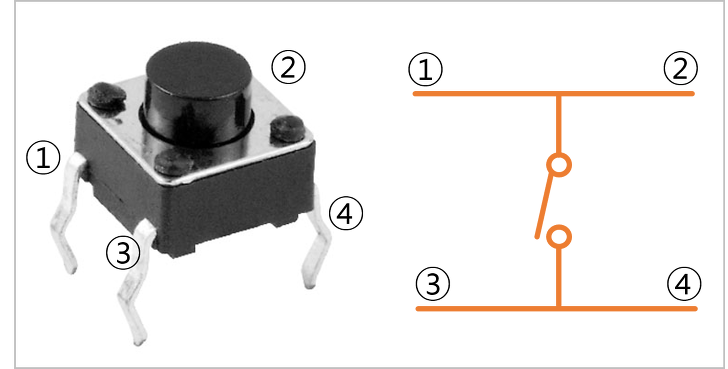
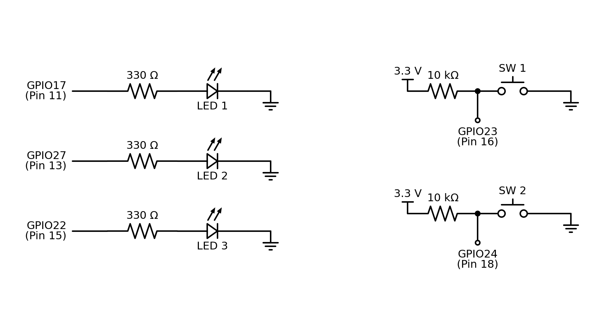
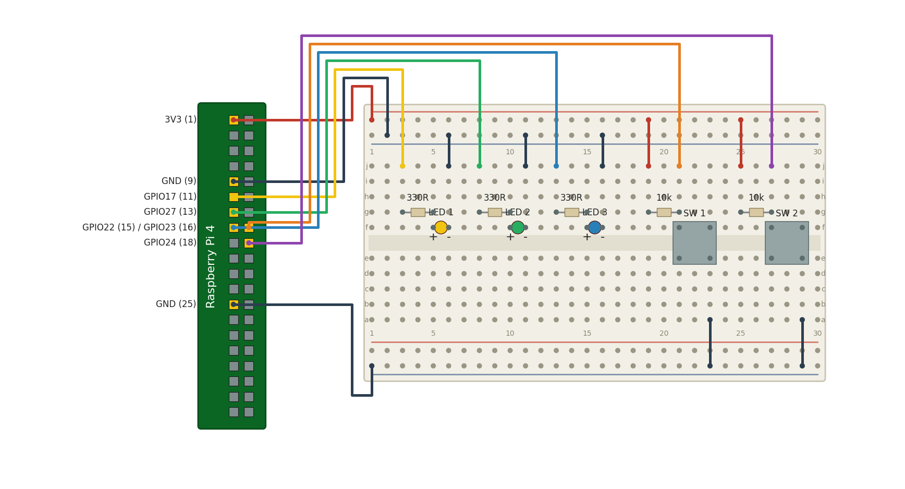
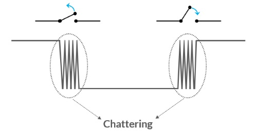
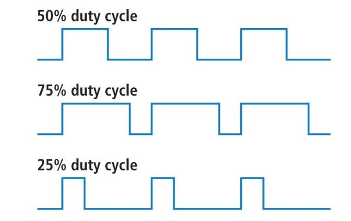
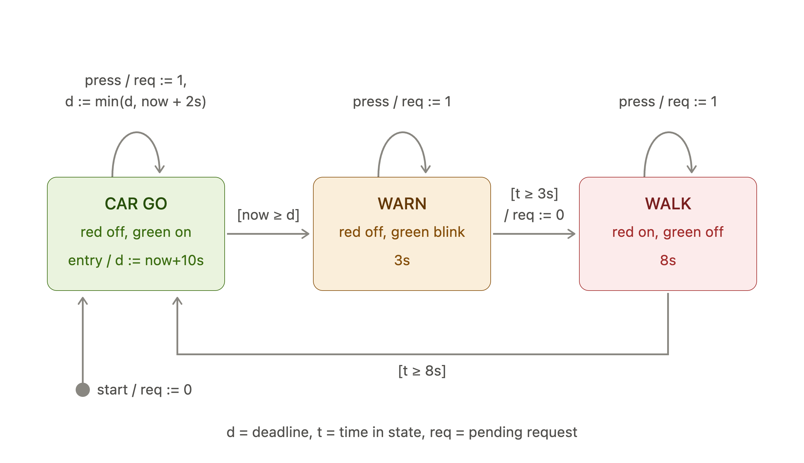
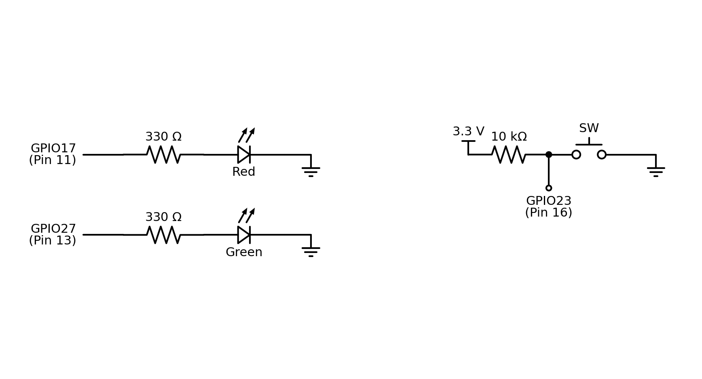
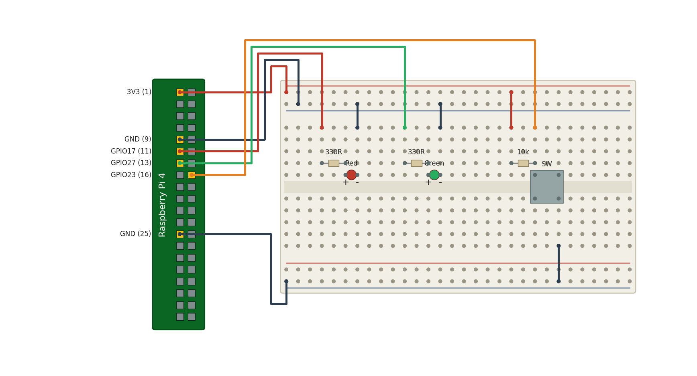

<!-- _class: lead -->

# 마이크로임베디드프로그래밍

## 실습 2 - LED와 스위치, PWM, 상태 기계

### [munseong.jeong@daejin.ac.kr](mailto:munseong.jeong@daejin.ac.kr)

---

## 실습 2 - 목표 (Goals)

- **디지털 출력**: GPIO 핀에 HIGH·LOW를 출력하여 LED를 켜고 끔
- **디지털 입력**: 버튼이 연결된 GPIO 핀의 전압 레벨을 읽어 눌림 여부 판단
- **디바운스**: 버튼 접점이 떨리는 동안 생기는 가짜 입력을 소프트웨어로 걸러냄
- **소프트웨어 PWM**: 핀을 켜고 끄는 시간의 비율을 바꾸어 LED 밝기 조절
- **유한 상태 기계**: 시간 경과와 버튼 입력에 반응하는 횡단보도 신호등 구현

| 파일명 | 주제 |
| :--- | :--- |
| `00_led_button.cc` | 실습 2-A: 버튼으로 LED 토글, 디바운스 |
| `01_pwm_dimmer.cc` | 실습 2-B: 소프트웨어 PWM으로 LED 밝기 조절 |
| `02_state_machine.cc` | 실습 2-C: 상태 기계로 구현한 횡단보도 신호등 |

---

## 실습 2 - 사용 부품과 핀 배치 (Parts and Pins)

| 부품명 | 수량 | 연결 방법 |
| :--- | :---: | :--- |
| **LED** | 2개 | 330Ω 전류 제한 저항과 직렬 연결 |
| **푸시버튼** | 2개 | 10kΩ 외장 풀업 저항과 함께 연결 |
| **점퍼 케이블** | 다수 | 브레드보드 배선 |

| 신호 | BCM 번호 | 물리 핀 번호 | 사용 실습 |
| :--- | :---: | :---: | :--- |
| **LED(빨강)** | 17 | 11 | 2-A, 2-B, 2-C |
| **LED(초록)** | 27 | 13 | 2-C |
| **버튼 1** | 23 | 16 | 2-A, 2-C |
| **버튼 2** | 24 | 18 | 2-B |

- **BCM 번호**: SoC(Broadcom) 기준의 GPIO 번호로, 코드에서 라인 번호로 사용
- **물리 핀 번호**: 40핀 헤더에서 커넥터 위치 순서대로 매긴 번호로, 배선 시 사용

---

## 실습 2 - LED와 전류 제한 저항 (Current-Limiting Resistor)

- **LED**(Light Emitting Diode): 애노드(+, 긴 다리)에서 캐소드(−, 짧은 다리)로 전류가 흐를 때 빛을 내는 다이오드
- **순방향 전압**: LED가 켜져 있는 동안 양단에 걸리는 전압으로, 빨간색 LED는 약 2V
- **전류 제한 저항**: LED와 직렬로 연결하여 흐르는 전류를 정하는 저항
  - 저항이 없는 경우: 전류가 제한되지 않아 LED와 GPIO 핀이 손상될 수 있음
  - 330Ω을 연결한 경우: (3.3V − 2V) / 330Ω ≈ 4mA
- **결선**: GPIO 핀 → 330Ω → LED 애노드, LED 캐소드 → GND
- **동작**: GPIO 핀에 HIGH(3.3V)를 출력하면 점등, LOW(0V)를 출력하면 소등

---

## 실습 2 - 풀업 회로의 동작 (Pull-Up)



- **택트 스위치 내부 구조**: ①-②, ③-④가 내부에서 항상 연결되어 있고, 버튼을 누르면 두 쌍이 서로 연결됨
- **외장 풀업 연결**: 입력 핀을 10kΩ 저항으로 3.3V에 연결하고, 스위치는 입력 핀과 GND 사이에 연결
- **동작**: 평상시 입력 핀은 HIGH, 버튼을 누르면 GND와 연결되어 LOW
- **저항의 역할**: 저항 없이 핀을 3.3V에 직결하면 버튼을 누를 때 3.3V와 GND가 단락됨

---

## 실습 2 - 풀업 회로의 동작 (Cont'd)

- **플로팅 입력**: 어디에도 연결되지 않은 입력 핀은 전압이 정해지지 않아 주변 잡음에 따라 0·1이 불규칙하게 읽힘
  - 풀업이 없는 경우: 버튼을 누르지 않아도 LOW가 읽혀 가짜 입력 발생
  - 풀업이 있는 경우: 버튼을 떼면 저항을 통해 HIGH로 고정
- **액티브 LOW**: 신호가 LOW일 때를 "활성"(눌림)으로 해석하는 방식
  - 예제 코드는 `level == 0`을 눌림으로 판단
- **내부 풀업**: `Gpio::kInputPullUp` 모드는 SoC 내부의 풀업 저항도 함께 활성화
  - 외장 10kΩ이 주 풀업이며, 내부 풀업은 외장 저항이 빠졌을 때 입력이 플로팅되지 않도록 보조

---

## 실습 2-A - 회로도 (Schematic)



---

## 실습 2-A - 브레드보드 배치 (Breadboard Layout)



---

## 실습 2 - 구성과 빌드 (Layout and Build)

```text
mep/
├── common/
│   ├── gpio.hpp
│   └── signal_stop.hpp
└── lab02/src/
    ├── 00_led_button.cc
    ├── 01_pwm_dimmer.cc
    └── 02_state_machine.cc
```

```bash
cd mep/lab02/src

# Compile and link the target binary with libgpiod
clang++ -std=c++14 -Wall -Wextra -I../../common 00_led_button.cc -o led -lgpiod
./led
```

- **`-I../../common`**: 공용 헤더 `gpio.hpp`, `signal_stop.hpp`를 찾을 디렉터리 지정
- **`-lgpiod`**: libgpiod 라이브러리 링크
- **나머지 프로그램**: 소스 파일과 출력 파일 이름만 바꾸어 같은 방법으로 빌드
- **공용 헤더의 전체 코드**: 9장 부록 참조

---

## 실습 2-A - 핀과 상수 (Pins and Constants)

[//]: # "INCLUDE: ./mep/11/src/00_led_button.cc --from 10 --to 15 --no-comment"

- **핀 번호**: 물리 핀 번호(11, 16)가 아닌 BCM 번호(17, 23)를 라인 번호로 사용
- **`kPollUs`**: 버튼을 읽는 간격으로, `usleep()`의 전달인자 단위인 µs로 표기(1000µs = 1ms)
- **`kSettleMs`**: 버튼을 뗀 뒤 다음 눌림을 받기까지 입력이 HIGH로 유지되어야 하는 시간(50ms)

---

## 실습 2-A - 라인 확보 (Claiming the Lines)

[//]: # "INCLUDE: ./mep/11/src/00_led_button.cc --from 27 --to 32 --no-comment"

- **라인**: libgpiod에서 GPIO 핀 하나를 가리키는 단위로, 칩(`/dev/gpiochip0`) 안의 번호로 식별
- **라인 요청**: 생성자가 해당 라인을 이 프로세스 전용으로 확보하고 입력·출력 방향을 설정
- **실패 검사**: 다른 프로세스가 이미 사용 중이거나 권한이 없으면 `ok()`가 `false`를 반환
- **RAII**: 객체가 소멸할 때 소멸자가 라인 요청과 칩을 자동으로 해제
- **`InstallStopHandler()`**: Ctrl-C(SIGINT) 등의 시그널을 받으면 종료 플래그만 설정
  - 루프가 플래그를 확인하고 정상적으로 빠져나오므로 소멸자가 실행되어 라인이 해제됨

---

## 실습 2 - 스위치 바운싱 (Switch Bouncing)



- **채터링**(chattering): 기계식 접점이 닿거나 떨어지는 순간 접점이 튀어 수 ms 동안 HIGH·LOW가 반복되는 현상
- **문제**: 1ms 간격으로 읽으면 한 번의 누름이 여러 번의 눌림으로 읽혀 LED가 여러 번 토글됨
- **디바운스**(debounce): 채터링으로 생긴 가짜 입력을 걸러 한 번의 누름을 한 번으로 처리하는 기법
- **고정 시간 지연 방식의 한계**: 채터링이 대기 시간보다 길게 이어지면 중복 입력 발생

---

## 실습 2-A - 디바운스 규칙 (Debounce Rule)

[//]: # "INCLUDE: ./mep/11/src/00_led_button.cc --from 44 --to 57 --no-comment"

- **즉시 반응**: `armed`가 `true`일 때 첫 LOW를 읽으면 기다리지 않고 바로 LED 토글
- **재무장 조건**: 마지막 LOW 시각(`last_low`) 이후 HIGH가 50ms 동안 이어져야 `armed`를 `true`로 설정
- **채터링 차단**: 떨림 중의 LOW는 `last_low`만 갱신하므로 50ms 대기가 처음부터 다시 시작됨

---

## 실습 2-B - 디지털 핀으로 밝기 만들기 (PWM)



- **PWM**(Pulse Width Modulation, 펄스 폭 변조): 주기를 고정하고 한 주기 안에서 HIGH인 시간의 비율을 바꾸는 신호 방식
- **듀티비**(duty cycle): 한 주기 중 HIGH인 시간의 백분율
  - 예: 10ms 주기에서 2.5ms 동안 HIGH이면 듀티비 25%
- **LED 밝기**: 주기가 충분히 짧으면 눈은 깜빡임 대신 평균 밝기를 인식하므로 듀티비가 클수록 밝게 보임

---

## 실습 2-B - PWM 상수 (PWM Constants)

[//]: # "INCLUDE: ./mep/11/src/01_pwm_dimmer.cc --from 13 --to 18 --no-comment"

- **`kPwmSteps`, `kStepUs`**: 한 주기를 100단계로 나누고 각 단계를 100µs 동안 유지
- **이론상 주기**: 100단계 × 100µs = 10ms(100Hz)
- **실제 주기**: `usleep()`의 지연과 GPIO 호출 시간이 더해져 10ms보다 길고, OS 스케줄링에 따라 매번 달라짐
- **`kSampleSteps`**: 10단계(약 1ms)마다 한 번 버튼을 읽음
- **`kBrightnessStep`**: 버튼을 한 번 누를 때마다 듀티비를 25%p씩 변경

---

## 실습 2-B - 순수 함수 (Pure Functions)

[//]: # "INCLUDE: ./mep/11/src/01_pwm_dimmer.cc --from 24 --to 31 --no-comment"

- **순수 함수**: 같은 전달인자에 항상 같은 값을 반환하고, GPIO·전역 변수 같은 외부 상태를 읽거나 바꾸지 않는 함수
- **`PwmLevel()`**: 듀티비 50%이면 단계 0~49에서 `true`(HIGH), 단계 50~99에서 `false`(LOW)
- **`NextBrightness()`**: 50 → 75 → 100 → 0 → 25 → 50 순서로 순환
- **장점**: GPIO 없이 호스트 PC에서 단위 테스트 가능
  - 예: `NextBrightness(100) == 0`, `PwmLevel(99, 100) == true` 확인

---

## 실습 2-B - PWM 주기 (One PWM Period)

[//]: # "INCLUDE: ./mep/11/src/01_pwm_dimmer.cc --from 51 --to 70 --no-comment"

- **한 단계의 동작**: 현재 단계의 출력 레벨을 LED에 쓰고 100µs 동안 대기
- **입력 검사 병행**: PWM 출력을 멈추지 않고 10단계마다 버튼을 읽어 실습 2-A와 같은 규칙으로 디바운스

---

## 실습 2-B - 소프트웨어 PWM과 하드웨어 PWM

| 구분 | 소프트웨어 PWM | 하드웨어 PWM |
| :--- | :--- | :--- |
| **신호 생성** | CPU가 프로그램으로 핀을 직접 켜고 끔 | SoC의 PWM 주변장치가 생성 |
| **사용 가능 핀** | 모든 GPIO 핀 | PWM 기능이 있는 핀(예: BCM 12, 13, 18, 19) |
| **CPU 부하** | 출력하는 동안 CPU가 계속 실행 | 설정 후 CPU 개입 없음 |
| **지터** | OS 스케줄링 때문에 큼 | 하드웨어 클록 기준이라 매우 작음 |

- **지터**(jitter): 펄스의 주기·폭이 매번 조금씩 달라지는 흔들림
- **LED 밝기 조절**: 지터가 눈에 띄지 않으므로 소프트웨어 PWM으로 충분
- **서보 모터 제어**: 펄스 폭(약 1~2ms)으로 각도가 정해지므로 지터가 곧 각도 떨림이 되어 하드웨어 PWM 권장

---

## 실습 2-C - 왜 상태 기계인가 (Why a State Machine)

- **플래그 방식의 문제**: `is_green`, `is_blinking`, `button_pressed` 같은 플래그를 조합하면 경우의 수가 2ⁿ으로 늘어 일부 조합의 처리가 누락되기 쉬움
- **유한 상태 기계**(FSM, Finite State Machine): 시스템이 정해진 개수의 상태 중 하나에 있으며, 조건이 충족되면 다른 상태로 전이하는 모델
- **장점**: 현재 상태 하나만 보면 출력과 다음 전이 조건이 결정되어 동작 추적이 쉬움
- **무어(Moore) 머신**: 출력이 현재 상태만으로 결정되는 FSM
  - 출력이 입력에도 의존하면 밀리(Mealy) 머신

---

## 실습 2-C - 왜 상태 기계인가 (Cont'd)

| 구성 요소 | 정의 | 이 실습의 적용 |
| :--- | :--- | :--- |
| **상태** | 시스템이 놓일 수 있는 구분된 상황 | `CAR GO`, `WARN`, `WALK` |
| **시간 전이** | 상태별 지속 시간이 끝나면 다음 상태로 이동 | 10초, 3초, 8초 경과 시 전이 |
| **이벤트 전이** | 외부 입력이 전이 시점을 바꿈 | 보행자 버튼이 `CAR GO`를 단축 |
| **출력** | 상태에 따라 정해지는 LED 점등 | 무어 머신 방식 |

- **두 LED의 의미**: 차량용 신호로, 초록은 차량 진행, 빨강은 차량 정지(보행자 횡단)

---

## 실습 2-C - 상태 전이 (State Transition)

| 상태 | 지속 시간 | 빨강 LED | 초록 LED | 다음 상태 |
| :--- | :---: | :---: | :---: | :--- |
| `CAR GO` | 10초 | Off | On | `WARN` |
| `WARN` | 3초 | Off | 점멸 | `WALK` |
| `WALK` | 8초 | On | Off | `CAR GO` |



---

## 실습 2-C - 상태 전이 (Cont'd)

### 보행자 버튼 규칙

- **`CAR GO` 중 누름**: 남은 시간을 최대 2초로 단축하며, 남은 시간이 2초 이하이면 그대로 유지
- **`WALK` 중 누름**: 요청을 보관했다가 다음 `CAR GO` 진입 직후 반영하여 2초 뒤 `WARN`으로 전이
- **`WARN` 중 누름**: 곧 `WALK`가 시작되므로 `WALK` 진입 시 요청을 지워 무시
- **여러 번 누름**: 몇 번을 눌러도 결과가 한 번 누른 경우와 같음(멱등성)
  - 예: `CAR GO` 중 10번 눌러도 남은 시간은 2초이며 더 줄어들지 않음

---

## 실습 2-C - 회로도 (Schematic)



---

## 실습 2-C - 브레드보드 배치 (Breadboard Layout)



---

## 실습 2-C - 상태 정의 (Defining the States)

[//]: # "INCLUDE: ./mep/11/src/02_state_machine.cc --from 20 --to 27 --no-comment"

- **`enum State`**: 상태마다 정수 번호(0, 1, 2)를 부여하고, `kStateCount`(3)로 상태 개수 표현
- **`kDurationMs`**: 상태 번호를 인덱스로 사용하는 상태별 지속 시간 표(ms)
- **`kNames`**: 상태 전이 로그에 출력할 상태 이름
- **장점**: 상태를 추가할 때 `enum`과 두 배열에 한 항목씩만 추가하면 됨

---

## 실습 2-C - 출력 함수 (Output Functions)

[//]: # "INCLUDE: ./mep/11/src/02_state_machine.cc --from 32 --to 37 --no-comment"

- **`RedOn()`**: `WALK`에서만 빨강 LED 점등
- **`GreenOn()`**: `CAR GO`에서 점등, `WARN`에서는 `blink` 값에 따라 점멸
- **`blink`**: `main()`에서 `now % 400 < 200`으로 계산하여 200ms 켜짐, 200ms 꺼짐을 반복
- **무어 머신의 이점**: 출력이 상태로만 결정되므로 상태와 LED 점등이 어긋날 수 없음

---

## 실습 2-C - 전이 규칙 (Transitions)

[//]: # "INCLUDE: ./mep/11/src/02_state_machine.cc --from 74 --to 84 --no-comment"

- **이벤트 전이**: `CAR GO`에서 남은 시간이 2초보다 길 때만 마감 시각(`deadline`)을 2초 뒤로 당김
- **시간 전이**: 현재 시각이 마감 시각을 지나면 다음 상태로 이동하고 새 마감 시각 설정
- **요청 해제**: `WALK` 진입 시 `requested`를 `false`로 바꾸어 한 번의 요청이 한 번의 횡단으로 처리됨
- **평가 순서**: 이벤트 전이를 먼저 평가하므로 같은 반복에서 단축된 마감 시각으로 시간 전이 판단

---

## 실습 2 - 과제 (Tasks)

1. **실습 2-A**: 버튼으로 LED 토글 확인, `kSettleMs`를 0으로 바꾸어 한 번 누를 때 여러 번 토글되는지 관찰
2. **실습 2-B**: `kStepUs`를 100 → 1000 → 3000으로 늘려 주기를 10ms → 100ms → 300ms로 바꾸고, 깜빡임이 보이기 시작하는 주기 기록
3. **실습 2-C 확장**: 황색 LED를 추가하여 `WARN` 구간을 별도 LED로 점등
4. **실습 2-C 로그**: `WALK` 중 버튼을 누른 뒤 다음 `CAR GO`가 2초 만에 끝나는지 전이 로그로 확인

### 고찰 항목

- **디바운스**: 고정 시간 지연 방식의 디바운스가 오동작하는 구체적 상황 분석
- **촛불 효과**: 촛불처럼 불규칙하게 흔들리는 밝기를 만들기 위한 듀티비 변경 규칙과 갱신 주기 설계
