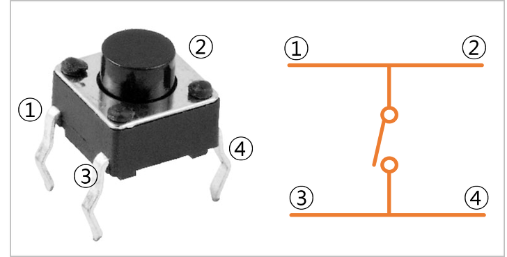
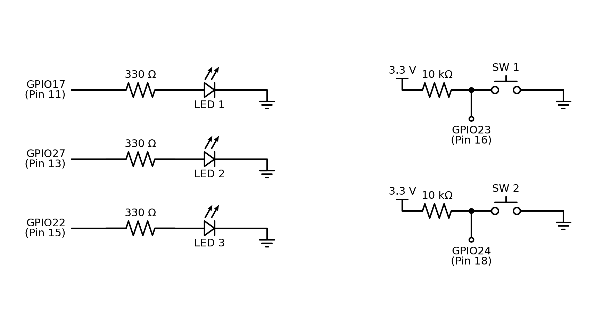
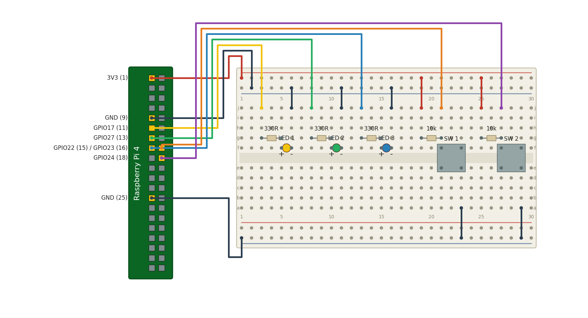
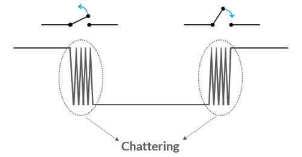
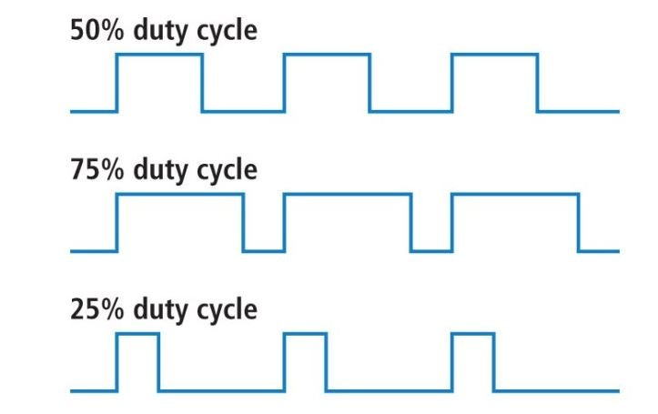
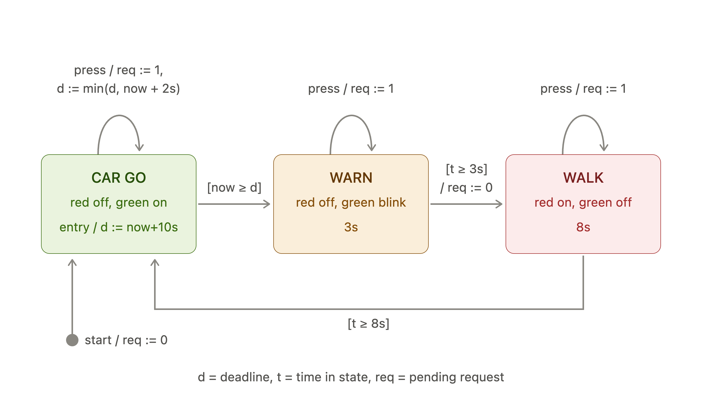
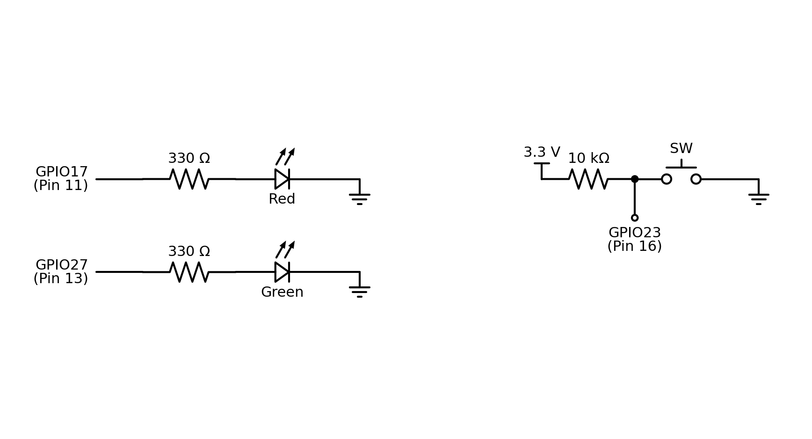
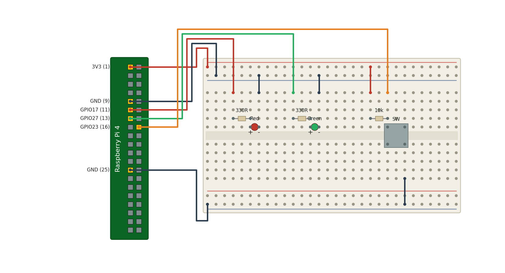

<!-- _class: lead -->

# 마이크로임베디드프로그래밍

## 실습 2 - LED와 스위치, PWM, 상태 기계

### [munseong.jeong@daejin.ac.kr](mailto:munseong.jeong@daejin.ac.kr)

---

## 실습 2 - 목표 (Goals)

- 디지털 **출력**으로 LED를 켜고, 디지털 **입력**으로 스위치를 읽음
- 스위치 접점의 **바운싱**을 소프트웨어로 걸러 냄
- **PWM**으로 디지털 핀에서 밝기를 만들어 냄
- **상태 기계**로 시간과 이벤트가 섞인 동작을 정리함

| 프로그램              | 주제                     |
| --------------------- | ------------------------ |
| `00_led_button.cc`    | 디지털 입출력과 디바운스 |
| `01_pwm_dimmer.cc`    | 소프트웨어 PWM           |
| `02_state_machine.cc` | 시간·이벤트 상태 전이    |

---

## 실습 2 - 사용 부품과 핀 배치 (Parts and Pins)

| 부품        | 수량 | 연결      |
| ----------- | ---- | --------- |
| LED         | 2    | 330Ω 직렬 |
| 푸시버튼    | 2    | 10kΩ 풀업 |
| 점퍼 케이블 | 다수 | —         |

| 신호      | BCM | 쓰이는 프로그램 |
| --------- | --- | --------------- |
| LED(빨강) | 17  | 2-A, 2-B, 2-C   |
| LED(초록) | 27  | 2-C             |
| 버튼 1    | 23  | 2-A, 2-C        |
| 버튼 2    | 24  | 2-B             |

---

## 실습 2 - 풀업 회로의 동작 (Pull-Up)



- 4핀 택트 스위치는 마주 보는 두 쌍이 **내부에서 이미 연결**되어 있음
- 10kΩ 풀업 저항으로 핀을 3.3V에 연결하고, 스위치는 핀과 GND 사이에 연결
  - 저항 없이 연결 시 3.3V와 GND가 직결되어 **단락**
- 평상시 **HIGH**, 누르면 **LOW**

---

## 실습 2-A - 회로도 (Schematic)



---

## 실습 2-A - 브레드보드 배치 (Breadboard Layout)



---

## 실습 2 - 구성과 빌드 (Layout and Build)

```text
mep/
├── common/
│   ├── gpio.hpp
│   └── signal_stop.hpp
└── lab02/src/
    ├── 00_led_button.cc
    ├── 01_pwm_dimmer.cc
    └── 02_state_machine.cc
```

```bash
cd mep/lab02/src
clang++ -std=c++14 -Wall -Wextra -I../../common 00_led_button.cc -o led -lgpiod
./led
```

- 세 프로그램 모두 같은 방식으로 빌드

---

## 실습 2-A - 핀과 상수 (Pins and Constants)

[//]: # "INCLUDE: ./mep/11/src/00_led_button.cc --from 10 --to 15 --no-comment"

- 핀 번호는 **BCM 번호** — 헤더의 물리적 핀 번호와 다름

---

## 실습 2-A - 라인 확보 (Claiming the Lines)

[//]: # "INCLUDE: ./mep/11/src/00_led_button.cc --from 27 --to 32 --no-comment"

- 생성자가 gpiochip 라인 오프셋을 요청; `ok()`로 성공 확인, 소멸자에서 해제

---

## 실습 2-A - 디바운스 규칙 (Debounce Rule)

[//]: # "INCLUDE: ./mep/11/src/00_led_button.cc --from 44 --to 57 --no-comment"

---

## 실습 2 - 스위치 바운싱 (Switch Bouncing)



- 금속 접점이 붙는 순간 수 ms 동안 **여러 번 붙었다 떨어짐**
- 전처리 없이 값을 읽으면 여러 번 눌린 것으로 처리됨

### 디바운스 규칙

- 디바운스(Debounce): 짧은 간격으로 연속 발생하는 입력을 하나의 입력으로 처리하는 기법
- 누름은 **즉시** 보고하고, 라인이 설정 시간 동안 계속 HIGH여야 `armed` 상태로 복귀
- 단순히 "N ms 동안 무시"는 부족함 — N보다 긴 채터는 두 번 세어짐

---

## 실습 2-B - 디지털 핀으로 밝기 만들기 (PWM)



- GPIO 출력은 HIGH 또는 LOW뿐이므로, 전환 속도와 듀티 비로 평균 밝기를 조절
- 한 주기에서 HIGH인 시간의 비율(듀티 비, duty cycle)이 평균 밝기를 결정
- 이상적인 지연 시간 기준 100단계 × 100µs = 10ms 주기(100Hz); 실제 주파수는 GPIO 호출과 스케줄링 오버헤드로 더 낮음

---

## 실습 2-B - PWM 상수 (PWM Constants)

[//]: # "INCLUDE: ./mep/11/src/01_pwm_dimmer.cc --from 13 --to 18 --no-comment"

---

## 실습 2-B - 순수 함수 (Pure Functions)

[//]: # "INCLUDE: ./mep/11/src/01_pwm_dimmer.cc --from 24 --to 31 --no-comment"

- 두 함수 모두 하드웨어를 건드리지 않음 — 호스트에서 시험 가능

---

## 실습 2-B - PWM 주기 (One PWM Period)

[//]: # "INCLUDE: ./mep/11/src/01_pwm_dimmer.cc --from 51 --to 70 --no-comment"

- 버튼을 PWM 주기 안에서 읽으므로 밝기를 유지한 채 입력을 받음

---

## 실습 2-B - 소프트웨어 PWM과 하드웨어 PWM

| 구분      | 소프트웨어 PWM        | 하드웨어 PWM      |
| --------- | --------------------- | ----------------- |
| 생성 주체 | CPU가 직접 전환       | 전용 타이머 회로  |
| 사용 핀   | 아무 GPIO나 가능      | 지정된 핀에서만   |
| CPU 부담  | 주기마다 깨어나야 함  | 설정 후 부담 없음 |
| 흔들림    | 다른 작업에 밀려 떨림 | 거의 없음         |

- LED 밝기 정도는 소프트웨어로 충분하지만, 서보·모터는 **하드웨어 PWM**이 필요

---

## 실습 2-C - 왜 상태 기계인가 (Why a State Machine)

- 시간과 이벤트가 섞이면 플래그 몇 개로는 곧 감당이 되지 않음
- **상태에 이름을 붙이면** 상태 기계 다이어그램(state machine diagram)으로 상태 전이 흐름을 파악할 수 있음

### 구성 요소

| 요소        | 이 실습에서                         |
| ----------- | ----------------------------------- |
| 상태        | `CAR GO`, `WARN`, `WALK`            |
| 시간 전이   | 정해진 시간이 지나면 다음 상태로    |
| 이벤트 전이 | 버튼이 녹색 구간(`CAR GO`)을 앞당김 |
| 출력        | 상태만으로 결정되는 LED 점등        |

---

## 실습 2-C - 상태 전이 (State Transition)

| 상태     | 지속 | 빨강(LED) | 초록(LED)   | 다음     |
| -------- | ---- | --------- | ----------- | -------- |
| `CAR GO` | 10초 | off       | on          | `WARN`   |
| `WARN`   | 3초  | off       | 깜빡임      | `WALK`   |
| `WALK`   | 8초  | on        | off         | `CAR GO` |



- 차량·보행자 신호 제어를 상태 기계로 구현한 예시
- 버튼(보행자 작동 신호기)은 `CAR GO`만 앞당기며, 누른 순간부터 최대 2초 뒤 녹색이 끝남(남은 시간이 2초 이하면 그대로)
- `WALK` 중에 누른 요청은 걸려 있다가 다음 `CAR GO`에 적용, `WARN` 중에 누른 요청은 곧 올 `WALK`로 처리된 것으로 봄
- 열 번 눌러도 한 번 누른 것과 같으며, 다시 눌러도 2초가 연장되지 않음

---

## 실습 2-C - 회로도 (Schematic)



---

## 실습 2-C - 브레드보드 배치 (Breadboard Layout)



---

## 실습 2-C - 상태 정의 (Defining the States)

[//]: # "INCLUDE: ./mep/11/src/02_state_machine.cc --from 20 --to 27 --no-comment"

---

## 실습 2-C - 출력 함수 (Output Functions)

[//]: # "INCLUDE: ./mep/11/src/02_state_machine.cc --from 32 --to 37 --no-comment"

---

## 실습 2-C - 전이 규칙 (Transitions)

[//]: # "INCLUDE: ./mep/11/src/02_state_machine.cc --from 74 --to 84 --no-comment"

- 이벤트 전이를 먼저 처리한 뒤, 시간 전이를 처리해야 함
  - 순서가 바뀌면 요청이 한 회차 늦게 반영됨

---

## 실습 2 - 과제 (Tasks)

1. 2-A를 빌드해 버튼으로 LED가 토글되는지 확인하고, 디바운스 시간을 0으로 바꿔 차이를 관찰
2. 2-B에서 `kPwmSteps`를 10으로 줄여 깜빡임이 보이기 시작하는 지점을 찾을 것
3. 2-C에 노란색 LED를 추가해 `WARN` 구간을 별도 LED로 표시하도록 확장
4. 2-C에서 버튼을 `WALK` 구간에 눌렀을 때 요청이 어떻게 처리되는지 로그로 확인

### 고찰 항목

- 디바운스를 "N ms 무시"로 구현하면 어떤 경우에 실패하는가
- 촛불처럼 자연스럽게 일렁이는 LED 캔들을 구현하려면 PWM 듀티비(Duty Cycle)와 갱신 주기를 어떻게 설계해야 하는가
