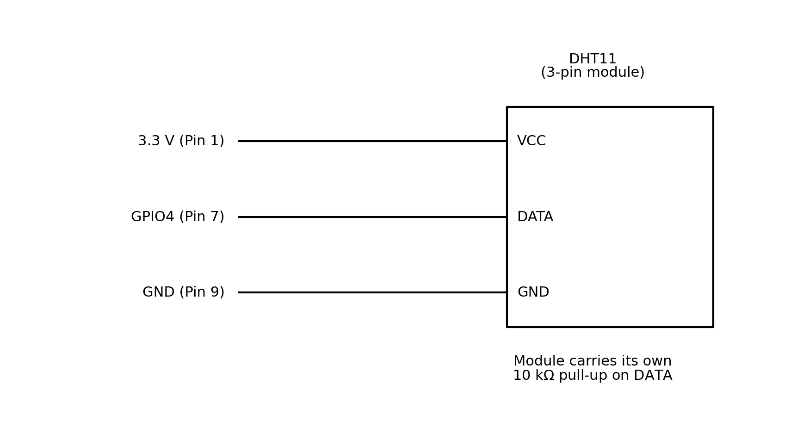
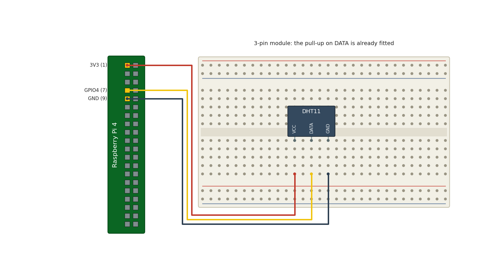
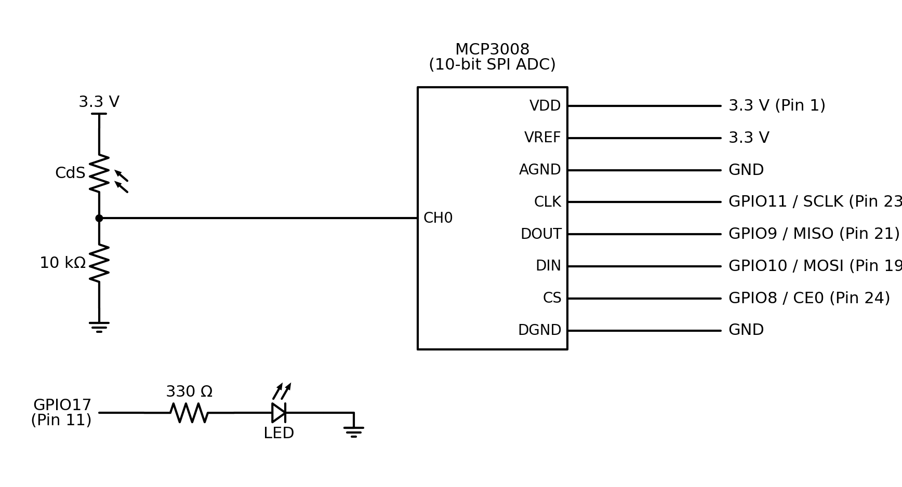
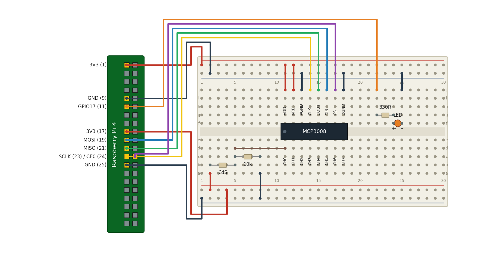
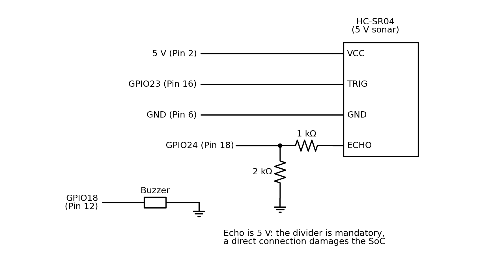
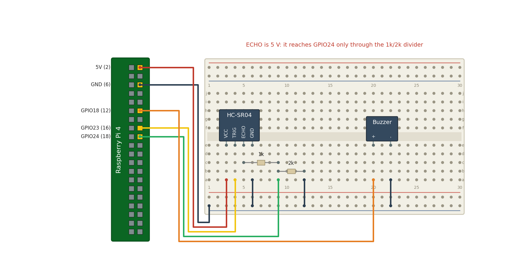

<!-- _class: lead -->

# 마이크로임베디드프로그래밍

## 실습 3 - 온습도·조도·거리 센서

### [munseong.jeong@daejin.ac.kr](mailto:munseong.jeong@daejin.ac.kr)

---

## 실습 3 - 목표 (Goals)

- **인터페이스 다양성**: 센서별 고유 통신 프로토콜의 차이점을 코드로 직접 검증
- **통신 구현**: 단일선 **비트뱅잉**, **SPI**, **펄스 폭 측정** 기법 단계별 구현
- **데이터 처리**: 원시 센서 신호의 물리량 변환 및 무결성 검증 로직 구현

| 프로그램 | 대상 센서 | 통신 방식 |
| :--- | :--- | :--- |
| `00_dht11_read.cc` | DHT11 | 단일선 비트뱅잉 |
| `01_cds_light.cc` | CdS + ADC | SPI(MCP3008) |
| `02_distance.cc` | HC-SR04 | 펄스 폭 측정 |

- 하드웨어 래퍼 라이브러리 없이 센서 인터페이스 로직을 실습 코드에 직접 구현

---

## 실습 3 - 비트뱅잉 (What Is Bit-Banging)

- **개념 정의**: 전용 하드웨어(UART·SPI·I2C 등) 없이 CPU가 **GPIO 핀을 소프트웨어로 직접 제어**해 통신 신호를 송수신하는 기법
- **명칭 어원**: 비트(bit) 단위로 핀 전위를 HIGH/LOW로 빠르게 두드리듯(bang) 토글하는 동작에서 유래

| 구분 | 하드웨어 통신(SPI 등) | 비트뱅잉(소프트웨어) |
| :--- | :--- | :--- |
| **파형 생성** | 전용 컨트롤러 자동 생성 | 소프트웨어 루프로 직접 토글 |
| **타이밍** | 하드웨어 클록 기준(정밀) | OS 스케줄링 영향으로 지터 발생 |
| **CPU 부하** | 낮음(DMA/인터럽트 활용) | 높음(바쁜 대기 지속) |
| **적용 대상** | 표준 통신 규격 장치 | 비표준 단일선 센서(DHT11 등) |

- **DHT11 적용**: 시작 신호 출력 ➔ 입력 모드 전환 ➔ HIGH 유지 시간(µs) 계측으로 0/1 비트 판정

---

## 실습 3 - 세 가지 통신 방식 (Sensor Interfaces)

| 통신 방식 | 타이밍 제어 주체 | 실습 적용 센서 |
| :--- | :--- | :--- |
| **비트뱅잉** | CPU가 소프트웨어 파형 직접 생성 | DHT11 |
| **SPI** | 전용 하드웨어가 동기 클록 생성 | MCP3008 |
| **펄스 폭 측정** | 센서 출력 펄스를 CPU가 계측 | HC-SR04 |

- **타이밍 민감도**: 비트뱅잉과 펄스 폭 측정은 마이크로초 단위 타이밍 정밀도가 핵심
- **하드웨어 가속**: SPI는 리눅스 커널 SPI 드라이버가 클록과 데이터를 전담 생성

---

## 실습 3-A - DHT11 회로 (Schematic)



- 단일 데이터 선 기반의 양방향 통신 구조 — 10kΩ 풀업 저항 필수 (모듈 내 기본 탑재)

---

## 실습 3-A - 브레드보드 배치 (Breadboard Layout)



---

## 실습 3-A - 통신 절차 (Protocol)

| 단계 | 주체 | 주요 동작 |
| :--- | :--- | :--- |
| **시작 신호** | 호스트 | 버스 라인을 20ms 동안 LOW 구동 |
| **응답 신호** | 센서 | LOW ➔ HIGH ➔ LOW 3단계 레벨 전환 |
| **데이터 전송** | 센서 | 40비트 직렬 전송(HIGH 유지 시간이 값 결정) |
| **체크섬 검증** | 호스트 | 상위 4바이트 합산값과 5번째 바이트 일치 비교 |

- **비트 판정 기준**: HIGH 유지 시간(약 27µs: `0`, 약 70µs: `1`)을 50µs 기준으로 판정
- **동적 방향 전환**: 동일 핀의 출력 ➔ 입력 전환을 위해 `Reconfigure()` 수행(실패 시 기존 자원 해제)

---

## 실습 3 - 구성과 빌드 (Layout and Build)

```text
mep/
├── common/
│   ├── gpio.hpp
│   └── signal_stop.hpp
└── lab03/src/
    ├── 00_dht11_read.cc
    ├── 01_cds_light.cc
    └── 02_distance.cc
```

```bash
cd mep/lab03/src

# Build each lab application with appropriate libraries
clang++ -std=c++14 -Wall -Wextra -I../../common 00_dht11_read.cc -o dht -lgpiod
clang++ -std=c++14 -Wall -Wextra -I../../common 01_cds_light.cc -o light
clang++ -std=c++14 -Wall -Wextra -I../../common 02_distance.cc -o distance -llgpio
```

- 조도 센서 실습은 커널 표준 SPI 디바이스(`/dev/spidev*`)를 직접 다루므로 별도 링크 라이브러리 없음

---

## 실습 3-A - 예제 코드 (Example)

[//]: # "INCLUDE: ./mep/12/src/00_dht11_read.cc --to 18"

---

## 실습 3-A - 예제 코드 (Cont'd - 1)

[//]: # "INCLUDE: ./mep/12/src/00_dht11_read.cc --from 19 --to 36"

- **바쁜 대기(Busy-Wait)**: 마이크로초 단위 신호 계측을 위해 슬립 없이 루프로 핀 상태 폴링

---

## 실습 3-A - 예제 코드 (Cont'd - 2)

[//]: # "INCLUDE: ./mep/12/src/00_dht11_read.cc --from 37 --to 46"

---

## 실습 3-A - 예제 코드 (Cont'd - 3)

[//]: # "INCLUDE: ./mep/12/src/00_dht11_read.cc --from 47 --to 64"

- **체크섬 불일치 처리**: 타이밍 지터 등으로 변질된 수신 프레임은 즉시 폐기

---

## 실습 3-A - 예제 코드 (Cont'd - 4)

[//]: # "INCLUDE: ./mep/12/src/00_dht11_read.cc --from 65"

---

## 실습 3-B - 라즈베리파이에는 ADC가 없다 (No Analog Input)

- **아날로그 입력 부재**: 라즈베리파이 GPIO는 디지털(0/1)만 지원하여 전압 크기 판독 불가
- **외장 ADC 활용**: 10비트 SPI ADC(MCP3008)를 연동하여 아날로그 전압을 디지털로 변환

### CdS 분압 회로 동작 원리

- **결선 구조**: 3.3V ➔ [CdS 포토레지스터] ➔ 센싱 노드 ➔ [10kΩ 저항] ➔ GND
- **센싱 노드**: CdS와 10kΩ 사이의 접점으로, MCP3008 CH0에 연결되는 분압 출력 지점
- **전압 변화**: V = 3.3V × 10kΩ / (CdS 저항 + 10kΩ) ➔ 조도 증가 시 CdS 저항 감소로 전압 상승

| 밝기 | CdS 저항(일반 5mm 셀) | 센싱 노드 전압 | ADC 값(10비트) |
| :--- | :--- | :--- | :--- |
| 어두움(암실) | 약 1MΩ | 약 0.03V | 약 10 |
| 실내 조명 | 약 10kΩ | 약 1.65V | 약 512 |
| 밝음(직사광) | 약 1kΩ | 약 3.0V | 약 930 |

- **10kΩ 선택 이유**: 실내 CdS 저항과 같아 실내에서 중간 전압(1.65V) ➔ 밝기 변화 양방향 0~3.3V 활용
- **계측 원리**: 절대 저항값이 아닌 저항비에 따른 분압 전압(0~3.3V)을 ADC로 계측

---

## 실습 3-B - 분압 회로 (Divider Schematic)



---

## 실습 3-B - 브레드보드 배치 (Breadboard Layout)



---

## 실습 3-B - 예제 코드 (Example)

[//]: # "INCLUDE: ./mep/12/src/01_cds_light.cc --to 11"

---

## 실습 3-B - 예제 코드 (Cont'd - 1)

[//]: # "INCLUDE: ./mep/12/src/01_cds_light.cc --from 12 --to 25"

- **SPI 디바이스 노드**: `/dev/spidev<버스>.<CE>` 형식 참조(`raspi-config`에서 SPI 활성화 필수)

---

## 실습 3-B - 예제 코드 (Cont'd - 2)

[//]: # "INCLUDE: ./mep/12/src/01_cds_light.cc --from 26 --to 45"

---

## 실습 3-B - 예제 코드 (Cont'd - 3)

[//]: # "INCLUDE: ./mep/12/src/01_cds_light.cc --from 46 --to 63"

- **순수 함수 설계**: 하드웨어 의존성이 없는 순수 함수로 구성하여 호스트 단위 테스트 가능

---

## 실습 3-B - 예제 코드 (Cont'd - 4)

[//]: # "INCLUDE: ./mep/12/src/01_cds_light.cc --from 64 --to 80"

---

## 실습 3-B - 예제 코드 (Cont'd - 5)

[//]: # "INCLUDE: ./mep/12/src/01_cds_light.cc --from 81"

---

## 실습 3-C - 거리 측정의 원리 (Time of Flight)

- **ToF(Time of Flight) 원리**: 초음파 발신 후 반사되어 수신될 때까지의 왕복 시간 계측

$$\text{Distance} = \frac{\text{Round-trip Time} \times \text{Speed of Sound}}{2}$$

- **음속 상수**: 20℃ 대기 중 음속 약 **343 m/s = 0.0343 cm/µs**(왕복 거리이므로 2로 제산)

### 5V Echo 신호 분압 주의사항

- **Echo 출력 전압**: HC-SR04 Echo 핀은 **5V 신호**를 출력하므로 3.3V GPIO 직결 시 손상 발생
- **전압 분압 회로**: 1kΩ 및 2kΩ 저항 분압을 통해 5V 신호를 약 3.3V로 감압 후 GPIO 연결

---

## 실습 3-C - 회로도 (Schematic)



---

## 실습 3-C - 브레드보드 배치 (Breadboard Layout)



---

## 실습 3-C - 예제 코드 (Example)

[//]: # "INCLUDE: ./mep/12/src/02_distance.cc --to 21"

- **`lgpio` 사용 이유**: 마이크로초 단위의 정밀 타이밍 제어 및 타임스탬프 API 활용

---

## 실습 3-C - 예제 코드 (Cont'd - 1)

[//]: # "INCLUDE: ./mep/12/src/02_distance.cc --from 22 --to 33"

- **시간 단위 주의**: `lguTimestamp()`는 **나노초(ns)를 반환**하므로 마이크로초 변환 시 단위 일치 필수

---

## 실습 3-C - 예제 코드 (Cont'd - 2)

[//]: # "INCLUDE: ./mep/12/src/02_distance.cc --from 34 --to 49"

---

## 실습 3-C - 예제 코드 (Cont'd - 3)

[//]: # "INCLUDE: ./mep/12/src/02_distance.cc --from 50 --to 62"

---

## 실습 3-C - 예제 코드 (Cont'd - 4)

[//]: # "INCLUDE: ./mep/12/src/02_distance.cc --from 63"

---

## 실습 3 - 과제 (Tasks)

1. **센서 동작 검증**: 세 센서(DHT11, CdS, HC-SR04) 개별 실행 및 터미널 출력 로그 확인
2. **비트 판정 임계값 실험**: DHT11 임계값을 30µs 및 70µs로 변경하여 체크섬 실패율 비교
3. **조도 계측 실험**: CdS 센서 차광 실험으로 `dark`부터 `very bright`까지 전 구간 단계 검증
4. **거리 오차 측정**: HC-SR04 거리를 10cm, 50cm, 100cm로 조정하여 실측치와 오차 표 작성

### 고찰 항목

- **비트뱅잉 vs SPI**: 비트뱅잉 방식이 하드웨어 SPI 대비 OS 스케줄링 타이밍에 민감한 이유 분석
- **체크섬의 필요성**: 통신 프레임 체크섬 검증이 누락될 경우 발생할 수 있는 오동작 위험 서술
- **Wait vs 인터럽트**: HC-SR04의 Echo 수신을 `lgpio` 엣지 콜백(Alert) 구조로 대체 구현하고, 기존 Busy-Wait 대비 프로세스 CPU 점유율([`top`](https://en.wikipedia.org/wiki/Top_(software))) 및 거리 계측 안정성 비교 분석
