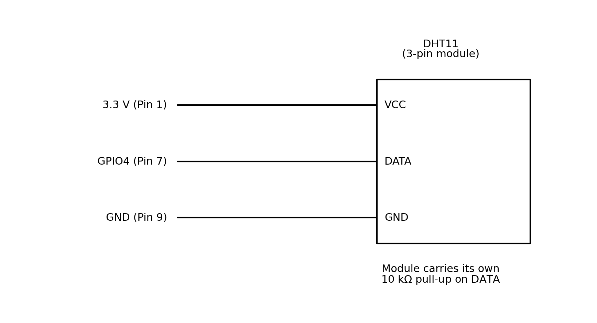
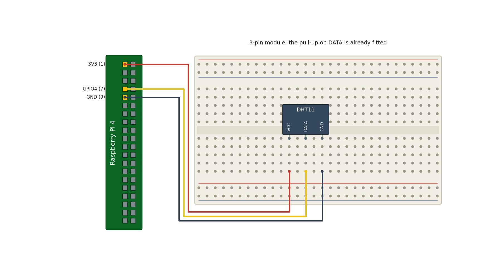
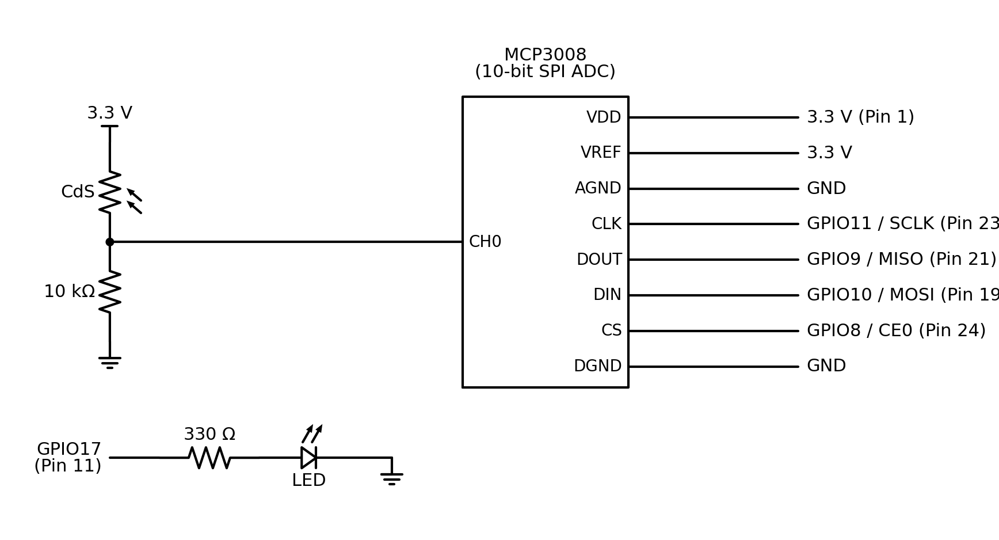
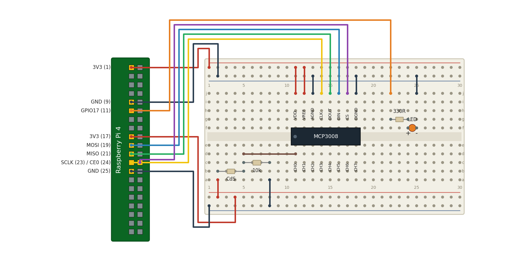
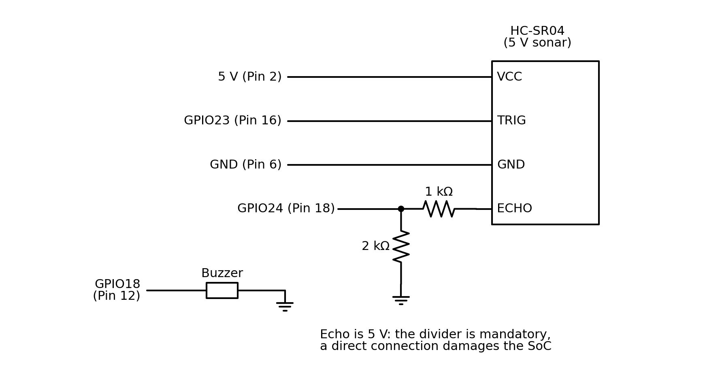
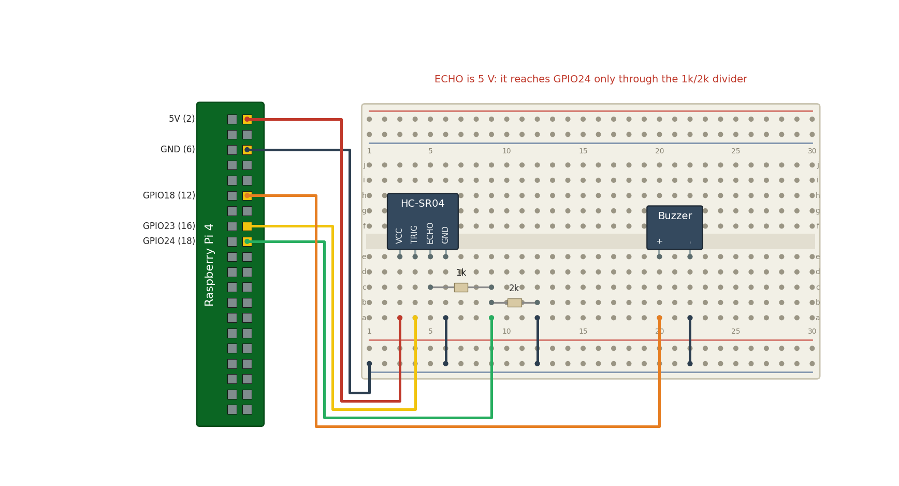

<!-- _class: lead -->

# 마이크로임베디드프로그래밍

## 실습 3 - 온습도·조도·거리 센서

### [munseong.jeong@daejin.ac.kr](mailto:munseong.jeong@daejin.ac.kr)

---

## 실습 3 - 목표 (Goals)

- **세 가지 통신 방식**: 센서마다 다른 방식으로 데이터를 보내며, 그 차이를 코드로 확인
- **직접 구현**: 단일선 비트뱅잉, SPI 전송, 펄스 폭 측정을 센서 전용 라이브러리 없이 구현
- **데이터 처리**: 센서가 보낸 원시 값을 습도·전압·거리 같은 물리량으로 변환하고 오류 검사

| 프로그램 | 대상 센서 | 통신 방식 |
| :--- | :--- | :--- |
| `00_dht11_read.cc` | DHT11(온습도) | 단일선 비트뱅잉 |
| `01_cds_light.cc` | CdS(조도) + MCP3008(ADC) | SPI |
| `02_distance.cc` | HC-SR04(초음파 거리) | 펄스 폭 측정 |

---

## 실습 3 - 비트뱅잉 (What Is Bit-Banging)

- **정의**: 전용 통신 하드웨어(UART·SPI·I2C 컨트롤러) 없이 CPU가 GPIO 핀을 프로그램으로 직접 켜고 끄거나 읽어서 통신 신호를 만드는 기법
- **이름의 유래**: 비트(bit) 단위로 핀을 HIGH·LOW로 두드리듯(bang) 바꾸는 동작에서 유래

| 구분 | 하드웨어 통신(SPI 등) | 비트뱅잉 |
| :--- | :--- | :--- |
| **파형 생성** | 전용 컨트롤러가 생성 | 프로그램 루프가 핀을 직접 바꿈 |
| **타이밍** | 하드웨어 클록 기준으로 정확 | OS 스케줄링 영향으로 지터 발생 |
| **CPU 부하** | 낮음(DMA·인터럽트 활용) | 높음(전송 내내 바쁜 대기) |
| **사용 대상** | 표준 통신 방식을 따르는 장치 | 고유한 단일선 방식을 쓰는 센서(DHT11 등) |

- **DHT11 적용 순서**: 시작 신호 출력 → 입력 모드로 전환 → HIGH 유지 시간(µs)을 재어 0·1 판정

---

## 실습 3 - 세 가지 통신 방식 (Sensor Interfaces)

| 통신 방식 | 타이밍을 만드는 주체 | 실습 센서 |
| :--- | :--- | :--- |
| **비트뱅잉** | CPU가 프로그램으로 신호 생성·측정 | DHT11 |
| **SPI** | SoC의 SPI 컨트롤러가 클록 생성 | MCP3008 |
| **펄스 폭 측정** | 센서가 펄스를 만들고 CPU가 그 길이를 측정 | HC-SR04 |

- **타이밍 민감도**: 비트뱅잉과 펄스 폭 측정은 µs 단위의 시간 측정 정확도가 결과를 결정
- **SPI의 역할 분담**: SoC의 SPI 컨트롤러가 클록과 데이터 파형을 만들고, 커널 SPI 드라이버는 프로그램의 전송 요청을 컨트롤러에 전달

---

## 실습 3-A - DHT11 회로 (Schematic)



- **단일선 통신**: 데이터선 하나(DATA)로 호스트와 센서가 번갈아 신호를 보냄
- **풀업 저항**: 두 장치 모두 선을 놓으면 풀업 저항이 HIGH로 만듦(실습용 3핀 모듈은 10kΩ 풀업 내장)

---

## 실습 3-A - 브레드보드 배치 (Breadboard Layout)



---

## 실습 3-A - 통신 절차 (Protocol)

| 단계 | 주체 | 동작 |
| :--- | :--- | :--- |
| **시작 신호** | 호스트 | 데이터선을 18ms 이상 LOW로 유지(예제는 20ms) |
| **응답 신호** | 센서 | 약 80µs LOW → 약 80µs HIGH → LOW |
| **데이터 전송** | 센서 | 40비트를 차례로 전송하며, 각 비트의 HIGH 유지 시간이 값을 결정 |
| **체크섬 검사** | 호스트 | 앞 4바이트 합의 하위 8비트가 5번째 바이트와 같은지 비교 |

- **비트 판정**: HIGH 유지 시간이 약 27µs이면 `0`, 약 70µs이면 `1`이므로 50µs를 기준으로 판정
- **방향 전환**: 같은 핀을 출력에서 입력으로 바꾸기 위해 `Reconfigure()` 호출
  - `Reconfigure()`는 기존 라인 요청을 해제한 뒤 새 방향으로 다시 요청

---

## 실습 3-A - 데이터 형식 (Data Frame)

| 바이트 | 0 | 1 | 2 | 3 | 4 |
| :--- | :---: | :---: | :---: | :---: | :---: |
| **내용** | 습도 정수부 | 습도 소수부 | 온도 정수부 | 온도 소수부 | 체크섬 |
| **예** | 45 | 0 | 23 | 0 | 68 |

- **체크섬**(checksum): 데이터 바이트를 더한 값으로, 수신 측이 다시 계산해 전송 오류를 검출
  - 예: 45 + 0 + 23 + 0 = 68이므로 5번째 바이트가 68이면 정상
  - 한 비트가 잘못 읽혀 습도가 47로 바뀌면 합이 70이 되어 68과 달라 폐기
- **소수부**: 예제는 정수부(0·2번)만 사용
  - DHT11의 소수부는 0이거나 모델에 따라 온도 소수 한 자리만 제공(소수 정밀도가 필요하면 DHT22 사용)

---

## 실습 3 - 구성과 빌드 (Layout and Build)

```text
mep/
├── common/
│   ├── gpio.hpp
│   └── signal_stop.hpp
└── lab03/src/
    ├── 00_dht11_read.cc
    ├── 01_cds_light.cc
    └── 02_distance.cc
```

```bash
cd mep/lab03/src

# Build each lab application with appropriate libraries
clang++ -std=c++14 -Wall -Wextra -I../../common 00_dht11_read.cc -o dht -lgpiod
clang++ -std=c++14 -Wall -Wextra -I../../common 01_cds_light.cc -o light
clang++ -std=c++14 -Wall -Wextra -I../../common 02_distance.cc -o distance -llgpio -lgpiod
```

- **`01_cds_light.cc`**: 커널의 SPI 장치 파일(`/dev/spidev0.0`)을 직접 다루므로 추가 라이브러리 없음
- **`02_distance.cc`**: TRIG·ECHO는 lgpio(`-llgpio`), 부저는 `Gpio` 클래스(`-lgpiod`)로 제어하여 둘 다 링크
- **공용 헤더의 전체 코드**: 9장 부록 참조

---

## 실습 3-A - 예제 코드 (Example)

[//]: # "INCLUDE: ./mep/12/src/00_dht11_read.cc --to 18"

- **`kTimeoutUs`**: DHT11의 가장 긴 펄스(약 80µs)보다 충분히 긴 200µs 안에 레벨이 바뀌지 않으면 실패로 처리
- **`kStartLowUs`**: 시작 신호의 LOW 유지 시간(20ms)

---

## 실습 3-A - 예제 코드 (Cont'd - 1)

[//]: # "INCLUDE: ./mep/12/src/00_dht11_read.cc --from 19 --to 36"

- **`WaitFor()`**: 라인이 `level`이 될 때까지 걸린 시간(µs)을 반환하고, 제한 시간을 넘으면 -1 반환
- **바쁜 대기**(busy-wait): 잠들지 않고 루프를 돌며 핀 상태를 계속 읽는 방식
  - `usleep()`은 타이머 여유(timer slack, 기본 50µs)만큼 늦게 깨어날 수 있어 27µs·70µs 구분 불가

---

## 실습 3-A - 예제 코드 (Cont'd - 2)

[//]: # "INCLUDE: ./mep/12/src/00_dht11_read.cc --from 37 --to 46"

- **시작 신호**: 출력 LOW로 설정하고 20ms 대기한 뒤 입력으로 바꾸어 선을 놓음
- **응답 신호 확인**: LOW → HIGH → LOW 순서로 세 번 레벨 변화를 기다림
  - 하나라도 200µs 안에 오지 않으면 센서 무응답으로 판단

---

## 실습 3-A - 예제 코드 (Cont'd - 3)

[//]: # "INCLUDE: ./mep/12/src/00_dht11_read.cc --from 47 --to 64"

- **비트 조립**: `i / 8`번째 바이트를 왼쪽으로 1비트 밀고 새 비트를 넣으므로 먼저 받은 비트가 최상위 비트(MSB)가 됨
- **체크섬 검사**: 합을 `std::uint8_t`로 변환하여 하위 8비트만 비교
- **불일치 처리**: 타이밍 지터 등으로 잘못 읽힌 프레임은 값을 쓰지 않고 `false` 반환

---

## 실습 3-A - 예제 코드 (Cont'd - 4)

[//]: # "INCLUDE: ./mep/12/src/00_dht11_read.cc --from 65"

- **측정 간격**: 센서가 허용하는 측정 간격을 지키기 위해 측정 사이에 2초(`kIntervalUs`) 대기
- **실패 메시지**: 풀업 저항과 시작 신호를 우선 점검하도록 안내

---

## 실습 3-B - 라즈베리파이에는 ADC가 없다 (No Analog Input)

- **디지털 입력의 한계**: GPIO 입력은 전압을 HIGH(1)·LOW(0) 둘 중 하나로만 읽어 전압의 크기는 알 수 없음
- **ADC**(Analog-to-Digital Converter): 아날로그 전압을 정수 값으로 바꾸는 장치
  - 10비트 ADC는 0V~기준 전압(3.3V)을 1024단계(0~1023)로 나누며, 한 단계는 약 3.2mV
- **MCP3008**: 8개의 입력 채널(CH0~CH7)을 가진 10비트 ADC 칩으로, 변환 결과를 SPI로 전달
- **CdS 셀**(황화카드뮴 광센서): 빛이 강할수록 저항이 작아지는 소자
- **측정 방법**: CdS의 저항 변화를 분압 회로로 전압 변화로 바꾸고, 그 전압을 MCP3008로 측정

---

## 실습 3-B - CdS 분압 회로 (Voltage Divider)

- **결선**: 3.3V → CdS → 측정 노드 → 10kΩ → GND
- **측정 노드**: CdS와 10kΩ 사이의 접점으로, MCP3008 CH0에 연결
- **노드 전압**: V = 3.3V × 10kΩ / (R_CdS + 10kΩ)이므로 밝아져 CdS 저항이 줄면 전압 상승

| 밝기 | CdS 저항(5mm 셀 대략값) | 노드 전압 | ADC 값(10비트) |
| :--- | :--- | :--- | :--- |
| 어두움(암실) | 약 1MΩ | 약 0.03V | 약 10 |
| 실내 조명 | 약 10kΩ | 약 1.65V | 약 512 |
| 밝음(직사광) | 약 1kΩ | 약 3.0V | 약 930 |

- **10kΩ을 쓰는 이유**: 실내 조명에서 CdS 저항과 같아 노드 전압이 중간(1.65V)이 되므로 밝아질 때와 어두워질 때 모두 전압 변화가 큼

---

## 실습 3-B - SPI (Serial Peripheral Interface)

- **정의**: 컨트롤러(라즈베리파이)가 클록을 만들고, 클록에 맞추어 주변장치와 1비트씩 데이터를 주고받는 동기식 직렬 통신 방식

| 신호 | BCM 번호 | 방향 | 역할 |
| :--- | :---: | :--- | :--- |
| **SCLK** | 11 | 컨트롤러 → 주변장치 | 클록 |
| **MOSI** | 10 | 컨트롤러 → 주변장치 | 명령·데이터 송신 |
| **MISO** | 9 | 주변장치 → 컨트롤러 | 결과 수신 |
| **CE0** | 8 | 컨트롤러 → 주변장치 | 통신 대상 선택(LOW일 때 선택) |

- **전이중**(full-duplex): 클록 한 번마다 MOSI로 1비트를 보내는 동시에 MISO로 1비트를 받음
  - 예: 3바이트를 보내면 같은 시간에 3바이트를 받음
- **spidev**: 커널 SPI 드라이버를 `/dev/spidev<버스>.<CE>` 형식의 장치 파일로 노출하는 인터페이스

---

## 실습 3-B - SPI (Cont'd)

### SPI 모드 (SPI Modes)

- **SPI 모드**: 클록의 유휴 레벨(CPOL)과 샘플링 시점(CPHA)의 조합으로 정해지는 4가지 설정(모드 0~3)

| 모드 | CPOL(유휴 클록) | CPHA | 샘플링 에지 |
| :---: | :---: | :---: | :--- |
| 0 | LOW | 0 | 첫 번째 에지(상승) |
| 3 | HIGH | 1 | 두 번째 에지(하강 다음의 상승) |

- **MCP3008**: 모드 0과 모드 3을 지원하며, 예제는 모드 0 사용
- **역할 분리**: 모드에 맞는 클록 생성은 SPI 컨트롤러가 담당하므로 모드 3으로 바꾸어도 읽기 코드는 같음

---

## 실습 3-B - 분압 회로 (Divider Schematic)



---

## 실습 3-B - 브레드보드 배치 (Breadboard Layout)



---

## 실습 3-B - 예제 코드 (Example)

[//]: # "INCLUDE: ./mep/12/src/01_cds_light.cc --to 11"

- **`linux/spi/spidev.h`**: SPI 전송 구조체 `spi_ioc_transfer`와 `ioctl()` 요청 번호 정의
- **libgpiod 미사용**: SPI 핀은 커널 SPI 드라이버가 관리하므로 GPIO 라이브러리가 필요 없음

---

## 실습 3-B - 예제 코드 (Cont'd - 1)

[//]: # "INCLUDE: ./mep/12/src/01_cds_light.cc --from 12 --to 25"

- **`kSpiDev`**: `/dev/spidev0.0`은 SPI 버스 0의 CE0에 연결된 장치(`raspi-config`에서 SPI 활성화 필요)
- **`kSpeedHz`**: 3.3V 전원에서 안전한 클록 상한으로 데이터시트의 2.7V 기준값(1.35MHz) 사용

---

## 실습 3-B - 예제 코드 (Cont'd - 2)

[//]: # "INCLUDE: ./mep/12/src/01_cds_light.cc --from 26 --to 45"

- **`ioctl(SPI_IOC_MESSAGE(1))`**: `tx` 3바이트를 보내면서 같은 시간에 `rx` 3바이트를 받음
- **널 비트 검사**: MCP3008은 결과 앞에 항상 0인 비트를 보내므로, 이 비트가 1이면 MISO 미연결로 판단

---

## 실습 3-B - MCP3008 전송 형식 (Cont'd - 3)

| 바이트 | 송신(`tx`) | 수신(`rx`) |
| :---: | :--- | :--- |
| 0 | `0x01`: 시작 비트 | 의미 없는 값(아직 출력 전) |
| 1 | `0x80`(단일 입력) + 채널 번호(비트 6~4) | 비트 2: 널 비트, 비트 1~0: 결과 상위 2비트 |
| 2 | `0x00`: 결과를 받기 위한 클록용 | 결과 하위 8비트 |

- **단일 입력**(single-ended): GND 기준으로 한 채널의 전압을 측정
- **차동 입력**(differential): 두 채널 사이의 전압 차를 측정하며, `0x80` 비트를 0으로 설정
- **`rx[0]`**: MCP3008이 아직 명령을 받는 중이라 MISO를 구동하지 않으므로 사용하지 않음
- **결과 조립 예**: `rx[1]`의 하위 2비트가 `0b10`, `rx[2]`가 `0x00`이면 (2 << 8) + 0 = 512

---

## 실습 3-B - 예제 코드 (Cont'd - 4)

[//]: # "INCLUDE: ./mep/12/src/01_cds_light.cc --from 46 --to 63"

- **`AdcToVoltage()`**: ADC 값을 전압으로 변환 (예: 512 → 약 1.652V)
- **`CdsOhm()`**: 분압 공식을 거꾸로 풀어 CdS 저항 계산 (예: 1.65V → 10kΩ)
- **순수 함수**: SPI 없이 호스트 PC에서 단위 테스트 가능

---

## 실습 3-B - 예제 코드 (Cont'd - 5)

[//]: # "INCLUDE: ./mep/12/src/01_cds_light.cc --from 64 --to 80"

- **`Configure()`**: SPI 모드 0, 워드 크기 8비트, 최대 클록 속도를 `ioctl()`로 설정
- **열기 실패**: SPI가 비활성화되어 `/dev/spidev0.0`이 없으면 `raspi-config` 안내 후 종료

---

## 실습 3-B - 예제 코드 (Cont'd - 6)

[//]: # "INCLUDE: ./mep/12/src/01_cds_light.cc --from 81"

- **오류 처리**: `ReadChannel()`이 음수를 반환하면 전원·MISO·CE0 배선 점검을 안내
- **자원 해제**: 종료 시 `close()`로 SPI 장치 파일을 닫음

---

## 실습 3-C - 거리 측정의 원리 (Time of Flight)

- **HC-SR04**: 초음파(40kHz)를 보내고 반사파를 받아 거리를 측정하는 5V 센서 모듈
  - TRIG 핀에 10µs 이상 HIGH 펄스를 주면 초음파 발신
  - 반사파가 돌아올 때까지 ECHO 핀이 HIGH를 유지
- **ToF**(Time of Flight): 신호가 대상까지 갔다가 돌아오는 왕복 시간으로 거리를 구하는 방법

$$\text{Distance} = \frac{\text{Round-trip Time} \times \text{Speed of Sound}}{2}$$

- **음속**: 20℃ 공기 중 약 343m/s = 0.0343cm/µs
- **계산 예**: ECHO HIGH가 1000µs이면 1000 × 0.0343 / 2 ≈ 17.2cm

---

## 실습 3-C - 거리 측정의 원리 (Cont'd)

### ECHO 신호의 전압 낮추기

- **문제**: HC-SR04의 ECHO 핀은 5V를 출력하지만 라즈베리파이 GPIO는 3.3V 기준이므로 직결하면 손상될 수 있음
- **분압 회로**: ECHO → 1kΩ → GPIO 24, GPIO 24 → 2kΩ → GND
  - GPIO 24의 전압: 5V × 2kΩ / (1kΩ + 2kΩ) ≈ 3.3V
- **TRIG 핀**: 라즈베리파이가 3.3V를 출력하는 방향이므로 분압 회로 없이 직결

### 경고 부저

- **능동 부저**(active buzzer): 내부에 발진 회로가 있어 전압을 가하기만 하면 소리를 내는 부저
  - 수동 부저는 PWM 같은 파형을 직접 공급해야 소리를 냄
- **동작**: 측정 거리가 10cm 미만이면 GPIO 18을 HIGH로 설정하여 경고음 출력

---

## 실습 3-C - 회로도 (Schematic)



---

## 실습 3-C - 브레드보드 배치 (Breadboard Layout)



---

## 실습 3-C - 예제 코드 (Example)

[//]: # "INCLUDE: ./mep/12/src/02_distance.cc --to 21"

- **lgpio를 쓰는 이유**: 10µs 트리거 펄스를 만드는 `lguSleep()`과 ns 단위 시각을 주는 `lguTimestamp()` 제공
- **`kEchoTimeoutUs`**: 30000µs는 약 514cm에 해당하므로 그보다 먼 반사는 실패로 처리

---

## 실습 3-C - 예제 코드 (Cont'd - 1)

[//]: # "INCLUDE: ./mep/12/src/02_distance.cc --from 22 --to 33"

- **시간 단위**: `lguTimestamp()`는 나노초(ns)를 반환하므로 1000으로 나누어 µs로 변환
- **구조**: 실습 3-A의 `WaitFor()`와 같은 바쁜 대기이며, 핀 읽기만 lgpio 함수로 바뀜

---

## 실습 3-C - 예제 코드 (Cont'd - 2)

[//]: # "INCLUDE: ./mep/12/src/02_distance.cc --from 34 --to 49"

- **사전 확인**: 측정 전 ECHO가 LOW가 아니면 이전 측정이 끝나지 않았으므로 실패 처리
- **트리거**: TRIG를 HIGH로 설정하고 10µs 후 LOW로 되돌림
- **펄스 폭 측정**: ECHO가 HIGH가 될 때까지 기다린 뒤, 다시 LOW가 될 때까지의 시간을 반환
- **`ToCm()`**: 왕복 시간이므로 음속을 곱한 뒤 2로 나눔

---

## 실습 3-C - 예제 코드 (Cont'd - 3)

[//]: # "INCLUDE: ./mep/12/src/02_distance.cc --from 50 --to 62"

- **두 라이브러리 병용**: TRIG·ECHO는 lgpio 핸들로, 부저는 libgpiod 기반 `Gpio` 객체로 제어
- **라인 확보**: `lgGpioClaimOutput()`·`lgGpioClaimInput()`으로 TRIG를 출력, ECHO를 입력으로 확보

---

## 실습 3-C - 예제 코드 (Cont'd - 4)

[//]: # "INCLUDE: ./mep/12/src/02_distance.cc --from 63"

- **경고 조건**: 측정에 성공하고 거리가 10cm 미만일 때만 부저를 켬
- **자원 해제**: lgpio로 확보한 두 라인과 칩 핸들을 직접 해제(부저는 `Gpio` 소멸자가 해제)

---

## 실습 3 - 과제 (Tasks)

1. **센서 동작 확인**: 세 프로그램(DHT11, CdS, HC-SR04)을 각각 실행하고 터미널 출력 기록
2. **비트 판정 기준 실험**: DHT11의 `kBitThresholdUs`를 30µs와 70µs로 바꾸어 체크섬 실패 비율 비교
3. **조도 측정 실험**: CdS를 가리거나 비추어 `dark`부터 `very bright`까지 모든 구간이 출력되는지 확인
4. **거리 오차 측정**: 실제 거리 10cm, 50cm, 100cm에서 측정값과 오차를 표로 정리

### 고찰 항목

- **비트뱅잉과 SPI**: 비트뱅잉이 하드웨어 SPI보다 OS 스케줄링의 영향을 크게 받는 이유 분석
- **체크섬의 필요성**: 체크섬 검사가 없을 때 발생할 수 있는 오동작 서술
- **온도에 따른 음속 보정**: 기온 변화에 따른 음속 변화와 거리 오차 계산
- **바쁜 대기와 인터럽트**:
  1. HC-SR04의 ECHO 수신을 lgpio의 에지 콜백(alert) 방식으로 바꾸어 구현
  2. 바쁜 대기 방식과 CPU 사용률([`top`](https://en.wikipedia.org/wiki/Top_(software))), 측정 안정성 비교
